# JS Runtime Module Management

## dune vs. LLRT vs. txiki.js vs. Deno vs. Node.js

> 从 **数据结构、依赖图、引擎 API** 三个角度，分析五种 JavaScript runtime 如何解析、加载、链接和执行 module。
>
> 以 **static import、dynamic import、Node `require()`** 三种 API 为入口，区分加载策略、模块身份与缓存、引擎链接求值、API 与 Promise 桥接四层责任。包含核心数据结构、V8/QuickJS API、依赖库角色和可复现的运行验证。
>
> 分析日期：2026-10-24。

---

## 目录

- [入门：CommonJS 与 ES modules 怎样工作](#入门commonjs-与-es-modules-怎样工作)
  - [CommonJS：执行一个文件，拿回它交出来的值](#commonjs执行一个文件拿回它交出来的值)
  - [ES modules：先接好导出的名字，再执行模块代码](#es-modules先接好导出的名字再执行模块代码)
  - [Dynamic import：需要的时候再开始，完成后给你模块接口](#dynamic-import需要的时候再开始完成后给你模块接口)
  - [缓存和循环依赖：为什么不能每次都重新执行文件](#缓存和循环依赖为什么不能每次都重新执行文件)
  - [哪些是模块规则，哪些是 runtime 自己决定的](#哪些是模块规则哪些是-runtime-自己决定的)
- [0. 分析范围、源码快照与验证方法](#0-分析范围源码快照与验证方法)
  - [0.1 源码快照](#01-源码快照)
  - [0.2 运行验证环境](#02-运行验证环境)
  - [0.3 相关文档](#03-相关文档)
- [1. 统一生命周期与四层责任](#1-统一生命周期与四层责任)
  - [1.1 先区分加载图、语义图与 CJS 调用关系](#11-先区分加载图语义图与-cjs-调用关系)
  - [1.2 三种 API 的合约](#12-三种-api-的合约)
  - [1.3 五种 runtime 的分工](#13-五种-runtime-的分工)
- [2. 引擎 API 合约：V8 与 QuickJS](#2-引擎-api-合约v8-与-quickjs)
  - [2.1 V8：host 组织加载，引擎执行链接与求值](#21-v8host-组织加载引擎执行链接与求值)
  - [2.2 QuickJS：engine 自己拥有 module 图](#22-quickjsengine-自己拥有-module-图)
  - [2.3 两种合约的对照](#23-两种合约的对照)
- [3. 数据结构与树形结构总览](#3-数据结构与树形结构总览)
  - [3.1 五套核心结构](#31-五套核心结构)
  - [3.2 四种“树”的形状](#32-四种树的形状)
  - [3.3 模块身份、缓存 key 与去重](#33-模块身份缓存-key-与去重)
- [4. dune：host 自己维护显式 module 树](#4-dunehost-自己维护显式-module-树)
  - [4.1 定位](#41-定位)
  - [4.2 核心数据结构](#42-核心数据结构)
  - [4.3 静态加载：两套入口，一棵树](#43-静态加载两套入口一棵树)
    - [4.3.1 builtin：19 个 JS ESM 模块构成真实依赖图](#431-builtin19-个-js-esm-模块构成真实依赖图)
    - [4.3.2 resolver 与 loader](#432-resolver-与-loader)
  - [4.4 动态 import：`ModuleGraph` + `same_origin`](#44-动态-importmodulegraph--same_origin)
  - [4.5 `fast_forward()`：自底向上的状态收敛](#45-fast_forward自底向上的状态收敛)
  - [4.6 V8 API 调用清单](#46-v8-api-调用清单)
  - [4.7 依赖库角色：crabuv 的 `spawn` 与 rayon 线程池](#47-依赖库角色crabuv-的-spawn-与-rayon-线程池)
  - [4.8 运行验证与边界](#48-运行验证与边界)
- [5. LLRT：QuickJS 拥有图，host 提供 resolver/loader 链](#5-llrtquickjs-拥有图host-提供-resolverloader-链)
  - [5.1 定位与装配](#51-定位与装配)
  - [5.2 核心数据结构](#52-核心数据结构)
  - [5.3 resolver / loader 链](#53-resolver--loader-链)
  - [5.4 native module 与 JS bytecode](#54-native-module-与-js-bytecode)
  - [5.5 CJS 兼容：`__cjs:` / `__cjsm:` 与 `RequireState`](#55-cjs-兼容__cjs--__cjsm-与-requirestate)
  - [5.6 QuickJS API 调用清单](#56-quickjs-api-调用清单)
  - [5.7 异步模型](#57-异步模型)
  - [5.8 运行验证](#58-运行验证)
- [6. txiki.js：一个 normalizer/loader，图完全在 QuickJS](#6-txikijs一个-normalizerloader图完全在-quickjs)
  - [6.1 定位](#61-定位)
  - [6.2 normalizer：名字规范化 + import map + internal 闸门](#62-normalizer名字规范化--import-map--internal-闸门)
  - [6.3 loader：按协议/模块类型分派](#63-loader按协议模块类型分派)
  - [6.4 QuickJS 的依赖图、链接与求值](#64-quickjs-的依赖图链接与求值)
  - [6.5 builtin 交付：esbuild → tjsc → C 数组](#65-builtin-交付esbuild--tjsc--c-数组)
  - [6.6 libuv 的角色：同步 loader，异步 job queue](#66-libuv-的角色同步-loader异步-job-queue)
  - [6.7 运行验证](#67-运行验证)
- [7. Deno：deno_graph + deno_core ModuleMap 双层图](#7-denodeno_graph--deno_core-modulemap-双层图)
  - [7.1 两层分工](#71-两层分工)
  - [7.2 `deno_core::ModuleMap` 的数据结构](#72-deno_coremodulemap-的数据结构)
  - [7.3 `RecursiveModuleLoad`：并行装载 + 两级去重](#73-recursivemoduleload并行装载--两级去重)
  - [7.4 V8 API：link 与 evaluate](#74-v8-apilink-与-evaluate)
  - [7.5 动态 import 与 TLA](#75-动态-import-与-tla)
  - [7.6 CLI 的 `deno_graph`](#76-cli-的-deno_graph)
  - [7.7 Extension builtin](#77-extension-builtin)
  - [7.8 tokio 的角色](#78-tokio-的角色)
  - [7.9 运行验证](#79-运行验证)
  - [7.10 Node compat：CJS loader 与双向 ESM 桥接](#710-node-compatcjs-loader-与双向-esm-桥接)
- [8. Node.js：JS 层 ESM loader + 独立 CJS loader](#8-nodejsjs-层-esm-loader--独立-cjs-loader)
  - [8.1 两套 loader](#81-两套-loader)
  - [8.2 ESM 数据结构](#82-esm-数据结构)
  - [8.3 ESM 加载流程：区分静态请求与 dynamic callback](#83-esm-加载流程区分静态请求与-dynamic-callback)
  - [8.4 CJS 数据结构与 require 流程](#84-cjs-数据结构与-require-流程)
  - [8.5 C++ `ModuleWrap` 与 V8 API](#85-c-modulewrap-与-v8-api)
  - [8.6 CJS/ESM bridge](#86-cjsesm-bridge)
  - [8.7 builtin：`BuiltinModule` map + ESM facade](#87-builtinbuiltinmodule-map--esm-facade)
  - [8.8 libuv 的角色：同步 fs，不经过事件循环](#88-libuv-的角色同步-fs不经过事件循环)
  - [8.9 运行验证](#89-运行验证)
- [9. 横向对比](#9-横向对比)
  - [9.1 三种 API 共享什么，又在哪里分叉](#91-三种-api-共享什么又在哪里分叉)
  - [9.2 static import：加载与链接路径](#92-static-import加载与链接路径)
  - [9.3 dynamic import：Promise 由谁完成](#93-dynamic-importpromise-由谁完成)
  - [9.4 require：独立 CJS loader 与 ESM 桥接](#94-require独立-cjs-loader-与-esm-桥接)
  - [9.5 双向互操作、解析条件与 live binding](#95-双向互操作解析条件与-live-binding)
  - [9.6 模块身份和缓存层次](#96-模块身份和缓存层次)
  - [9.7 builtin 交付与编译缓存](#97-builtin-交付与编译缓存)
  - [9.8 依赖库在 module 路径中的实际角色](#98-依赖库在-module-路径中的实际角色)
  - [9.9 环、错误与进程存活](#99-环错误与进程存活)
- [10. 行为验证：环境、脚本与结果](#10-行为验证环境脚本与结果)
  - [10.1 本轮验证范围](#101-本轮验证范围)
  - [10.2 可直接复现的脚本](#102-可直接复现的脚本)
  - [10.3 实测结果](#103-实测结果)
  - [10.4 实测与源码如何对应](#104-实测与源码如何对应)
- [11. 对 rsvim 的映射](#11-对-rsvim-的映射)
  - [11.1 原稿结构与可复用模式](#111-原稿结构与可复用模式)
  - [11.2 dynamic import 的最小扩展](#112-dynamic-import-的最小扩展)
  - [11.3 需要 CJS 时的新增责任](#113-需要-cjs-时的新增责任)
- [12. 证据索引](#12-证据索引)
  - [本轮修正与三种 API 的关键证据](#本轮修正与三种-api-的关键证据)
  - [dune](#dune)
  - [LLRT](#llrt)
  - [txiki.js](#txikijs)
  - [Deno](#deno)
  - [Node.js](#nodejs)
  - [QuickJS / rquickjs 通用](#quickjs--rquickjs-通用)
- [13. 结论](#13-结论)

### 阅读路线

| 想了解 | 建议阅读 |
|---|---|
| 先理解 require / import 的基本工作方式 | 从“入门”开始：导出值、导出绑定、执行时机、缓存与循环依赖 |
| static import / dynamic import / require 的区别 | §1.2、§9.1–§9.6；Deno require 见 §7.10，LLRT require 见 §5.5 |
| 五个 runtime 的核心数据结构 | §3.1，然后 §4.2 / §5.2 / §6.2 / §7.2 / §8.2 |
| module 之间的树/图怎么长出来 | §3.2，然后 §4.3 / §5.3 / §6.4 / §7.3 / §8.3 / §8.4 |
| V8 / QuickJS 用了哪些内置 API | §2（总合约），然后 §4.6 / §5.6 / §6.4 / §7.4 / §8.5 |
| 依赖库（crabuv/tokio/libuv）做了什么 | §4.7 / §5.7 / §6.6 / §7.8 / §8.8，汇总在 §9.8 |
| 示意图/流程图 | §2–§8 的 Mermaid 图与各 runtime 的 ASCII 结构图 |
| 实际跑起来是什么行为 | §10 |

---

## 入门：CommonJS 与 ES modules 怎样工作

模块首先解决一个很实际的问题：**把代码分到不同文件里，明确哪些东西给别人用，以及自己需要哪些文件提供的东西。** 每个模块有自己的变量作用域，不必把所有名字都塞进全局对象。

JavaScript 生态里最常见的两套方案是 CommonJS（CJS）和 ES modules（ESM）。CommonJS 是较早形成的模块约定，本文主要讨论 Node 的 `require` / `module.exports` 用法；它不是 JavaScript 语言内建的模块语法。ES modules 则是 JavaScript 语言正式提供的模块机制，使用 `import` / `export`，V8、QuickJS 等引擎都理解这套机制。

下面先讲常规工作方式，省略 loader hooks、特殊模块类型等细节。CJS 例子按 Node 的行为解释；五个 runtime 的兼容程度和例外放在后面的实现章节与 §9。

### CommonJS：执行一个文件，拿回它交出来的值

可以把一个 CJS 文件想成 runtime 包起来的一次函数调用：文件中的普通变量留在内部，通过 `module.exports` 交出对外接口。接口可以是一个对象，也可以直接是一个函数或其他值。

```js
// counter.cjs
exports.count = 0;
exports.increment = function () {
  exports.count += 1;
};
```

```js
// main.cjs
const counter = require("./counter.cjs");
const { count } = counter;

counter.increment();
console.log(counter.count); // 1
console.log(count);         // 0
```

这里 `require()` 拿到的是导出对象。`counter.count` 每次都去对象上读属性，所以能看到更新；`const { count } = counter` 则是普通的 JavaScript 解构赋值，把当时的数字 0 存进了本地变量。

因此，不能简单说“CommonJS 的导出全是拷贝”：**对象可以共享，但从对象取出一个数字赋给本地变量，不会让这个变量自动跟着对象属性变化。**

`exports` 起初是 `module.exports` 的简写引用，所以 `exports.count = 0` 可以添加导出。若想把整个接口换成一个函数或新对象，要给 `module.exports` 赋值；仅写 `exports = 新对象` 只是改了本地引用。

`require()` 是一个真正的函数调用：可以放在函数或条件分支里，参数也可以在运行时计算。第一次加载某个 CJS 模块，通常经历：

```text
执行到 require("./counter.cjs")
  → 找到目标文件
  → 创建模块对象，并先放进缓存
  → 执行文件中的代码，过程中填充 module.exports
  → 返回 module.exports
  → 调用者继续执行下一行
```

这是一个同步接口：普通 CJS 文件的顶层代码执行完，require 才返回。模块内部也可以启动定时器或网络请求，但 require 不会自动等待这些工作完成；模块需要自己导出 Promise、初始化函数或回调接口。

### ES modules：先接好导出的名字，再执行模块代码

ESM 将“对外提供什么”和“依赖谁”直接写进语言语法。下面的 `export` 声明两个具名导出，`import` 把它们接到调用方。

```js
// counter.mjs
export let count = 0;

export function increment() {
  count += 1;
}
```

```js
// main.mjs
import { count, increment } from "./counter.mjs";

console.log(count); // 0
increment();
console.log(count); // 1
```

这里的 `import { count }` **不是对象解构**。它建立了一个指向导出变量的连接：每次读取 count，都能看到导出模块中这个变量的当前值。这就是后文所说的 **live binding（持续连接的绑定）**。

调用方不能通过给这个导入名字赋值来修改导出变量；修改要由导出模块自己完成。如果导出的是对象，调用方仍可能修改对象的属性——“不能给导入名字重新赋值”不等于“对象被深度冻结”。

ESM 常见的三个写法可以这样理解：

| 写法 | 直观含义 |
|---|---|
| `export const x = 1` / `import { x } from "m"` | 模块提供名为 x 的接口，调用方按这个名字接入 |
| `export default ...` / `import value from "m"` | 模块提供一个名为 default 的接口，调用方可以给它起自己的名字 |
| `import * as ns from "m"` | 拿到按导出名访问的 namespace，例如 `ns.x`、`ns.default` |

namespace 可以理解为“查看这个模块所有导出的窗口”；它不是 Node 的 `module.exports` 对象。默认导入也只是取 default 这一项，不会自动收集全部具名导出。

对于普通的静态 import，核心流程是：

```text
读取入口文件
  → 从 import / export-from 语句中找出依赖
  → 继续获取依赖模块，形成依赖关系
  → 把导入名与导出名对应起来（link，链接）
  → 按依赖关系执行模块代码（evaluate，求值）
```

所以 static import 不是“执行到这一行才加载”的普通语句。下面例子中，即使 import 写在 console.log 后面，依赖模块仍先于入口模块的普通代码执行：

```js
// dep.mjs
console.log("dep");

// order.mjs，另一个文件
console.log("main");
import "./dep.mjs";

// 运行 order.mjs，输出顺序：dep，然后 main。
```

将“接好名字”和“执行代码”分开，既让 runtime 能提前发现依赖，也让工具更容易分析哪些导出被使用。这里说的“静态”是指依赖声明能提前看见，并不意味着模块一定在构建期执行，也不意味着读取源码必须使用同步 I/O。

### Dynamic import：需要的时候再开始，完成后给你模块接口

`import()` 是 ESM 的运行期入口。它可以写在条件分支或函数里，说明符可以动态决定，返回一个 Promise。

```js
async function runFeature() {
  const feature = await import("./feature.mjs");
  feature.run();
}
```

调用 runFeature 时才发起导入。正常情况下，await 会等到目标模块及其必要依赖加载、链接、求值完成，再得到 namespace；期间失败则抛到这个 await，调用者可以用 try/catch 处理。

它与 static import 通常进入同一套 ESM 模块系统，并共享已经加载的模块。它也可以出现在 Node 的 CJS 文件中，作为加载 ESM 的入口。

注意 `const { count } = await import("./counter.mjs")` 又回到了**普通对象解构**：此处保存的是当时读到的值。若要持续观察导出变量，可保留 namespace 并读取 `ns.count`。

ESM 还允许模块在顶层使用 await，这叫 **top-level await（TLA）**。例如一个配置模块可以先等待配置加载，再完成初始化；静态依赖它的模块需要等它完成，`await import()` 也需要等它完成。这个等待规则不会因为底层文件读取是同步的而消失。

### 缓存和循环依赖：为什么不能每次都重新执行文件

正常情况下，同一个模块实例只初始化一次。多个调用方加载它，会复用它的导出和内部状态；static import 和 dynamic import 也通常共享 ESM 实例。因此，模块既能组织函数，也常用来保存共享状态。

这里的“同一个”取决于 runtime 最终解析出的模块身份，不只是代码中写的文件名。两个不同拼写是否归到同一个实例，要看路径、URL、包解析和缓存规则；§3 和 §9 会进一步解释。

缓存还让下面这种互相引用成为可能：

```text
A 依赖 B
B 又依赖 A
```

**CommonJS** 通常先把 A 的模块对象放进缓存，再开始执行 A。A 加载 B，B 再 require A 时，就能拿到正在初始化的 A，而不会无限重跑。代价是 B 看到的可能只是 A 的部分 exports：A 还没有执行到的赋值，自然暂时不可见。

**ESM** 会先建立两个模块之间的导入/导出连接，再处理循环中的执行顺序。连接已经存在，不代表变量已经赋值：如果 B 太早读取 A 中尚未初始化的 const/let，就会报错；这就是后文的 TDZ。若只是先建立函数引用，等模块初始化后再调用，环完全可能正常工作。

所以判断循环是否正确，既要看 runtime 有没有重复创建模块，也要看程序是否过早读取了尚未准备好的值。不能简单把“有环”理解成“必然报错”。

### 哪些是模块规则，哪些是 runtime 自己决定的

ESM 规定导入导出如何连接、如何执行和等待；但 `import "some-package"` 到底去哪找文件，不完全由语言决定。`node_modules`、package.json、HTTP URL、import map、权限检查，都是 runtime 需要提供的策略。这也解释了为什么五个 runtime 都支持 import，却不一定能直接运行同一个 npm 包。

本文示例用 `.cjs` 和 `.mjs` 清楚地区分两种格式；在 Node 中，`.js` 还受 package.json 的 `type` 等规则影响。它们是 runtime 的文件识别规则，不是“JavaScript 看见某个扩展名就天然具备所有模块行为”。

现代 Node、Deno 还允许 require 一部分 ESM 模块，但要求依赖图能同步求值，含 TLA 时会拒绝。LLRT 的实现方式不同，dune 和 txiki 则没有内建 Node CJS loader。后面的架构分析会沿着三个问题展开：**如何找到模块、如何复用模块、什么时候把结果交给调用方。**

---

## 0. 分析范围、源码快照与验证方法

### 0.1 源码快照

| Runtime | Repo | HEAD | Date | Engine | Host language |
|---|---|---|---|---|---|
| **dune** | `aalykiot/dune` | `5958b64` (v0.11.4) | 2026-10-15 | V8 (`rusty_v8` 150.2.0) | Rust |
| **LLRT** | `awslabs/llrt` | `bd60ee6` (v0.9.0-beta) | 2026-10-21 | QuickJS-NG 0.16.2 via `rquickjs` 0.14.0 | Rust |
| **txiki.js** | `saghul/txiki.js` | `fc2b5f3b` | 2026-10-21 | QuickJS-NG (`10b9969`) | C |
| **Deno** | `denoland/deno` | `7e4306fbe8` | 2026-10-22 | V8 via `deno_core` | Rust |
| **Node.js** | `nodejs/node` | `fd204481115` | 2026-10-22 | V8 | C++ / JavaScript |

依赖库源码：

| 依赖 | 快照 | 在本文中的角色 |
|---|---|---|
| `crabuv` | `aalykiot/crabuv@2fda099` | dune 的 libuv-shaped event loop + rayon 线程池 |
| `tokio` | Deno `Cargo.lock` 锁定版本 | Deno CLI 的异步运行时；模块装载本身主要用 `FuturesUnordered` |
| `libuv` | txiki `deps/libuv` / Node `deps/uv` | txiki 的 event loop 与同步 fs；Node 的同步 fs 封装与 loader hook worker 消息通道 |
| `rquickjs` | 0.14.0 | LLRT 对 QuickJS module loader 的 Rust 封装 |
| `deno_graph` | 0.111.1 | Deno CLI 的静态依赖图 |

> 表中为本轮 review 的本地 HEAD。原稿记录的 Node `a232998e0`、Deno `d7205acbed`、LLRT `d2ae1d9` 已与本地 HEAD 不同。行号优先配合函数名搜索；Node 当前主线程普通 ESM 加载主要使用 `ModuleJobSync`，仍有特殊路径使用 `ModuleJob`。

本轮核查了五个 runtime 的 host 源码、txiki 的 `deps/quickjs`（实际 checkout 为 `10b9969`），以及 LLRT 的 Cargo 依赖 `rquickjs-sys-0.14.0/quickjs`。两份 QuickJS 源码均确认了 compile-only 期间递归解析依赖、先标记 resolved 再递归、dynamic import 等待 evaluation 等关键路径；行号分别以 §12 指定的源码为准。

### 0.2 运行验证环境

dune、LLRT、Deno 使用用户通过 `cargo build` 构建的本地 debug binary；txiki 使用用户通过 `make` 构建的 `build/tjs`。Node 未完成本地构建，使用已安装版本作行为对照：

| Runtime | 运行方式 | 版本/备注 |
|---|---|---|
| dune | 本地 `target/debug/dune` | `dune 0.11.4` |
| LLRT | 本地 `target/debug/llrt` | `LLRT v0.9.0-beta` |
| txiki.js | 本地 `build/tjs` | `v26.6.0` |
| Deno | 本地 `target/debug/deno` | `deno 2.9.8 (stable, debug)` |
| Node.js | 已安装二进制 | `node v24.14.0` |

验证脚本与输出见 [§10](#10-行为验证环境脚本与结果)。**源码 HEAD 与测试二进制版本分别记录**：例如 Node HEAD 的 `ModuleJobSync` 路径由源码确认，安装的 Node 24 只用于行为对照。原稿的 Deno 2.9.7 / Node 26.12.1 输出不作为本轮验证证据。

### 0.3 相关文档

| Document | 本文使用的内容 |
|---|---|
| `JS_RUNTIME_EVENT_LOOP_ANALYSIS.md` | libuv/Tokio 编程模型、module work 与事件循环 liveness、dynamic import 的端到端路径 |
| 本文 §2、§3 | 新增：V8/QuickJS module API 合约、五套数据结构与树模型总览 |
| 本文 §4–§8 | 新增：逐 runtime 的结构定义、字段关系、加载/链接/求值流程图 |
| 本文 §10 | 新增：可复现的运行实验与输出 |

---

## 1. 统一生命周期与四层责任

### 1.1 先区分加载图、语义图与 CJS 调用关系

ESM 的概念流程是：

```text
specifier → resolve → load/transform → compile → link/instantiate → evaluate
                ↕ 模块身份与实例缓存                       ↓
                    去重贯穿加载过程                bindings / namespace
```

这不是所有引擎严格分开的 API 步骤。QuickJS 的 `JS_Eval(MODULE | COMPILE_ONLY)` 会在编译期间递归解析、加载静态依赖；CJS 通常编译成函数 wrapper，没有 ESM 的预链接阶段。缓存也不是执行完成才写入：为处理环，通常需要在递归加载或执行之前登记实例。

| 层次 | 责任 | 典型数据结构/入口 |
|---|---|---|
| 解析与加载策略 | 包解析、URL、import map、权限、格式识别、源码/字节码获取 | runtime resolver/loader、Node translators、Deno CLI graph |
| 模块身份与缓存 | 将规范化名字映射到实例；登记加载中模块；保存装载任务 | dune `ModuleMap`、Node `loadCache`、Deno `ModuleMapData`、QuickJS `loaded_modules`；CJS 另有缓存 |
| 引擎链接与求值 | import/export 绑定、TDZ、循环依赖的 SCC、TLA 依赖传播 | V8 `SourceTextModule`；QuickJS `JSModuleDef` |
| API 与 Promise 桥接 | static import、`import()`、`require()` 的入口和返回值；错误传播、jobs/event loop | Node `ModuleJob`、Deno `pending_*`、dune dynamic resolver、QuickJS import jobs、LLRT require 泵 |

**加载依赖图**回答“哪些源码还没拿到”；**引擎语义图**回答“哪些绑定已建立、哪些模块还在等待异步依赖”。CJS 的 `require(expr)` 在执行时才产生依赖，不必也通常不能预先完整表达成静态 ESM 请求图。Node/Deno 的 `module.children` 和 LLRT 的 `RequireState` 服务于 CJS，不能与静态 import 边等同。

### 1.2 三种 API 的合约

| API | 依赖何时发现 | 返回/绑定形式 | 完成与错误语义 |
|---|---|---|---|
| `import { x } from "m"` | 解析模块时发现静态请求 | ESM import binding；默认导入也只是一个 binding | 链接先于模块体执行；依赖的异步求值会延迟依赖者；错误由入口求值传播 |
| `import(expr)` | 执行表达式时计算说明符 | Promise；普通 evaluation-phase import 通常以 namespace 完成 | 加载、链接、求值包括 TLA 完成后才成功；失败应 reject |
| `require(expr)` | 执行函数调用时 | CJS 通常返回 `module.exports`；ESM 互操作由 runtime 决定 | 同步返回或抛错；Node/Deno 拒绝含 TLA 的 ESM 图，LLRT 使用同步等待机制 |

本文对比普通 evaluation-phase import；source/defer phase 在 API 清单中注明，不把其返回形式混入上述默认流程。namespace 导出可调用 `then` 时还涉及 Promise thenable assimilation，因此不能把所有 `import()` 的用户可见结果无条件视为 namespace。

static import 与 dynamic import 通常共享 ESM 注册表、解析规则和实例；两者入口、调度与错误交付不同。`require()` 使用 require 条件解析包，可能与 import 条件命中不同文件。只有身份与缓存桥接均一致时，才能讨论“同一份实例”。

### 1.3 五种 runtime 的分工

| Runtime | host 的加载/缓存职责 | 引擎职责 | CJS |
|---|---|---|---|
| dune | Rust `ModuleMap`、`EsModule` 加载树和 `fast_forward`；自行桥接 dynamic Promise | V8 链接、SCC、求值和 TLA | 无内建 Node CJS loader |
| LLRT | resolver/loader 链、`ModuleCache.esm`、`RequireState` | QuickJS 注册表、静态依赖图、链接求值、dynamic import jobs | 在 ESM 引擎之上模拟 exports 与同步 require |
| txiki.js | C normalizer/loader、builtin 表、import map、event loop | QuickJS 注册表、静态依赖图、链接求值、dynamic import jobs | 无内建 Node CJS loader |
| Deno | CLI `deno_graph`、core `ModuleMap` 和装载 futures；另有 CJS loader | V8 链接、SCC、求值和 TLA | Node 风格函数 wrapper 与独立缓存 |
| Node.js | JS `ModuleLoader`/`ModuleJob`/`loadCache`；C++ `ModuleWrap` 桥接 V8 | V8 链接、SCC、求值和 TLA | 独立同步 loader 与缓存 |

V8 和 QuickJS 都实现 ESM 语义图。主要差别是：QuickJS 还内建按 module name/attributes 查找的注册表及递归 loader 驱动；V8 host 需要自行组织模块身份和加载。选择 V8 不意味着要重新实现 ESM 的环处理或 TLA 算法。

---

## 2. 引擎 API 合约：V8 与 QuickJS

理解 module 数据结构之前，先区分引擎已经实现的语义和需要 host 提供的加载策略。

### 2.1 V8：host 组织加载，引擎执行链接与求值

V8 实现 ES module 的编译、绑定、循环依赖和 TLA 求值，但不提供按 URL/specifier 查找的模块注册表、包解析或 I/O loader。embedder 提供模块身份、加载策略和以下回调/调用：

| API | 调用者 | 作用 |
|---|---|---|
| `v8::ScriptCompiler::CompileModule(scope, &source)` | embedder | 把源码编译成 `v8::Module`，不执行 |
| `v8::Module::GetModuleRequests()` | embedder | 取静态 import 边，返回 `FixedArray` |
| `v8::ModuleRequest::GetSpecifier()` | embedder | 取原始说明符 |
| `v8::ModuleRequest::GetImportAttributes()` / `GetPhase()` | embedder | 取 import attributes / phase |
| `v8::Module::InstantiateModule(context, resolve_cb)` | embedder | 实例化；每条 import 边回调 `resolve_cb` 要求返回 `v8::Module` |
| `v8::Module::Evaluate(context)` | embedder | 求值，返回 `v8::Promise`（TLA 时 pending） |
| `v8::Module::GetStatus()` | embedder | `Uninstantiated / Instantiating / Instantiated / Evaluating / Evaluated / Errored` |
| `v8::Module::GetException()` | embedder | 状态为 `Errored` 时取异常；实例化失败还需检查调用返回值/捕获的异常 |
| `v8::Module::GetModuleNamespace()` | embedder | 取 namespace object，用于 `import()` 的 resolve 值 |
| `v8::Module::GetIdentityHash()` | embedder | 取 module 身份哈希，常被当作 map 的辅助 key |
| `v8::Module::CreateSyntheticModule(...)` | embedder | 创建 synthetic module（Node CJS/JSON/builtin、Deno synthetic ESM） |
| `v8::Module::SetSyntheticModuleExport(...)` | embedder | 设置 synthetic export |
| `v8::Module::IsGraphAsync()` | embedder | 判断图里是否有 TLA（Node `hasAsyncGraph` 底层） |
| `v8::PromiseResolver::New/Resolve/Reject` | embedder | dynamic import 的 Promise、TLA 的桥接 |
| `Isolate::SetHostImportModuleDynamicallyCallback(cb)` | embedder | 注册 `import()` 回调，必须返回一个 Promise |
| `Isolate::SetHostInitializeImportMetaObjectCallback(cb)` | embedder | 第一次访问 `import.meta` 时填充对象 |
| `Module::InstantiateModule` 的 `ResolveModuleCallback` | V8 → embedder | 参数含 `specifier`、`import_attributes`、`referrer`，返回被依赖的 `v8::Module` |

V8 内部状态机的简化图如下（名称采用公开 API 命名，额外展开内部 async 状态）：

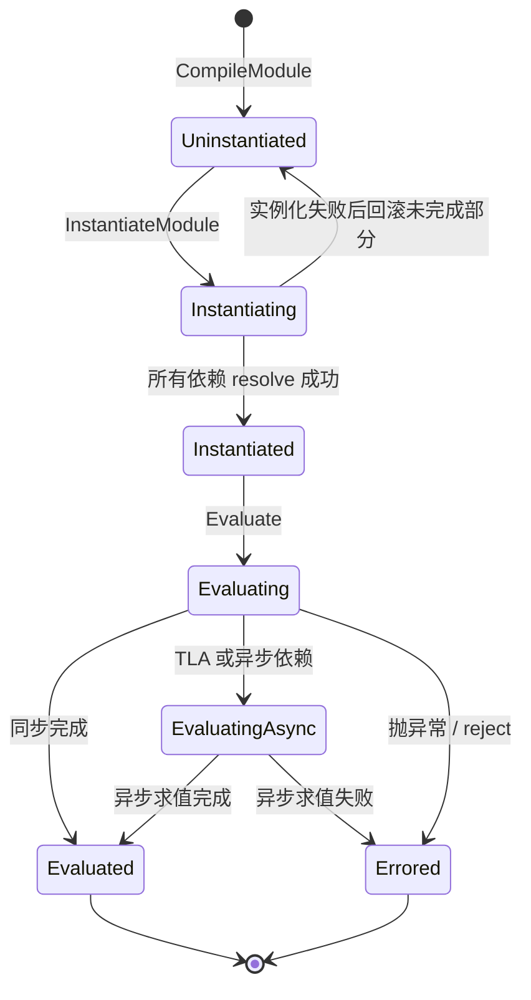

`GetStatus()` 把内部 `kEvaluatingAsync` 和 `kEvaluated` 都映射为公开的 `kEvaluated`，所以 **`Evaluated` 不等于 evaluation Promise 已 fulfilled**。`Module::Instantiate` 失败会调用 `ResetGraph`；链接失败也不能一概画成 `Errored`。证据：Node vendored V8 的 `src/api/api.cc::Module::GetStatus`、`src/objects/module.cc::Instantiate` 和 `src/objects/source-text-module.cc::MaybeTransitionComponent`。

静态 import 的完整调用链（以 dune 为例，Deno/Node 形状相同）：

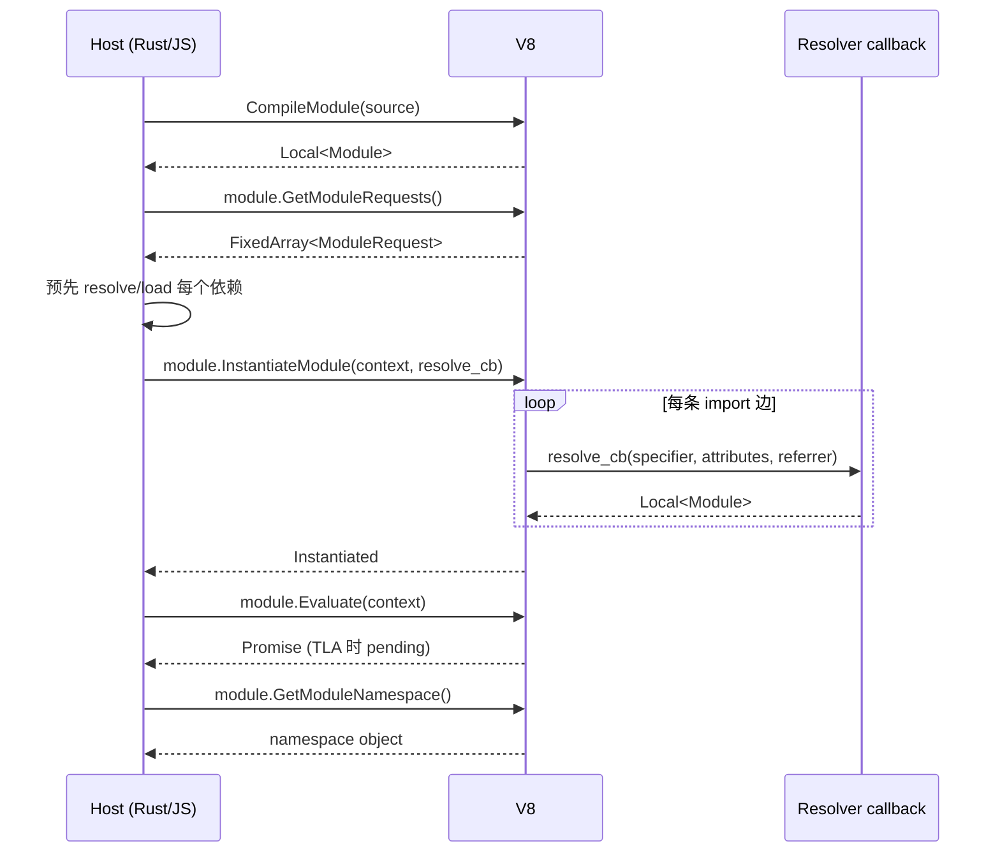

普通 dynamic import 触发另一个 host callback，该回调返回 Promise。host 必须把 evaluation Promise 的成功/失败桥接到它：成功时以 namespace 完成，失败时 reject。取得 namespace 本身不证明求值已完成。

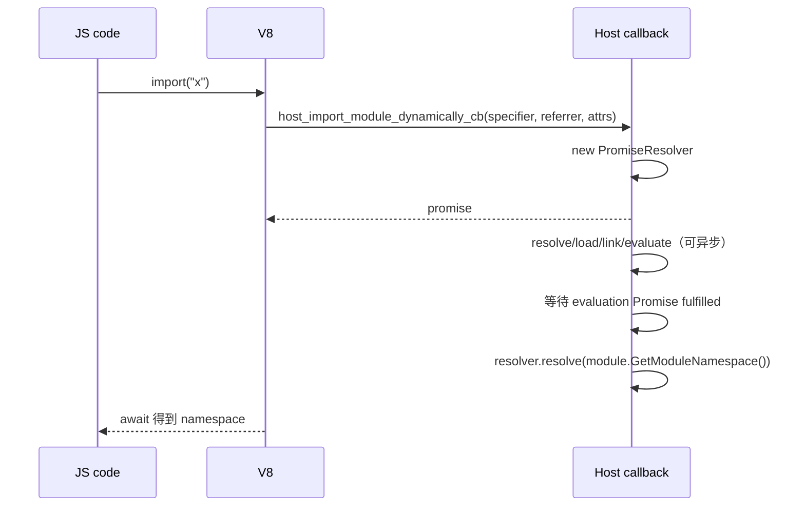

关键点：

- V8 没有按 specifier 查找的 host 注册表；同一身份是否返回同一个 `v8::Module` 由 host 决定。对同一个 module，V8 会保留状态和求值结果。
- host 要避免加载递归重复创建实例，并在 `resolve_cb` 返回已有 module；V8 自己执行链接/求值的 DFS、SCC 和 TLA 传播。
- `Evaluate` 返回 Promise；host 丢弃它不会取消 V8 的异步求值，但会失去等待完成、向 `import()` 传播错误和判断 liveness 的依据。dune 的问题在这一桥接层。
- `import.meta` 也是 host 回调；V8 只负责在第一次访问时调用它。

### 2.2 QuickJS：engine 自己拥有 module 图

QuickJS 内建模块注册表和递归装载驱动；host 注册 normalizer、loader、attribute checker，提供文件/包/builtin 策略，并负责推进 jobs 与外部 I/O。CJS 兼容仍需 host 额外实现。

| API | 调用者 | 作用 |
|---|---|---|
| `JS_SetModuleLoaderFunc2(rt, normalize, load, check_attrs, opaque)` | host | 一次性注册模块 loader 三件套 |
| `JS_SetModuleNormalizeFunc2(rt, normalize)` | host（可选） | 单独注册带 attributes 的 normalizer |
| `normalize(ctx, base_name, name, opaque)` | QuickJS → host | 把 `(base, specifier)` 转成 canonical module name |
| `load(ctx, name, opaque, attributes)` | QuickJS → host | 返回 `JSModuleDef *` |
| `JS_Eval(ctx, src, len, filename, JS_EVAL_TYPE_MODULE \| JS_EVAL_FLAG_COMPILE_ONLY)` | host | 编译并递归解析/加载静态依赖，不执行模块体 |
| `JS_ReadObject(ctx, buf, len, JS_READ_OBJ_BYTECODE)` | host | 字节码反序列化为 module |
| `JS_ResolveModule(ctx, obj)` | host（可选） | 递归解析依赖；`JS_Eval`/`JS_ReadObject` 之后可用 |
| `JS_EvalFunction(ctx, module_val)` | host | 内部完成 link + evaluate，返回 evaluation Promise |
| `JS_GetModuleNamespace(ctx, m)` | host | 取 namespace |
| `JS_GetImportMeta(ctx, m)` | host | 取/建 `import.meta` 对象 |
| `JS_NewCModule` / `JS_AddModuleExport` / `JS_SetModuleExport` | host | 创建 C/native module 并声明/设置导出 |
| `JS_SetModulePrivateValue` / `JS_GetModulePrivateValue` | host | 给 C module 绑定私有数据 |
| `JS_NewPromiseCapability` | host/engine | 创建 dynamic import / TLA 的 Promise |
| `JS_ExecutePendingJob(rt, &ctx)` | host | 驱动 QuickJS job queue（dynamic import job 也在这里） |
| `JS_LoadModule(ctx, base, filename)` | host | 直接启动加载/求值并返回 Promise；区别于 JS `import()` 先排 job |
| `JS_GetScriptOrModuleName(ctx, level)` | host | 取当前模块名（LLRT CJS 用它索引 exports） |

`COMPILE_ONLY` 不代表不加载依赖：`JS_EvalInternal` 在检查此 flag 之前就调用 `js_resolve_module`。这与 V8 `CompileModule` 只生成静态请求的边界不同；LLRT 的 `Module::declare` 和 txiki 的源码 loader 都会进入这条路径。

`JSModuleDef` 是 QuickJS 的 ESM 语义图节点：

```c
struct JSModuleDef {
    JSAtom module_name;
    struct list_head link;              /* ctx->loaded_modules 链表 */

    JSReqModuleEntry *req_module_entries;   /* 静态依赖边 */
    int req_module_entries_count, ..._size;

    JSExportEntry *export_entries;          /* 本模块导出 */
    JSStarExportEntry *star_export_entries; /* export * */
    JSImportEntry *import_entries;          /* import 绑定 */

    JSValue attributes;                 /* import attributes，缓存键的一部分 */
    JSValue module_ns;                  /* namespace */
    JSValue func_obj;                   /* JS module 的编译产物 */
    JSModuleInitFunc *init_func;        /* C module 的初始化函数 */
    bool has_tla;
    bool resolved, func_created;
    JSModuleStatus status;              /* UNLINKED..EVALUATED */

    int dfs_index, dfs_ancestor_index;  /* link/eval 的 Tarjan SCC */
    JSModuleDef *stack_prev;

    JSModuleDef **async_parent_modules; /* TLA 反向边 */
    int pending_async_dependencies;
    bool async_evaluation;
    JSModuleDef *cycle_root;            /* 环的根 */
    JSValue promise;
    JSValue resolving_funcs[2];

    bool eval_has_exception;
    JSValue eval_exception;
    JSValue meta_obj;                  /* import.meta */
    JSValue private_value;              /* C module 私有数据 */
};
```

依赖边：

```c
typedef struct JSReqModuleEntry {
    JSAtom module_name;
    JSModuleDef *module;   /* resolve 后指向被依赖模块 */
    JSValue attributes;
} JSReqModuleEntry;
```

QuickJS 的内建实例注册表是每个 `JSContext` 的 `ctx->loaded_modules` 双向链表；`js_find_loaded_module()` 按 module name atom 和 attributes 线性查找。host 仍可增加缓存，例如 LLRT 的 `ModuleCache.esm` 和 `RequireState`。

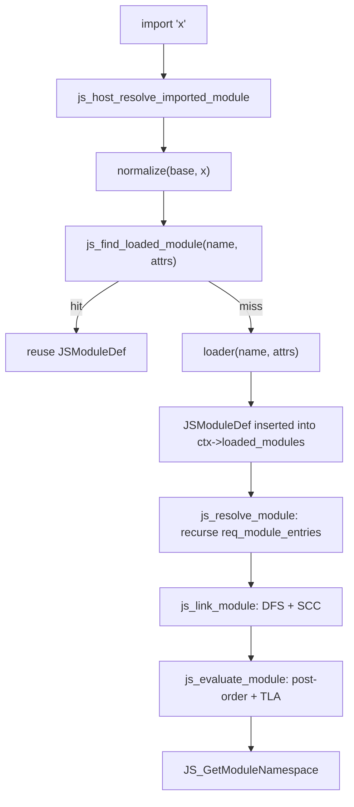

QuickJS 的链接和求值都使用 Tarjan 式 DFS：

- **link**：`js_inner_module_linking()` 标记 `LINKING`，记录 `dfs_index/dfs_ancestor_index`，递归依赖，绑定 import/export，最后在 SCC 根出栈时统一置 `LINKED`；
- **evaluate**：`js_inner_module_evaluation()` 后序遍历，依赖先于依赖者；TLA 模块进入 `EVALUATING_ASYNC`，通过 `async_parent_modules` 延迟父模块；
- **cycle**：每个 SCC 只有一个 `cycle_root`，环内共享同一个 evaluation Promise。

对应的 `JSModuleStatus` 状态机：

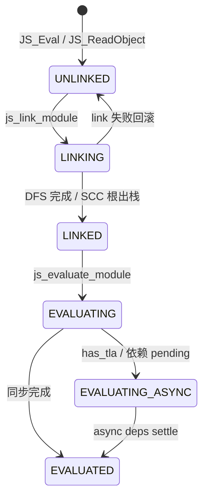

注意：这个状态机在 **engine 内部**，host 只看到 `JSModuleDef*` 和 `JS_EvalFunction` 返回的 Promise；LLRT/txiki 不能直接读 `status`，只能通过 QuickJS API 间接观察。

### 2.3 两种合约的对照

| 维度 | V8 | QuickJS-NG（本文依赖版本） |
|---|---|---|
| module 对象 | `v8::Module`；host 用 `Global` 持有 | `JSModuleDef *`；context 注册表持有 |
| 按名字的实例注册表 | host 自建 | `ctx->loaded_modules`；host 可另加缓存 |
| 编译边界 | `CompileModule` 生成静态请求，不自行读依赖 | `JS_Eval(MODULE \| COMPILE_ONLY)` 同时递归解析/加载依赖 |
| resolve/load 策略 | host；静态 resolve callback 返回 module | host normalizer/loader；engine 驱动递归 |
| 链接、环、live binding | V8 实现；host 调 `InstantiateModule` | QuickJS 实现；由 `JS_EvalFunction` 进入 |
| 求值、TLA 依赖传播 | V8 实现；`Evaluate` 返回 Promise | QuickJS 实现；`JS_EvalFunction` 返回 Promise |
| dynamic import | host callback 桥接加载、evaluation 和 namespace | engine 创建 Promise、排 job、等待 evaluation |
| jobs 与外部 I/O | host 推进 microtasks/event loop | host 推进 `JS_ExecutePendingJob` 和外部 I/O |
| synthetic/native module | `CreateSyntheticModule` + exports | `JS_NewCModule` + export 声明/赋值 |
| 编译缓存 | `CreateCodeCache` 等；Node/Deno 有实际使用路径 | `JS_WriteObject` / `JS_ReadObject` bytecode |

不要把三种缓存混为一谈：**resolve cache** 保存解析结果，**module instance cache** 保存模块身份、状态与导出，**code/bytecode cache** 缓存编译产物。V8 没有第一、二类的通用 host 策略，并不意味着它没有模块状态、求值复用或编译缓存。

---

## 3. 数据结构与树形结构总览

### 3.1 五套核心结构

| Runtime | 全局注册表/缓存 | 树/图节点 | 依赖边 | 状态/并发 |
|---|---|---|---|---|
| **dune** | `ModuleMap`：`by_path: HashMap<path, Global<Module>>`、`by_id: HashMap<i32, Vec<(path, Global<Module>)>>`、`seen: HashMap<path, ModuleStatus>`、`pending: Vec<Rc<RefCell<ModuleGraph>>>` | `EsModule { path, status, dependencies: Vec<Rc<RefCell<EsModule>>>, exception, is_dynamic_import }` | `EsModule.dependencies`（`Rc` 树） | `ModuleStatus::{Fetching,Resolving,Duplicate,Ready}`；`EsModuleFuture` 在 event loop 中推进 |
| **LLRT** | QuickJS `ctx->loaded_modules`；host 侧 `ModuleResolver.modules: HashSet`、`ModuleLoader.modules: HashMap<name, fn>`、`BYTECODE_CACHE: phf::Map`、`NODE_MODULES_PATHS_CACHE`、`ModuleCache.esm`、`RequireState` | `JSModuleDef`（engine） | `JSReqModuleEntry[]`（engine） | QuickJS `JSModuleStatus`；`RequireState{cache,exports,progress}` 处理 CJS 环 |
| **txiki.js** | QuickJS `ctx->loaded_modules`；host 只有 `builtins[]` 和 `qrt->builtins.import_map_resolver` | `JSModuleDef`（engine） | `JSReqModuleEntry[]`（engine） | QuickJS 状态机；import map 是 JS 闭包 |
| **Deno** | `ModuleMap`：`data: ModuleMapData { handles, handles_inverted, info, by_name, main_module_id, lazy_esm_sources, ... }` + `dynamic_import_map` + 三组 `TrackedFutures/TrackedVec`；CJS `Module._cache` | `ModuleInfo { id, main, name, requests, module_type, is_internal }`；`v8::Global<Module>` 单独存 `handles[id]` | `ModuleInfo.requests: Vec<ModuleRequest>`；运行时再经 V8 resolve 回调映射回 handle | `ModuleId = usize`；`RecursiveModuleLoad{state,pending,visited,visited_as_alias}`；`pending_tla_waiters` |
| **Node.js** | `ModuleLoader.loadCache: LoadCache`（`url → {type → ModuleJobBase}`）、`#resolveCache`；CJS `Module._cache: filename → Module`、`_pathCache`、`_extensions`；`BuiltinModule.map` | ESM `ModuleJobBase/ModuleJob/ModuleJobSync` + C++ `ModuleWrap`；CJS `Module { id, path, exports, filename, loaded, children, paths }` | `ModuleJob` 通过 `ModuleWrap.getModuleRequests()` 递归 `getOrCreateModuleJob`；CJS `module.children` 只是观察树 | V8 `ModuleStatus` + job 状态；CJS `loaded`、环依赖占位 exports |

### 3.2 四种“树”的形状

ES module 的静态依赖是**可能含环的有向图**。去重不会消除环；只有将强连通分量（SCC）缩成节点后，才得到 DAG。这里的“树”指 loader 的遍历视角：

- dune 把它真的建成一棵 `EsModule` 树，用 `Duplicate` 叶子表示“这个 path 已经出现过”；
- QuickJS 在 `JSModuleDef.req_module_entries` 里存图边，遍历时看起来像 DFS 树；
- Deno 存 `ModuleInfo.requests` 边 + `by_name` 索引，树是 resolve 时临时展开的；
- Node 存 `ModuleJob` 对象图，`ModuleWrap` 只持有 V8 侧的绑定关系。

**(a) dune：host 手写的 `Rc<RefCell<EsModule>>` 树 + 全局 `seen` 表**

```text
ModuleMap
 ├─ by_path: "main.js" -> v8::Global<Module>
 ├─ seen:    "main.js" -> Resolving, "a.js" -> Ready, ...
 └─ pending: [ ModuleGraph{kind: Static, root_rc} ]

ModuleGraph.root_rc
   EsModule(main)
     ├─ EsModule(a)  ── Rc ──> EsModule(shared)
     └─ EsModule(b)  ── Rc ──> EsModule(shared)   // 两个 Rc 节点，同一个 path
```

注意：`EsModule` 节点**不做去重**，相同 path 可能出现多个 `Rc` 节点；去重发生在 `seen` 表，依赖节点用 `ModuleStatus::Duplicate` 表示“路径已被别人加载”。

**(b) QuickJS：engine 内的有向图，host 通过 `JSModuleDef*` 交接**

```text
ctx->loaded_modules (双向链表)
  [main] <-> [a] <-> [b] <-> [shared] <-> ...

main.req_module_entries
  ├─ { name:"a", module:*a }
  └─ { name:"b", module:*b }
a.req_module_entries -> *shared
b.req_module_entries -> *shared       // 同一个 JSModuleDef
```

引擎按 `(name, attributes)` 查找已有节点；模块先登记，解析依赖前先设置 `resolved` 标记，因此环可以闭合且不会无限递归。链接和求值阶段再由 engine 的 SCC 算法处理环。

**(c) Deno：索引表 + 独立 handle 数组**

```text
ModuleMap
 ├─ data.handles: Vec<Global<Module>>           // 按 ModuleId 下标
 ├─ data.info:    Vec<ModuleInfo>               // 同一下标
 ├─ data.by_name: ModuleNameTypeMap<SymbolicModule>
 │      "file:///main.js" -> Mod(0)
 │      "file:///a.js"    -> Mod(1)
 │      "npm:foo"         -> Alias("file:///.../foo.js")
 ├─ data.handles_inverted: HashMap<Global<Module>, usize>
 ├─ dynamic_import_map: HashMap<ModuleLoadId, DynImportState>
 └─ pending_dynamic_imports: TrackedFutures<StreamFuture<RecursiveModuleLoad>>
```

`ModuleId` 是 `handles.len()` 分配的**注册下标**，不是内容哈希；字符串到 id 的映射在 `by_name`，V8 handle 到 id 的反查在 `handles_inverted`。

**(d) Node：两套图**

```text
ESM:
 ModuleLoader.loadCache
   "file:///main.mjs" -> { "javascript": ModuleJobSync }
   "file:///a.json"   -> { "json": ModuleJobSync }
        │
        └─ ModuleJobSync.module: ModuleWrap
              └─ C++ kModuleSlot -> v8::Global<v8::Module>

CJS:
 Module._cache
   "/abs/a.js" -> Module { id, exports, loaded, children:[...] }
 Module._pathCache
   "a\0/abs/node_modules\0..." -> "/abs/a.js"
```

Node 的 ESM 图由 `ModuleJob` 对象和 V8 `ModuleWrap` 共同表达；CJS 图由 `Module` 对象和 `children` 数组表达，但真正决定复用/环处理的是 `Module._cache`。

### 3.3 模块身份、缓存 key 与去重

| Runtime | 模块身份 | 缓存 key | 并发 import 去重 |
|---|---|---|---|
| **dune** | 解析后的 path 字符串 | `ModuleMap.by_path[path]`；`seen[path]` | `ModuleGraph.same_origin` 合并同一 root 的 resolver；`Duplicate` 状态避免重复加载 |
| **LLRT** | QuickJS name + attributes；host 另有 path 身份 | `ctx->loaded_modules` + `ModuleCache.esm[path]` + `RequireState` | QuickJS 查实例；host cache 桥接不同入口；native loader 的 `remove` 是一次性装载约束，并非通用去重算法 |
| **txiki.js** | normalizer 返回的字符串 + attributes | `ctx->loaded_modules` | 同上；import map 在 normalizer 中同步解析 |
| **Deno** | `ModuleId`；字符串侧是 `(ModuleName, RequestedModuleType)` | `handles[id]` + `by_name`；重定向用 `SymbolicModule::Alias` | `RecursiveModuleLoad.visited: HashSet<ModuleReference>` + `visited_as_alias` |
| **Node ESM** | URL + import type | `loadCache[url][type]`；`#resolveCache[parentURL][specifier+attrs]` | `ModuleJob` 在 `syncLink` 中**先把自己写进 loadCache**，再递归 link |
| **Node CJS** | 绝对 filename | `Module._cache[filename]`；`Module._pathCache[request+paths]` | 先 `new Module` 并立即入 cache，再执行 |

一个容易被忽略的差异：

- **dune 用 resolve 返回的 path 字符串**。文件补扩展名发生在 load 层，不回写身份；`./a` 与 `./a.js` 可指向同一物理文件却形成两个实例（§10）；
- **Deno 用 `ModuleSpecifier` + `RequestedModuleType`**，重定向是 alias；
- **Node ESM 用 URL + type 两级 key**，`import './a.json' with {type:'json'}` 与普通 JS 不会互相覆盖；
- **QuickJS 查找键包含 name + attributes**，不同 attributes 会导致注册表 miss；loader 仍可拒绝请求或返回 host cache 中的对象，因此不能保证任意不同 attributes 必然生成两个可用实例。

Deno CJS 与 Node CJS 均另有 filename → `Module` 缓存；`ModuleId` 是 ESM 注册下标，不是 CJS 模块 ID。缓存复用还受 context/realm 边界、别名规范化和 import/require 条件解析影响。

---

## 4. dune：host 自己维护显式 module 树

### 4.1 定位

dune 是 V8 + Rust + 自己的 libuv-shaped event loop（`crabuv`）。此处与加载相关的两个关键 V8 回调是：

- `module_resolve_cb`：`instantiate_module` 时，embedder 必须为每条静态 import 返回一个 `v8::Module`；
- `host_import_module_dynamically_cb`：`import()` 时，embedder 必须返回一个 Promise。

dune 在 Rust host 中维护 module cache、加载依赖树、加载状态和并发去重；V8 仍负责链接和求值的语义状态机。`src/modules.rs` 和 `src/runtime.rs` 是研究其 host 装载流程的入口。

### 4.2 核心数据结构

`src/modules.rs`：

```rust
pub struct ModuleMap {
    pub main: Option<ModulePath>,
    pub by_path: HashMap<ModulePath, ModuleRef>,
    pub by_id: HashMap<i32, Vec<(ModulePath, ModuleRef)>>,
    pub seen: HashMap<ModulePath, ModuleStatus>,
    pub pending: Vec<Rc<RefCell<ModuleGraph>>>,
}

pub type ModuleRef = v8::Global<v8::Module>;
```

| 字段 | 类型 | 作用 |
|---|---|---|
| `main` | `Option<String>` | 入口模块路径；`insert()` 时若为空且路径是存在的文件或 http(s) URL 则赋值。`import.meta.main` 用它比较 |
| `by_path` | `HashMap<path, Global<Module>>` | path → 已编译的 V8 module；`module_resolve_cb` 的最终查找表 |
| `by_id` | `HashMap<i32, Vec<(path, Global<Module>)>>` | V8 `identity_hash` → module；V8 不保证 hash 唯一，所以用 `Vec` 处理碰撞 |
| `seen` | `HashMap<path, ModuleStatus>` | 全局加载状态；静态/动态图共享，用于判重 |
| `pending` | `Vec<Rc<RefCell<ModuleGraph>>>` | 尚未 ready 的静态/动态 import 图；事件循环每 tick 扫描 |

`ModuleStatus`：

```rust
pub enum ModuleStatus {
    Fetching,   // 正在读取/编译该模块
    Resolving,  // 已编译，正在等待/解析依赖
    Duplicate,  // 该 path 已被其他图加载，本节点只是引用
    Ready,      // 依赖全部 ready，可以 instantiate/evaluate
}
```

依赖树节点：

```rust
pub struct EsModule {
    pub path: ModulePath,
    pub status: ModuleStatus,
    pub dependencies: Vec<Rc<RefCell<EsModule>>>,
    pub exception: Rc<RefCell<Option<String>>>,
    pub is_dynamic_import: bool,
}
```

图对象：

```rust
pub struct ModuleGraph {
    pub kind: ImportKind,                 // Static | Dynamic(Global<PromiseResolver>)
    pub root_rc: Rc<RefCell<EsModule>>,
    pub same_origin: LinkedList<Global<PromiseResolver>>,
}
```

异步加载任务：

```rust
pub struct EsModuleFuture {
    pub path: ModulePath,
    pub module: Rc<RefCell<EsModule>>,
    pub result: Result<ModuleSource>,
}
```

关系图：

```text
JsRuntimeState
 ├─ module_map: ModuleMap
 │    ├─ by_path: path ──────────────► v8::Global<v8::Module>
 │    ├─ by_id:   identity_hash ─────► Vec<(path, module)>
 │    ├─ seen:    path ──────────────► ModuleStatus
 │    └─ pending: Vec<Rc<RefCell<ModuleGraph>>>
 │                         │
 │                         ▼
 │                    ModuleGraph
 │                     ├─ kind: Static | Dynamic(resolver)
 │                     ├─ root_rc ──► EsModule
 │                     │                ├─ path
 │                     │                ├─ status
 │                     │                └─ dependencies: Vec<Rc<RefCell<EsModule>>>
 │                     └─ same_origin: LinkedList<Global<PromiseResolver>>
 │
 └─ pending_futures: Vec<Box<dyn JsFuture>>
      └─ EsModuleFuture { path, module, result }   // 源码已到手，待编译
```

### 4.3 静态加载：两套入口，一棵树

dune 有两条静态加载路径：

1. **`fetch_module_tree()`**：同步递归，用于启动时的 builtin 环境（`dune:environment/main`）和 REPL；
2. **`execute_module()` + `EsModuleFuture`**：异步，用于用户入口脚本；源码读取通过 crabuv 线程池，编译回到 loop 线程。

`execute_module()` 先创建图并登记：

```rust
let graph = ModuleGraph::static_import(&path);
let graph_rc = Rc::new(RefCell::new(graph));
state.module_map.pending.push(Rc::clone(&graph_rc));
state.module_map.seen.insert(path.clone(), ModuleStatus::Fetching);

state.handle.spawn(
    move || load_import(&specifier, true),       // 在 rayon 线程读文件/HTTP
    Some(move |_, result| {                      // 回到 loop 线程
        state.pending_futures.push(Box::new(EsModuleFuture { ... }));
    }),
);
```

`EsModuleFuture::run()` 在事件循环 tick 中执行，流程是：

```text
EsModuleFuture::run(scope)
  ├─ 若 module.exception 已被设置：清理 seen，return
  ├─ 取源码 result
  ├─ create_origin(path, is_module=true)
  ├─ v8::script_compiler::compile_module
  ├─ ModuleMap.insert(path, identity_hash, Global<Module>)
  ├─ seen[path] = Resolving
  ├─ for each request in module.get_module_requests():
  │    ├─ resolve_import(base=path, specifier, import_map)
  │    ├─ match seen[specifier]:
  │    │    Ready    -> continue（不再建节点）
  │    │    Some(_)  -> status = Duplicate
  │    │    None     -> status = Fetching
  │    ├─ new EsModule { path, status, deps: [], ... }
  │    ├─ dependencies.push(Rc<...>)
  │    └─ if unseen: seen.insert(specifier, Fetching); handle.spawn(load, cb)
  └─ self.module.status = Resolving
     self.module.dependencies = dependencies
```

`fast_forward_imports()` 每 tick 扫描 `pending`，对根调用 `fast_forward()`；当整棵树都 `Ready` 时，把图从 `pending` 移出，执行：

```rust
module.instantiate_module(tc_scope, module_resolve_cb)
let _ = module.evaluate(tc_scope);
```

如果是动态 import，则再用 `module.get_module_namespace()` resolve 所有等待的 Promise。

树展开过程：

```text
t0: root(main) Fetching ──compile──► Resolving
      request "./a.js" 未见 -> 建节点 a(Fetching), seen[a]=Fetching, spawn load
      request "./b.js" 未见 -> 建节点 b(Fetching), seen[b]=Fetching, spawn load

t1: a 编译完成 -> insert, seen[a]=Resolving
      request "./shared.js" 未见 -> 建 shared(Fetching), spawn

t2: b 编译完成 -> insert, seen[b]=Resolving
      request "./shared.js" 已见(Resolving) -> 建 Duplicate 节点 shared(Duplicate)
      （不重复 load）

t3: shared 编译完成 -> insert, seen[shared]=Resolving
      无依赖 -> 在 fast_forward 中变 Ready

t4: fast_forward(root)
      a -> shared Ready -> a Ready
      b -> shared Duplicate, seen[shared]=Ready -> b Ready
      root 所有 dep Ready -> root Ready
      -> instantiate_module + evaluate
```

`fetch_module_tree()` 则是同步版本：编译当前模块、插入 `ModuleMap`、遍历 request 递归调用自己。它没有 `ModuleGraph`/`pending`，也不维护 `ModuleStatus`，只靠 `by_path.contains_key()` 判重。dune 的 builtin 入口 `src/js/main.js` 就是用它拉起来的。

#### 4.3.1 builtin：19 个 JS ESM 模块构成真实依赖图

dune 的 builtin 不是 native module，而是 `include_str!` 进二进制的 JS ESM 源文件：

```rust
CORE_MODULES: HashMap<&str, &str> = [
  "console", "events", "process", "timers", "assert", "util",
  "fs", "perf_hooks", "colors", "dns", "net", "test",
  "stream", "http", "sqlite",
  "@web/abort", "@web/text_encoding", "@web/clone", "@web/fetch",
]
```

入口 `src/js/main.js`：

```js
import process from 'process';
import timers from 'timers';
import fetch from '@web/fetch';
import structuredClone from '@web/clone';
import { Console, prompt, wrapConsole } from 'console';
import { AbortController, AbortSignal } from '@web/abort';
import { TextEncoder, TextDecoder } from '@web/text_encoding';
```

这些 import 是真实的 ESM 依赖：

```text
main
 ├─ process -> events, util
 ├─ timers -> assert
 ├─ @web/fetch -> http -> net -> dns
 │                    -> assert, events
 ├─ console -> perf_hooks, colors
 ├─ @web/abort -> events
 ├─ @web/text_encoding
 └─ @web/clone

test -> fs, perf_hooks, colors
stream -> assert, events
```

因此 dune 的 builtin 是一张**真实的 builtin 依赖图**，不是“独立小模块的集合”。`fetch_module_tree()` 递归加载依赖，正是为了让 `instantiate_module` 时 `module_resolve_cb` 能在 `module_map` 里找到所有子模块。没有 CJS、没有 npm；bare specifier 只有命中 `CORE_MODULES` 或被 import map 改写后才能解析。

#### 4.3.2 resolver 与 loader

`resolve_import()` 按 specifier 选择 loader：

```text
resolve_import(base, specifier, import_map)
  ├─ import map lookup（可选）
  ├─ is_core_module_import = CORE_MODULES.contains_key(specifier)
  ├─ is_url_import = URL_REGEX(specifier) || URL_REGEX(base)
  └─ match (core, url):
       (true, _) -> CoreModuleLoader
       (_, true) -> UrlModuleLoader
       _         -> FsModuleLoader
```

三个 loader：

| Loader | resolve | load |
|---|---|---|
| `CoreModuleLoader` | 只认 `CORE_MODULES` 的 19 个名字 | `include_str!` 的源码 |
| `FsModuleLoader` | 绝对路径 / 相对 `./` `../` / CWD；尝试 `js/jsx/ts/tsx/json/wasm` 扩展名和 `index.*` | `fs::read_to_string`，JSON 包成 `export default JSON.parse(...)`，TS/JSX/WASM 交给 SWC/Wasm 转译 |
| `UrlModuleLoader` | `Url::parse` / 以 base URL 解析相对路径 | `ureq` 下载；SHA-1 哈希后缓存到 `.cache`（debug）或 `~/.dune/cache`（release） |

`ImportMap` 是 WICG 子集：

```rust
pub struct ImportMap { map: Vec<(String, String)> }
```

- 解析 `imports` 对象；
- 按 key 长度降序排序，以支持 trailing slash 的包前缀；
- `lookup()` 用 `starts_with` 做前缀匹配；
- 支持 extensionless specifier；
- 没有 scopes、没有 `node_modules`、没有 CJS。

所以 dune 的 bare specifier 只有两种归宿：命中 `CORE_MODULES`，或被 import map 改写；否则 `FsModuleLoader` 会报 `Module not found`。

### 4.4 动态 import：`ModuleGraph` + `same_origin`


`host_import_module_dynamically_cb()` 的步骤：

```text
import("x")
  ├─ resolve_import(base, "x", import_map)       // 失败：resolver.reject(exception)
  ├─ 若 by_path 已有 x 且没有同 root 的 pending 图：
  │     resolver.resolve(x.get_module_namespace())   // 已加载，直接给 namespace
  ├─ 若 pending 中已有 root.path == x：
  │     graph.same_origin.push_back(resolver)        // 合并到同一图
  ├─ 否则：
  │     graph = ModuleGraph::dynamic_import(x, resolver)
  │     pending.push(graph)
  │     seen[x] = Fetching
  │     handle.spawn(load_import(x), cb -> EsModuleFuture)
  └─ 返回 resolver 的 Promise
```

`same_origin` 的存在是为了处理“同一个模块被并发 `import()` 多次”的情况：只加载一次，所有 resolver 在根图 ready 后一起 resolve。加载任务在 `exception` 中登记失败时，`fast_forward_imports()` 会遍历 main promise 和 `same_origin` 逐个 reject。这不覆盖所有链接/求值失败：实例化失败路径会报告并退出，求值 Promise 则被丢弃。

关键语义差异：

- 动态 import 的 graph 在 `evaluate()` 之后**立即** resolve namespace，不等待 evaluation Promise；
- 因此如果模块有 TLA，`await import()` 可能在模块执行完成前就返回；
- 访问尚未初始化的导出会触发 TDZ；即使不读取导出，也能观察到 import 已完成但模块的 TLA 后副作用尚未发生；
- 模块体抛错时，`import()` 也可能先 fulfilled，再由全局未处理 rejection 路径报告错误，调用方的 `catch` 无法收到预期失败。

这正是 §10 中 dune 的实测结果。

### 4.5 `fast_forward()`：自底向上的状态收敛

```rust
pub fn fast_forward(&mut self, seen_modules: &mut HashMap<ModulePath, ModuleStatus>) {
    if self.status == ModuleStatus::Ready { return; }

    if self.status == ModuleStatus::Duplicate {
        let status_ref = seen_modules.get(&self.path).unwrap();
        if status_ref == &ModuleStatus::Ready {
            self.status = ModuleStatus::Ready;
        }
        return;
    }

    self.dependencies.iter_mut()
        .for_each(|dep| dep.borrow_mut().fast_forward(seen_modules));

    if self.dependencies.is_empty() && self.status == ModuleStatus::Resolving {
        self.status = ModuleStatus::Ready;
        seen_modules.insert(self.path.clone(), self.status);
        return;
    }

    if self.dependencies.is_empty() { return; }

    if !self.dependencies.iter_mut()
        .map(|m| m.borrow().status)
        .any(|status| status != ModuleStatus::Ready)
    {
        self.status = ModuleStatus::Ready;
        seen_modules.insert(self.path.clone(), self.status);
    }
}
```

算法本身是后序遍历：先把所有孩子推进到 `Ready`，再判断自己。`Duplicate` 节点不递归，只查 `seen` 表。

但它有一个结构性缺陷：**环依赖会死锁**。

```text
c1 -> c2 -> c1

c1: Resolving, deps=[c2]
c2: Resolving, deps=[c1(Duplicate)]
seen[c1] = Resolving
seen[c2] = Resolving

fast_forward(c1):
  fast_forward(c2):
    c2.deps = [c1(Duplicate)] -> seen[c1] = Resolving
    -> c2 保持 Resolving
  c1.deps 不全是 Ready -> c1 保持 Resolving
```

结果 `pending` 永远非空，事件循环继续运行。本轮不触发 TDZ 的合法静态环在 3 秒超时后终止（§10）。死锁发生在 host 的 Ready 收敛阶段，尚未调用 V8 `InstantiateModule`；问题不是 V8 缺少环处理。builtin 的同步 `fetch_module_tree` 路径不使用这套 Ready 算法，不能一概称 dune 所有路径都不支持环。

另一个缺陷是 TLA：

```rust
let _ = module.evaluate(tc_scope);
```

evaluation Promise 被丢弃，`has_pending_imports()` 只检查加载图。V8 的 TLA 仍可由 microtasks 和定时器/I/O 推进，但 evaluation Promise 本身没有被这条 liveness 路径跟踪；`import()` 也没有正确等待它或传播其 rejection。

dune 的 `ModuleStatus` 收敛图（正常路径与环）：

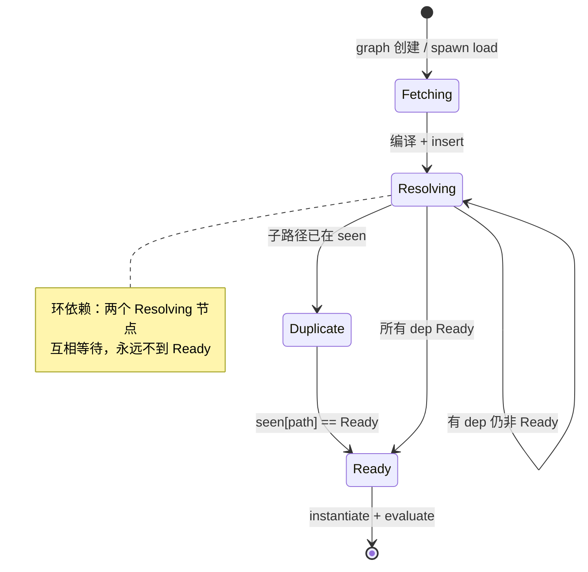

`fast_forward()` 只做“孩子 Ready 则父亲 Ready”，没有 SCC 归并；这就是环会空转的根因。

### 4.6 V8 API 调用清单

| 位置 | API | 用途 |
|---|---|---|
| `runtime.rs:151` | `isolate.set_host_import_module_dynamically_callback` | 注册 `import()` |
| `runtime.rs:154` | `set_host_initialize_import_meta_object_callback` | 注册 `import.meta` 初始化 |
| `modules.rs:320` / `561` | `v8::script_compiler::compile_module` | 编译源码为 module（动态图 / 静态树） |
| `modules.rs:334` / `581` | `module.get_identity_hash()` | module id，用于 `by_id` |
| `modules.rs:335` / `582` | `v8::Global::new(scope, module)` | 长期持有 module |
| `modules.rs:351` / `588` | `module.get_module_requests()` | 静态 import 边 |
| `modules.rs:361` / `596` | `ModuleRequest::get_specifier()` | 原始说明符 |
| `runtime.rs:242` / `570` | `module.instantiate_module(scope, module_resolve_cb)` | 实例化 + resolve 回调 |
| `hooks.rs:30` | `referrer.get_identity_hash()` | 由 referrer module 反查 path |
| `hooks.rs:65` | `ModuleMap.get_module_path(identity_hash, module)` | 由 referrer module 反查 path（`import.meta`） |
| `runtime.rs:251` | `module.evaluate(scope)` | 求值，丢弃 Promise（环境模块） |
| `runtime.rs:579` | `module.evaluate(tc_scope)` | 动态图求值，丢弃 Promise |
| `runtime.rs:603` | `module.get_module_namespace()` | 动态 import resolve 值 |
| `hooks.rs:160` | `v8::PromiseResolver::new` | dynamic import Promise |
| `hooks.rs:194` | `resolver.resolve(namespace)` | 已加载模块直接 resolve |
| `hooks.rs:175` | `resolver.reject(exception)` | resolve 失败 |
| `runtime.rs:253` | `module.get_status()` | 判断 `Errored` |
| `runtime.rs:254` | `module.get_exception()` | 取异常 |
| `hooks.rs:71/76` | `meta.create_data_property("url"/"main")` | 填充 `import.meta` |

一个容易忽略的点：dune 用 `get_identity_hash()` 而不是自增 id。V8 不保证 hash 唯一，所以 `by_id` 的值是 `Vec`，`get_module_path()` 在碰撞时需要线性比较 `Global<Module>` 是否相等。

### 4.7 依赖库角色：crabuv 的 `spawn` 与 rayon 线程池

dune 的模块加载之所以是异步的，不是因为 V8 或 JS，而是因为它把“读源码”当成另一种 libuv resource：

```text
handle.spawn(work, callback)
  └─ crabuv::LoopHandle::spawn
       ├─ 把 work 包成 WorkFn
       ├─ 分配 Task 资源，发送 Request::TaskSpawn 到 loop
       ├─ loop 把 work 投递到 rayon ThreadPool
       ├─ work 在 worker 线程执行：fs::read_to_string / ureq
       ├─ 完成后把 TaskOutput 放回 loop 的完成队列
       └─ loop 线程执行 callback：把 EsModuleFuture 推入 pending_futures
```

对应源码：`crabuv/src/event_loop.rs:732` 的 `spawn`、`crabuv/src/thread_pool.rs:33` 的 rayon `spawn`、`crabuv/src/task.rs` 的 `Task { id, on_complete, cancel_tx }`。

时序：

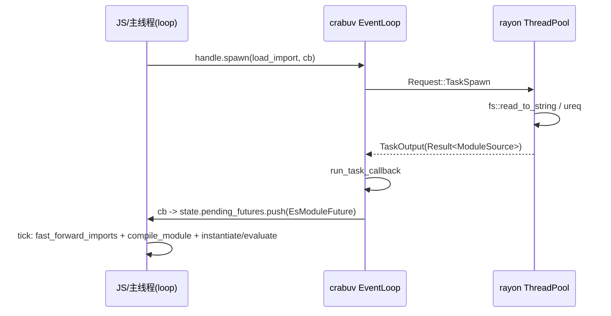

因此 dune 的 module loading 和 `fs`、`dns`、`net` 共用同一套 async 基础设施；这也解释了为什么它的 loader 可以在 Rust 侧直接调用同步 `fs::read_to_string`，而不会阻塞 JS 线程。

但注意：**QuickJS 的 LLRT/txiki loader 是同步的，Node 主线程 ESM 也是同步的**；这里确认的是 dune 的这条线程池装载路径；不能仅凭 Deno core 使用 futures，就推断其底层文件/网络操作不使用线程池或异步 I/O。

### 4.8 运行验证与边界

本轮结果及完整脚本见 §10：合法静态环超时；并发 dynamic import 复用 namespace 但提前完成；模块抛错时 import 先成功、随后出现未处理 rejection；省略扩展名与显式扩展名可导致重复实例。

这些结果分别对应 host 的加载图就绪判定、evaluation Promise 桥接和路径身份规则。修复方向是区分“已获取/编译”与“已求值”，允许加载环闭合后交给 V8 链接，并持续跟踪 evaluation Promise。dune 没有内建 Node `require()`、CJS wrapper 或 npm 包解析器。

---

## 5. LLRT：QuickJS 拥有图，host 提供 resolver/loader 链

### 5.1 定位与装配

LLRT 是 QuickJS-NG + `rquickjs`，面向 AWS Lambda 冷启动。QuickJS 本身有 module loader 机制，所以 LLRT 不手写依赖树；它提供两条**独立的链**：

```rust
// llrt_core/src/vm.rs
let resolver = (module_resolver, EmbeddedResolver, PackageResolver, file_resolver);
let loader   = (module_loader, EmbeddedLoader, PackageLoader);
runtime.set_loader(resolver, loader).await;
```

`rquickjs` 把这组 trait 对象塞进 `LoaderHolder`，注册到 QuickJS：

```rust
// rquickjs-core/src/loader.rs
JS_SetModuleLoaderFunc2(rt, None, Some(Self::load_raw), None, self.0 as _);
JS_SetModuleNormalizeFunc2(rt, Some(Self::normalize_raw));
```

注意：

- `module_check_attrs = None`，LLRT 不校验 import attributes 的键；
- resolver 和 loader 是**两次独立回调**，各自独立 fallthrough；
- QuickJS 在调用 loader 之前会先 `js_find_loaded_module(name, attributes)`，命中则直接复用 `JSModuleDef`。

### 5.2 核心数据结构

LLRT 没有 dune 式显式加载树，但 host 不只是“名字 → loader”：它还维护 path → module 的 `ModuleCache.esm` 和 CJS 的 `RequireState`。静态 ESM 图在 QuickJS 内部，运行期 require 关系不等于这张静态图。

**(1) 原生模块表**

```rust
// llrt_modules/src/module/resolver.rs
#[derive(Debug, Default)]
pub struct ModuleResolver { modules: HashSet<String> }

// llrt_modules/src/module/loader.rs
type LoadFn = for<'js> fn(Ctx<'js>, Vec<u8>) -> Result<Module<'js>>;
#[derive(Debug, Default)]
pub struct ModuleLoader { modules: HashMap<String, LoadFn> }
```

`ModuleBuilder::with_module::<N, M: ModuleDef>()` 一次做三件事：

```text
module_resolver.add_name(name)          // resolver 认这个名字
module_loader.with_module(name, M)      // loader 能声明这个 native module
global_attachment.add_name(name)        // 用户可见 builtin 列表
```

默认 native 路径中，`ModuleLoader::load()` 用 `self.modules.remove(name)` 取出函数指针，再调用 `Module::declare_def::<M, _>()`。这是一次性 loader 表项；正常重复请求由 context 的 QuickJS 注册表拦截。不能据此承诺跨 context 或不同 attributes 的重复 native load 总能成功；hook short-circuit 另有分支。

**(2) 字节码缓存**

```rust
// llrt_core/src/modules/embedded/mod.rs
pub static BYTECODE_CACHE: phf::Map<&'static str, &'static [u8]>;
```

构建期 `llrt_core/build.rs` 遍历 `bundle/js`：

```text
esbuild bundle/js/*.js
  -> QuickJS Module::declare + module.write()
  -> OUT_DIR/<name>.lrt（zstd 压缩，带 6 字节头）
  -> 生成 bytecode_cache.rs：
       pub static BYTECODE_CACHE: phf::Map<&'static str, &'static [u8]> =
         phf::phf_map! { "llrt:test/index" => include_bytes!("...lrt"), ... };
```

`.lrt` 头格式：

| 偏移 | 长度 | 内容 |
|---|---|---|
| 0 | 5 | `"lrt01"` |
| 5 | 1 | `b'c'` 压缩 / `b'u'` 未压缩 |
| 6 | 4 | 压缩时：原始长度 u32 LE |
| 6/10 | n | zstd frame / QuickJS bytecode |

运行时 `EmbeddedLoader` 命中 phf 后，用 `zstd::bulk::Decompressor::with_prepared_dictionary(&DECOMPRESSOR_DICT)` 解压，再 `Module::load` → `JS_ReadObject(..., JS_READ_OBJ_BYTECODE)`。

**(3) Node 风格包解析缓存**

```rust
// llrt_modules/src/package/resolver.rs
type NodePathListValues = Rc<RefCell<Vec<Rc<str>>>>;
type NodeModulePaths = HashMap<Box<str>, Option<NodePathList>>;
static NODE_MODULES_PATHS_CACHE: Lazy<Mutex<NodeModulePaths>>;
static HOME_NODE_MODULES: Lazy<Vec<Box<str>>>;
```

`require_resolve()` 是 Node CJS 解析算法的逐条移植：`LOAD_AS_FILE`、`LOAD_AS_DIRECTORY`、`LOAD_NODE_MODULES`、`package.json#exports` 条件匹配、self-reference、`#imports`。

**(4) CJS 状态（Ctx userdata）**

```rust
// llrt_modules/src/module/mod.rs
pub struct RequireState<'js> {
    pub cache:    HashMap<Rc<str>, Value<'js>>,   // require 结果缓存
    pub exports:  HashMap<Rc<str>, Value<'js>>,   // CJS module.exports
    pub progress: HashMap<Rc<str>, Object<'js>>,  // 循环 require 占位
}

pub(crate) struct ModuleCache<'js> {
    pub(crate) esm: HashMap<Rc<str>, Module<'js>>,
}

pub struct ModuleHookState<'js> { hooks: Vec<Hook<'js>> }
```

这些状态是 **per-Context** 的，由 `module::init` 通过 `ctx.store_userdata(RefCell::new(...))` 安装，不是 per-Runtime。

对象关系：

```text
Vm { runtime: AsyncRuntime, ctx: AsyncContext }
 ├─ runtime.raw.loader: LoaderHolder
 │    └─ LoaderOpaque {
 │         resolver: (ModuleResolver, EmbeddedResolver, PackageResolver, FileResolver)
 │         loader:   (ModuleLoader, EmbeddedLoader, PackageLoader)
 │       }
 └─ ctx userdata
      ├─ ModuleNames { list: HashSet<String> }        // isBuiltin/builtinModules
      ├─ ModuleHookState { hooks: Vec<Hook> }         // registerHooks
      ├─ ModuleCache { esm: HashMap<name, Module> }
      └─ RequireState { cache, exports, progress }    // CJS
```

LLRT 的静态依赖图因此可以包含多种节点，并允许环：同一个 `main.js` 的依赖里，可能同时有 native、bytecode、文件 ESM、CJS 包装器。

```text
main.js (PackageLoader -> Module::declare)
  ├─ node:fs        (ModuleResolver + ModuleLoader -> JS_NewCModule)
  ├─ node:path      (ModuleResolver + ModuleLoader -> JS_NewCModule)
  ├─ node:stream    (EmbeddedResolver + EmbeddedLoader -> JS_ReadObject)
  │    ├─ node:events (native)
  │    └─ node:util   (native)
  ├─ ./cjs.cjs      (PackageResolver + PackageLoader -> 生成的 ESM 源码 wrapper)
  │    └─ require("__cjs:...") -> RequireState.exports
  └─ ./local.js     (PackageResolver + PackageLoader -> ModuleCache -> Module::declare)
       └─ 与 main 共享同一个 JSModuleDef（若再次 import）
```

静态 import/export-from 边由 `JSModuleDef.req_module_entries` 表达；执行时的 `require()` 调用通过 `RequireState` 和 loader 桥接，不会自动成为该数组中的静态边。

调用时序：

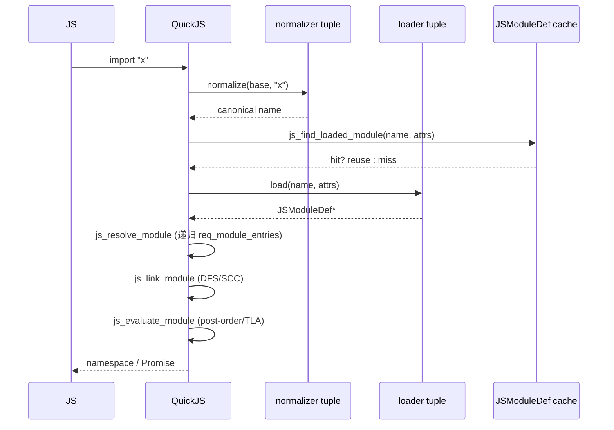

### 5.3 resolver / loader 链

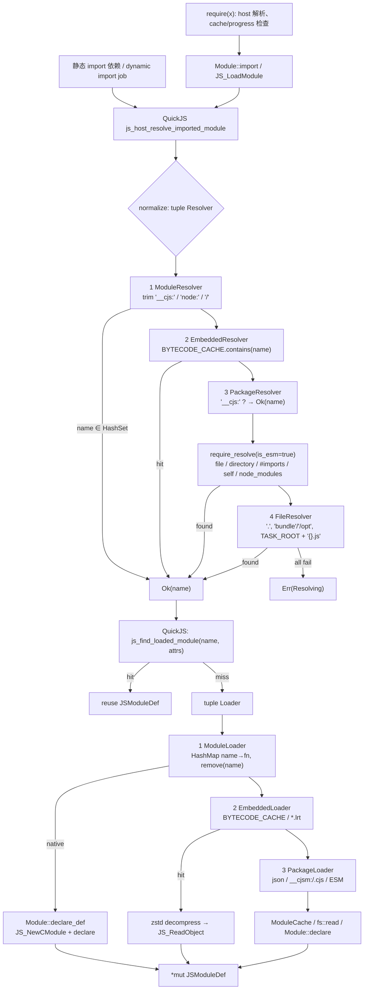

rquickjs 的 tuple fallthrough 语义很关键：

- 只有 `Err(Resolving { .. })` / `Err(Loading { .. })` 才会继续下一个 resolver/loader；
- `Ok` 立即返回；
- 其它错误直接冒泡；
- 全部失败时，把各层 message 用 `\n` join。

因此 resolver 成功**不代表** loader 成功，两条链必须各自能兜住。

### 5.4 native module 与 JS bytecode

LLRT 的 builtin 分两类：

**(1) native `ModuleDef`**

```rust
impl ModuleDef for FsModule {
    fn declare(declare: &Declarations) -> Result<()> {
        declare.declare("readFile")?;
        declare.declare("default")?;
        Ok(())
    }
    fn evaluate<'js>(ctx: &Ctx<'js>, exports: &Exports<'js>) -> Result<()> {
        export_default(ctx, exports, |default| {
            default.set("readFile", Func::from(...))?;
            Ok(())
        })
    }
}
```

注册路径：

```text
ModuleLoader::load_func::<D>
  -> Module::declare_def::<D, _>
       -> JS_NewCModule(ctx, name, eval_fn)
       -> D::declare(&Declarations)
            -> JS_AddModuleExport
       -> QuickJS 求值时回调 eval_fn
            -> D::evaluate(&Ctx, &Exports)
                 -> JS_SetModuleExport
```

所以 native module 对 QuickJS 来说就是 C module：无需解析 JS 源码；declare 提前登记导出名，链接阶段建立绑定，evaluate 回调设置导出值。

**(2) JS builtin + bytecode**

少部分 builtin 是 JS（`node:stream`、`@llrt/test` 等）：

```ts
// llrt_core/src/modules/js/stream.ts
import { EventEmitter as EE } from "node:events";
import { inherits } from "node:util";
```

构建期 esbuild 打成 `bundle/js/*.js`，`llrt_core/build.rs` 用 QuickJS 编译成 `.lrt` bytecode，按模块名放进 `BYTECODE_CACHE`。运行时首次 import 时解压、`JS_ReadObject`，依赖仍由 QuickJS 通过 loader 解析。

### 5.5 CJS 兼容：`__cjs:` / `__cjsm:` 与 `RequireState`

LLRT 用两个 magic prefix 把 CJS 塞进 ESM loader：

| 前缀 | 生成方 | 语义 |
|---|---|---|
| `__cjs:` | `require()` | 这次导入来自 CJS；`PackageResolver` 直接放行（不查文件系统），`PackageLoader` 按 ESM 声明，CJS 顶层代码直接执行 |
| `__cjsm:` | ESM 解析到 CJS 包时 | `PackageLoader` 先 require 执行并发现导出名，再声明调用 require 的 ESM 源码 wrapper |

`require()` 的关键流程：

```text
require(x)
  ├─ 取 globalThis.__require_hook（内嵌字节码的 embedded_resolve）
  ├─ 原生名直接命中 ModuleNames
  ├─ 否则以当前模块绝对路径为 base，require_resolve(..., is_esm=false)
  ├─ 非 .json/.lrt 结果加 __cjs: 前缀
  ├─ state.cache[x] 命中 -> 返回
  ├─ .json -> fs::read_to_string + json_parse
  ├─ state.progress[x] 命中 -> 返回占位对象（循环 require）
  ├─ 建占位 Object，放入 progress
  ├─ Module::import(ctx, "__cjs:/abs/x.cjs")   // JS_LoadModule
  ├─ 手动泵：
  │    loop {
  │      if promise.result::<Object>() { break }
  │      poll_timers(...)
  │      ctx.execute_pending_job()
  │    }
  └─ 读取 state.exports / imported namespace，按分支返回值或拷贝属性，写入 cache
```

`globalThis.exports` / `globalThis.module.exports` 是一对 Accessor：

```text
get/set exports
  -> ctx.get_script_or_module_name()       // JS_GetScriptOrModuleName
  -> trim "__cjs:"
  -> RequireState.exports[name]
```

因此 `.cjs` 文件被当作 ESM 执行时，`module.exports = ...` 不会写入真正的 CommonJS 包装函数，而是写入按模块名索引的全局存储。这是 LLRT 能用 ESM loader 承载 CJS 语义的核心技巧。

`import` 一个 CJS 文件时，`PackageLoader::load_cjs_module()` **先同步调用 `require("__cjs:" + name)` 执行 CJS 并枚举导出名**，再生成下面的 ESM 源码 wrapper。wrapper 求值时再次调用 require，通常命中结果缓存。CJS 副作用因此可能发生在 loader 阶段，而非等 ESM wrapper 求值才首次发生：

```js
const value = require("<name>");
export default value.default || value;
const { a, b } = value;
export { a, b };
```

具名导出来自运行时对象 keys；`const { a, b } = value` 保存当时的属性值，不会持续读取 CJS 对象属性。`default` 的 `value.default || value` 规则也不同于 Node 将整个 `module.exports` 作为 default 的常规行为。

**`require(ESM)` 也不是直接返回原始 namespace。** `require.rs` 会根据 CJS exports、default export 类型等分支拷贝属性或合并到 default 对象。以 `export let x = 1; export function inc() { x++; }` 为例，require 返回对象的 `x` 在 `inc()` 后仍可为 1；Node/Deno namespace 则读到 2（§10）。

同一目标经 import/require 加载时，`PackageLoader` 的 `ModuleCache.esm[path]` 可复用 module，`RequireState.cache` 可复用 require 返回值。但两者不是同一种缓存，返回对象也不必等于 namespace。import/require 条件还可能解析到不同文件。

### 5.6 QuickJS API 调用清单

| API | LLRT 调用点 | 用途 |
|---|---|---|
| `JS_SetModuleLoaderFunc2` | rquickjs `LoaderHolder::set_to_runtime` | 注册 loader |
| `JS_SetModuleNormalizeFunc2` | 同上 | 注册 normalizer |
| `JS_Eval(..., MODULE \| COMPILE_ONLY)` | `Module::declare` | 源码 → module |
| `JS_ReadObject(..., BYTECODE)` | `Module::load` | 字节码 → module |
| `JS_NewCModule` | `Module::declare_def` | native module |
| `JS_AddModuleExport` | `Declarations::declare` | 声明 native 导出 |
| `JS_SetModuleExport` | `Exports::export` | 设置 native 导出 |
| `JS_EvalFunction` | `Module::eval` | link + evaluate |
| `JS_LoadModule` | `Module::import` | require 的 host 入口；JS `import()` 则经 `js_dynamic_import_job` 调内部加载函数 |
| `JS_GetImportMeta` | `Module::meta` | `import.meta.url` |
| `JS_ExecutePendingJob` | `Ctx::execute_pending_job` | 泵 Job queue |
| `JS_GetScriptOrModuleName` | `module::init` 的 exports accessor | 当前模块名 |
| `JS_WriteObject` | build.rs `module.write` | 生成 `.lrt` |
| `JS_GetModuleNamespace` | `Module::namespace` | namespace |

`require()` 的同步泵调用 `poll_timers()` 和 `ctx.execute_pending_job()`，没有 poll rquickjs 的通用 future 调度器。因此 Promise jobs 与该定时器路径可推动 TLA；如果完成还依赖异步 future 经调度器回到 JS，这个循环不能保证进展，可能一直等待。不能把它视为 Node/Deno 的同步 ESM 检查，也不能视为完整异步 event loop。

### 5.7 异步模型

- **模块加载路径完全同步**：`Loader::load` 是 C ABI 回调，内部 `std::fs::read` / `fs::read_to_string`；
- `AsyncRuntime` 只是包一层 `async_lock::Mutex<InnerRuntime>`；
- future 由 rquickjs 自己的 `Spawner`/`Schedular` 驱动，`AsyncRuntime::idle()` 循环 `JS_ExecutePendingJob` 并 poll spawner；
- LLRT 的 `#[tokio::main]` 提供 Tokio 给网络/定时器等应用 API；
- `Ctx::spawn` 把 future 推入 rquickjs 调度器，`spawn_exit` 负责把结果回传/错误上报。

模块源码 I/O 是阻塞的，但 dynamic import 的 job 调度和 TLA 求值仍是异步语义。普通运行由 `AsyncRuntime::idle()` 推进 jobs 与 futures；嵌套的同步 require 泵只覆盖 jobs 和定时器，推进范围更小。

### 5.8 运行验证

本轮 §10 验证：合法 ESM 环正常；并发 import 等待 TLA；求值错误通过 import Promise reject；`require(ESM)` 的属性拷贝导致测试中的 `x` 保持旧值；定时器驱动的 TLA 可以在 require 的同步泵中完成。

循环 require 的部分导出也有差异：Node/Deno 将模块当前 exports 暴露给环中调用者；LLRT 的 `progress` 占位对象与 `state.exports` 分开，提前写入 exports 的属性可能尚未复制到占位对象。本轮 A 先写 `exports.a = "a"`、B 在环中读取它时，Node/Deno 得到 `"a"`，LLRT 得到 `undefined`（§10）。

这些结论不能扩大为“完全兼容 Node require”。例如 `node:module` 的 `createRequire` 当前只是返回全局 require，没有建立 Node 式绑定指定 base URL 的新函数，见 `llrt_modules/src/module/mod.rs::create_require`。

---

## 6. txiki.js：一个 normalizer/loader，图完全在 QuickJS

### 6.1 定位

txiki.js 是 C + QuickJS-NG + libuv，目标是 Web 平台 API + 系统能力，明确不做 Node 兼容。它只注册一组 module 回调：

```c
/* src/vm.c:550 */
JS_SetModuleLoaderFunc2(rt,
                        tjs_module_normalizer,
                        tjs_module_loader,
                        tjs_module_attr_checker,
                        qrt);
```

和 LLRT 一样，txiki **没有自己的 module 注册表/图**；`ctx->loaded_modules` 就是缓存，`JSModuleDef` 就是节点。host 侧只有：

```c
/* src/private.h */
typedef struct TJSRuntime {
    ...
    struct {
        JSValue promise_event_ctor;
        JSValue dispatch_event_func;
        JSValue import_map_resolver;     /* JS 闭包，不是 C 解析器 */
        JSValue internal_core;           /* tjs:internal/core 的 default */
        JSValue internal_message_pipe;   /* tjs:internal/worker 的 default */
        JSValue error_event_ctor;
    } builtins;
} TJSRuntime;
```

以及一个静态的 builtin 表：

```c
/* src/builtins.c */
typedef struct {
    const char *name;
    const uint8_t *data;
    uint32_t data_size;
} tjs_builtin_t;

static tjs_builtin_t builtins[] = {
    { "tjs:assert", tjs__assert, sizeof(tjs__assert) },
    { "tjs:getopts", tjs__getopts, sizeof(tjs__getopts) },
    { "tjs:hashing", tjs__hashing, sizeof(tjs__hashing) },
    { "tjs:internal/home", tjs__internal_home, sizeof(tjs__internal_home) },
    { "tjs:internal/path", tjs__internal_path, sizeof(tjs__internal_path) },
    { "tjs:path", tjs__path, sizeof(tjs__path) },
    ...
    { NULL, NULL, 0 },
};
```

`tjs__load_builtin()` 线性 `strcmp` 查找，命中后 `JS_ReadObject(..., JS_READ_OBJ_BYTECODE)`，取出 `JSModuleDef*` 并释放 JSValue。

### 6.2 normalizer：名字规范化 + import map + internal 闸门

```c
char *tjs_module_normalizer(JSContext *ctx,
                            const char *base_name,
                            const char *name,
                            void *opaque);
```

算法：

```text
1. 若 name 以 "tjs:internal/" 开头：
      且 base_name 不以 "tjs:" 开头
      -> throw ReferenceError("module ... is not exposed to user code")
2. 若 name[0] != '.'：
      a. 若 qrt->builtins.import_map_resolver 是函数：
           调用 resolver(name, base_name)
           字符串 -> 返回映射结果
           null   -> throw "blocked by import map"
           undefined -> 继续
      b. 原样返回 name
3. 若 name 以 '.' 开头：
      - 取 base_name 的 dirname
      - 只折叠开头的 "./" / "../"
      - 拼接，统一平台路径分隔符
      - 返回文本规范化路径（不做 URL 解析、不 realpath、不查文件）
```

要点：

- import map 完全在 JS 侧实现（`src/js/core/import-map.js`）：`imports`/`scopes` 是 null-prototype 对象，键按长度降序排序后做线性前缀匹配；C 侧只持有 resolver 函数。
- `tjs:internal/*` 的隔离是**名字前缀策略**，不是权限系统；它只看原始 `name`/`base_name`，不复查 import map 的结果。
- normalizer 拿不到 attributes：`JS_SetModuleLoaderFunc2` 的 `module_normalize_has_attr` 为 false，attributes 只传给 loader 和 attr checker。

### 6.3 loader：按协议/模块类型分派

```c
JSModuleDef *tjs_module_loader(JSContext *ctx,
                               const char *module_name,
                               void *opaque,
                               JSValueConst attributes);
```

分派：

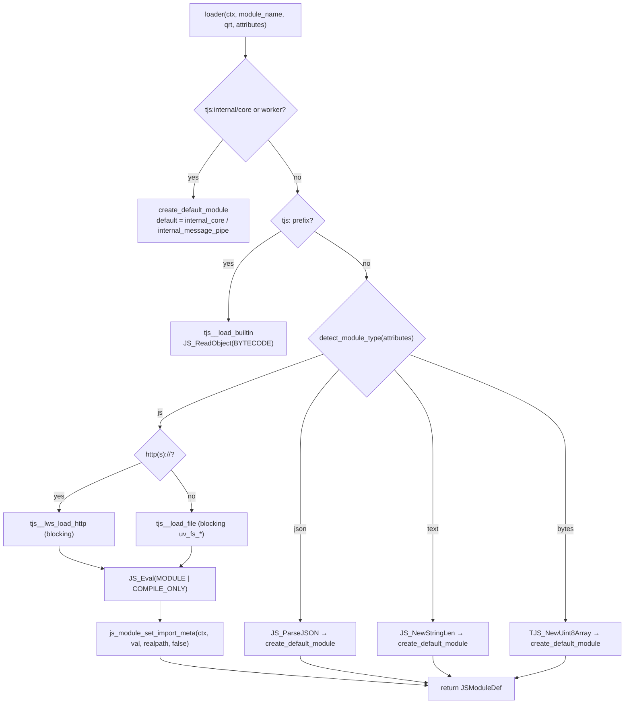

注意：

- 通常以 `with { type: 'json' }` 请求 JSON。`detect_module_type` 在 attributes 为 `undefined` 时选 JS；若传入 attributes 对象但 `type` 不是字符串，则按 `.json` 后缀判断，不能把所有缺少 type 的请求都描述为相同分支。
- `tjs_module_attr_checker` 只允许键 `type`，值不校验。
- 文件/HTTP 都是同步阻塞；loader 回调返回 `JSModuleDef*`，本身无法 await。

### 6.4 QuickJS 的依赖图、链接与求值

txiki 的“树”就是 QuickJS 的图：

```text
ctx->loaded_modules (双向链表)
  [main] <-> [a] <-> [b] <-> [shared] <-> [util] ...

main.req_module_entries:
  { name:"a", module:*a }
  { name:"b", module:*b }
a.req_module_entries -> *shared
b.req_module_entries -> *shared     // 同一个 JSModuleDef
shared.req_module_entries -> *util
```

解析：

```text
js_resolve_module(m)
  if m->resolved: return
  m->resolved = true          // 必须在递归前设置，截断循环解析
  for each rme in m->req_module_entries:
      rme->module = js_host_resolve_imported_module_atom(m->name, rme->name, rme->attrs)
      js_resolve_module(rme->module)
```

`js_host_resolve_imported_module` 的顺序是：normalize → 查 `ctx->loaded_modules` → 未命中才调 loader。模块在解析依赖前已经插入 `loaded_modules`，所以环在 resolve 阶段自然闭合。

链接（`JS_EvalFunction` 内部）：

```text
js_create_module_function(m)     // 为每个模块创建 func_obj / 变量槽
js_link_module(m)
  js_inner_module_linking(m, stack, index)
    - status = LINKING
    - dfs_index = dfs_ancestor_index = index++
    - 递归每个 req_module_entries
    - 若孩子仍在 LINKING，更新 dfs_ancestor_index（SCC）
    - 绑定 import/export
    - SCC 根出栈时统一 status = LINKED
js_evaluate_module(m)
  js_inner_module_evaluation(m)
    - status = EVALUATING
    - 后序递归依赖
    - C module: m->init_func(ctx, m)
    - JS module: 调用 func_obj；若返回 pending promise：
         has_tla / EVALUATING_ASYNC，登记 async_parent_modules
    - SCC 根出栈时 status = EVALUATED 或 EVALUATING_ASYNC
```

`JSModuleStatus`：

```text
UNLINKED → LINKING → LINKED → EVALUATING → EVALUATING_ASYNC → EVALUATED
```

cycle 由 `cycle_root` 统一持有 evaluation Promise；TLA 通过 `async_parent_modules` / `pending_async_dependencies` 延迟父模块。

动态 import：

```text
js_dynamic_import(specifier)
  -> JS_NewPromiseCapability
  -> 把 [resolve, reject, basename, specifier, attributes] 入 QuickJS job queue
  -> 返回 promise
job: js_dynamic_import_job
  -> JS_LoadModuleInternal
       -> host resolve
       -> js_resolve_module
       -> JS_EvalFunction（link + evaluate）
       -> evaluation promise.then -> resolve(namespace)
```

这里的源码 I/O 仍然同步；异步边界既包括 import job 的调度，也包括之后等待 evaluation Promise/TLA。宿主仍需推进 jobs 和 TLA 所依赖的定时器/网络事件。

QuickJS API 使用清单：

| API | txiki 调用点 | 用途 |
|---|---|---|
| `JS_SetModuleLoaderFunc2` | `src/vm.c:550` | 注册 normalizer/loader/attr checker |
| `JS_Eval(..., MODULE \| COMPILE_ONLY)` | `src/modules.c:202-206` | 文件/HTTP 源码 → module |
| `JS_ReadObject(..., BYTECODE)` | `src/builtins.c:93`、`src/eval.c:29` | builtin/core 字节码 → module |
| `JS_ResolveModule` | `src/eval.c:36` | 递归解析字节码模块依赖 |
| `JS_EvalFunction` | `src/eval.c:44`、`src/vm.c:1203` | link + evaluate |
| `JS_GetImportMeta` | `src/modules.c:309` | 设置 `import.meta` |
| `JS_GetModuleName` | `src/modules.c:270` | `import.meta.url` 的来源 |
| `JS_NewCModule` / `JS_AddModuleExport` / `JS_SetModulePrivateValue` | `src/modules.c:48/54/55` | `tjs:internal/core`、`worker` 的 default C module |
| `JS_ParseJSON` | `src/modules.c:209` | JSON 模块 |
| `JS_NewStringLen` / `TJS_NewUint8Array` | `src/modules.c:212/215` | text / bytes 模块 |
| `JS_ExecutePendingJob` | `src/vm.c:962` | job drain（dynamic import/microtask） |
| `JS_GetModuleNamespace` | 未直接调用 | 动态 import 内部使用（`quickjs.c`） |

注意：txiki 没有 `JS_SetImportMetaCallback`（该版本不存在），也没有导出的 `JS_LinkModule`/`JS_EvaluateModule`；link/evaluate 都封装在 `JS_EvalFunction` 内部。

### 6.5 builtin 交付：esbuild → tjsc → C 数组


| 层 | 构建 | 加载时机 |
|---|---|---|
| polyfills | esbuild `src/js/polyfills/index.js` → `tjsc -n tjs:internal/polyfills` | 启动时 eager（`vm.c:567`） |
| core | esbuild `src/js/core/index.js` → `tjsc -n tjs:internal/bootstrap` | 启动时 eager（`vm.c:568`） |
| `tjs:internal/core` | 不是字节码；`create_default_module` 绑定 `qrt->builtins.internal_core` | 首次 import（core bundle 立即 import） |
| `tjs:internal/worker` | 同上，绑定 `internal_message_pipe` | worker bootstrap |
| stdlib `tjs:*` | 每个文件 `qjsc/tjsc` 成 bytecode，进 `builtins[]` | 首次 import（lazy） |
| `tjs:internal/home` / `tjs:internal/path` | 同样在 `builtins[]` | 首次 import |

构建流水线：

```text
src/js/core/index.js
  --esbuild --bundle --external:tjs:*--> src/bundles/js/core/core.js
  --tjsc -m -s -n "tjs:internal/bootstrap" -p tjs__--> src/bundles/c/core/core.c
  --#include in src/builtins.c? 不，core.c 直接编进 tjs 静态库
```

`src/builtins.c` 只 include stdlib 和 `internal/{home,path}` 的生成 C；core/polyfills/run-main/run-repl/worker-bootstrap 由 CMake 直接编进 `tjs`，通过 `tjs__eval_bytecode` 从内嵌缓冲区执行。

`tjs__eval_bytecode()` 对 module 做：

```c
JS_ResolveModule(ctx, obj);                  // 递归解析依赖
js_module_set_import_meta(ctx, obj, false, false);
JS_EvalFunction(ctx, obj);                   // link + evaluate
// 只检查 promise 是否已 rejected；pending 的 TLA 不等待
```

### 6.6 libuv 的角色：同步 loader，异步 job queue

txiki 的 loader 是同步的，但这不意味着它绕过了 libuv：

- `tjs__load_file()` 调用 `uv_fs_open/read/close`，且 `loop = NULL`，即 libuv 的**同步封装**，在调用线程直接执行 syscall；
- HTTP 加载用 libwebsockets，`while (!done) lws_service(lws_ctx, 250)` 轮询，最多 10 秒；
- `TJS_Run()` 主循环是 `uv_run(UV_RUN_DEFAULT)`；QuickJS job 由 `uv_check` 回调里的 `tjs__execute_jobs()` 排空；
- dynamic import job 就在这个 drain 中执行；
- TLA evaluation Promise 由 QuickJS job queue 推进；宿主没有额外的 liveness 跟踪。

```mermaid
sequenceDiagram
  participant JS as JS
  participant QJS as QuickJS
  participant L as tjs_module_loader
  participant UV as libuv
  participant Loop as TJS_Run
  JS->>QJS: import "x"
  QJS->>L: loader(name)
  L->>UV: uv_fs_open/read (loop=NULL, blocking)
  UV-->>L: source
  L->>QJS: JS_Eval(COMPILE_ONLY)
  QJS->>QJS: js_resolve_module → 递归 loader
  QJS->>QJS: JS_EvalFunction → link + evaluate
  QJS-->>JS: namespace / promise
  Loop->>UV: uv_run(UV_RUN_DEFAULT)
  UV->>Loop: check callback
  Loop->>QJS: JS_ExecutePendingJob (dynamic import / microtasks)
```

### 6.7 运行验证

本轮运行本地 `build/tjs`（v26.6.0），并核查 `deps/quickjs` 实际子模块源码。§10 的 namespace 复用、合法 ESM 环、dynamic import 等待 TLA、求值异常 rejection 四组实验均符合上述路径。

没有内建 Node require/CJS loader。`import()` 等待 evaluation 的合约由 QuickJS 实现；进程是否继续运行还取决于 txiki 的 jobs 与 libuv 活跃工作，不能仅凭一个 pending Promise 推断进程保活。

---

## 7. Deno：deno_graph + deno_core ModuleMap 双层图

### 7.1 两层分工

Deno 的 ESM 装载可先从 CLI 构建图和 core 注册表两层理解；此外还有 V8 内部语义图，以及 Node compat 的 CJS loader/cache（§7.10）。下面两层不是 Deno 全部模块状态的清单：

```text
┌─────────────────────────────────────────────────────────────────────┐
│ CLI 层（deno_graph）                                                 │
│   resolve: import map / npm / JSR / node: / file / http              │
│   graph: ModuleSpecifier → ModuleSlot { Module | Err | Pending }     │
│   依赖边: Dependency { maybe_code, maybe_type, is_dynamic, ... }     │
│   产物: 源码 + 转译结果 + 缓存信息                                    │
└──────────────────────────────┬──────────────────────────────────────┘
                               │ ModuleLoader::load()
                               ▼
┌─────────────────────────────────────────────────────────────────────┐
│ 运行时层（deno_core::ModuleMap）                                     │
│   ModuleId(usize) → handles[id] (v8::Global<Module>) + info[id]      │
│   by_name: (ModuleName, RequestedModuleType) → SymbolicModule        │
│   RecursiveModuleLoad: FuturesUnordered + visited                    │
│   dynamic import: dynamic_import_map + pending_* + module_waker      │
└─────────────────────────────────────────────────────────────────────┘
```

`deno_graph` 是 CLI 的静态/构建图，`ModuleMap` 是运行时图；两者在 `ModuleLoader` 的 `resolve/load` 边界交接，不共享数据结构。

### 7.2 `deno_core::ModuleMap` 的数据结构

```rust
// libs/core/modules/map.rs
pub(crate) struct ModuleMap {
    pub(crate) loader: RefCell<Rc<dyn ModuleLoader>>,
    pub(crate) source_mapper: Rc<RefCell<SourceMapper>>,
    exception_state: Rc<ExceptionState>,

    dynamic_import_map: RefCell<HashMap<ModuleLoadId, DynImportState>>,
    preparing_dynamic_imports: TrackedFutures<Pin<Box<PrepareLoadFuture>>>,
    pending_dynamic_imports: TrackedFutures<StreamFuture<RecursiveModuleLoad>>,
    pending_dyn_mod_evaluations: TrackedVec<DynImportModEvaluate>,
    pending_tla_waiters:
        RefCell<HashMap<ModuleId, Vec<v8::Global<v8::PromiseResolver>>>>,

    pending_mod_evaluation: Cell<bool>,
    evaluating_top_level: Cell<bool>,
    code_cache_ready_futs: TrackedFutures<Pin<Box<CodeCacheReadyFuture>>>,
    module_waker: AtomicWaker,

    data: RefCell<ModuleMapData>,
    will_snapshot: bool,
    loading_internal_modules: Cell<bool>,
    pub(crate) dyn_module_evaluate_idle_counter: Cell<u32>,
    pub(crate) import_sync_eval_stack: RefCell<Vec<ModuleId>>,
}
```

真正存节点的是 `ModuleMapData`：

```rust
// libs/core/modules/module_map_data.rs
pub(crate) struct ModuleMapData {
    /// V8 handle → index
    pub(crate) handles_inverted: HashMap<v8::Global<v8::Module>, usize>,
    /// index → V8 handle
    pub(crate) handles: Vec<v8::Global<v8::Module>>,
    pub(crate) main_module_callbacks: Vec<v8::Global<v8::Function>>,
    /// index → metadata
    pub(crate) info: Vec<ModuleInfo>,

    /// (ModuleName, RequestedModuleType) → Mod(id) | Alias(name)
    by_name: ModuleNameTypeMap<SymbolicModule>,
    pub(crate) next_load_id: ModuleLoadId,
    pub(crate) main_module_id: Option<ModuleId>,

    pub(crate) synthetic_module_exports_store: SyntheticModuleExportsStore,
    pub(crate) lazy_esm_sources: Rc<RefCell<HashMap<ModuleName, ModuleCodeString>>>,
    pub(crate) residual_lazy_esm_sources: &'static [(&'static str, &'static str)],
    pub(crate) known_lazy_esm: RefCell<HashSet<Cow<'static, str>>>,
    pub(crate) lazy_script_sources: ...,
    pub(crate) loaded_script_results: ...,
    pub(crate) synthetic_esm_modules: ...,
    pub(crate) sources: HashMap<ModuleSourceKey, v8::Global<v8::Object>>,
    ...
}

pub(crate) struct ModuleInfo {
    pub id: ModuleId,
    pub main: bool,
    pub name: ModuleName,                 // FastString
    pub requests: Vec<ModuleRequest>,
    pub module_type: ModuleType,
    pub is_internal: bool,
}
```

`ModuleId` 的分配方式很关键：

```rust
let id = data.handles.len();
data.handles_inverted.insert(handle.clone(), id);
data.handles.push(handle);
data.by_name.insert(&RequestedModuleType::from(module_type),
                    name,
                    SymbolicModule::Mod(id));
data.info.push(ModuleInfo { id, ... });
```

所以：

- `ModuleId` 是**注册顺序下标**，不是内容哈希；
- `handles[id]` 和 `info[id]` 必须用同一个 id 访问；
- 字符串到 id 的映射在 `by_name`；
- 重定向用 `SymbolicModule::Alias(ModuleName)`，`get_id()` 会沿 alias 链追到 `Mod(id)`；
- `next_load_id` 只用于动态加载批次（`ModuleLoadId`），与 `ModuleId` 无关。

```text
ModuleMap
 ├─ data
 │   ├─ handles[0] = Global<v8::Module>(main)
 │   ├─ handles[1] = Global<v8::Module>(a)
 │   ├─ handles[2] = Global<v8::Module>(b)
 │   ├─ info[0] = { id:0, main:true,  name:"file:///main.js", requests:[a,b], ... }
 │   ├─ info[1] = { id:1, main:false, name:"file:///a.js",    requests:[shared], ... }
 │   ├─ info[2] = { id:2, main:false, name:"file:///b.js",    requests:[shared], ... }
 │   ├─ by_name["file:///main.js"] -> Mod(0)
 │   ├─ by_name["file:///a.js"]    -> Mod(1)
 │   ├─ by_name["npm:foo"]         -> Alias("file:///.../foo.js")
 │   └─ handles_inverted[Global(main)] -> 0
 ├─ dynamic_import_map: load_id -> DynImportState { resolver, cped, phase }
 ├─ preparing_dynamic_imports: FuturesUnordered<PrepareLoadFuture>
 ├─ pending_dynamic_imports: FuturesUnordered<StreamFuture<RecursiveModuleLoad>>
 ├─ pending_dyn_mod_evaluations: Vec<DynImportModEvaluate>
 ├─ pending_tla_waiters: ModuleId -> Vec<Global<PromiseResolver>>
 └─ module_waker: AtomicWaker
```

### 7.3 `RecursiveModuleLoad`：并行装载 + 两级去重

```rust
pub(crate) struct RecursiveModuleLoad {
    id: ModuleLoadId,
    root_module_id: Option<ModuleId>,
    init: LoadInit,                    // Main | Side | DynamicImport
    state: LoadState,                  // Init | LoadingRoot | LoadingImports | Done
    pub(crate) module_map_rc: Rc<ModuleMap>,
    pending: FuturesUnordered<Pin<Box<ModuleLoadFuture>>>,
    visited: HashSet<ModuleReference>,
    visited_as_alias: Rc<RefCell<HashSet<String>>>,
    root_module_reference: Option<ModuleReference>,
    resolved_specifier: Option<Result<ModuleSpecifier, CoreError>>,
    loader: Rc<dyn ModuleLoader>,
}
```

状态机：

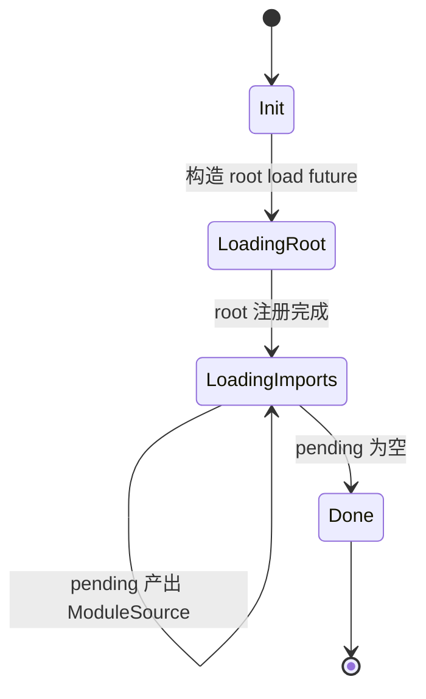

装载过程：

```text
poll_next()
  ├─ Init: resolve_root_from_init()
  │        Main -> ResolutionKind::MainModule, referrer "."
  │        Side -> Import
  │        DynamicImport -> DynamicImport
  │        loader.prepare_load()（lazy/synthetic 跳过）
  │        构造 root future 推入 pending
  ├─ LoadingRoot/LoadingImports:
  │        pending.try_poll_next_unpin()
  │        Some(ModuleSource) -> register_and_recurse()
  │        None -> Done
  └─ Done -> Ready(None)

register_and_recurse(source)
  ├─ check redirect / get_id() 去重
  ├─ new_module_with_pending:
  │    ├─ compile_module2 / compile_module
  │    ├─ get_module_requests → resolve_with_scope → ModuleReference
  │    └─ create_module_info(id = handles.len())，登记自身
  └─ finalize_module → register_and_recurse_inner:
       ├─ visited / visited_as_alias 命中 -> skip
       ├─ get_id() 已注册 -> already_registered 队列
       └─ 否则 needs_load -> 包装 future 推入 pending
```

去重键是 `(specifier, requested_module_type)`，不是原始字符串：

- `visited: HashSet<ModuleReference>` 处理正常边；
- `visited_as_alias: HashSet<String>` 处理“重定向后同一个 found URL”；
- `already_registered` 是同步队列，避免对已在 `ModuleMap` 的模块重复 `load()`。

### 7.4 V8 API：link 与 evaluate

Deno 的运行时注册/链接流程：

```text
compile:
  v8::script_compiler::compile_module2(scope, &mut source, ...)
  -> module.get_module_requests()
  -> 为每条 request 预解析 ModuleRequest { reference, specifier_key, phase, ... }
  -> create_module_info(...)

instantiate:
  tc_scope.set_slot(self as *const ModuleMap)
  module.instantiate_module2(scope,
                             ModuleMap::module_resolve_callback,
                             ModuleMap::module_source_callback)
  -> V8 对每条边回调 module_resolve_callback
       -> 用 (specifier_key, requested_module_type) 找预解析的 reference
       -> resolve_callback: synthetic_esm → loader.resolve → get_id → lazy ESM
       -> 返回 handles[id]
  -> drop_instantiated_requests(...) 释放已链接图的边

evaluate:
  module.evaluate(scope) -> Promise
  -> then2(on_fulfilled, on_rejected)
  -> tokio::sync::oneshot 把 V8 promise 桥回 Rust future
  -> pending_mod_evaluation = true
```

V8 API 清单：

| API | 位置 | 用途 |
|---|---|---|
| `v8::script_compiler::compile_module2` | `map.rs:865` | 编译 + import attributes |
| `module.get_module_requests()` | `map.rs:965` | 收集静态边 |
| `module.instantiate_module2` | `map.rs:1207` | link + resolve/source 回调 |
| `module.get_module_namespace()` | `map.rs` | 取 namespace |
| `module.evaluate()` | `evaluation.rs` | 求值 |
| `v8::PromiseResolver::new` | `map.rs:1802` | synthetic module evaluation steps 必须返回 Promise |
| `v8::Global::new` | `module_map_data.rs` | 持有 module handle |

Deno 的 `ModuleMap` 与 V8 的关系可以概括为：

```text
V8 module graph  ── handles[id] ──►  ModuleMapData
      ▲                                  │
      │ instantiate_module2              │ by_name / get_id
      └──────── resolve callback ◄───────┘
```

V8 负责“module 之间的绑定关系”，`ModuleMap` 负责“id ↔ handle ↔ 名字 ↔ metadata”的索引，以及异步加载/求值状态。

### 7.5 动态 import 与 TLA

```rust
type PrepareLoadFuture = dyn Future<Output = (ModuleLoadId, Result<RecursiveModuleLoad, CoreError>)>;

struct DynImportState {
    resolver: v8::Global<v8::PromiseResolver>,
    cped: v8::Global<v8::Value>,
    phase: ModuleImportPhase,
}

struct DynImportModEvaluate {
    load_id: ModuleLoadId,
    module_id: ModuleId,
    promise: v8::Global<v8::Promise>,
}
```

`load_dynamic_import()` 的快路径：

1. 已 `Evaluated` 且没有 pending TLA → 直接 resolve namespace；
2. 已 `Evaluated` 但 TLA 未完成 → 把 resolver 放进 `pending_tla_waiters[module_id]`；
3. lazy ESM / synthetic ESM → 同步构建并 resolve；
4. 否则走 `RecursiveModuleLoad` 慢路径，把 `DynImportState` 放进 `dynamic_import_map`。

求值阶段：

```text
dynamic_import_module_evaluate()
  -> module.evaluate() 的内部 Promise
  -> then2(wake_module, wake_module)     // 只唤醒 module_waker
  -> DynImportModEvaluate 入 pending_dyn_mod_evaluations

evaluate_dyn_imports()
  -> poll promise state
  -> Fulfilled: dynamic_import_resolve(namespace)
  -> Rejected:  dynamic_import_reject(exception) + reject_tla_waiters
```

事件循环 liveness：

```text
EventLoopPendingState {
  has_pending_dynamic_imports:    preparing || pending
  has_pending_dyn_module_evaluation: !pending_dyn_mod_evaluations.is_empty()
  has_pending_module_evaluation:  pending_mod_evaluation
  ...
}
```

这三项参与 `is_pending()`，让 event loop 跟踪模块工作；但不意味着 pending evaluation 会无限保活。没有可推进的工作时，`jsruntime.rs` 还检测 stalled TLA / evaluation deadlock 并报错。正常 dynamic import 路径等待 evaluation Promise 再 resolve namespace。

动态 import 的三段式流水线：

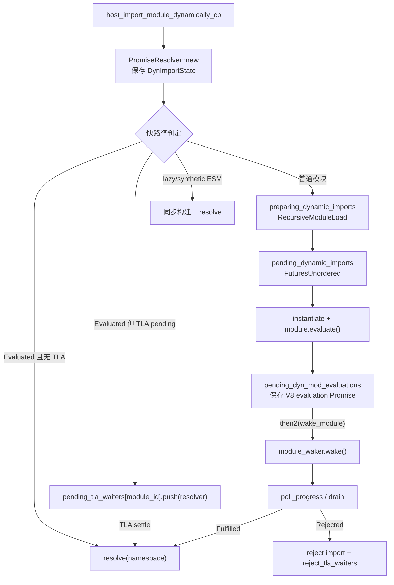

注意：`DynImportState` 里保存的是**用户 Promise 的 resolver**，`DynImportModEvaluate` 里保存的是**内部 evaluation Promise**；二者通过 `pending_dyn_mod_evaluations` 和 `pending_tla_waiters` 分开管理。

### 7.6 CLI 的 `deno_graph`

```rust
pub struct ModuleGraph {
    pub roots: IndexSet<ModuleSpecifier>,
    module_slots: BTreeMap<ModuleSpecifier, ModuleSlot>,
    pub imports: IndexMap<ModuleSpecifier, GraphImport>,
    pub redirects: BTreeMap<ModuleSpecifier, ModuleSpecifier>,
    pub packages: PackageSpecifiers,
    ...
}

enum ModuleSlot {
    Module(Module),
    Err(ModuleError),
    Pending { is_asset: bool },
}

enum Module {
    Js(JsModule),
    Json(JsonModule),
    Wasm(WasmModule),
    Npm(NpmModule),
    Node(BuiltInNodeModule),
    External(ExternalModule),
}

struct JsModule {
    is_script: bool,
    dependencies: IndexMap<String, Dependency>,
    source: ModuleTextSource,
    media_type: MediaType,
    specifier: ModuleSpecifier,
    maybe_types_dependency: ...,
    ...
}

struct Dependency {
    maybe_code: Resolution,
    maybe_type: Resolution,
    is_dynamic: bool,
    maybe_attribute_type: Option<...>,
    imports: ...,
}
```

`MainModuleGraphContainer` 用 `Arc<RwLock<Arc<ModuleGraph>>>` 做读多写少：

```text
graph() -> Arc<ModuleGraph>              // 直接 clone 内层 Arc
update:
  acquire_update_permit()
  clone graph
  graph.build(...)
  commit() -> 原子换入
```

`CliModuleLoader` 的职责：

```text
prepare_load(specifier)
  -> acquire_update_permit
  -> ModuleLoadPreparer::prepare_module_load
  -> graph.build(...) / 增量更新

load(specifier)
  -> load_code_source(graph)
  -> deno_resolver::load()
  -> ModuleSource::new_with_redirect(...)
  -> 返回 ModuleLoadResponse::Async/Sync

resolve(specifier, referrer)
  -> resolver.resolve_with_graph(graph, ...)
  -> import map / npm / JSR / node: / permissions
```

`deno info --json` 输出的就是 `deno_graph` 的结构：

```json
{
  "roots": ["file:///.../main1.js"],
  "modules": [
    { "kind": "esm", "specifier": "file:///.../a.js", ... },
    { "kind": "esm", "specifier": "file:///.../main1.js",
      "dependencies": [
        { "specifier": "./a.js",
          "code": { "specifier": "file:///.../a.js", "resolutionMode": "import" } }
      ] }
  ],
  "redirects": {}
}
```

### 7.7 Extension builtin

```rust
pub struct Extension {
    pub name: &'static str,
    pub deps: &'static [&'static str],
    pub js_files: Cow<'static, [ExtensionFileSource]>,
    pub esm_files: Cow<'static, [ExtensionFileSource]>,
    pub lazy_loaded_esm_files: Cow<'static, [ExtensionFileSource]>,
    pub lazy_loaded_js_files: Cow<'static, [ExtensionFileSource]>,
    pub synthetic_esm_modules: Cow<'static, [(&'static str, &'static str)]>,
    pub esm_entry_point: Option<&'static str>,
    pub ops: Cow<'static, [OpDecl]>,
    ...
}
```

四种交付方式：

| 形式 | 字段 | 加载/求值 |
|---|---|---|
| **ESM extension** | `esm_files` | 启动时 `load_side_es_module` 注册，不自动 evaluate；`esm_entry_point` 指定的模块在启动时 evaluate |
| **lazy ESM** | `lazy_loaded_esm_files` | 注册源码到 `lazy_esm_sources`，首次 import 时 `LazyEsmModuleLoader` 同步加载+求值 |
| **synthetic ESM** | `synthetic_esm_modules` | 先执行 backing IIFE 得到 exports 对象，再 `new_synthetic_module_from_exports_object` 包成 ESM facade |
| **snapshot** | 同 extension | 源码和 entry point 可进入 V8 snapshot；已进 snapshot 的扩展不再重跑 js/esm |

`ext:` 的访问限制：

```rust
// map.rs
fn validate_ext_module_import(...) {
    if will_snapshot || loading_internal_modules {
        if referrer == "." || is_internal_referrer(referrer) { return Ok(()) }
    }
    Err(TypeError("Importing ext: modules is only allowed from ext: and node: modules"))
}
```

实测用户代码 `import("ext:core/mod.js")` 会被拒绝；`node:fs` 则由 CLI/Node compat 层提供 facade。

### 7.8 tokio 的角色

Deno core 的模块任务主要组织为 futures；这与 CLI 使用 Tokio 驱动外部 I/O 不矛盾：

- `RecursiveModuleLoad` 用 `FuturesUnordered` + `StreamFuture`；
- 动态 import 的 prepare future 也是 `FuturesUnordered`；
- `module_waker: AtomicWaker` 把 V8 promise 的回调接回事件循环；
- 求值用 `tokio::sync::oneshot` 把 V8 Promise 桥回 Rust future；
- CLI 主运行路径使用 current-thread Tokio runtime，V8 在其所属线程执行；底层网络、文件获取和转译采用什么调度方式，应继续沿具体 loader 实现分析，不能仅由 `FuturesUnordered` 推断。

`FuturesUnordered` 描述 core 如何并发 poll 装载任务，不代表每个 import 都创建独立 Tokio task；同步 require 的 `op_import_sync` 还使用阻塞等待装载的特殊路径。

### 7.9 运行验证

本轮本地 debug 构建 Deno 2.9.8 的结果见 §10：合法静态环正常；dynamic import 等待 TLA 并传播求值异常；require 同步 ESM 的导出仍能反映绑定变化；require 含 TLA 的图报 `ERR_REQUIRE_ASYNC_MODULE`。

### 7.10 Node compat：CJS loader 与双向 ESM 桥接

`ext/node/polyfills/01_require.js` 实现独立的 Node 风格 CJS loader。它不把所有 CJS 模块都直接作为 core `ModuleInfo` 节点管理：

```text
CJS Module
 ├─ id / filename / path
 ├─ exports / loaded
 ├─ parent / children / paths
 └─ Module._cache[filename] → Module

require(CJS)
  → Module._load → _resolveFilename
  → 命中 cache：返回 exports（环中可返回尚未完成的 exports）
  → 未命中：new Module，先写入 cache
  → module.load → 扩展名/格式处理 → _compile
  → core.compileFunction(source, ..., [exports, require, module, __filename, __dirname])
  → compiledWrapper.call(exports, require, module, filename, dirname)
  → 返回 module.exports；失败时删除未完成的缓存项
```

`op_require_*` 提供文件、包信息与路径能力；`op_require_read_file` 经过权限检查和 `NodeRequireLoader` 读取源码。require 因而不是绕过 Deno 权限模型的入口。

**CJS require ESM：** `loadESMFromCJS` 将 filename 转成 URL，调用 `op_import_sync`（hook 提供源码时可走 `op_import_sync_with_source`）。core 装载/实例化图，检查 `is_graph_async()`，同步求值并返回 namespace/facade。异步图被拒绝，即使此前曾通过 import 完成 TLA 也一样；JS 层将对应错误映射为 `ERR_REQUIRE_ASYNC_MODULE`。`import_sync_eval_stack` 与 V8 状态共同检测跨 CJS/ESM 的重新进入环。存在 `'module.exports'` 导出时，JS bridge 可选它作为 require 返回值。

**ESM import CJS：** `libs/node_resolver/analyze.rs::exports_to_wrapper_module` 根据静态分析所得导出名生成 ESM 源码：

```js
import { createRequire } from "node:module";
const require = createRequire(import.meta.url);
const mod = require("/absolute/path/module.cjs");
export default mod;
// 实际生成器还处理具名导出、'module.exports' 导出和 main 入口。
```

wrapper 的 ESM 身份由 core ModuleMap 管理，CJS 实例由 `Module._cache` 管理。它与 Node synthetic module 的实现形态不同，但都需要连接 ESM 和 CJS 两套缓存；与 LLRT 先执行 CJS 枚举 keys 的策略也不同。

证据：`ext/node/polyfills/01_require.js::{Module._load, wrapSafe, loadESMFromCJS}`、`ext/node/ops/require.rs::op_require_read_file`、`libs/core/ops_builtin.rs::op_import_sync`、`libs/node_resolver/analyze.rs::exports_to_wrapper_module`。

---

## 8. Node.js：JS 层 ESM loader + 独立 CJS loader

### 8.1 两套 loader

Node 的独特之处：CJS 是原生起点，ESM 是后加并通过 bridge 兼容。它不是一套 loader，而是两套：

```text
ESM:
  static import
    -> 编译得到 ModuleRequest
    -> ModuleJob.syncLink/link -> getOrCreateModuleJob

  import()
    -> V8 dynamic callback -> src/module_wrap.cc -> esm/utils.js
    -> ModuleLoader.import -> getOrCreateModuleJob

  共同后续:
    -> ModuleJobSync / ModuleJob + loadCache
    -> ModuleWrap -> V8 instantiate / evaluate
    -> static 绑定与依赖求值；dynamic Promise 完成

CJS:
  require()
    -> Module._load
    -> Module._resolveFilename
    -> Module._findPath
    -> Module._cache
    -> compile wrapper
    -> execute
```

2026 快照的一个重要变化：**主线程普通 ESM 入口主要使用 `ModuleJobSync`**（`loader.js:620-622`），普通路径同步 link，无 TLA 时同步 evaluate；`kRequireInImportedCJS` 等特殊路径仍使用 `ModuleJob`，该类在主线程也会调用 `syncLink`。不能只凭类名判断每一步是否异步。

### 8.2 ESM 数据结构

```js
// lib/internal/modules/esm/loader.js
class ModuleLoader {
  #defaultConditions = getDefaultConditions();
  #resolveCache = new ResolveCache();
  loadCache = new LoadCache();
  isForAsyncLoaderHookWorker = false;
  #asyncLoaderHooks;
}
```

没有 `moduleJobs` 字段：job 全部存在 `loadCache` 里。

`LoadCache` 是**两级 key**：

```js
class LoadCache extends SafeMap {
  get(url, type = kImplicitTypeAttribute) {
    return super.get(url)?.[type];
  }
  set(url, type = kImplicitTypeAttribute, job) {
    const cachedJobsForUrl = super.get(url) ?? { __proto__: null };
    cachedJobsForUrl[type] = job;
    return super.set(url, cachedJobsForUrl);
  }
}
```

所以：

```text
loadCache: Map<url, { [type]: ModuleJobBase }>
  "file:///a.mjs" -> { "javascript": ModuleJobSync }
  "file:///a.json" -> { "json": ModuleJobSync }
```

`type` 默认是 `"javascript"`；`import './a.json' with { type: 'json' }` 与普通 JS 不会互相覆盖。

`#resolveCache` 是另一套 key：`specifier + '::' + sorted(JSON(attrs))`，按 `parentURL` 分桶；注册自定义 loader 时不用它。

`ModuleJobBase` / `ModuleJob` / `ModuleJobSync`：

```js
class ModuleJobBase {
  constructor(loader, url, importAttributes, phase, isMain, inspectBrk) {
    this.loader = loader;
    this.importAttributes = importAttributes;
    this.phase = phase;
    this.isMain = isMain;
    this.inspectBrk = inspectBrk;
    this.url = url;
  }

  syncLink(requestType) {
    // 先把自己写进 loadCache，再递归 link，处理循环
    const hadPreviousEntry = this.loader.loadCache.get(this.url, this.type) !== undefined;
    this.loader.loadCache.set(this.url, this.type, this);
    const moduleRequests = this.module.getModuleRequests();
    const modules = Array(moduleRequests.length);
    ...
    this.module.link(modules);
  }
}

class ModuleJob extends ModuleJobBase {
  // module 或 modulePromise
  // linked: Promise | ModuleJobBase[]
  // instantiated: Promise | undefined
  // commonJsDeps: boolean[]
}

class ModuleJobSync extends ModuleJobBase {
  // module: ModuleWrap
  // linked: ModuleJobBase[]
  // type: string
  // modulePromise getter
  instantiateSync() { this.module.instantiate(); }
  runSync(parent) { ... evaluateSync() }
}
```

对象关系：

```text
ModuleLoader
 ├─ loadCache: Map<url, {type: ModuleJobBase}>
 ├─ #resolveCache: Map<parentURL, Map<key, {url, format}>>
 └─ #asyncLoaderHooks: AsyncLoaderHooksProxiedToLoaderHookWorker
      └─ AsyncLoaderHookWorker -> Worker thread -> MessagePort/Atomics

ModuleJobBase
 ├─ url, loader, importAttributes, phase, isMain, inspectBrk
 ├─ ModuleJob: module | modulePromise, linked(Promise 或数组), instantiated, commonJsDeps
 └─ ModuleJobSync: module(ModuleWrap), linked[], type, commonJsDeps

ModuleWrap (C++ BaseObject)
 ├─ internal field kModuleSlot: v8::Global<v8::Module>
 ├─ kSyntheticEvaluationStepsSlot: JS callback
 ├─ kContextObjectSlot
 ├─ kLinkedRequestsSlot: Array<ModuleWrap>
 ├─ kModuleSourceObjectSlot
 └─ linked_module_wraps_: std::vector<ModuleWrap*>
```

### 8.3 ESM 加载流程：区分静态请求与 dynamic callback

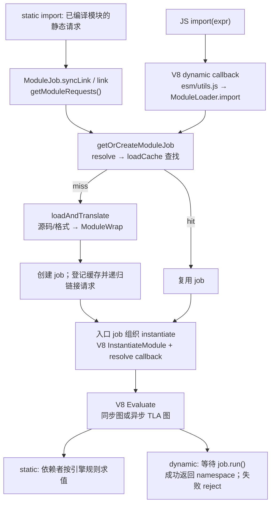

图中两个入口共享 job/cache，但静态 import 不触发 dynamic callback。`syncLink` 先临时登记自身，再递归获取依赖 job，最终 `ModuleWrap.link` 保存依赖 wrappers；之后 `instantiate()` 才调用 V8 的链接语义。`ModuleJobSync` 的加载/链接同步，`run()` 仍可 await TLA；`runSync()` 则拒绝异步图。

`resolve` 的关键路径：

```text
defaultResolve
  ├─ data: -> 直接返回
  ├─ node: -> 直接返回 specifier
  ├─ 入口点：parentURL = CWD
  └─ moduleResolve
       ├─ 相对/绝对 -> new URL
       ├─ '#' -> packageImportsResolve
       ├─ URL -> 直接
       └─ packageResolve
            ├─ BuiltinModule.canBeRequiredWithoutScheme -> node:
            ├─ packageJsonReader.getPackageJSONURL
            └─ packageExportsResolve / legacyMainResolve
```

`load` 的关键点：

- 主线程走 `defaultLoadSync`，`file:` 用 `readFileSync`，`data:` 用 `dataURLProcessor`；
- `node:` → `format = 'builtin'`、`source = null`；
- 判定为 `commonjs` 时，async 版本会把 source 置 null，让 CJS loader 自己重新读；
- translator 是 `SafeMap`：`module`、`commonjs-sync`、`require-commonjs`、`builtin`、`json`、`wasm`、`addon` 等。

以下是 **host job 的编排阶段**，不是 V8 `GetStatus()` 枚举：

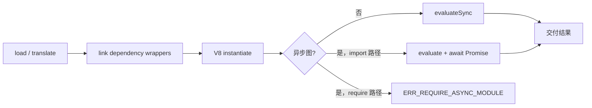

- `ModuleJobSync.run()` 在同步图中调用 `evaluateSync`，异步图中等待 `evaluationPromise`；`runSync()` 检查 `hasAsyncGraph` 后拒绝 TLA。
- `ModuleJob` 在 loader worker 可使用异步链接；主线程路径也可使用同步链接。
- host 通过先登记 job 避免加载环重复创建实例；V8 处理最终绑定、循环求值与 TDZ。异步 job 的 instantiate 流程还会遍历依赖，避免 host 等待链因环互相等待。
- V8 `Evaluated` 可能仍对应 pending TLA，不能代替 `evaluationPromise` 判断完成，见 §2.1。

### 8.4 CJS 数据结构与 require 流程

```js
function Module(id = '', parent) {
  this.id = id;
  this.path = path.dirname(id);
  setOwnProperty(this, 'exports', {});
  this[kFirstModuleParent] = parent;
  this[kLastModuleParent] = parent;
  updateChildren(parent, this, false);
  this.filename = null;
  this.loaded = false;
  this.children = [];
}
```

静态表：

```text
Module._cache:     filename -> Module
Module._pathCache: request + '\x00' + paths.join('\x00') -> filename
Module._extensions: '.js' | '.json' | '.node' -> handler
```

`Module._load`：

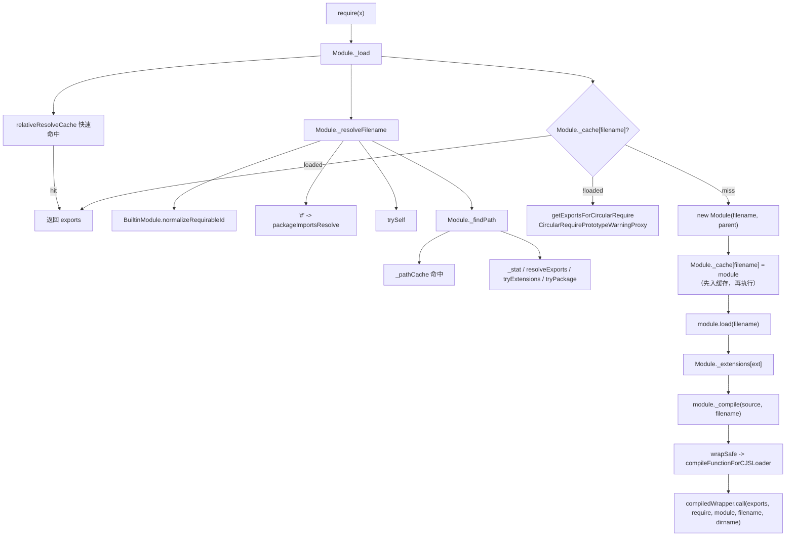

环依赖能工作，靠的是 **先 `new Module` 并写入 `Module._cache`，再执行**；尚未执行完的模块被再次 require 时，返回当前 `module.exports` 的占位对象（并用 `CircularRequirePrototypeWarningProxy` 对未定义属性发出警告）。

### 8.5 C++ `ModuleWrap` 与 V8 API

`ModuleWrap` 是一个 `BaseObject`，内部字段槽位：

```text
kModuleSlot                 -> v8::Global<v8::Module>
kModuleSourceObjectSlot     -> source-phase object
kSyntheticEvaluationStepsSlot -> JS evaluation callback（CJS/JSON/builtin）
kContextObjectSlot
kLinkedRequestsSlot         -> Array<ModuleWrap>
```

| JS 侧 | C++ | V8 API |
|---|---|---|
| `new ModuleWrap(url, ctx, source, ...)` | `ModuleWrap::New` | `ScriptCompiler::CompileModule`；synthetic 时 `Module::CreateSyntheticModule` |
| `wrap.link(modules)` | `ModuleWrap::Link` | `Module::GetModuleRequests()` + `ModuleRequest` |
| `wrap.instantiate()` | `ModuleWrap::Instantiate` | `Module::InstantiateModule(context, ResolveModuleCallback)` |
| `wrap.evaluate(t, b)` | `ModuleWrap::Evaluate` | `Module::Evaluate(context)` → Promise |
| `wrap.evaluateSync()` | `ModuleWrap::EvaluateSync` | `Module::Evaluate` + `Module::GetModuleNamespace` |
| `wrap.getNamespace()` | `ModuleWrap::GetNamespace` | `Module::GetModuleNamespace` |
| `wrap.getStatus()` | `ModuleWrap::GetStatus` | `Module::GetStatus` |
| `wrap.getModuleRequests()` | `ModuleWrap::GetModuleRequests` | `Module::GetModuleRequests` → `FixedArray` |
| `hasAsyncGraph` | C++ lazy property | `Module::IsGraphAsync` |

动态 import 的桥接：

```cpp
static MaybeLocal<Promise> ImportModuleDynamicallyWithPhase(...) {
  // 调 JS callback，拿到 thenable
  Local<Promise::Resolver> resolver;
  Promise::Resolver::New(context).ToLocal(&resolver);
  resolver->Resolve(context, result);
  return handle_scope.Escape(resolver->GetPromise());
}
```

即：JS callback 返回的 Promise 被塞进一个在 referrer context 里新建的 `v8::Promise::Resolver`，再把 resolver 的 Promise 交回 V8。`Link` 还会对 `ModuleRequest` 做 `ModuleCacheKey` 去重；同一个 request 映射到不同 `ModuleWrap` 会抛 `ERR_MODULE_LINK_MISMATCH`。

CJS 的函数编译是另一条路：`compileFunctionForCJSLoader` → `ScriptCompiler::CompileFunction`，参数表 `(exports, require, module, __filename, __dirname)`，与 `ModuleWrap` 无关。

### 8.6 CJS/ESM bridge

Node 有三条桥：

1. **`import` 一个 CJS 文件**：`createCJSModuleWrap()` 用 `cjs_lexer` 静态分析导出名，构造 synthetic `ModuleWrap`，evaluation callback 里才执行 CJS；
2. **`require` 一个 ESM 文件**：`importSyncForRequire()` 复用 `ModuleJobSync`，有 TLA 就抛 `ERR_REQUIRE_ASYNC_MODULE`；
3. **loader hooks**：`module.registerHooks()` 是同步 in-thread hook（CJS/ESM 共用全局 `resolveHooks/loadHooks`）；`module.register()` 是异步 loader hook worker，v26 已 runtime deprecated。

CJS wrapper 的导出名由静态分析加上 `default` / `module.exports` 确定；具名导出的值在 wrapper 求值时设置，后续 CJS 属性赋值不自动更新这些值。default 通常引用实际 `module.exports` 对象，因此对象内部变化仍可见。运行期才添加且未被分析发现的属性不会自动变成具名导出。

`require(ESM)` 则不同：通常返回 namespace 或保留绑定关系的 facade，也支持 ESM 显式导出名为 `'module.exports'` 的互操作形式。它不是把所有导出属性复制到普通对象；本轮 live binding 测试与 LLRT 有明显差异（§10）。

### 8.7 builtin：`BuiltinModule` map + ESM facade

```js
class BuiltinModule {
  static map = new SafeMap(builtinIds.map((id) => [id, new BuiltinModule(id)]));

  constructor(id) {
    this.filename = `${id}.js`;
    this.id = id;
    this.exports = {};
    this.loaded = false;
    this.loading = false;
    this.module = undefined;      // C++ ModuleWrap（ESM facade）
    this.exportKeys = undefined;  // ESM 具名导出名
  }
}
```

`node:` 在 ESM load 中：

```text
defaultLoadSync
  -> protocol === 'node:' -> format='builtin', source=null
translator builtin
  -> 切掉 node: 前缀
  -> loadBuiltinModule(id)
  -> BuiltinModule.getESMFacade()
       -> new ModuleWrap('node:'+id, undefined, exportKeys+['default'], cb)
       -> instantiate()
       -> evaluate()
  -> syncExports() 把 CJS exports 逐个 setExport
```

因此 builtin 同时能被 `require()` 和 `import`：

```text
require('fs')              -> BuiltinModule.exports（CJS 对象）
import fs from 'node:fs'   -> facade 的 default binding（通常是该 exports 对象）
import * as ns from 'node:fs' -> facade 的 namespace
```

### 8.8 libuv 的角色：同步 fs，不经过事件循环

当前源码的默认主线程文件加载路径同步阻塞；hooks 和 loader worker 是另行配置的路径：

```text
ESM: getSourceSync -> loaderMethods.readFileSync -> fs.readFileSync
     -> binding.read / readFileUtf8 -> uv_fs_open/read/close
CJS: loaderMethods.readFileSync(filename, 'utf8')
     -> binding.readFileUtf8 -> uv_fs_open/read/close
```

关键在 libuv 的同步路径：

```c
/* deps/uv/src/unix/fs.c */
uv_fs_read(loop, req, fd, bufs, nbufs, off, cb)
  if (cb == NULL) goto post;
POST:
  if (cb == NULL) {
      uv__fs_work(&req->work_req);   // 在调用线程直接 read(2)
  }
```

所以：

- `loop` 甚至可以是 `NULL`；
- 不 submit 到线程池；
- 不注册 req 到 loop；
- 不创建异步 I/O 请求，但会占用调用线程、阻塞该线程的事件循环进展。

模块加载的另一条可选跨线程路径是 **loader hooks**：

```text
module.register()
  -> AsyncLoaderHooksProxiedToLoaderHookWorker
  -> AsyncLoaderHookWorker
  -> new InternalWorker(...)
  -> MessageChannel + AtomicsWaitAsync / AtomicsWait
```

worker 与主线程的 MessagePort 收发走 libuv 的 async handle，但主线程在等待同步 hook 结果时是 futex 阻塞的。

### 8.9 运行验证

本轮安装的 Node v24.14.0 验证了合法 ESM 环、dynamic import 的 TLA/错误语义、require ESM 的绑定更新，以及 require TLA 的错误（§10）。这些行为测试不能证明当前仓库 HEAD 的 `ModuleJobSync` 调度实现；该实现结论来自上面的源码路径。

---

## 9. 横向对比

### 9.1 三种 API 共享什么，又在哪里分叉

static import 和 dynamic import 通常共享 ESM resolver、实例注册表、引擎链接与求值，但静态请求来自编译结果，dynamic 请求来自运行期表达式。`require()` 是另一套返回值和同步性合约；Node/Deno 使用独立 CJS loader，LLRT 将其接到 QuickJS ESM 加载机制。

| API | 发现依赖 | 结果 | 加载 I/O 与 API 同步性 |
|---|---|---|---|
| static import | 编译时的 ModuleRequest / JSReqModuleEntry | import binding；模块体按依赖求值规则执行 | host 可以异步预加载；声明本身不返回 Promise |
| dynamic import | 执行 `import(expr)` | Promise，普通成功路径以 namespace 完成 | Promise API 不等于 I/O 非阻塞；LLRT/txiki 和当前 Node 默认文件加载仍同步 |
| require | 执行函数调用 | 通常是 `module.exports`；ESM 互操作有例外 | 同步交付结果；LLRT 内部同步等待 Promise 的行为不同于 Node/Deno |

### 9.2 static import：加载与链接路径

| Runtime | 静态请求如何展开 | 身份与缓存 | 链接/求值 |
|---|---|---|---|
| Node | `ModuleJob.syncLink/link` 遍历 `ModuleWrap.getModuleRequests()`，递归创建/复用 job；当前主线程普通文件加载同步 | `loadCache[url][type]`；resolve cache 分开 | `ModuleWrap` 调 V8；V8 处理绑定、SCC、TLA |
| Deno | CLI graph 准备源码；core `RecursiveModuleLoad` 用 futures 装载依赖 | `by_name[(name,type)]`、alias、`handles[id]`；visited 用于本次装载 | core 调 V8；额外跟踪 evaluation Promise |
| dune | 用户入口通过 crabuv worker 获取源码，compile 后建立 `EsModule` 加载树；builtin 有同步递归路径 | `by_path`、`seen`、`pending` | `fast_forward` 放行后调用 V8；用户路径的环会卡在放行前 |
| LLRT | QuickJS compile/resolve 递归调用 resolver/loader 链；文件读取同步 | QuickJS 注册表 + host `ModuleCache.esm[path]` | QuickJS 链接、SCC、求值 |
| txiki | QuickJS 调 C normalizer/loader；文件/HTTP 读取阻塞 | QuickJS `loaded_modules` | QuickJS 链接、SCC、求值 |

同样叫 compile，V8 `CompileModule` 与 QuickJS `JS_Eval(MODULE | COMPILE_ONLY)` 的依赖加载边界不同，见 §2。host 要保证重复路径返回已有实例，但不需要重新实现引擎的 ESM SCC 算法。

### 9.3 dynamic import：Promise 由谁完成

| Runtime | 入口与加载 | 完成条件 | 与 static import 的共享部分 |
|---|---|---|---|
| Node | V8 callback → `ModuleLoader.import()` → job | await `job.run()`，失败 reject，成功交付 namespace | 相同 ESM job/cache/translator |
| Deno | V8 callback → core 的 prepare/load/evaluate 队列；已有实例有快路径 | 跟踪 evaluation Promise 和 TLA waiters | core ModuleMap、loader、V8 module |
| dune | V8 callback → `ModuleGraph::dynamic_import`；同 root resolver 放入 `same_origin` | 当前实现 evaluate 后直接 resolve，未等待完成且未正确传播求值 rejection | `ModuleMap`、加载任务与 V8 module |
| LLRT | QuickJS `js_dynamic_import` 创建 Promise 并排 job | job 加载后等待 evaluation Promise | QuickJS 模块注册表和 resolver/loader 链 |
| txiki | 同一 QuickJS job 机制，host 驱动 jobs/libuv | 等待 evaluation Promise | QuickJS 注册表和 C normalizer/loader |

取得 namespace、加载图 Ready、V8 公开状态 `Evaluated` 都不能独立证明 TLA 已完成。**load Promise、evaluation Promise、用户 import Promise**应分别识别；dune 将后两者的完成时机混在一起，是其提前成功和错误传播问题的原因。

### 9.4 require：独立 CJS loader 与 ESM 桥接

| Runtime | CJS 执行/缓存 | require ESM | TLA |
|---|---|---|---|
| Node | `Module._load`、函数 wrapper、`Module._cache[filename]`；先入缓存再执行 | `importSyncForRequire` 接入 ESM job；通常返回 namespace/facade，也支持 `'module.exports'` 导出 | `hasAsyncGraph` 检查整个图并拒绝 |
| Deno | JS Node compat loader、`core.compileFunction` wrapper、`Module._cache`；Rust ops 提供路径/权限/I/O | `loadESMFromCJS` → `op_import_sync` → core ModuleMap | `is_graph_async()` 拒绝；映射为 `ERR_REQUIRE_ASYNC_MODULE` |
| LLRT | CJS 源码进入 ESM 编译；全局 exports accessor；`RequireState.cache/exports/progress` | `Module::import` → `JS_LoadModule`，再同步泵并处理返回属性 | 可推进 jobs 和定时器，因此能等待部分 TLA；不保证任意异步 future 进展 |
| dune | 无内建 Node CJS loader | 不支持 | 不适用 |
| txiki | 无内建 Node CJS loader | 不支持 | 不适用 |

Node/Deno 的 ESM 代码可用 `node:module` 的 `createRequire(import.meta.url)` 建立 require；普通 ESM 没有词法绑定的 Node require。LLRT 安装了全局 require，其 `createRequire` 当前只是返回该函数，不能假定相同 base 绑定语义。

Node/Deno 的 CJS 环可以拿到当前 `module.exports`，但不代表属性已初始化，也不保证未来替换整个 `module.exports` 会更新旧引用。LLRT 的 progress 占位与 exports 存储分离，本轮部分导出实验存在差异，见 §10。

### 9.5 双向互操作、解析条件与 live binding

| 方向 | Node | Deno | LLRT |
|---|---|---|---|
| ESM import CJS | 静态分析导出名，创建 synthetic `ModuleWrap`；求值 callback 执行 CJS | 分析导出名，生成调用 createRequire 的 ESM 源码 wrapper | loader 先 require 执行 CJS，再枚举 keys 并生成 ESM 源码 wrapper |
| CJS default | 通常引用整个 `module.exports` | wrapper `export default mod` | `export default value.default \|\| value` |
| CJS 具名导出 | wrapper 求值时设置属性值，不自动跟随以后赋值 | wrapper 从 CJS 对象取值并导出 | 析构到 const 再导出；动态获取名字不等于 live binding |
| require ESM 的绑定 | namespace/facade 通常保留对 ESM binding 的访问 | 同样通过 namespace/facade | 可拷贝导出属性或合并 default 对象；测试中 `let x` 的后续变化不可见 |

static/dynamic import 使用 import 解析条件，require 使用 require 条件；带条件 exports 的包可以选择不同文件。因此“import 与 require 共享实例”应附带**同一解析目标、同一 realm/context、正确的跨缓存桥接**等前提。CJS 的 default 对象内部变化可见，也不意味着具名导出会随之自动变化。

### 9.6 模块身份和缓存层次

| Runtime | ESM 实例身份 | 额外缓存/状态 | 需要注意的边界 |
|---|---|---|---|
| dune | resolve 返回的 path | `seen`、`same_origin` | load 层补扩展名不合并 path；`./a` 与 `./a.js` 可执行两次 |
| LLRT | QuickJS name + attributes | host `ModuleCache.esm[path]`；`RequireState`；包路径缓存 | host cache 和 magic prefixes 参与桥接；require 返回对象不等于 namespace |
| txiki | normalizer 返回的 name + attributes | builtin 源码/字节码表 | 文本规范化不是完整 realpath/URL canonicalization |
| Deno | `(ModuleName, RequestedModuleType)` → ID → handle | CLI graph、alias、装载 visited；CJS filename cache | ModuleId 是注册下标；CLI graph 和 CJS cache 均不是 V8 module 本身 |
| Node | `(URL,type)` → job → ModuleWrap | resolve cache；CJS filename cache；builtin map | 两套 loader/cache 必须桥接；query/fragment、符号链接选项和 hooks 会影响身份 |

### 9.7 builtin 交付与编译缓存

| Runtime | builtin 交付 | 实例化/执行时机 |
|---|---|---|
| dune | `include_str!` 的 JS ESM 源码 | 环境入口同步加载 builtin 图；其他 builtin 按需加载 |
| LLRT | native `ModuleDef` + 嵌入 `.lrt` bytecode | native 声明/求值；bytecode 解压/反序列化后进入 QuickJS 图 |
| txiki | C module + esbuild/tjsc 生成的 C 字节数组 | core/polyfills 启动执行，stdlib 按需加载 |
| Deno | extension ESM、lazy/synthetic ESM、snapshot | 启动或首次访问，取决于 extension 配置 |
| Node | `BuiltinModule`、js2c/snapshot、ESM facade | CJS builtin 与 ESM facade 连接同一 exports 存储 |

V8 code cache 和 QuickJS bytecode 都属于**编译产物复用**，不是模块实例缓存的替代品。Deno `ModuleMap::new_es_module` 路径调用 `create_code_cache()`；Node `ModuleWrap::CreateCachedData` 调 `ScriptCompiler::CreateCodeCache`。是否启用、何时保存和失效策略需沿各自代码继续分析，不能写成“V8 runtime 未使用 code cache”。

### 9.8 依赖库在 module 路径中的实际角色

| Runtime | 依赖库 | 已核查的角色 |
|---|---|---|
| dune | crabuv / rayon | 用户模块源码获取投递到 worker，完成后回 JS 线程编译；builtin 同步路径另行处理 |
| LLRT | Tokio / rquickjs Spawner | loader 读文件同步；普通运行驱动 jobs 和 futures；require 泵只驱动 jobs 与定时器 |
| txiki | libuv / libwebsockets | loader 用同步 fs 和阻塞 HTTP；event loop 驱动外部事件和 QuickJS jobs |
| Deno | futures / Tokio | core 用 FuturesUnordered 编排加载；CLI 的外部 I/O 仍依赖具体运行时；同步 require 有 block_on 装载路径 |
| Node | libuv / loader worker | 默认主线程文件读取同步；可选异步 hooks 通过 worker 消息桥接 |

同步 `uv_fs_*` 不提交异步请求，但阻塞调用线程；不能称为“不占用事件循环”。同样，使用 `FuturesUnordered` 不说明底层 I/O 是否用线程池，返回 Promise 也不说明加载 I/O 一定非阻塞。

### 9.9 环、错误与进程存活

- **合法 ESM 环**由引擎 SCC 算法支持；只有过早读取未初始化绑定才会触发 TDZ。dune 用户路径另有 host Ready 死锁，不能归因于 V8。
- **CJS 环**依靠先入缓存、暴露部分 exports；Node/Deno 和 LLRT 的占位细节不同。
- **dynamic import 错误**应由用户 import Promise reject；加载失败、链接失败、求值失败要分别验证，不能只测找不到文件。
- **TLA 语义**与**进程 liveness**分开：引擎负责异步求值依赖，host 负责 jobs、I/O 与退出策略。Deno 有 stalled TLA/deadlock 检测；txiki 的 pending Promise 本身不一定保活；LLRT 的 require 泵可能在无可推进任务时等待。

---

## 10. 行为验证：环境、脚本与结果

### 10.1 本轮验证范围

使用 §0.2 的四个本地构建 binary 加安装版 Node：`deno/target/debug/deno`、`dune/target/debug/dune`、`llrt/target/debug/llrt`、`txiki.js/build/tjs`、`PATH` 中的 Node。没有为此重新 build Node。

脚本在临时目录中创建独立 fixture，每次测试启动独立进程，记录 binary 路径、版本、stdout/stderr、退出码或超时。先对临时目录做 realpath，避免 macOS `/var` 与 `/private/var` 等别名干扰基本实例去重测试；路径身份的边界另用 alias 用例验证。共运行 27 个 runtime/fixture 组合。

| Fixture | 要验证的行为 |
|---|---|
| `identity.mjs` | 两次 static import + 一次 dynamic import 是否复用 namespace；实际求值次数 |
| `cycle-main.mjs` | 使用函数声明构造不触发 TDZ 的合法静态环；不将“所有环”误判为错误 |
| `dynamic.mjs` | 两个并发 import 的 namespace 身份，以及 resolve 时定时器 TLA 是否已经完成 |
| `fail-main.mjs` | 被导入模块的同步 throw 是否通过 import Promise reject |
| `require.cjs` | require ESM 的 binding 是否继续更新；require 含定时器 TLA 的 ESM |
| `partial-main.cjs` | CJS 环中能否读取另一模块在进入环之前写入的 exports |
| `alias.mjs` | dune 中 `./counter` 与 `./counter.js` 是否具有相同实例身份 |

### 10.2 可直接复现的脚本

将以下代码保存为 Python 文件后执行 `python3 <文件名>`。默认仓库位于 `~/github`；如使用其他位置，只需修改 `repos`。结果 JSON 与全部 fixtures 保留在脚本打印的临时目录中。3 秒超时用于截断本轮已知的 dune 环死锁；不同机器上若出现新超时，应结合源码和更长时间复核，不能仅凭超时推断语义。

```python
from pathlib import Path
from concurrent.futures import ThreadPoolExecutor
import json
import re
import shutil
import subprocess
import tempfile

repos = Path.home() / 'github'
root = Path(tempfile.mkdtemp(prefix='js-module-review-')).resolve()
files = {
    'once.mjs': 'globalThis.evals=(globalThis.evals||0)+1; export const n=globalThis.evals;',
    'identity.mjs': 'import * as a from "./once.mjs"; import * as b from "./once.mjs"; const c=await import("./once.mjs"); console.log("identity",a===b,a===c,globalThis.evals);',
    'cycle-main.mjs': 'import "./cycle-a.mjs";',
    'cycle-a.mjs': 'import { b } from "./cycle-b.mjs"; export function a(){return "a"}; console.log("cycle",b());',
    'cycle-b.mjs': 'import { a } from "./cycle-a.mjs"; export function b(){return a()+"b"};',
    'slow.mjs': 'await new Promise(r=>setTimeout(r,30)); globalThis.done=true; export const value=42;',
    'dynamic.mjs': 'const [a,b]=await Promise.all([import("./slow.mjs"),import("./slow.mjs")]); console.log("dynamic",a===b,globalThis.done===true);',
    'fail.mjs': 'throw new Error("module-boom"); export const x=1;',
    'fail-main.mjs': 'try {await import("./fail.mjs"); console.log("unexpected-fulfilled")} catch(e){console.log("caught",e.message)}',
    'live.mjs': 'export let x=1; export function inc(){x++}',
    'require.cjs': 'const m=require("./live.mjs"); m.inc(); console.log("require-live",m.x); try{const t=require("./slow.mjs"); console.log("require-tla",t.value)}catch(e){console.log("require-tla-error",e.code||e.message)}',
    'partial-a.cjs': 'exports.a="a"; const b=require("./partial-b.cjs"); exports.seen=b.seen;',
    'partial-b.cjs': 'exports.seen=require("./partial-a.cjs").a;',
    'partial-main.cjs': 'console.log("partial",require("./partial-a.cjs").seen);',
    'counter.js': 'globalThis.count=(globalThis.count||0)+1; export const n=globalThis.count;',
    'alias.mjs': 'import * as a from "./counter"; import * as b from "./counter.js"; console.log("alias",a===b,globalThis.count);',
}
for name, source in files.items():
    (root / name).write_text(source)
node = shutil.which('node')
if not node:
    raise SystemExit('node is required for the installed-version comparison')
runtimes = {
    'Node': [node],
    'Deno': [str(repos / 'deno/target/debug/deno'), 'run', '--no-config', '--allow-read'],
    'dune': [str(repos / 'dune/target/debug/dune'), 'run'],
    'LLRT': [str(repos / 'llrt/target/debug/llrt')],
    'txiki': [str(repos / 'txiki.js/build/tjs'), 'run'],
}
versions = {}
for name, command in runtimes.items():
    result = subprocess.run([command[0], '--version'], capture_output=True, text=True, check=True, timeout=10)
    versions[name] = {'binary': command[0], 'version': result.stdout.strip()}
ansi = re.compile(r'\x1b\[[0-9;]*m')
def run(job):
    name, filename = job
    try:
        result = subprocess.run(runtimes[name] + [str(root / filename)], cwd=root,
                                capture_output=True, text=True, timeout=3)
        return {'runtime': name, 'test': filename, 'exit': result.returncode,
                'stdout': ansi.sub('', result.stdout).strip(),
                'stderr': ansi.sub('', result.stderr).strip()}
    except subprocess.TimeoutExpired:
        return {'runtime': name, 'test': filename, 'timeout_seconds': 3}
jobs = [(name, filename) for name in runtimes
        for filename in ['identity.mjs', 'cycle-main.mjs', 'dynamic.mjs', 'fail-main.mjs']]
jobs += [(name, filename) for name in ['Node', 'Deno', 'LLRT']
         for filename in ['require.cjs', 'partial-main.cjs']]
jobs += [('dune', 'alias.mjs')]
with ThreadPoolExecutor(max_workers=4) as pool:
    results = list(pool.map(run, jobs))
report = {'versions': versions, 'results': results}
(root / 'results.json').write_text(json.dumps(report, ensure_ascii=False, indent=2))
print('Results:', root / 'results.json')
print(json.dumps(report, ensure_ascii=False, indent=2))
```

`identity` 的计数在依赖模块内部递增，入口不会在 static import 已执行后把计数清零。`dynamic` 则在 import 完成后直接检查 TLA 后设置的标记，避免只有读取未初始化导出时才发现提前完成。

### 10.3 实测结果

| 检查项 | Node 24.14.0（安装版） | Deno 2.9.8（本地 debug） | dune 0.11.4（本地 debug） | LLRT 0.9.0-beta（本地 debug） | txiki 26.6.0（本地 make） |
|---|---|---|---|---|---|
| namespace / 求值次数 | `identity true true 1` | 同 Node | 同 Node | 同 Node | 同 Node |
| 合法静态环 | `cycle ab` | 同 Node | 3 秒超时 | 同 Node | 同 Node |
| 并发 import 等待 TLA | `dynamic true true` | 同 Node | `dynamic true false` | 同 Node | 同 Node |
| import 求值失败 | `caught module-boom`，exit 0 | 同 Node | `unexpected-fulfilled`，随后未处理 rejection，exit 1 | 同 Node | 同 Node |
| require ESM，调用 inc 后读 x | `require-live 2` | 同 Node | 无内建 require，未执行此 fixture | `require-live 1` | 无内建 require，未执行此 fixture |
| require 定时器 TLA | `ERR_REQUIRE_ASYNC_MODULE` | 同 Node | 不适用 | `require-tla 42` | 不适用 |
| CJS 环中的部分导出 | `partial a` | 同 Node | 不适用 | `partial undefined` | 不适用 |
| dune 省略扩展名的身份 | 未运行 | 未运行 | `alias false 2` | 未运行 | 未运行 |

### 10.4 实测与源码如何对应

1. **dune 环死锁**：`EsModule::fast_forward` 互相等待 Ready，尚未进入 V8 链接；正常的 Node/Deno/LLRT/txiki 环证明 TDZ 不是环必然产生的结果。
2. **dune dynamic import 提前成功/错误丢失**：`fast_forward_imports` 丢弃 evaluation Promise 后 resolve namespace，与 TLA 标记为 false、throw 未被 catch 的结果一致。
3. **dune 同文件重复实例**：`FsModuleLoader::resolve` 保留省略扩展名的 path，`load_as_file` 在读文件时才尝试扩展名；`ModuleMap` key 因此不同。
4. **LLRT require ESM 拷贝导出**：`require.rs` 遍历 imported object 属性写入返回对象；引擎中的 `x` 已更新，但拷贝出的数值未更新。
5. **LLRT require 等待 TLA**：同步循环推进 `poll_timers` 和 QuickJS jobs，使定时器 TLA 完成；这不是对任意 Tokio/rquickjs future 进展的保证。
6. **LLRT CJS 部分导出差异**：`state.progress` 的对象先供环返回，而 `state.exports` 的属性在 require 完成阶段才合并；Node/Deno 直接从缓存 Module 读取当前 exports。
7. **Node/Deno require TLA 拒绝**：对应 ESM bridge 中 `hasAsyncGraph` / `is_graph_async()` 检查，不能因为模块“最终能完成”就当作同步图。

这些是有针对性的行为验证，不是完整兼容性测试。没有用它们证明所有别名、attributes、hooks、网络加载、跨 realm 情况都正确；Node 当前 HEAD 的内部 job 调度仍以源码为依据。原稿中 import.meta、builtin 隔离、import map 等额外输出未在这套脚本中重跑，相关实现说明保留为源码分析。

---

## 11. 对 rsvim 的映射

原稿附带了 rsvim 的设计讨论。本轮 `~/github/rsvim` 路径不存在，未复核其当前源码；以下保留原稿的结构摘录和适用于类似 V8 embedder 的迁移建议，不作为 rsvim 当前实现状态的证据。

### 11.1 原稿结构与可复用模式

原稿记录的 `rsvim_core/src/js/module/module_map.rs` 结构：

```rust
pub struct ModuleMap {
    main: Option<ModulePath>,
    by_path: FoldMap<ModulePath, v8::Global<v8::Module>>,
    by_id: FoldMap<i32, Vec<(ModulePath, v8::Global<v8::Module>)>>,
}
```

若加载器按“compile 当前模块 → 放入 map → 遍历静态请求 → 只加载尚未登记的依赖”执行，加载环可以通过已登记实例闭合。此后把同一 V8 module 返回给 `InstantiateModule` 的 resolve callback，循环链接和求值由 V8 负责。这是正常的分工，不是偶然绕过了环问题。

`by_path` 管理身份；`by_id` 辅助从 referrer handle 反查名字。identity hash 不是唯一 ID，碰撞时仍需比较 handle。失败传播、路径规范化、缓存中失败实例的处理，与图是否使用自增 ID 是不同问题。

### 11.2 dynamic import 的最小扩展

不必先复制 dune 的 `EsModule` 树和 Ready 收敛规则。一个可行的扩展顺序是：

1. 定义规范化模块身份和加载中/已编译/失败的登记规则，避免并发创建重复实例。
2. 将“源码已获取、静态依赖已登记”作为装载完成条件；不要要求环中的依赖先达到求值完成。
3. 调用 V8 `InstantiateModule`，以异常返回替代无法恢复的查表 `unwrap`。
4. 保存 `Evaluate` 返回的 Promise；fulfilled 时以 namespace 完成 import，rejected 时转发异常。
5. 在 event loop 中推进 microtasks、I/O 与待完成模块任务，并明确定义无法继续推进的 TLA 如何报告。

无静态依赖的 builtin bundle 可单独编译并实例化；拆成互相 import 的 builtin 后，就要让 loader 能发现和登记完整依赖图。builtin 是源文件、native module、bytecode 还是 snapshot，不改变上述身份和 Promise 合约。

### 11.3 需要 CJS 时的新增责任

Node/Deno 提供独立 CJS wrapper、filename cache、部分 exports 和双向 ESM 桥接；LLRT 展示了在 ESM 引擎之上模拟 CJS 的另一种实现，也暴露了返回值拷贝、部分 exports 和同步等待的兼容差异。需要 Node 生态时，应明确选择兼容目标，不能把 `require()` 简化成“阻塞等待 import Promise”。

---

## 12. 证据索引

> 行号会随上游提交漂移；优先按函数/结构名搜索。

### 本轮修正与三种 API 的关键证据

| 结论 | 源文件 | 搜索入口 |
|---|---|---|
| V8 自己处理 ESM SCC 和异步依赖 | [source-text-module.cc](node/deps/v8/src/objects/source-text-module.cc) | `MaybeTransitionComponent`、`InnerModuleEvaluation` |
| V8 Evaluated 可能仍有 pending TLA | [api.cc](node/deps/v8/src/api/api.cc) | `Module::GetStatus` |
| 实例化失败回滚、求值 Promise 复用 | [module.cc](node/deps/v8/src/objects/module.cc) | `Module::Instantiate`、`ResetGraph`、`Module::Evaluate` |
| Node 静态请求不走 dynamic callback | [module_job.js](node/lib/internal/modules/esm/module_job.js) | `syncLink`、`getModuleRequests` |
| Node dynamic import 等待 job | [loader.js](node/lib/internal/modules/esm/loader.js) | `async import`、`importSyncForRequire` |
| QuickJS compile-only 仍解析依赖、递归前标记 | [quickjs.c](txiki.js/deps/quickjs/quickjs.c) | `JS_EvalInternal`、`js_resolve_module` |
| QuickJS JS import job 与 C API 的区别 | [quickjs.c](txiki.js/deps/quickjs/quickjs.c) | `js_dynamic_import_job`、`JS_LoadModule`、`JS_LoadModuleInternal` |
| dune 提前完成 import / 丢失求值 rejection | [runtime.rs](dune/src/runtime.rs) | `fast_forward_imports` 中 `evaluate`、`resolve` |
| dune 路径身份与扩展名补全分离 | [loaders.rs](dune/src/loaders.rs) | `FsModuleLoader::resolve`、`load_as_file` |
| LLRT require 泵、返回属性拷贝、部分 exports | [require.rs](llrt/llrt_modules/src/module/require.rs) | `require`、`progress`、`poll_timers`、`imported_object.props` |
| LLRT 提前执行 CJS 和额外 ESM cache | [loader.rs](llrt/llrt_modules/src/package/loader.rs) | `load_cjs_module`、`cache.esm` |
| Deno 独立 CJS loader 与 wrapper | [01_require.js](deno/ext/node/polyfills/01_require.js) | `Module._load`、`wrapSafe`、`loadESMFromCJS` |
| Deno require 的权限检查 | [require.rs](deno/ext/node/ops/require.rs) | `op_require_read_file`、`ensure_read_permission` |
| Deno require ESM 拒绝 TLA 和跨模式环 | [ops_builtin.rs](deno/libs/core/ops_builtin.rs) | `op_import_sync`、`import_sync_eval_stack`、`is_graph_async` |
| Deno import CJS 的源码 wrapper | [analyze.rs](deno/libs/node_resolver/analyze.rs) | `exports_to_wrapper_module` |
| Deno 编译缓存 | [map.rs](deno/libs/core/modules/map.rs) | `create_code_cache` |
| Node 编译缓存 | [module_wrap.cc](node/src/module_wrap.cc) | `ModuleWrap::CreateCachedData` |

### dune

| 内容 | 位置 |
|---|---|
| `CORE_MODULES` | `src/modules.rs:35-60` |
| `ModuleMap` | `src/modules.rs:82-150` |
| `ModuleStatus` | `src/modules.rs:160-170` |
| `EsModule` / `fast_forward` | `src/modules.rs:172-224` |
| `ModuleGraph` | `src/modules.rs:227-268` |
| `EsModuleFuture` | `src/modules.rs:271-420` |
| `resolve_import` / `load_import` | `src/modules.rs:425-500` |
| `ImportMap` | `src/modules.rs:502-540` |
| `fetch_module_tree` | `src/modules.rs:542-612` |
| dynamic import callback | `src/hooks.rs:151-243` |
| `module_resolve_cb` | `src/hooks.rs:14-48` |
| `import.meta` callback | `src/hooks.rs:50-97` |
| `fast_forward_imports` | `src/runtime.rs:507-620` |
| `execute_module` | `src/runtime.rs:371-424` |
| iso callbacks | `src/runtime.rs:151-154` |
| crabuv `spawn` | `crabuv/src/event_loop.rs:732` |
| crabuv thread pool | `crabuv/src/thread_pool.rs:33` |
| crabuv task | `crabuv/src/task.rs` |

### LLRT

| 内容 | 位置 |
|---|---|
| loader 装配 | `llrt_core/src/vm.rs:84-117` |
| `ModuleResolver` | `llrt_modules/src/module/resolver.rs:21-68` |
| `ModuleLoader` | `llrt_modules/src/module/loader.rs:20-77` |
| `RequireState` / `ModuleCache` | `llrt_modules/src/module/mod.rs:47-84` |
| CJS require | `llrt_modules/src/module/require.rs:18-188` |
| CJS 导出发现 / host ESM cache | `llrt_modules/src/package/loader.rs::load_cjs_module` / `load_module` |
| createRequire 的 base 语义 | `llrt_modules/src/module/mod.rs::create_require` |
| `ModuleBuilder` | `llrt_modules/src/module_builder.rs:38-42, 206-228` |
| `EmbeddedResolver` | `llrt_core/src/modules/embedded/resolver.rs:38-53` |
| `EmbeddedLoader` | `llrt_core/src/modules/embedded/loader.rs:93-159` |
| `BYTECODE_CACHE` 生成 | `llrt_core/build.rs:95-198` |
| `.lrt` 格式 | `llrt_core/src/bytecode.rs:4-32` |
| `PackageResolver` | `llrt_modules/src/package/resolver.rs:91-248` |
| `PackageLoader` | `llrt_modules/src/package/loader.rs:80-149` |
| CJS 前缀 | `llrt_modules/src/lib.rs:78-81` |
| rquickjs loader | `rquickjs-core/src/loader.rs:44-146, 242-311` |

### txiki.js

| 内容 | 位置 |
|---|---|
| loader 注册 | `src/vm.c:550` |
| `tjs_module_normalizer` | `src/modules.c:338-442` |
| `tjs_module_loader` | `src/modules.c:136-246` |
| `js_module_set_import_meta` | `src/modules.c:257-322` |
| `builtins[]` | `src/builtins.c:54-76` |
| `tjs__load_builtin` | `src/builtins.c:78-102` |
| import map resolver setter | `src/vm.c:226-239, 299-303` |
| import map JS 实现 | `src/js/core/import-map.js:56-92` |
| `TJS_Run` | `src/vm.c:1089-1147` |
| job drain | `src/vm.c:938-980, 1058-1065` |
| sync file load | `src/vm.c:1158-1191` |
| QuickJS `JSModuleDef` | `deps/quickjs/quickjs.c:1020-1074` |
| QuickJS host resolve | `deps/quickjs/quickjs.c:30759-30822` |
| QuickJS link | `deps/quickjs/quickjs.c:31486-31725` |
| QuickJS evaluate | `deps/quickjs/quickjs.c:32269-32430` |
| QuickJS dynamic import | `deps/quickjs/quickjs.c:31839-32029` |

### Deno

| 内容 | 位置 |
|---|---|
| `ModuleMap` | `libs/core/modules/map.rs:110-141` |
| `ModuleMapData` | `libs/core/modules/module_map_data.rs:186-251` |
| `ModuleInfo` | `libs/core/modules/mod.rs:782-793` |
| `ModuleId` | `libs/core/modules/mod.rs:50` |
| `create_module_info` | `libs/core/modules/module_map_data.rs:344-390` |
| `by_name` / `SymbolicModule` | `libs/core/modules/module_map_data.rs:27-115` |
| `get_id` / alias | `libs/core/modules/module_map_data.rs:394-417` |
| `RecursiveModuleLoad` | `libs/core/modules/recursive_load.rs:76-96` |
| 装载去重 | `libs/core/modules/recursive_load.rs:440-601` |
| `ModuleLoader` trait | `libs/core/modules/loaders.rs:61-252` |
| dynamic import | `libs/core/modules/map/dynamic.rs:46-192` |
| TLA / evaluations | `libs/core/modules/map/dynamic.rs:300-479` |
| `instantiate_module2` | `libs/core/modules/map.rs:1171-1221` |
| resolve callback | `libs/core/modules/map.rs:1307-1384` |
| evaluate / oneshot | `libs/core/modules/map/evaluation.rs:47-229` |
| `Extension` | `libs/core/extensions.rs:722-745` |
| `ext:` 限制 | `libs/core/modules/map.rs:1520-1549` |
| `EventLoopPendingState` | `libs/core/runtime/jsruntime.rs:3050-3063, 3078-3081` |
| CLI `deno_graph` | `~/.cargo/registry/.../deno_graph-0.111.1/src/graph.rs:2193-2213` |
| `CliModuleLoader` | `cli/module_loader.rs:600-618, 1322-1324` |
| `MainModuleGraphContainer` | `cli/graph_container.rs:40-49` |
| CJS loader / cache / wrapper | `ext/node/polyfills/01_require.js::Module._load` / `wrapSafe` |
| CJS → ESM bridge | `ext/node/polyfills/01_require.js::loadESMFromCJS`；`libs/core/ops_builtin.rs::op_import_sync` |
| ESM → CJS wrapper | `libs/node_resolver/analyze.rs::exports_to_wrapper_module` |
| require 读取权限 | `ext/node/ops/require.rs::op_require_read_file` |
| stalled TLA / deadlock | `libs/core/runtime/jsruntime.rs`，搜索 `find_and_report_stalled_level_await_in_any_realm` |

### Node.js

| 内容 | 位置 |
|---|---|
| `ModuleLoader` | `lib/internal/modules/esm/loader.js:143-181` |
| `LoadCache` | `lib/internal/modules/esm/module_map.js:93-126` |
| `ResolveCache` | `lib/internal/modules/esm/module_map.js:34-58` |
| `ModuleJobBase` | `lib/internal/modules/esm/module_job.js:295-345` |
| `ModuleJob` | `lib/internal/modules/esm/module_job.js:393-430` |
| `ModuleJobSync` | `lib/internal/modules/esm/module_job.js:595-631` |
| `defaultResolve` | `lib/internal/modules/esm/resolve.js:928-998` |
| `packageResolve` | `lib/internal/modules/esm/resolve.js:729-800` |
| `defaultLoadSync` | `lib/internal/modules/esm/load.js:134-175` |
| CJS wrapper | `lib/internal/modules/esm/translators.js:208-278` |
| builtin translator | `lib/internal/modules/esm/translators.js:475-486` |
| `ModuleWrap` | `src/module_wrap.cc:258-1200` |
| V8 `instantiate` | `src/module_wrap.cc:732-749` |
| V8 `evaluate` | `src/module_wrap.cc:764-803` |
| dynamic import 桥 | `src/module_wrap.cc:1126-1191` |
| CJS `Module` | `lib/internal/modules/cjs/loader.js:382-399` |
| `Module._load` | `lib/internal/modules/cjs/loader.js:1341-1449` |
| 环处理 | `lib/internal/modules/cjs/loader.js:1107-1132` |
| `Module._findPath` | `lib/internal/modules/cjs/loader.js:784-883` |
| `BuiltinModule` | `lib/internal/bootstrap/realm.js:245-276` |
| `getESMFacade` | `lib/internal/bootstrap/realm.js:389-407` |
| libuv 同步 fs | `deps/uv/src/unix/fs.c:139-152, 2016` |
| Node fs 同步调用 | `src/node_file.cc:3470, 3505-3540` |

### QuickJS / rquickjs 通用

下表 `quickjs.c/h` 行号以 txiki 的 `deps/quickjs` 提交 `10b9969` 为准。LLRT 的对应实现位于 Cargo registry 的 `rquickjs-sys-0.14.0/quickjs`，函数名相同但行号略有差别；Rust binding 位于 `rquickjs-core-0.14.0/src`。不要把两份依赖的源码行号混用。

| 内容 | 位置 |
|---|---|
| `JS_SetModuleLoaderFunc2` | `quickjs.h:1217-1224`；`quickjs.c:30562-30574` |
| `JSModuleDef` | `quickjs.c:1020-1074` |
| `js_find_loaded_module` | `quickjs.c:30723-30742` |
| `js_host_resolve_imported_module` | `quickjs.c:30759-30822` |
| `js_resolve_module` | `quickjs.c:31342-31375` |
| `js_link_module` | `quickjs.c:31697-31725` |
| `js_evaluate_module` | `quickjs.c:32384-32430` |
| `js_dynamic_import` | `quickjs.c:31935-32029` |
| compile-only 前先 resolve | `quickjs.c:38239-38247`，`JS_EvalInternal` |
| C API 直接启动加载 | `quickjs.c::JS_LoadModule` / `JS_LoadModuleInternal` |
| rquickjs `Loader` / `Resolver` | `rquickjs-core/src/loader.rs:44-146` |
| rquickjs tuple fallthrough | `rquickjs-core/src/loader.rs:242-311` |
| rquickjs declare / import | `rquickjs-core/src/value/module.rs::Module::declare` / `Module::import` |

---

## 13. 结论

五种实现共享两类职责：**引擎执行 ESM 的链接与求值语义；runtime 决定模块身份、获取方式、API 桥接和事件循环推进**。QuickJS 内建名字注册表和递归装载驱动，V8 将这些加载组织工作交给 host；两者都处理 ESM 的循环依赖和 TLA。

- **dune**：Rust 中显式维护加载树。用户路径的 Ready 算法卡住合法环，dynamic import 没有正确等待和传播 evaluation Promise；这些是 host 装载/桥接缺陷，不能推导为 V8 缺少相关语义。
- **LLRT**：QuickJS 管理静态 ESM 图，host 提供 resolver/loader、path cache 和 `RequireState`。require 借助 ESM 加载加同步泵实现，TLA、返回对象和循环部分导出与 Node/Deno 有可观察差异。
- **txiki.js**：C normalizer/loader 提供文件、HTTP、import map 和 builtin；QuickJS 管理 ESM 实例与求值，libuv 驱动 jobs 和外部事件。源码 I/O 阻塞，没有内建 Node CJS loader。
- **Deno**：CLI graph 管理源码准备，core ModuleMap 管理 ESM 身份和装载任务，V8 管理语义图；Node compat 再提供独立 CJS loader/cache，并通过 `op_import_sync` 和生成的 ESM wrapper 双向桥接。
- **Node.js**：JS `ModuleLoader`/`ModuleJob` 管理装载与求值编排，C++ `ModuleWrap` 连接 V8；CJS 有独立同步 loader。当前源码主线程普通 ESM 路径主要使用 `ModuleJobSync`，仍不改变 `import()` 的 Promise 合约。

选择方案时，应分别回答：模块如何规范化身份、加载如何并发和去重、何时完成用户 import Promise、是否需要 Node CJS 的同步与部分 exports 语义，以及如何交付 builtin/编译缓存。static import、dynamic import、require 可以复用底层模块，但不能省略各自的 API 合约。§9 给出这三条路径的比较，§10 提供本地 binary 与源码交叉验证的可复现证据。
