# JS Engines Behind Five Runtimes: V8 vs QuickJS

APIs and data structures, read from the source of node, deno, dune (V8) and llrt, txiki.js (QuickJS-ng).

## Table of Contents

1. [Scope, Sources and Verification](#1-scope-sources-and-verification)
2. [Engines at a Glance](#2-engines-at-a-glance)
3. [The Embedding Lifecycle (Common Skeleton)](#3-the-embedding-lifecycle-common-skeleton)
4. [V8: Embedder API](#4-v8-embedder-api)
5. [V8: Internal Data Structures](#5-v8-internal-data-structures)
6. [QuickJS: Embedder API](#6-quickjs-embedder-api)
7. [QuickJS: Internal Data Structures](#7-quickjs-internal-data-structures)
8. [Rust Bindings: `v8` crate / `deno_core` and `rquickjs`](#8-rust-bindings)
9. [How the Five Runtimes Use Their Engine](#9-how-the-five-runtimes-use-their-engine)
10. [V8 vs QuickJS: Side-by-Side Comparison](#10-v8-vs-quickjs-side-by-side-comparison)
11. [Consequences for Runtime Design](#11-consequences-for-runtime-design)
12. [ECMAScript Specification Mapping](#12-ecmascript-specification-mapping)
13. [Logic Flow Charts](#13-logic-flow-charts)
14. [Evidence Index](#14-evidence-index)

---

## 1. Scope, Sources and Verification

Five runtimes live under `~/github`. Two engines sit underneath them.

| Runtime | Language | Engine | Engine source read | Binding layer |
|---|---|---|---|---|
| node | C++ | V8 14.6.202.34 | `node/deps/v8/include/*.h`, `node/deps/v8/src/**` | direct C++ API |
| deno | Rust | V8 (crate `v8` 150.4.0, via facade `deno_v8` 0.5.0) | `~/.cargo/.../v8-150.4.0/src`, [`deno/libs/core`](https://github.com/denoland/deno/tree/fe7ed012d92c642fd8e5607ac5a45d517538b5c5/libs/core), [`deno/libs/deno_v8`](https://github.com/denoland/deno/tree/fe7ed012d92c642fd8e5607ac5a45d517538b5c5/libs/deno_v8) | `rusty_v8` + `deno_core` |
| dune | Rust | V8 (crate `v8` 150.2.0) | `~/.cargo/.../v8-150.2.0/src`, [`dune/src`](https://github.com/aalykiot/dune/tree/5958b6460d4a567a41e6194f637a86a45b265f95/src) | `rusty_v8`, no `deno_core` |
| llrt | Rust | QuickJS-ng 0.15.1 (via `rquickjs-sys` 0.12.2) | `~/.cargo/.../rquickjs-core-0.12.2`, [`llrt/llrt_core/src`](https://github.com/awslabs/llrt/tree/0a10758f31eec3e5421a6b8ff1f459df1f4354c4/llrt_core/src) | `rquickjs` |
| txiki.js | C | QuickJS-ng 0.15.1 | [`txiki.js/deps/quickjs/quickjs.h`](https://github.com/quickjs-ng/quickjs/blob/bf8988fc401e737f9946cd10a3463b48aab0fd7e/quickjs.h), [`quickjs.c`](https://github.com/quickjs-ng/quickjs/blob/bf8988fc401e737f9946cd10a3463b48aab0fd7e/quickjs.c) | direct C API |

Notes on the versions:

- The V8 version in node is read from [`node/deps/v8/include/v8-version.h:11-14`](https://github.com/nodejs/node/blob/bc2e01dcf6acd5cf7d169b5f26cf89abaaeb41f1/deps/v8/include/v8-version.h#L11-L14). Deno and dune bundle their own V8 through the `v8` crate. Their V8 version is **not** node's, so any header claim in section 4 is verified against node's copy only.
- llrt and txiki.js ship the same QuickJS-ng fork. Both report `QJS_VERSION 0.15.1` ([`txiki.js/deps/quickjs/quickjs.h:1410-1412`](https://github.com/quickjs-ng/quickjs/blob/bf8988fc401e737f9946cd10a3463b48aab0fd7e/quickjs.h#L1410-L1412)), and llrt's `rquickjs-sys-0.12.2` defines `QUICKJS_NG` the same way.
- [`deno/libs/deno_v8/Cargo.toml`](https://github.com/denoland/deno/blob/fe7ed012d92c642fd8e5607ac5a45d517538b5c5/libs/deno_v8/Cargo.toml) has mutually exclusive features: `v8` (default, `rusty_v8`) and `quickjs` (a `v8x_backend`). The default build is plain V8.

Verification method:

- Declarations and struct layouts were read in the headers and in [`quickjs.c`](https://github.com/quickjs-ng/quickjs/blob/bf8988fc401e737f9946cd10a3463b48aab0fd7e/quickjs.c), with line references in the text.
- I did **not** read V8 `.cc` implementation bodies. Statements about V8 algorithms (how the scavenger promotes, how ICs transition) are marked **[inferred]**.
- A few key facts were re-checked directly in the source after being gathered. These are the V8 version, `Isolate::New`, `CodeKind` ordering, QuickJS `JS_NewContext` intrinsics, the absence of QuickJS inline caches, the opcode counts, [`vm.c`](https://github.com/saghul/txiki.js/blob/1a230d31183f062fae7a6c4fd2cff466cecc1787/src/vm.c) setup calls in txiki.js, and node's default microtask policy.
- No code was run for this document.
- File and line references in the text are links to GitHub permalinks pinned to the commits listed in section 14.1, so they stay valid as upstream changes. Before linking, each reference was resolved to a path, checked against the local file, and the cited lines were checked for the symbol named beside them.

Companion documents in this directory cover other angles: `js-runtime-modules.md` (module loading, including an engine-contract section) and `js-runtime-event-loop.md` (promise scheduling and exit).

---

## 2. Engines at a Glance

| | V8 | QuickJS-ng |
|---|---|---|
| Language | C++ | C (single [`quickjs.c`](https://github.com/quickjs-ng/quickjs/blob/bf8988fc401e737f9946cd10a3463b48aab0fd7e/quickjs.c), 63,529 lines in this snapshot) |
| Execution | Ignition interpreter, then Sparkplug (baseline), Maglev (mid-tier), Turbofan (top tier) | one bytecode interpreter, no JIT |
| Memory management | generational, tracing, concurrent GC | reference counting plus a cycle collector |
| Value representation | tagged pointer or Smi (31 or 32 bit integer) in a machine word | 16-byte tagged union on 64-bit, NaN-boxed `uint64` on 32-bit |
| Objects | hidden classes (`Map`) with transitions, inline caches via `FeedbackVector` | interned `JSShape` with a hash lookup per access, no inline caches |
| Threading | one thread per `Isolate` at a time (`Locker`); worker threads for GC and compilation | one `JSRuntime` is single-threaded; workers use separate runtimes |
| Embedding ABI | C++ classes, no stable ABI | plain C API, `JS_EXTERN` functions |
| Snapshots | `SnapshotCreator` and `StartupData` (heap snapshot) | none for the heap; bytecode only via `JS_WriteObject` |
| Debugging | inspector protocol ([`v8-inspector.h`](https://github.com/nodejs/node/blob/bc2e01dcf6acd5cf7d169b5f26cf89abaaeb41f1/deps/v8/include/v8-inspector.h)) | none built in |
| Wasm | built in ([`v8-wasm.h`](https://github.com/nodejs/node/blob/bc2e01dcf6acd5cf7d169b5f26cf89abaaeb41f1/deps/v8/include/v8-wasm.h)) | none; txiki.js adds WAMR separately |
| Size (**not measured here**) | large; embeds compilers, GC and optional Wasm and ICU | small; one C file plus regexp and Unicode tables |

---

## 3. The Embedding Lifecycle (Common Skeleton)

Every runtime goes through the same stages. The engine objects differ in name and in who owns what.

| Stage | V8 | QuickJS |
|---|---|---|
| Process init | `V8::InitializePlatform`, `V8::Initialize` | none (the allocator may be replaced) |
| Heap / VM instance | `Isolate::New(CreateParams)` | `JS_NewRuntime` / `JS_NewRuntime2` |
| Global environment | `Context::New` | `JS_NewContext` (or `JS_NewContextRaw` + `JS_AddIntrinsic*`) |
| Native function | `FunctionTemplate` or `Function::New` with a `FunctionCallback` | `JS_NewCFunction*` with a `JSCFunction` |
| Native class | `FunctionTemplate` + `ObjectTemplate` + internal fields | `JS_NewClassID` + `JS_NewClass` + `JS_SetOpaque` |
| Run code | `ScriptCompiler::Compile*`, `Script::Run`, `Module::Evaluate` | `JS_Eval`, `JS_EvalFunction` |
| Modules | `Module` + `ResolveModuleCallback` supplied at `InstantiateModule` | `JS_SetModuleLoaderFunc2` normalizer + loader; engine owns the graph |
| Drain microtasks | `MicrotaskQueue::PerformCheckpoint` | loop `JS_ExecutePendingJob` |
| Unhandled rejection | `Isolate::SetPromiseRejectCallback` | `JS_SetHostPromiseRejectionTracker` |
| Handle lifetime | `HandleScope`, `Local`, `Global` | manual `JS_DupValue` / `JS_FreeValue` |
| Teardown | `Isolate::Dispose`, `V8::Dispose` | `JS_FreeContext`, `JS_FreeRuntime` |

The most important difference sits in the "handle lifetime" row, and it shapes everything else. In V8 the tracing GC finds roots through scopes and handles, so embedder code usually has no free calls. In QuickJS every `JSValue` that is a pointer carries a reference count, so embedder code must pair every acquisition with a release.

---

## 4. V8: Embedder API

All header paths are under [`node/deps/v8/include/`](https://github.com/nodejs/node/tree/bc2e01dcf6acd5cf7d169b5f26cf89abaaeb41f1/deps/v8/include).

### 4.1 Platform and process initialization

- `class Platform` ([`v8-platform.h:1224`](https://github.com/nodejs/node/blob/bc2e01dcf6acd5cf7d169b5f26cf89abaaeb41f1/deps/v8/include/v8-platform.h#L1224)) is the embedder's service interface. It supplies a page allocator, a worker thread count (`NumberOfWorkerThreads`), per-isolate foreground task runners (`GetForegroundTaskRunner`), `PostJob` and a monotonic clock.
- [`libplatform/libplatform.h:44`](https://github.com/nodejs/node/blob/bc2e01dcf6acd5cf7d169b5f26cf89abaaeb41f1/deps/v8/include/libplatform/libplatform.h#L44) offers `NewDefaultPlatform`.
- `class V8` ([`v8-initialization.h:61`](https://github.com/nodejs/node/blob/bc2e01dcf6acd5cf7d169b5f26cf89abaaeb41f1/deps/v8/include/v8-initialization.h#L61)) holds the statics: `InitializePlatform`, `Initialize`, `InitializeICU`, `InitializeExternalStartupData`, `SetFlagsFromString`, `SetFlagsFromCommandLine`, `Dispose`, `DisposePlatform`.
- node wraps the platform as `NodePlatform : MultiIsolatePlatform` ([`node/src/node_platform.h:227`](https://github.com/nodejs/node/blob/bc2e01dcf6acd5cf7d169b5f26cf89abaaeb41f1/src/node_platform.h#L227)). It routes V8 foreground tasks onto libuv (`uv_async_t flush_tasks_`).

### 4.2 Isolate

`class Isolate` ([`v8-isolate.h:291`](https://github.com/nodejs/node/blob/bc2e01dcf6acd5cf7d169b5f26cf89abaaeb41f1/deps/v8/include/v8-isolate.h#L291)) is one independent VM instance with its own heap.

```cpp
static Isolate* New(const CreateParams& params);        // v8-isolate.h:734
struct CreateParams {                                    // :311-370
  ResourceConstraints constraints;
  const StartupData* snapshot_blob;                      // :317
  ArrayBuffer::Allocator* array_buffer_allocator;        // :343
  const intptr_t* external_references;                   // :352 (needed for snapshots)
  CppHeap* cpp_heap;                                     // :370
};
```

Other notable members:

- Execution control: `TerminateExecution`, `CancelTerminateExecution`, `RequestInterrupt`.
- Memory: `GetHeapStatistics`, `LowMemoryNotification`, `AddNearHeapLimitCallback`, `SetFatalErrorHandler`, `SetOOMErrorHandler`.
- Error formatting: `SetPrepareStackTraceCallback`, `SetCaptureStackTraceForUncaughtExceptions`.
- Threading: `Isolate::Scope`, and `Locker` / `Unlocker` ([`v8-locker.h`](https://github.com/nodejs/node/blob/bc2e01dcf6acd5cf7d169b5f26cf89abaaeb41f1/deps/v8/include/v8-locker.h)). Only one thread may enter an isolate at a time.

### 4.3 Host callbacks

These are the hooks that make an embedder a runtime. All are installed on the isolate.

| Hook | Setter | Signature (shape) |
|---|---|---|
| Unhandled / late-handled rejection | `SetPromiseRejectCallback` | `void(PromiseRejectMessage)`; events `kPromiseRejectWithNoHandler`, `kPromiseHandlerAddedAfterReject` ([`v8-promise.h:158`](https://github.com/nodejs/node/blob/bc2e01dcf6acd5cf7d169b5f26cf89abaaeb41f1/deps/v8/include/v8-promise.h#L158)) |
| Dynamic `import()` | `SetHostImportModuleDynamicallyCallback` | `MaybeLocal<Promise>(context, host_defined_options, resource_name, specifier, import_attributes)` ([`v8-callbacks.h:380`](https://github.com/nodejs/node/blob/bc2e01dcf6acd5cf7d169b5f26cf89abaaeb41f1/deps/v8/include/v8-callbacks.h#L380)) |
| `import.meta` | `SetHostInitializeImportMetaObjectCallback` | `void(context, module, meta)` ([`v8-callbacks.h:443`](https://github.com/nodejs/node/blob/bc2e01dcf6acd5cf7d169b5f26cf89abaaeb41f1/deps/v8/include/v8-callbacks.h#L443)) |
| ShadowRealm | `SetHostCreateShadowRealmContextCallback` | `MaybeLocal<Context>(initiator)` |
| Error stacks | `SetPrepareStackTraceCallback` | `(context, error, sites)` |
| Wasm streaming | `SetWasmStreamingCallback` | for `WebAssembly.compileStreaming` |
| Static module resolution | passed per call to `Module::InstantiateModule(ctx, ResolveModuleCallback)` ([`v8-script.h:259`](https://github.com/nodejs/node/blob/bc2e01dcf6acd5cf7d169b5f26cf89abaaeb41f1/deps/v8/include/v8-script.h#L259)) | not an isolate hook |

### 4.4 Handles and ownership

V8's GC moves objects, so embedders never hold raw heap pointers. They hold handles that the GC knows about.

| Type | File | Role |
|---|---|---|
| `Local<T>` | [`v8-local-handle.h`](https://github.com/nodejs/node/blob/bc2e01dcf6acd5cf7d169b5f26cf89abaaeb41f1/deps/v8/include/v8-local-handle.h) | stack-scoped handle, valid until the enclosing `HandleScope` closes. Two backing variants exist (`DirectHandleBase`, `IndirectHandleBase`), selected at build time. |
| `HandleScope` | [`v8-local-handle.h:119`](https://github.com/nodejs/node/blob/bc2e01dcf6acd5cf7d169b5f26cf89abaaeb41f1/deps/v8/include/v8-local-handle.h#L119) | opens a region; all `Local`s created inside die with it |
| `EscapableHandleScope` | same | `Escape()` promotes one handle to the parent scope |
| `MaybeLocal<T>`, `Maybe<T>` | [`v8-local-handle.h:734`](https://github.com/nodejs/node/blob/bc2e01dcf6acd5cf7d169b5f26cf89abaaeb41f1/deps/v8/include/v8-local-handle.h#L734), [`v8-maybe.h:39`](https://github.com/nodejs/node/blob/bc2e01dcf6acd5cf7d169b5f26cf89abaaeb41f1/deps/v8/include/v8-maybe.h#L39) | results that may be empty because an exception is pending |
| `Persistent<T>`, `Global<T>` | [`v8-persistent-handle.h:250`](https://github.com/nodejs/node/blob/bc2e01dcf6acd5cf7d169b5f26cf89abaaeb41f1/deps/v8/include/v8-persistent-handle.h#L250), [`:349`](https://github.com/nodejs/node/blob/bc2e01dcf6acd5cf7d169b5f26cf89abaaeb41f1/deps/v8/include/v8-persistent-handle.h#L349) | heap-allocated strong roots; `Global` is move-only |
| `Eternal<T>` | [`v8-persistent-handle.h:45`](https://github.com/nodejs/node/blob/bc2e01dcf6acd5cf7d169b5f26cf89abaaeb41f1/deps/v8/include/v8-persistent-handle.h#L45) | never freed; for per-isolate constants |
| weak handles | `SetWeak(P*, cb, WeakCallbackType)` | types `kParameter`, `kInternalFields` ([`v8-weak-callback-info.h:65-71`](https://github.com/nodejs/node/blob/bc2e01dcf6acd5cf7d169b5f26cf89abaaeb41f1/deps/v8/include/v8-weak-callback-info.h#L65-L71)) |
| `TracedReference<T>` | [`v8-traced-handle.h:165`](https://github.com/nodejs/node/blob/bc2e01dcf6acd5cf7d169b5f26cf89abaaeb41f1/deps/v8/include/v8-traced-handle.h#L165) | for objects traced by the embedder's own GC (cppgc) |

Failure convention: calls return `MaybeLocal` or `Maybe` instead of throwing. `TryCatch` ([`v8-exception.h:138`](https://github.com/nodejs/node/blob/bc2e01dcf6acd5cf7d169b5f26cf89abaaeb41f1/deps/v8/include/v8-exception.h#L138)) catches the exception that caused the empty result.

### 4.5 Value hierarchy

`Data` ([`v8-data.h:18`](https://github.com/nodejs/node/blob/bc2e01dcf6acd5cf7d169b5f26cf89abaaeb41f1/deps/v8/include/v8-data.h#L18)) is the root of everything handle-able. `Value` ([`v8-value.h:32`](https://github.com/nodejs/node/blob/bc2e01dcf6acd5cf7d169b5f26cf89abaaeb41f1/deps/v8/include/v8-value.h#L32)) derives from it, and `Object`, `Function`, `Promise`, `Module`, `Script`, `Template` and the primitives hang below.

- `Object` ([`v8-object.h:262`](https://github.com/nodejs/node/blob/bc2e01dcf6acd5cf7d169b5f26cf89abaaeb41f1/deps/v8/include/v8-object.h#L262)): `Set`, `Get`, `DefineProperty`, `GetOwnPropertyNames`, `SetPrivate`, `SetIntegrityLevel`, `SetPrototypeV2`, `GetPrototypeV2`.
- Internal fields, the central mechanism for wrapping C++ objects: `InternalFieldCount`, `SetInternalField(int, Local<Data>)`, `GetAlignedPointerFromInternalField`.
- `External` ([`v8-external.h:29`](https://github.com/nodejs/node/blob/bc2e01dcf6acd5cf7d169b5f26cf89abaaeb41f1/deps/v8/include/v8-external.h#L29)) boxes a `void*` as a JS value.
- `Function` ([`v8-function.h:27`](https://github.com/nodejs/node/blob/bc2e01dcf6acd5cf7d169b5f26cf89abaaeb41f1/deps/v8/include/v8-function.h#L27)), `Promise` ([`v8-promise.h:24`](https://github.com/nodejs/node/blob/bc2e01dcf6acd5cf7d169b5f26cf89abaaeb41f1/deps/v8/include/v8-promise.h#L24)), `Proxy`, `RegExp`, `Date`, `Map`/`Set`/`WeakRef` in [`v8-container.h`](https://github.com/nodejs/node/blob/bc2e01dcf6acd5cf7d169b5f26cf89abaaeb41f1/deps/v8/include/v8-container.h), [`v8-primitive.h`](https://github.com/nodejs/node/blob/bc2e01dcf6acd5cf7d169b5f26cf89abaaeb41f1/deps/v8/include/v8-primitive.h) for strings, symbols and BigInt.

### 4.6 Templates and callbacks

Templates ([`v8-template.h`](https://github.com/nodejs/node/blob/bc2e01dcf6acd5cf7d169b5f26cf89abaaeb41f1/deps/v8/include/v8-template.h)) are blueprints that an isolate instantiates once per context.

- `FunctionTemplate` ([l.506](https://github.com/nodejs/node/blob/bc2e01dcf6acd5cf7d169b5f26cf89abaaeb41f1/deps/v8/include/v8-template.h#L506)): `GetFunction`, `InstanceTemplate`, `PrototypeTemplate`, `Inherit`, `SetClassName`, `ReadOnlyPrototype`.
- `ObjectTemplate` ([l.867](https://github.com/nodejs/node/blob/bc2e01dcf6acd5cf7d169b5f26cf89abaaeb41f1/deps/v8/include/v8-template.h#L867)): `SetInternalFieldCount`, `SetNativeDataProperty`, `SetLazyDataProperty`, `SetAccessorProperty`, and interceptors via `SetHandler(NamedPropertyHandlerConfiguration)` ([l.703](https://github.com/nodejs/node/blob/bc2e01dcf6acd5cf7d169b5f26cf89abaaeb41f1/deps/v8/include/v8-template.h#L703)).
- Native callbacks receive `FunctionCallbackInfo<Value>&` ([`v8-function-callback.h:121`](https://github.com/nodejs/node/blob/bc2e01dcf6acd5cf7d169b5f26cf89abaaeb41f1/deps/v8/include/v8-function-callback.h#L121)) with `Length`, `operator[]`, `This`, `NewTarget`, `IsConstructCall`, `GetReturnValue`. Property interceptors get `PropertyCallbackInfo<T>` ([l.224](https://github.com/nodejs/node/blob/bc2e01dcf6acd5cf7d169b5f26cf89abaaeb41f1/deps/v8/include/v8-function-callback.h#L224)).

### 4.7 Contexts

`Context::New(isolate, extensions, global_template, global_object, ..., MicrotaskQueue*)` ([`v8-context.h:115`](https://github.com/nodejs/node/blob/bc2e01dcf6acd5cf7d169b5f26cf89abaaeb41f1/deps/v8/include/v8-context.h#L115)). A context is a global object plus the standard builtins.

- Embedder data slots on the context (`Get/SetEmbedderDataV2`, aligned-pointer variants). node uses these to find its `Environment` from inside a V8 callback ([`node/src/node_context_data.h:96-129`](https://github.com/nodejs/node/blob/bc2e01dcf6acd5cf7d169b5f26cf89abaaeb41f1/src/node_context_data.h#L96-L129)).
- `Context::Scope` enters and leaves a context. `Context::SetSecurityToken`, `DeepFreeze`.
- A context can own its own `MicrotaskQueue`, which is how node's `vm` module isolates microtasks.

### 4.8 Scripts, code caching and modules

[`v8-script.h`](https://github.com/nodejs/node/blob/bc2e01dcf6acd5cf7d169b5f26cf89abaaeb41f1/deps/v8/include/v8-script.h) and `ScriptCompiler`:

- Compile: `CompileUnboundScript`, `CompileModule`, `CompileFunction` (wrapped function bodies, used for CommonJS and for node's builtins).
- Code caching: `CreateCodeCache`, `CreateCodeCacheForFunction`, `CachedData` (with `rejected` flag), `CompileOptions` `kConsumeCodeCache`, `kEagerCompile`.
- Streaming compile: `StreamedSource`, `ScriptStreamingTask`.
- `Module` ([l.187](https://github.com/nodejs/node/blob/bc2e01dcf6acd5cf7d169b5f26cf89abaaeb41f1/deps/v8/include/v8-script.h#L187)): status `kUninstantiated ... kEvaluated | kErrored`. `GetModuleRequests`, `InstantiateModule`, `Evaluate` (returns a Promise), `IsGraphAsync`, `GetModuleNamespace`, and `CreateSyntheticModule(name, export_names, SyntheticModuleEvaluationSteps)` for host-defined modules.

The module graph itself is built by the embedder: V8 asks for each request's resolution, it does not load anything on its own.

### 4.9 Microtasks

- `enum class MicrotasksPolicy { kExplicit, kScoped, kAuto }` ([`v8-microtask.h:24`](https://github.com/nodejs/node/blob/bc2e01dcf6acd5cf7d169b5f26cf89abaaeb41f1/deps/v8/include/v8-microtask.h#L24)).
- `MicrotaskQueue::New(isolate, policy)`, `EnqueueMicrotask`, `PerformCheckpoint`, `AddMicrotasksCompletedCallback` ([`v8-microtask-queue.h`](https://github.com/nodejs/node/blob/bc2e01dcf6acd5cf7d169b5f26cf89abaaeb41f1/deps/v8/include/v8-microtask-queue.h)).
- node sets its policy through `IsolateSettings` (default `kExplicit`, [`node/src/node.h:437`](https://github.com/nodejs/node/blob/bc2e01dcf6acd5cf7d169b5f26cf89abaaeb41f1/src/node.h#L437), applied at [`node/src/api/environment.cc:257`](https://github.com/nodejs/node/blob/bc2e01dcf6acd5cf7d169b5f26cf89abaaeb41f1/src/api/environment.cc#L257)). deno and dune also select `Explicit`.

### 4.10 Memory: ArrayBuffer and serialization

- `ArrayBuffer::Allocator` ([`v8-array-buffer.h:153`](https://github.com/nodejs/node/blob/bc2e01dcf6acd5cf7d169b5f26cf89abaaeb41f1/deps/v8/include/v8-array-buffer.h#L153)): `Allocate`, `AllocateUninitialized`, `Free`. The embedder owns backing memory policy.
- `BackingStore` ([l.49](https://github.com/nodejs/node/blob/bc2e01dcf6acd5cf7d169b5f26cf89abaaeb41f1/deps/v8/include/v8-array-buffer.h#L49)) is shared and reference counted. `ArrayBuffer::NewBackingStore` can wrap an external pointer plus a deleter.
- `ValueSerializer` / `ValueDeserializer` ([`v8-value-serializer.h:65`](https://github.com/nodejs/node/blob/bc2e01dcf6acd5cf7d169b5f26cf89abaaeb41f1/deps/v8/include/v8-value-serializer.h#L65)): the structured-clone format, with a `Delegate` to write host objects.

### 4.11 Snapshots

`SnapshotCreator` ([`v8-snapshot.h:135`](https://github.com/nodejs/node/blob/bc2e01dcf6acd5cf7d169b5f26cf89abaaeb41f1/deps/v8/include/v8-snapshot.h#L135)) serializes a heap into a `StartupData` blob. `CreateParams::snapshot_blob` feeds it back.

- Native function pointers reachable from the snapshot must be listed in `external_references`, since raw addresses change between processes.
- Embedder objects need `SerializeInternalFieldsCallback` / `DeserializeInternalFieldsCallback`.
- `FunctionCodeHandling::kKeep | kClear` chooses whether compiled code is preserved.

### 4.12 Errors, inspector, profilers

- `TryCatch`, `Exception`, `Message` ([`v8-exception.h`](https://github.com/nodejs/node/blob/bc2e01dcf6acd5cf7d169b5f26cf89abaaeb41f1/deps/v8/include/v8-exception.h), [`v8-message.h`](https://github.com/nodejs/node/blob/bc2e01dcf6acd5cf7d169b5f26cf89abaaeb41f1/deps/v8/include/v8-message.h)).
- `V8Inspector`, `V8InspectorClient`, `V8InspectorSession` ([`v8-inspector.h`](https://github.com/nodejs/node/blob/bc2e01dcf6acd5cf7d169b5f26cf89abaaeb41f1/deps/v8/include/v8-inspector.h)): the Chrome DevTools protocol endpoint used by node and deno.
- `CpuProfiler`, `HeapProfiler` ([`v8-profiler.h`](https://github.com/nodejs/node/blob/bc2e01dcf6acd5cf7d169b5f26cf89abaaeb41f1/deps/v8/include/v8-profiler.h)).

### 4.13 Embedder GC and fast calls

- `CppHeap` and `cppgc/` (Oilpan): C++ objects with `GarbageCollected`, `Member`, `MakeGarbageCollected`, traced together with the JS heap (unified heap). node uses this in `CppgcMixin`, deno in [`libs/core/cppgc.rs`](https://github.com/denoland/deno/blob/fe7ed012d92c642fd8e5607ac5a45d517538b5c5/libs/core/cppgc.rs).
- `CFunction` ([`v8-fast-api-calls.h:384`](https://github.com/nodejs/node/blob/bc2e01dcf6acd5cf7d169b5f26cf89abaaeb41f1/deps/v8/include/v8-fast-api-calls.h#L384)) lets a template bind a C++ function that optimized code can call without the `FunctionCallbackInfo` boundary, with a slow fallback.

---

## 5. V8: Internal Data Structures

These are not part of the stable embedder API, but they determine its cost model. Paths are under [`node/deps/v8/`](https://github.com/nodejs/node/tree/bc2e01dcf6acd5cf7d169b5f26cf89abaaeb41f1/deps/v8).

### 5.1 Tagged values

- Every JS value is a `Tagged<T>` word ([`src/objects/tagged.h:74`](https://github.com/nodejs/node/blob/bc2e01dcf6acd5cf7d169b5f26cf89abaaeb41f1/deps/v8/src/objects/tagged.h#L74)). The low bit separates a Smi (small integer, `kSmiTag = 0`) from a heap pointer (`kHeapObjectTag = 1`); `kWeakHeapObjectTag = 3` marks weak references ([`include/v8-internal.h:58-74`](https://github.com/nodejs/node/blob/bc2e01dcf6acd5cf7d169b5f26cf89abaaeb41f1/deps/v8/include/v8-internal.h#L58-L74)).
- A Smi is 31 bits with pointer compression and 32 bits without.
- Doubles are boxed as `HeapNumber` objects (**[inferred]** from the Smi-or-pointer design; not traced in source here).
- Node's build config sets `v8_enable_pointer_compression=0` and `v8_enable_sandbox=0` (`node/config.gypi:558-571`; this file is generated by `./configure` and is not tracked in git, so it has no permalink), so node uses full 64-bit tagged words and no sandbox.
- With `V8_ENABLE_SANDBOX`, pointers outside the heap go through external pointer tables ([`src/sandbox/`](https://github.com/nodejs/node/tree/bc2e01dcf6acd5cf7d169b5f26cf89abaaeb41f1/deps/v8/src/sandbox)), and bytecode and code live in a trusted space (`TRUSTED_SPACE`).

### 5.2 Objects and hidden classes

- Every heap object starts with a `Map` word. `HeapObject` is [`src/objects/heap-object.h:169`](https://github.com/nodejs/node/blob/bc2e01dcf6acd5cf7d169b5f26cf89abaaeb41f1/deps/v8/src/objects/heap-object.h#L169).
- `Map` ([`src/objects/map.h:240`](https://github.com/nodejs/node/blob/bc2e01dcf6acd5cf7d169b5f26cf89abaaeb41f1/deps/v8/src/objects/map.h#L240)) is the hidden class: instance size and type, bit fields (including `elements_kind`, `number_of_own_descriptors`, dictionary mode), `prototype`, `instance_descriptors`, `dependent_code`, `prototype_validity_cell`, and transitions.
- `DescriptorArray` ([`descriptor-array.h:88`](https://github.com/nodejs/node/blob/bc2e01dcf6acd5cf7d169b5f26cf89abaaeb41f1/deps/v8/src/objects/descriptor-array.h#L88)) stores key, details and value per property. `TransitionArray` ([`transitions.h:315`](https://github.com/nodejs/node/blob/bc2e01dcf6acd5cf7d169b5f26cf89abaaeb41f1/deps/v8/src/objects/transitions.h#L315)) is a weak array of Maps reached by adding one property.
- `JSReceiver` ([`js-objects.h:46`](https://github.com/nodejs/node/blob/bc2e01dcf6acd5cf7d169b5f26cf89abaaeb41f1/deps/v8/src/objects/js-objects.h#L46)) -> `JSObject` ([l.371](https://github.com/nodejs/node/blob/bc2e01dcf6acd5cf7d169b5f26cf89abaaeb41f1/deps/v8/src/objects/js-objects.h#L371)). Named properties live in `raw_properties_or_hash` (a `PropertyArray`, a dictionary, or a hash), indexed elements live in a separate backing store typed by `ElementsKind` (`PACKED_SMI_ELEMENTS`, `HOLEY_SMI_ELEMENTS`, `HOLEY_ELEMENTS`, `HOLEY_DOUBLE_ELEMENTS`, dictionary kinds).
- Subclasses: `JSFunction`, `JSArray`, `JSArrayBuffer`, `JSPromise`, `NativeContext`, `Script`.

Practical effect: objects built with the same property sequence share a Map, so property loads can be turned into "check Map, load at offset" by inline caches.

### 5.3 Strings

[`src/objects/string.h`](https://github.com/nodejs/node/blob/bc2e01dcf6acd5cf7d169b5f26cf89abaaeb41f1/deps/v8/src/objects/string.h) has several representations selected at runtime:

| Kind | Meaning |
|---|---|
| `SeqOneByteString`, `SeqTwoByteString` | flat Latin-1 or UTF-16 data |
| `InternalizedString` | deduplicated, usable as a property key |
| `ConsString` | rope: `first` + `second`, flattened on demand |
| `SlicedString` | `parent` + `offset` view |
| `ThinString` | forwarding pointer to the internalized copy |
| `ExternalString` / `UncachedExternalString` | data owned by the embedder |

### 5.4 Functions, bytecode, feedback

- `SharedFunctionInfo` ([`shared-function-info.h:262`](https://github.com/nodejs/node/blob/bc2e01dcf6acd5cf7d169b5f26cf89abaaeb41f1/deps/v8/src/objects/shared-function-info.h#L262)): per function literal; scope info and function data (bytecode, builtin id, Wasm data).
- `BytecodeArray`: constant pool, handler table, source positions, frame size, parameter count.
- `Code` ([`code.h:63`](https://github.com/nodejs/node/blob/bc2e01dcf6acd5cf7d169b5f26cf89abaaeb41f1/deps/v8/src/objects/code.h#L63)): compiled machine code.
- `FeedbackVector` ([`feedback-vector.h:309`](https://github.com/nodejs/node/blob/bc2e01dcf6acd5cf7d169b5f26cf89abaaeb41f1/deps/v8/src/objects/feedback-vector.h#L309)) and `FeedbackCell`: per-closure type feedback slots (`FeedbackSlotKind` includes `kLoadProperty`, `kCall`, store kinds). Inline-cache logic is in [`src/ic/`](https://github.com/nodejs/node/tree/bc2e01dcf6acd5cf7d169b5f26cf89abaaeb41f1/deps/v8/src/ic).

### 5.5 Execution tiers

`CodeKind` ([`src/objects/code-kind.h:30-33`](https://github.com/nodejs/node/blob/bc2e01dcf6acd5cf7d169b5f26cf89abaaeb41f1/deps/v8/src/objects/code-kind.h#L30-L33)) lists `INTERPRETED_FUNCTION`, `BASELINE`, `MAGLEV`, `TURBOFAN_JS`. Node's build enables Maglev (`config.gypi`).

| Tier | Directory | Role |
|---|---|---|
| Ignition | [`src/interpreter/`](https://github.com/nodejs/node/tree/bc2e01dcf6acd5cf7d169b5f26cf89abaaeb41f1/deps/v8/src/interpreter) | bytecode interpreter and feedback collection |
| Sparkplug | [`src/baseline/`](https://github.com/nodejs/node/tree/bc2e01dcf6acd5cf7d169b5f26cf89abaaeb41f1/deps/v8/src/baseline) | fast non-optimizing template compiler from bytecode |
| Maglev | [`src/maglev/`](https://github.com/nodejs/node/tree/bc2e01dcf6acd5cf7d169b5f26cf89abaaeb41f1/deps/v8/src/maglev) | mid-tier optimizing compiler |
| Turbofan | [`src/compiler/`](https://github.com/nodejs/node/tree/bc2e01dcf6acd5cf7d169b5f26cf89abaaeb41f1/deps/v8/src/compiler) (with `turboshaft/`) | top-tier optimizing compiler |

Deoptimization lives in [`src/deoptimizer/`](https://github.com/nodejs/node/tree/bc2e01dcf6acd5cf7d169b5f26cf89abaaeb41f1/deps/v8/src/deoptimizer). Which tier a function runs in is chosen by V8 from feedback, and the embedder cannot see it.

### 5.6 Heap and GC

`class Heap` ([`src/heap/heap.h:267`](https://github.com/nodejs/node/blob/bc2e01dcf6acd5cf7d169b5f26cf89abaaeb41f1/deps/v8/src/heap/heap.h#L267)). `AllocationSpace` ([`src/common/globals.h:1405-1421`](https://github.com/nodejs/node/blob/bc2e01dcf6acd5cf7d169b5f26cf89abaaeb41f1/deps/v8/src/common/globals.h#L1405-L1421)): `RO_SPACE`, `NEW_SPACE`, `OLD_SPACE`, `CODE_SPACE`, `SHARED_SPACE`, `TRUSTED_SPACE`, plus large-object variants for each.

- Young generation: `Scavenger` and `MinorMarkSweepCollector` ([`heap/scavenger.h`](https://github.com/nodejs/node/blob/bc2e01dcf6acd5cf7d169b5f26cf89abaaeb41f1/deps/v8/src/heap/scavenger.h), [`heap/minor-mark-sweep.h`](https://github.com/nodejs/node/blob/bc2e01dcf6acd5cf7d169b5f26cf89abaaeb41f1/deps/v8/src/heap/minor-mark-sweep.h)).
- Old generation: `MarkCompactCollector` with [`incremental-marking.h`](https://github.com/nodejs/node/blob/bc2e01dcf6acd5cf7d169b5f26cf89abaaeb41f1/deps/v8/src/heap/incremental-marking.h), [`concurrent-marking.h`](https://github.com/nodejs/node/blob/bc2e01dcf6acd5cf7d169b5f26cf89abaaeb41f1/deps/v8/src/heap/concurrent-marking.h), [`sweeper.h`](https://github.com/nodejs/node/blob/bc2e01dcf6acd5cf7d169b5f26cf89abaaeb41f1/deps/v8/src/heap/sweeper.h). File layout confirms incremental, concurrent and parallel phases; the umbrella name "Orinoco" is **[inferred]**.
- Write barriers: [`heap-write-barrier.h`](https://github.com/nodejs/node/blob/bc2e01dcf6acd5cf7d169b5f26cf89abaaeb41f1/deps/v8/src/heap/heap-write-barrier.h), [`marking-barrier.h`](https://github.com/nodejs/node/blob/bc2e01dcf6acd5cf7d169b5f26cf89abaaeb41f1/deps/v8/src/heap/marking-barrier.h).
- `cppgc` heaps are in [`heap/cppgc/`](https://github.com/nodejs/node/tree/bc2e01dcf6acd5cf7d169b5f26cf89abaaeb41f1/deps/v8/src/heap/cppgc) and [`heap/cppgc-js/`](https://github.com/nodejs/node/tree/bc2e01dcf6acd5cf7d169b5f26cf89abaaeb41f1/deps/v8/src/heap/cppgc-js).

### 5.7 Handle blocks

The public `v8::HandleScope` is a thin wrapper on `i::HandleScope` ([`src/handles/handles.h:263`](https://github.com/nodejs/node/blob/bc2e01dcf6acd5cf7d169b5f26cf89abaaeb41f1/deps/v8/src/handles/handles.h#L263)). Handle slots are allocated in blocks (`kHandleBlockSize`, [`src/api/api.h:446`](https://github.com/nodejs/node/blob/bc2e01dcf6acd5cf7d169b5f26cf89abaaeb41f1/deps/v8/src/api/api.h#L446)) by `HandleScopeImplementer`. Closing a scope rewinds the "next" pointer. **[inferred]**: the exact `HandleScopeData` field names.

---

## 6. QuickJS: Embedder API

All of this is the public header [`txiki.js/deps/quickjs/quickjs.h`](https://github.com/quickjs-ng/quickjs/blob/bf8988fc401e737f9946cd10a3463b48aab0fd7e/quickjs.h) (QuickJS-ng 0.15.1, 1,424 lines).

### 6.1 Value model and ownership

```c
typedef uint32_t JSAtom;
typedef struct JSRuntime JSRuntime;   typedef struct JSContext JSContext;
typedef struct JSObject  JSObject;

typedef struct JSValue { JSValueUnion u; int64_t tag; } JSValue;   // 64-bit, quickjs.h:306
typedef uint64_t JSValue;                                          // 32-bit NaN boxing, :235
```

`JSValue` is passed by value. Tags ([`quickjs.h:161-182`](https://github.com/quickjs-ng/quickjs/blob/bf8988fc401e737f9946cd10a3463b48aab0fd7e/quickjs.h#L161-L182)): refcounted ones are negative (`BIG_INT -9`, `SYMBOL -8`, `STRING -7`, `STRING_ROPE -6`, `MODULE -3`, `FUNCTION_BYTECODE -2`, `OBJECT -1`). Non-refcounted: `INT 0`, `BOOL 1`, `NULL 2`, `UNDEFINED 3`, `UNINITIALIZED 4`, `CATCH_OFFSET 5`, `EXCEPTION 6`, `SHORT_BIG_INT 7`, `FLOAT64 8`. `JS_VALUE_HAS_REF_COUNT(v)` is a single unsigned compare on the tag.

Ownership rules, stated in the header comments ([`quickjs.h:188-204`](https://github.com/quickjs-ng/quickjs/blob/bf8988fc401e737f9946cd10a3463b48aab0fd7e/quickjs.h#L188-L204)):

- A function taking `JSValue` takes ownership; the caller must not free it afterwards.
- A function taking `JSValueConst` borrows; the caller still frees.
- A function returning `JSValue` hands ownership to the caller, who must call `JS_FreeValue`.
- `JS_EXCEPTION` is the error sentinel; the exception object sits on the context (`JS_GetException`). Every call that can fail must be checked.
- A build mode `JS_CHECK_JSVALUE` exists only to make the compiler catch mix-ups of the two.

### 6.2 Runtime and context

- `JS_NewRuntime`, `JS_NewRuntime2(const JSMallocFunctions*, void *opaque)` lets the embedder swap the allocator (txiki.js uses mimalloc, llrt uses a Rust allocator).
- Limits and knobs: `JS_SetMemoryLimit`, `JS_SetGCThreshold`, `JS_SetMaxStackSize`, `JS_UpdateStackTop` (call when moving a runtime across threads), `JS_SetInterruptHandler`, `JS_SetCanBlock` (allow `Atomics.wait`), `JS_SetDumpFlags`, `JS_ComputeMemoryUsage`.
- `JS_SetRuntimeOpaque` / `JS_SetContextOpaque`, `JS_AddRuntimeFinalizer` (LIFO cleanup at free).
- `JS_NewContext` registers 12 intrinsics ([`quickjs.c:2540-2550`](https://github.com/quickjs-ng/quickjs/blob/bf8988fc401e737f9946cd10a3463b48aab0fd7e/quickjs.c#L2540-L2550) plus Performance). For a smaller context use `JS_NewContextRaw` and `JS_AddIntrinsicBaseObjects`, `...Date`, `...Eval`, `...RegExp`, `...JSON`, `...Proxy`, `...MapSet`, `...TypedArrays`, `...Promise`, `...BigInt`, `...WeakRef`, `...AToB`, `JS_AddPerformance`, `JS_AddIntrinsicDOMException`.
- `JS_RunGC` forces a cycle collection; `JS_MarkValue` is for `gc_mark` callbacks.
- `JS_SetSharedArrayBufferFunctions(rt, ...)` lets several runtimes share SAB memory through embedder-provided alloc/free/dup.

### 6.3 Strings and atoms

- Create: `JS_NewStringLen`, `JS_NewString`, `JS_NewStringUTF16`, `JS_NewAtomString`. Read: `JS_ToCStringLen2` (optionally CESU-8), `JS_ToCStringLenUTF16`. Release: `JS_FreeCString*`.
- Atoms (`JSAtom`): `JS_NewAtom`, `JS_NewAtomLen`, `JS_NewAtomUInt32`, `JS_DupAtom`, `JS_FreeAtom`, `JS_AtomToValue`, `JS_AtomToCString`, `JS_ValueToAtom`. Atoms are the internal property key type, so `JS_GetProperty` takes an atom and the `*Str` variants convert from C strings on each call.

### 6.4 Objects, properties, calls

- Create: `JS_NewObject`, `JS_NewObjectProto`, `JS_NewObjectClass`, `JS_NewObjectProtoClass`, `JS_NewObjectFrom` (values owned), `JS_NewArray`, `JS_NewArrayFrom`, `JS_NewDate`, `JS_NewProxy`.
- Properties: `JS_GetProperty{,Uint32,Int64,Str}`, `JS_SetProperty{...}`, `JS_DefineProperty*`, `JS_DefinePropertyGetSet`, `JS_HasProperty`, `JS_DeleteProperty`, `JS_GetOwnPropertyNames`, `JS_GetOwnProperty`, `JS_SealObject`, `JS_FreezeObject`, `JS_GetPrototype`, `JS_SetPrototype`.
- Flags: `JS_PROP_CONFIGURABLE | WRITABLE | ENUMERABLE`, `JS_PROP_HAS_*` for partial descriptors, `JS_PROP_THROW`.
- Calls: `JS_Call`, `JS_Invoke`, `JS_CallConstructor{,2}`. Type tests: `JS_IsFunction`, `JS_IsArray`, `JS_IsPromise`, `JS_IsMap`, `JS_IsSet`, `JS_IsDate`, `JS_IsProxy` ...
- Conversions: `JS_ToBool`, `JS_ToInt32`, `JS_ToInt64`, `JS_ToFloat64`, `JS_ToString`, `JS_ToObject`, `JS_ToPropertyKey` and others. These can run user code and return -1 or `JS_EXCEPTION` on error.
- Numbers: small integers are unboxed (`JS_NewInt32`), larger ones become doubles (`JS_NewInt64`, `JS_NewUint32`); BigInt via `JS_NewBigInt64`, `JS_NewBigUint64`.

### 6.5 Native classes

```c
typedef struct JSClassDef {
    const char *class_name;
    JSClassFinalizer *finalizer;     // refcount hit zero
    JSClassGCMark *gc_mark;          // report children to the cycle collector
    JSClassCall *call;               // non-NULL => callable object
    JSClassExoticMethods *exotic;    // proxy-like hooks
} JSClassDef;

JSClassID JS_NewClassID(JSRuntime*, JSClassID*);
int       JS_NewClass(JSRuntime*, JSClassID, const JSClassDef*);
int       JS_SetOpaque(JSValueConst obj, void *opaque);
void     *JS_GetOpaque(JSValueConst obj, JSClassID);
void     *JS_GetOpaque2(JSContext*, JSValueConst obj, JSClassID);   // throws TypeError on mismatch
```

- Per-class prototype: `JS_SetClassProto` / `JS_GetClassProto`.
- `JSClassExoticMethods` (`get_own_property`, `get_own_property_names`, `delete_property`, `define_own_property`, `has_property`, `get_property`, `set_property`) correspond to V8's interceptors.

### 6.6 C functions and property tables

- `JS_NewCFunction2(ctx, func, name, length, cproto, magic)`, with `JSCFunctionEnum` (`generic`, `generic_magic`, `constructor`, `getter`, `setter`, `iterator_next`, ...).
- `JS_NewCFunctionData` and `JS_NewCClosure(ctx, func, name, finalizer, length, magic, opaque)` capture data. The "magic" int lets one C function serve many JS functions.
- `JSCFunctionListEntry` plus macros `JS_CFUNC_DEF`, `JS_CGETSET_DEF`, `JS_PROP_INT32_DEF`, `JS_OBJECT_DEF`, `JS_ALIAS_DEF` declare whole prototypes as static tables, installed by `JS_SetPropertyFunctionList`. This is QuickJS's analog of V8's template.

### 6.7 Evaluation and modules

- `JS_Eval(ctx, input, len, filename, flags)` and `JS_Eval2(ctx, ..., JSEvalOptions*)`. Flags: `JS_EVAL_TYPE_GLOBAL | MODULE`, `JS_EVAL_FLAG_STRICT`, `COMPILE_ONLY`, `BACKTRACE_BARRIER`, `ASYNC` (top-level await in scripts). `JS_DetectModule`.
- `JS_EvalFunction` runs a compiled script/module value; `JS_ResolveModule` loads a module's dependencies.
- Module hooks: `JS_SetModuleLoaderFunc2(rt, normalize, loader, check_attrs, opaque)`, `JS_SetModuleNormalizeFunc2`. The loader returns a `JSModuleDef*`. After that the **engine** links and evaluates the graph.
- Native (C) modules: `JS_NewCModule`, `JS_AddModuleExport`, `JS_AddModuleExportList` (before instantiation), `JS_SetModuleExport`, `JS_SetModuleExportList` (after).
- `JS_GetImportMeta`, `JS_GetModuleName`, `JS_GetModuleNamespace`, `JS_SetModulePrivateValue`.

### 6.8 Promises and jobs

- `JS_NewPromiseCapability` (returns the promise and fills two resolving functions), `JS_PromiseState`, `JS_PromiseResult`, `JS_NewSettledPromise`.
- `JS_SetPromiseHook(rt, hook, opaque)`: events `INIT`, `BEFORE`, `AFTER`, `RESOLVE`.
- `JS_SetHostPromiseRejectionTracker(rt, cb, opaque)`: `cb(ctx, promise, reason, is_handled, opaque)`.
- The queue is the **embedder's** to drain: `JS_IsJobPending`, `JS_ExecutePendingJob(rt, &ctx)` (returns 1, 0 or -1), `JS_EnqueueJob`.

### 6.9 Binary data, JSON, serialization

- `JS_NewArrayBuffer(ctx, buf, len, free_func, opaque, is_shared)`, `JS_NewArrayBufferCopy`, `JS_GetArrayBuffer`, `JS_DetachArrayBuffer`, `JS_NewTypedArray`, `JS_NewUint8Array`, `JS_GetTypedArrayBuffer`, `JS_SetImmutableArrayBuffer`.
- `JS_ParseJSON`, `JS_JSONStringify`.
- `JS_WriteObject2` / `JS_ReadObject2` with flags `JS_WRITE_OBJ_BYTECODE`, `STRIP_SOURCE`, `STRIP_DEBUG`, `SAB`, `REFERENCE`. The header warns that bytecode from an untrusted writer can corrupt memory ([`quickjs.h:1224`](https://github.com/quickjs-ng/quickjs/blob/bf8988fc401e737f9946cd10a3463b48aab0fd7e/quickjs.h#L1224)).

### 6.10 `quickjs-libc`

[`quickjs-libc.h`](https://github.com/quickjs-ng/quickjs/blob/bf8988fc401e737f9946cd10a3463b48aab0fd7e/quickjs-libc.h) (87 lines) is an optional host layer: `js_init_module_std/os/bjson`, `js_std_loop`, `js_std_loop_once`, `js_std_await`, `js_std_dump_error`, `js_module_loader`, `js_std_eval_binary`, and worker hooks. txiki.js replaces most of it with libuv; llrt does not use it.

---

## 7. QuickJS: Internal Data Structures

Line references are into [`txiki.js/deps/quickjs/quickjs.c`](https://github.com/quickjs-ng/quickjs/blob/bf8988fc401e737f9946cd10a3463b48aab0fd7e/quickjs.c).

### 7.1 Runtime and context

- `JSRuntime` ([l.270](https://github.com/quickjs-ng/quickjs/blob/bf8988fc401e737f9946cd10a3463b48aab0fd7e/quickjs.c#L270)): allocator state (`malloc_state`), atom table (`atom_hash`, `atom_array`), `class_array`, `context_list`, GC lists (`gc_obj_list`, `gc_zero_ref_count_list`, `tmp_obj_list`), `gc_phase`, `malloc_gc_threshold`, stack bounds, `current_exception`, `interrupt_handler`, `promise_hook`, `host_promise_rejection_tracker`, `job_list`, module loader hooks, the interned **shape hash table**, finalizers.
- `JSContext` ([l.481](https://github.com/quickjs-ng/quickjs/blob/bf8988fc401e737f9946cd10a3463b48aab0fd7e/quickjs.c#L481)): itself a GC object. It holds `class_proto[]`, `function_proto`, `native_error_proto[]`, `global_obj`, `global_var_obj` (global `let`/`const`), `loaded_modules`, and optional function pointers `compile_regexp` and `eval_internal` that stay NULL unless that intrinsic was added.
- Default stack limit is 1 MiB ([`quickjs.h:424`](https://github.com/quickjs-ng/quickjs/blob/bf8988fc401e737f9946cd10a3463b48aab0fd7e/quickjs.h#L424)), initial GC threshold 256 KiB ([l.1980](https://github.com/quickjs-ng/quickjs/blob/bf8988fc401e737f9946cd10a3463b48aab0fd7e/quickjs.c#L1980)).

### 7.2 Headers and the object layout

- `JSRefCountHeader { int ref_count }` ([l.429](https://github.com/quickjs-ng/quickjs/blob/bf8988fc401e737f9946cd10a3463b48aab0fd7e/quickjs.c#L429)) fronts strings, BigInts and modules.
- `JSGCObjectHeader` ([l.397](https://github.com/quickjs-ng/quickjs/blob/bf8988fc401e737f9946cd10a3463b48aab0fd7e/quickjs.c#L397)): `ref_count`, 4-bit `gc_obj_type`, 1-bit `mark`, list link. Only types that can form cycles carry it: `JS_OBJECT`, `FUNCTION_BYTECODE`, `SHAPE`, `VAR_REF`, `ASYNC_FUNCTION`, `JS_CONTEXT`.
- `JSObject` ([l.1043](https://github.com/quickjs-ng/quickjs/blob/bf8988fc401e737f9946cd10a3463b48aab0fd7e/quickjs.c#L1043)): flag bits (`extensible`, `is_exotic`, `fast_array`, `is_constructor`, ...), `class_id`, `shape`, `prop` (array of `JSProperty`, parallel to the shape), `first_weak_ref`, and a union `u` holding class-specific payload: `func` (bytecode + closure var refs), `cfunc` (C function, realm, magic), `array` (fast array values, shared by Array/Arguments/typed arrays), `opaque`, `proxy_data`, `promise_data`, `map_state`, `array_buffer`, `typed_array`, `regexp`.

### 7.3 Shapes and properties

- `JSShape` ([l.1026](https://github.com/quickjs-ng/quickjs/blob/bf8988fc401e737f9946cd10a3463b48aab0fd7e/quickjs.c#L1026)): header, `hash`, `prop_hash_mask`, `prop_size`, `prop_count`, `proto`, and a trailing `JSShapeProperty prop[]`.
- `JSShapeProperty` ([l.1020](https://github.com/quickjs-ng/quickjs/blob/bf8988fc401e737f9946cd10a3463b48aab0fd7e/quickjs.c#L1020)): `{ hash_next:26, flags:6, atom }`.
- `JSProperty` ([l.999](https://github.com/quickjs-ng/quickjs/blob/bf8988fc401e737f9946cd10a3463b48aab0fd7e/quickjs.c#L999)): a union of `value`, `getset {getter, setter}`, `var_ref`, and `init` for lazily initialized (`AUTOINIT`) properties.
- Shapes are interned in `rt->shape_hash`, so objects built the same way share one. Property lookup (`find_own_property`, [l.6467](https://github.com/quickjs-ng/quickjs/blob/bf8988fc401e737f9946cd10a3463b48aab0fd7e/quickjs.c#L6467)) hashes the atom against `prop_hash_mask` and walks the `hash_next` chain.
- **There are no inline caches.** A search for `inline cache`, `JSInlineCache` and `get_field_ic` across [`quickjs.c`](https://github.com/quickjs-ng/quickjs/blob/bf8988fc401e737f9946cd10a3463b48aab0fd7e/quickjs.c) and [`quickjs-opcode.h`](https://github.com/quickjs-ng/quickjs/blob/bf8988fc401e737f9946cd10a3463b48aab0fd7e/quickjs-opcode.h) found nothing. Every property access runs the shape lookup.

### 7.4 Strings and atoms

- `JSString` ([l.618](https://github.com/quickjs-ng/quickjs/blob/bf8988fc401e737f9946cd10a3463b48aab0fd7e/quickjs.c#L618)): `ref_count`, `len:31`, `is_wide_char:1` (Latin-1 or UTF-16), `hash:28`, `kind:2` (normal, slice, indirect), `atom_type:2`, `hash_next`.
- `JSStringRope` ([l.640](https://github.com/quickjs-ng/quickjs/blob/bf8988fc401e737f9946cd10a3463b48aab0fd7e/quickjs.c#L640)), tag `JS_TAG_STRING_ROPE`: `{ len, is_wide_char, depth, left, right }`, so repeated concatenation avoids copying.
- A `JSAtom` is an index into `rt->atom_array`; `JSAtomStruct` is a `JSString`. Atom kinds: string, global symbol, symbol, private. Predefined atoms come from [`quickjs-atom.h`](https://github.com/quickjs-ng/quickjs/blob/bf8988fc401e737f9946cd10a3463b48aab0fd7e/quickjs-atom.h).

### 7.5 Functions and the interpreter

- `JSFunctionBytecode` ([l.779](https://github.com/quickjs-ng/quickjs/blob/bf8988fc401e737f9946cd10a3463b48aab0fd7e/quickjs.c#L779)), a GC object: `byte_code_buf`, `vardefs`, `closure_var`, `cpool`, stack size, `realm`, `filename`, `pc2line_buf`, optional source text.
- `JSStackFrame` ([l.369](https://github.com/quickjs-ng/quickjs/blob/bf8988fc401e737f9946cd10a3463b48aab0fd7e/quickjs.c#L369)) lives on the C stack, linked through `prev_frame` from `rt->current_stack_frame`. `JSVarRef` ([l.407](https://github.com/quickjs-ng/quickjs/blob/bf8988fc401e737f9946cd10a3463b48aab0fd7e/quickjs.c#L407)) implements closure captures: attached to a live frame slot, or detached with the value copied in.
- `JS_CallInternal` ([l.17580](https://github.com/quickjs-ng/quickjs/blob/bf8988fc401e737f9946cd10a3463b48aab0fd7e/quickjs.c#L17580)) is the interpreter. With `DIRECT_DISPATCH` it uses a `dispatch_table[256]` with computed `goto`; it falls back to `switch` on Emscripten and MSVC. [`quickjs-opcode.h`](https://github.com/quickjs-ng/quickjs/blob/bf8988fc401e737f9946cd10a3463b48aab0fd7e/quickjs-opcode.h) defines 252 real opcodes and 19 compile-time temporary opcodes (counted by line prefix).
- Generators and async functions re-enter the interpreter with a saved `JSAsyncFunctionState`.
- `js_poll_interrupts` decrements a counter from 10000 and calls the interrupt handler.

### 7.6 Memory management

Reference counting does the normal freeing: `JS_FreeValue` runs `free_zero_refcount` at zero, using `gc_zero_ref_count_list` to avoid deep recursion.

Cycles are handled by `JS_RunGC` ([l.7079](https://github.com/quickjs-ng/quickjs/blob/bf8988fc401e737f9946cd10a3463b48aab0fd7e/quickjs.c#L7079)), a trial-deletion collector in three passes:

1. `gc_decref` ([l.6969](https://github.com/quickjs-ng/quickjs/blob/bf8988fc401e737f9946cd10a3463b48aab0fd7e/quickjs.c#L6969)): subtract all internal references via `mark_children`; objects that drop to zero become candidates.
2. `gc_scan` ([l.7008](https://github.com/quickjs-ng/quickjs/blob/bf8988fc401e737f9946cd10a3463b48aab0fd7e/quickjs.c#L7008)): objects with `ref_count > 0` after step 1 are externally reachable; re-increment their children to rescue everything they reach.
3. `gc_free_cycles` ([l.7028](https://github.com/quickjs-ng/quickjs/blob/bf8988fc401e737f9946cd10a3463b48aab0fd7e/quickjs.c#L7028)): free what remains.

Triggering: `js_trigger_gc` ([l.1583](https://github.com/quickjs-ng/quickjs/blob/bf8988fc401e737f9946cd10a3463b48aab0fd7e/quickjs.c#L1583)) runs on object allocation when `malloc_size + size > malloc_gc_threshold`, then sets the threshold to 1.5 times the live size. Native classes join in via their `gc_mark` callback; any `JSValue` an embedder keeps inside a native object without reporting it through `gc_mark` is invisible to the cycle collector. A `FORCE_GC_AT_MALLOC` build flag collects before every allocation to expose such bugs (txiki.js exposes it as `BUILD_WITH_GC_STRESS`).

### 7.7 Jobs, promises, modules

- `JSJobEntry` ([l.991](https://github.com/quickjs-ng/quickjs/blob/bf8988fc401e737f9946cd10a3463b48aab0fd7e/quickjs.c#L991)): `{ link, ctx, job_func, argc, argv[] }`, appended to `rt->job_list` by `JS_EnqueueJob`. `JS_ExecutePendingJob` pops and runs exactly one. The engine never drains the queue itself.
- Promise state is `JSPromiseData` with two reaction lists; reaction and thenable jobs go through the same queue.
- `JSModuleDef` ([l.942](https://github.com/quickjs-ng/quickjs/blob/bf8988fc401e737f9946cd10a3463b48aab0fd7e/quickjs.c#L942)): entry tables (`req_module_entries`, `export_entries`, `star_export_entries`, `import_entries`), `module_ns`, `func_obj`, `init_func` (for C modules), `has_tla`, `meta_obj`, status (`UNLINKED, LINKING, LINKED, EVALUATING, EVALUATING_ASYNC, EVALUATED`) and the spec's DFS/async fields. `js_inner_module_linking` and `js_inner_module_evaluation` implement the ECMAScript algorithms including top-level await. The graph lives inside the engine; the host only normalizes names and loads individual modules.

### 7.8 Other built-ins

- `JSBigInt` ([l.449](https://github.com/quickjs-ng/quickjs/blob/bf8988fc401e737f9946cd10a3463b48aab0fd7e/quickjs.c#L449)): 32-bit limbs, two's complement, capped at 1 Mi bits; values that fit in int32 use the unboxed `SHORT_BIG_INT` tag.
- `JSClass` ([l.359](https://github.com/quickjs-ng/quickjs/blob/bf8988fc401e737f9946cd10a3463b48aab0fd7e/quickjs.c#L359)) in `rt->class_array`; user class ids are allocated by `JS_NewClassID`.
- RegExp: [`libregexp.c`](https://github.com/quickjs-ng/quickjs/blob/bf8988fc401e737f9946cd10a3463b48aab0fd7e/libregexp.c), a backtracking bytecode engine; [`libunicode.c`](https://github.com/quickjs-ng/quickjs/blob/bf8988fc401e737f9946cd10a3463b48aab0fd7e/libunicode.c) holds Unicode tables. The compiler is optional per context.
- Date is in [`quickjs.c`](https://github.com/quickjs-ng/quickjs/blob/bf8988fc401e737f9946cd10a3463b48aab0fd7e/quickjs.c) itself.
- Bytecode I/O: `JS_WriteObject2` / `JS_ReadObject2` with `BC_VERSION 26`.

### 7.9 What QuickJS does not have

No JIT, no heap snapshot, no inspector or debug protocol, no incremental or concurrent GC, no inline caches, no cross-thread sharing of a runtime.

---

## 8. Rust Bindings

Three runtimes are Rust. The binding crate decides how safe the engine's ownership rules are to use.

### 8.1 `v8` crate (`rusty_v8`), used by deno and dune

Source: `~/.cargo/registry/src/index.crates.io-*/v8-150.4.0/src` (deno), `v8-150.2.0` (dune).

- `Isolate` ([`isolate.rs:807`](https://github.com/denoland/rusty_v8/blob/5c15a6995c9bb4bacd3e341b59fff32c909c80bf/src/isolate.rs#L807)) and `OwnedIsolate` ([l.2320](https://github.com/denoland/rusty_v8/blob/5c15a6995c9bb4bacd3e341b59fff32c909c80bf/src/isolate.rs#L2320)). `Isolate::new(CreateParams)`, `snapshot_creator`, `create_blob`. Typed per-isolate storage with `set_slot` / `get_slot`.
- `Local<'s, T>` ([`handle.rs:110`](https://github.com/denoland/rusty_v8/blob/5c15a6995c9bb4bacd3e341b59fff32c909c80bf/src/handle.rs#L110)) is lifetime-bound to its scope. `Global<T>` ([l.286](https://github.com/denoland/rusty_v8/blob/5c15a6995c9bb4bacd3e341b59fff32c909c80bf/src/handle.rs#L286)) is the persistent handle. `Weak<T>` ([l.678](https://github.com/denoland/rusty_v8/blob/5c15a6995c9bb4bacd3e341b59fff32c909c80bf/src/handle.rs#L678)) supports finalizers.
- Scopes are **pinned** in the 150.x series: `HandleScope`, `ContextScope`, `CallbackScope`, `TryCatch` ([`scope.rs`](https://github.com/denoland/rusty_v8/blob/5c15a6995c9bb4bacd3e341b59fff32c909c80bf/src/scope.rs)), used through macros `scope!`, `callback_scope!`, `tc_scope!`, `escapable_handle_scope!` and referenced as `PinScope`. This is a different surface from older `rusty_v8` examples.
- Also wrapped: `FunctionBuilder`, `ValueSerializer`, `script_compiler`, `snapshot`, `fast_api` (CFunction), `inspector`, `cppgc`, `ExternalReference` for snapshot pointers.
- `deno_v8` ([`deno/libs/deno_v8/lib.rs`](https://github.com/denoland/deno/blob/fe7ed012d92c642fd8e5607ac5a45d517538b5c5/libs/deno_v8/lib.rs)) is a facade re-exporting either `rusty_v8` or a QuickJS-backed `v8x_backend`.

### 8.2 `deno_core` ([`deno/libs/core`](https://github.com/denoland/deno/tree/fe7ed012d92c642fd8e5607ac5a45d517538b5c5/libs/core))

A framework layered on the `v8` crate; dune does not use it.

- `JsRuntime` ([`runtime/jsruntime.rs:456`](https://github.com/denoland/deno/blob/fe7ed012d92c642fd8e5607ac5a45d517538b5c5/libs/core/runtime/jsruntime.rs#L456)) wraps an isolate with `JsRuntimeState`, `RuntimeOptions`, and `JsRuntimeForSnapshot`.
- Isolate setup ([`runtime/setup.rs:284-302`](https://github.com/denoland/deno/blob/fe7ed012d92c642fd8e5607ac5a45d517538b5c5/libs/core/runtime/setup.rs#L284-L302)): Explicit microtasks, stack-trace capture, promise reject callback, prepare-stack-trace callback, import.meta and dynamic import hooks, Wasm streaming callback.
- **Ops**: `#[op2]` functions are the native API. Examples ([`ops_builtin.rs`](https://github.com/denoland/deno/blob/fe7ed012d92c642fd8e5607ac5a45d517538b5c5/libs/core/ops_builtin.rs)):
  ```rust
  #[op2(fast)] fn op_add(a: i32, b: i32) -> i32 { a + b }
  #[op2] pub fn op_resources(state: &mut OpState) -> Vec<(ResourceId, String)>
  #[op2] pub async fn op_add_async(a: i32, b: i32) -> i32
  ```
  The macro ([`libs/ops/op2/`](https://github.com/denoland/deno/tree/fe7ed012d92c642fd8e5607ac5a45d517538b5c5/libs/ops/op2)) emits a slow `FunctionCallback` and, for `fast` ops, a V8 Fast API `CFunction`. Ops become functions through `FunctionTemplate` ([`runtime/bindings.rs`](https://github.com/denoland/deno/blob/fe7ed012d92c642fd8e5607ac5a45d517538b5c5/libs/core/runtime/bindings.rs)). `OpDecl` holds `slow_fn`, `fast_fn`, metrics, `is_async`.
- `OpState` ([`ops.rs:395`](https://github.com/denoland/deno/blob/fe7ed012d92c642fd8e5607ac5a45d517538b5c5/libs/core/ops.rs#L395)): a type-keyed state map, `ResourceTable`, waker handling.
- `Extension` ([`extensions.rs:722`](https://github.com/denoland/deno/blob/fe7ed012d92c642fd8e5607ac5a45d517538b5c5/libs/core/extensions.rs#L722)): bundle of ops, JS/ESM sources, external references, state setup.
- `ModuleMap` ([`modules/map.rs:110`](https://github.com/denoland/deno/blob/fe7ed012d92c642fd8e5607ac5a45d517538b5c5/libs/core/modules/map.rs#L110)): loader, dynamic-import state, TLA waiters.
- Snapshots: `create_snapshot_creator` passes external references to `Isolate::snapshot_creator`; the CLI embeds a prebuilt `CLI_SNAPSHOT.bin`.
- [`cppgc.rs`](https://github.com/denoland/deno/blob/fe7ed012d92c642fd8e5607ac5a45d517538b5c5/libs/core/cppgc.rs): Rust objects as `GarbageCollected` values, wrapped as `CppGcObject { tag, member }`.
- `serde_v8` ([`libs/serde_v8`](https://github.com/denoland/deno/tree/fe7ed012d92c642fd8e5607ac5a45d517538b5c5/libs/serde_v8)): conversion types `Value`, `JsBuffer`, `ByteString`, `BigInt`, `V8Slice`, `StringOrBuffer`; newer code uses derives `FromV8`, `ToV8`, `WebIDL`.

### 8.3 `rquickjs` (0.12.2), used by llrt

Source: `~/.cargo/registry/src/index.crates.io-*/rquickjs-core-0.12.2/src`.

- **Ownership via lifetimes.** `Value<'js>` ([`value.rs:39`](https://github.com/DelSkayn/rquickjs/blob/635f9322ccc875e3f9851e7f75ec538cf3274fd5/core/src/value.rs#L39)) is `{ ctx: Ctx<'js>, value: JSValue }`; `Clone` calls `JS_DupValue`, `Drop` calls `JS_FreeValue`. `Object`, `Function`, `Promise`, `String`, `Symbol`, `BigInt`, `Array`, `ArrayBuffer`, `TypedArray` are newtypes. `Ctx<'js>` ([`context/ctx.rs:82`](https://github.com/DelSkayn/rquickjs/blob/635f9322ccc875e3f9851e7f75ec538cf3274fd5/core/src/context/ctx.rs#L82)) holds an *invariant* `'js`, so values cannot escape `Context::with` or mix between contexts.
- **`Persistent<T>`** ([`persistent.rs:37`](https://github.com/DelSkayn/rquickjs/blob/635f9322ccc875e3f9851e7f75ec538cf3274fd5/core/src/persistent.rs#L37)) erases the lifetime so a value can outlive a `with` closure, and `restore` re-attaches it. Restoring into another runtime returns `Error::UnrelatedRuntime`.
- **Runtime.** `Runtime` and `AsyncRuntime` ([`runtime/async.rs:77`](https://github.com/DelSkayn/rquickjs/blob/635f9322ccc875e3f9851e7f75ec538cf3274fd5/core/src/runtime/async.rs#L77)) wrap the raw runtime in a lock. They install a Rust allocator through `JS_NewRuntime2` ([`runtime/raw.rs:174`](https://github.com/DelSkayn/rquickjs/blob/635f9322ccc875e3f9851e7f75ec538cf3274fd5/core/src/runtime/raw.rs#L174)). Setters mirror the C API: memory limit, max stack size, GC threshold, interrupt handler, promise hook, rejection tracker, loader.
- **Async.** `Ctx::spawn` stores a `!Send` future in a scheduler; `AsyncRuntime::drive()` / `idle()` alternates `JS_ExecutePendingJob` with polling spawned futures, so Tokio drives both. `Promise::wrap_future` turns a Rust future into a JS promise.
- **Classes.** `JsClass<'js>` ([`class.rs:87`](https://github.com/DelSkayn/rquickjs/blob/635f9322ccc875e3f9851e7f75ec538cf3274fd5/core/src/class.rs#L87)) requires `Trace + JsLifetime`; `Trace::trace(Tracer)` ([`class/trace.rs:14`](https://github.com/DelSkayn/rquickjs/blob/635f9322ccc875e3f9851e7f75ec538cf3274fd5/core/src/class/trace.rs#L14)) implements the `gc_mark` callback. `Class<'js, C>` borrows through a `JsCell`. Rust data lives in the object's opaque slot. Macros: `#[rquickjs::class]`, `#[rquickjs::methods]`, `#[derive(JsLifetime)]`.
- **Modules.** Traits `Resolver` ([`loader.rs:44`](https://github.com/DelSkayn/rquickjs/blob/635f9322ccc875e3f9851e7f75ec538cf3274fd5/core/src/loader.rs#L44)) and `Loader` ([`loader.rs:96`](https://github.com/DelSkayn/rquickjs/blob/635f9322ccc875e3f9851e7f75ec538cf3274fd5/core/src/loader.rs#L96)) are installed with `JS_SetModuleLoaderFunc2`. Native modules implement `ModuleDef` ([`value/module.rs:113`](https://github.com/DelSkayn/rquickjs/blob/635f9322ccc875e3f9851e7f75ec538cf3274fd5/core/src/value/module.rs#L113)) with `declare` and `evaluate`, mapping onto `JS_NewCModule`, `JS_AddModuleExport` and `JS_SetModuleExport`. `Module::write` produces bytecode (`JS_WriteObject`).
- **Conversion.** `FromJs` / `IntoJs` ([`value/convert.rs:47`](https://github.com/DelSkayn/rquickjs/blob/635f9322ccc875e3f9851e7f75ec538cf3274fd5/core/src/value/convert.rs#L47), [`:66`](https://github.com/DelSkayn/rquickjs/blob/635f9322ccc875e3f9851e7f75ec538cf3274fd5/core/src/value/convert.rs#L66)), `Coerced<T>` for JS-style coercion. Errors: `Error`, `CaughtError<'js>`, `Exception`.

---

## 9. How the Five Runtimes Use Their Engine

### 9.1 node (V8, C++)

- **Process:** [`node.cc:1370`](https://github.com/nodejs/node/blob/bc2e01dcf6acd5cf7d169b5f26cf89abaaeb41f1/src/node.cc#L1370) initializes the platform; [`node.cc:1388`](https://github.com/nodejs/node/blob/bc2e01dcf6acd5cf7d169b5f26cf89abaaeb41f1/src/node.cc#L1388) calls `V8::Initialize()`.
- **Isolate:** `NewIsolate` ([`api/environment.cc:347-376`](https://github.com/nodejs/node/blob/bc2e01dcf6acd5cf7d169b5f26cf89abaaeb41f1/src/api/environment.cc#L347-L376)) sets up an isolate group, applies snapshot parameters, registers on the platform, creates a `CppHeap` and sizes heap limits from `uv_get_constrained_memory`. `SetIsolateUpForNode` installs `SetMicrotasksPolicy`, `SetPromiseRejectCallback`, fatal and OOM handlers, `PrepareStackTraceCallback`, `HostImportModuleDynamicallyCallback` ([`module_wrap.cc:1219`](https://github.com/nodejs/node/blob/bc2e01dcf6acd5cf7d169b5f26cf89abaaeb41f1/src/module_wrap.cc#L1219)), `HostInitializeImportMetaObjectCallback` ([l.1441](https://github.com/nodejs/node/blob/bc2e01dcf6acd5cf7d169b5f26cf89abaaeb41f1/src/module_wrap.cc#L1441)) and the ShadowRealm hook.
- **State layers:** `IsolateData` ([`env.h:138`](https://github.com/nodejs/node/blob/bc2e01dcf6acd5cf7d169b5f26cf89abaaeb41f1/src/env.h#L138); interned strings and templates from X-macro lists), `Environment` ([`env.h:720`](https://github.com/nodejs/node/blob/bc2e01dcf6acd5cf7d169b5f26cf89abaaeb41f1/src/env.h#L720)), `Realm` ([`node_realm.h:78`](https://github.com/nodejs/node/blob/bc2e01dcf6acd5cf7d169b5f26cf89abaaeb41f1/src/node_realm.h#L78)). Context slots ([`node_context_data.h`](https://github.com/nodejs/node/blob/bc2e01dcf6acd5cf7d169b5f26cf89abaaeb41f1/src/node_context_data.h)) map a V8 `Context` back to its `Environment` and `Realm`.
- **Native objects:** `BaseObject` ([`base_object.h:46`](https://github.com/nodejs/node/blob/bc2e01dcf6acd5cf7d169b5f26cf89abaaeb41f1/src/base_object.h#L46)) uses two aligned-pointer internal fields (type tag and `this`), a `Global<Object>` handle and `MakeWeak`. Newer objects use `CppgcMixin` ([`cppgc_helpers.h:55`](https://github.com/nodejs/node/blob/bc2e01dcf6acd5cf7d169b5f26cf89abaaeb41f1/src/cppgc_helpers.h#L55)).
- **Binding registration:** `NODE_BINDING_CONTEXT_AWARE_INTERNAL(modname, Initialize)` registers an initializer, and inside it:
  ```cpp
  SetMethod(context, target, "runMicrotasks", RunMicrotasks);          // node_task_queue.cc:166
  registry->Register(RunMicrotasks);   // ExternalReferenceRegistry, required for the snapshot
  ```
  `SetMethod` wraps `NewFunctionTemplate` ([`util.h:972`](https://github.com/nodejs/node/blob/bc2e01dcf6acd5cf7d169b5f26cf89abaaeb41f1/src/util.h#L972)); `SetFastMethod` accepts a `CFunction*`.
- **Snapshot:** [`node_snapshotable.cc`](https://github.com/nodejs/node/blob/bc2e01dcf6acd5cf7d169b5f26cf89abaaeb41f1/src/node_snapshotable.cc) builds with `SnapshotCreator` ([l.1209](https://github.com/nodejs/node/blob/bc2e01dcf6acd5cf7d169b5f26cf89abaaeb41f1/src/node_snapshotable.cc#L1209)), `SetDefaultContext` / `AddContext`, and `AddData` for per-object state.
- **Microtasks:** policy is `kExplicit`; `RunMicrotasks` and `InternalCallbackScope::Close` call `PerformCheckpoint`. `vm` contexts can have their own queue.
- **Code cache:** builtins compile through `ScriptCompiler::CompileFunction` / `CompileModule` with `kConsumeCodeCache` and `CachedData::rejected` checks ([`node_builtins.cc:322-415`](https://github.com/nodejs/node/blob/bc2e01dcf6acd5cf7d169b5f26cf89abaaeb41f1/src/node_builtins.cc#L322-L415)).

### 9.2 deno (V8 via `rusty_v8` + `deno_core`)

- Application code almost never calls V8 directly. It declares `#[op2]` ops and `Extension`s; `deno_core` handles templates, fast calls, snapshots and the module map (section 8.2).
- The CLI ships a startup snapshot (`CLI_SNAPSHOT.bin`).
- Event loop: `poll_event_loop` ([`jsruntime.rs:2390`](https://github.com/denoland/deno/blob/fe7ed012d92c642fd8e5607ac5a45d517538b5c5/libs/core/runtime/jsruntime.rs#L2390)) enters a `scope!` + `ContextScope`, runs `perform_microtask_checkpoint()` and polls op futures.
- Promise rejections go through [`bindings.rs`](https://github.com/denoland/deno/blob/fe7ed012d92c642fd8e5607ac5a45d517538b5c5/libs/core/runtime/bindings.rs) callbacks into `exception_state.track_promise_rejection`.

### 9.3 dune (V8 via `rusty_v8`, direct)

- `JsRuntime { isolate: OwnedIsolate, inspector, event_loop, state: Rc<RefCell<JsRuntimeState>> }` ([`runtime.rs:99`](https://github.com/aalykiot/dune/blob/5958b6460d4a567a41e6194f637a86a45b265f95/src/runtime.rs#L99)), stored in the isolate with `set_slot`.
- Init ([`runtime.rs:114-160`](https://github.com/aalykiot/dune/blob/5958b6460d4a567a41e6194f637a86a45b265f95/src/runtime.rs#L114-L160)): V8 flags, a `Once`-guarded platform init, `Isolate::new(CreateParams::default())` (no snapshot, no external references), explicit microtasks, reject and import hooks.
- Native functions are plain `FunctionTemplate::new(scope, callback)` ([`bindings.rs:127-135`](https://github.com/aalykiot/dune/blob/5958b6460d4a567a41e6194f637a86a45b265f95/src/bindings.rs#L127-L135)), grouped in a `BINDINGS` table (`fs`, `net`, `timers`, `dns`, `sqlite`, `promise`, ...) that JS reaches through `process.binding`.
- Rust state in JS objects: a leaked `Box<T>` placed in an internal field as `v8::External`, with a `Weak` finalizer to drop it. No cppgc.
- Module loading: its own `ModuleMap`; `compile_module`, `instantiate_module(scope, resolve_cb)`, `evaluate`.
- Event loop is libuv via `crabuv` (`tick_event_loop`), with explicit microtask checkpoints.

### 9.4 llrt (QuickJS via `rquickjs`)

- `Vm` construction ([`llrt_core/src/vm.rs:114-134`](https://github.com/awslabs/llrt/blob/0a10758f31eec3e5421a6b8ff1f459df1f4354c4/llrt_core/src/vm.rs#L114-L134)): `AsyncRuntime::new()`, `set_max_stack_size`, `set_gc_threshold`, `set_loader(resolver, loader)`, `AsyncContext::full()` (= `JS_NewContext`).
- The `rust-alloc` feature routes QuickJS allocations to Rust's global allocator (snmalloc in [`llrt/src/main.rs`](https://github.com/awslabs/llrt/blob/0a10758f31eec3e5421a6b8ff1f459df1f4354c4/llrt/src/main.rs)).
- Resolver / Loader are tuples of chained implementations: embedded bytecode, package, file.
- Native modules are `ModuleDef` implementations; classes use `#[rquickjs::class]`.
- Bytecode: [`compiler.rs`](https://github.com/awslabs/llrt/blob/0a10758f31eec3e5421a6b8ff1f459df1f4354c4/llrt_core/src/compiler.rs) writes modules with `Module::write`, adds an `lrt01` header, compresses; `EmbeddedLoader` reads them back with `Module::load`.
- The promise hook is installed only in an async-hooks mode (`HOOKING_MODE`).

### 9.5 txiki.js (QuickJS, C)

- One `TJSRuntime` ([`private.h:70`](https://github.com/saghul/txiki.js/blob/1a230d31183f062fae7a6c4fd2cff466cecc1787/src/private.h#L70)) per thread: `JSRuntime`, `JSContext`, a `uv_loop_t`, prepare / idle / check handles.
- Setup ([`vm.c:408-465`](https://github.com/saghul/txiki.js/blob/1a230d31183f062fae7a6c4fd2cff466cecc1787/src/vm.c#L408-L465)):
  ```c
  rt = JS_NewRuntime2(&tjs_mf, NULL);       // mimalloc-backed JSMallocFunctions
  ctx = JS_NewContext(rt);
  JS_SetSharedArrayBufferFunctions(rt, &tjs_sf);
  JS_SetCanBlock(rt, is_worker);
  JS_SetModuleLoaderFunc2(rt, tjs_module_normalizer, tjs_module_loader, tjs_module_attr_checker, qrt);
  JS_SetHostPromiseRejectionTracker(rt, tjs__promise_rejection_tracker, NULL);
  ```
- Native class idiom ([`mod_hashing.c`](https://github.com/saghul/txiki.js/blob/1a230d31183f062fae7a6c4fd2cff466cecc1787/src/mod_hashing.c)): static `JSClassID` and `JSClassDef`, `JS_NewObjectClass` + `JS_SetOpaque` with `js_mallocz` data, `JS_GetOpaque2` to unwrap, `JS_SetPropertyFunctionList` with a `JSCFunctionListEntry` table, `JS_SetClassProto`.
- Microtasks: `tjs__drain_microtasks` loops `JS_ExecutePendingJob`, driven from libuv prepare / check / idle handles.
- Bytecode: JS bundles are compiled by `tjsc` into C byte arrays; [`builtins.c`](https://github.com/saghul/txiki.js/blob/1a230d31183f062fae7a6c4fd2cff466cecc1787/src/builtins.c) loads them with `JS_ReadObject(..., JS_READ_OBJ_BYTECODE)`.
- Workers: each worker is a `uv_thread` with its own `JSRuntime`, `JSContext` and loop. Only `SharedArrayBuffer` memory is shared, via the refcounted `JSSharedArrayBufferFunctions`.

---

## 10. V8 vs QuickJS: Side-by-Side Comparison

### 10.1 API shape

| Concern | V8 | QuickJS-ng |
|---|---|---|
| Language of API | C++ classes and templates | C functions and macros |
| Error reporting | `MaybeLocal` / `Maybe<T>` empty + `TryCatch` | `JS_EXCEPTION` sentinel + `JS_GetException` |
| Value passing | `Local<T>` handle by value (pointer into a handle block) | `JSValue` by value (copy of the tagged union) |
| Lifetime control | scopes (`HandleScope`) + persistent handles | explicit reference counts (`JS_DupValue`, `JS_FreeValue`) |
| Long-lived reference | `Global<T>` / `Persistent<T>` | just keep a `JSValue` you own, and mark it in `gc_mark` if inside a native object |
| Native function signature | `void(const FunctionCallbackInfo<Value>&)` | `JSValue(JSContext*, JSValueConst this, int argc, JSValueConst* argv)` |
| Method tables | `FunctionTemplate` / `ObjectTemplate` setup code | static `JSCFunctionListEntry[]` + `JS_SetPropertyFunctionList` |
| Native class instance data | internal fields (aligned pointers / `External`) | `JS_SetOpaque` on an object of a registered class id |
| Native finalization | weak handle callback / `cppgc` | `JSClassDef.finalizer` (deterministic at refcount zero) |
| Property interception | `NamedPropertyHandlerConfiguration` | `JSClassExoticMethods` |
| Context minimization | fixed builtins | `JS_NewContextRaw` + `JS_AddIntrinsic*` |
| Parameter checking | by hand, with `Isolate::ThrowException` | `JS_GetOpaque2` throws TypeError; `JS_ThrowTypeError` etc. |

### 10.2 Execution and memory

| | V8 | QuickJS-ng |
|---|---|---|
| Peak speed (qualitative, not benchmarked here) | highest with Maglev / Turbofan | interpreter speed |
| Startup (qualitative, not benchmarked here) | needs a snapshot to start fast | little to initialize, no JIT warmup |
| Memory floor (qualitative, not measured here) | higher: heap spaces, compiler and background threads | lower: one runtime, no JIT code |
| GC pauses | mostly concurrent / incremental; young-gen scavenges | objects freed immediately at refcount zero; occasional cycle collection pause proportional to heap |
| GC trigger | heap-growth heuristics | `malloc_size` over a threshold at object allocation |
| Memory limits | `ResourceConstraints`, near-heap-limit callback | `JS_SetMemoryLimit`, `JS_SetGCThreshold` |
| Stack limit | derived from thread stack | `JS_SetMaxStackSize`; `JS_UpdateStackTop` after moving threads |
| Interrupting runaway code | `TerminateExecution`, `RequestInterrupt` | `JS_SetInterruptHandler` (polled) |
| Property access | Map check + IC | shape hash lookup every time |

### 10.3 Modules, jobs and promises

| | V8 | QuickJS-ng |
|---|---|---|
| Who builds the module graph | the embedder (V8 asks via `ResolveModuleCallback`) | the engine, calling the embedder's normalizer and loader |
| Native modules | `Module::CreateSyntheticModule` | `JS_NewCModule` + `JS_AddModuleExport` |
| Top-level await | `Module::Evaluate` returns a Promise, `IsGraphAsync` | implemented in the engine's module algorithm |
| Import attributes | in the dynamic import callback's attribute array | `JS_SetModuleLoaderFunc2` with a check hook |
| Microtask queue | engine-owned; drained by `PerformCheckpoint` or by policy | engine-owned list; drained by repeatedly calling `JS_ExecutePendingJob` |
| Multiple queues | `MicrotaskQueue::New` per context | one `job_list` per runtime |
| Rejection tracking | `SetPromiseRejectCallback` | `JS_SetHostPromiseRejectionTracker` |
| Promise lifecycle hooks | `Isolate::SetPromiseHook` | `JS_SetPromiseHook` (`INIT`, `BEFORE`, `AFTER`, `RESOLVE`) |

### 10.4 Persistence, caching and tooling

| | V8 | QuickJS-ng |
|---|---|---|
| Compiled-code persistence | `CodeCache` via `ScriptCompiler`; may be rejected | `JS_WriteObject` bytecode; version-locked, trusted input only |
| Startup state | full heap snapshot (`SnapshotCreator`) | none |
| Embedder pointers in snapshot | must be registered in `external_references` | not applicable |
| Debugger / profiler | inspector protocol, CPU and heap profilers | none built in; `JS_DumpMemoryUsage`, `JS_SetDumpFlags` |
| WebAssembly | built in | not in the engine |
| Structured clone | `ValueSerializer` | not in the engine (txiki.js and llrt implement their own) |
| Threads | `Isolate` per thread, `Locker` for hand-off | `JSRuntime` per thread, `JS_UpdateStackTop` for hand-off |
| Shared memory | SAB via `BackingStore` | SAB via `JSSharedArrayBufferFunctions` |

### 10.5 Binding ergonomics seen in the five runtimes

| Runtime | Native-function declaration | Per-object native data | Snapshot |
|---|---|---|---|
| node | `SetMethod(context, target, "name", cb)` + `ExternalReferenceRegistry` | `BaseObject` (2 internal fields + `Global`) or `CppgcMixin` | yes, built-in |
| deno | `#[op2]` macro (slow + fast paths) | cppgc `CppGcObject` | yes, `CLI_SNAPSHOT.bin` |
| dune | `FunctionTemplate::new(scope, cb)` by hand | `Box` in `External`, `Weak` finalizer | no |
| llrt | `Func::from(rust_fn)` inside `ModuleDef::evaluate` | `#[rquickjs::class]` + `Trace` | no (bytecode only) |
| txiki.js | `JSCFunctionListEntry` tables | `JS_SetOpaque` + `JSClassDef.finalizer` | no (bytecode only) |

---

## 11. Consequences for Runtime Design

1. **Where reference bugs go.** In V8 the typical embedder bug is a dangling or too-long-lived handle or a missing external-reference registration. In QuickJS it is a leaked or double-freed `JSValue`, or a `JSValue` held in a native object but missing from `gc_mark`. `rquickjs` moves most of this into the type system; raw C (txiki.js) uses `BUILD_WITH_GC_STRESS` + ASAN to catch it.
2. **Event-loop ownership.** Neither engine runs an event loop. With V8 the embedder chooses when to call `PerformCheckpoint`, with QuickJS when to call `JS_ExecutePendingJob`. A runtime's promise and `process.nextTick` ordering is therefore decided in the host, not in the engine; see `js-runtime-event-loop.md`.
3. **Module systems.** Because QuickJS owns the module graph and V8 does not, a QuickJS host mostly writes a resolver and a loader, while a V8 host also writes graph bookkeeping (dune's `ModuleMap`, deno's `ModuleMap`, node's `ModuleWrap` objects). See `js-runtime-modules.md`.
4. **Startup cost.** The snapshot is what lets node and deno start fast despite a large JS bootstrap. QuickJS runtimes (llrt, txiki.js) get small startup differently: precompiled bytecode loaded at startup, plus a tiny engine initialization.
5. **Peak throughput vs footprint.** CPU-bound or long-lived servers favor V8's tiers. Short-lived, memory-constrained workloads (Lambda cold starts for llrt) favor QuickJS.
6. **Native-call overhead.** V8 offers a Fast API so hot native calls can skip the `FunctionCallbackInfo` machinery (node `SetFastMethod`, deno `#[op2(fast)]`). QuickJS has no equivalent, but its calls into C are cheap by construction since an argument is just a `JSValue*`.
7. **Threads.** Both engines isolate state per runtime; worker threads in txiki.js and Node both mean one engine instance per thread, with messages (and SAB) between them.
8. **Security of persisted code.** QuickJS bytecode must only come from a trusted source ([`quickjs.h:1224`](https://github.com/quickjs-ng/quickjs/blob/bf8988fc401e737f9946cd10a3463b48aab0fd7e/quickjs.h#L1224)). V8 code caches are validated and may be rejected (`CachedData::rejected`), which makes them safer to treat as hints.

---

## 12. ECMAScript Specification Mapping

ECMA-262 does not define an embedding API. It defines (a) **abstract operations** and **internal methods** that an engine must behave as if it implemented, and (b) **host-defined operations** (names starting with `Host...`, plus `InitializeHostDefinedRealm` and a few others) that the embedder must supply. The V8 and QuickJS APIs in sections 4 and 6 are the engines' concrete forms of (b), and a thin public view of (a).

Notation: spec names are given as operation names, because section numbers change between editions. V8's own header points at the spec by anchor, for example `https://tc39.es/ecma262/#sec-cyclic-module-records` ([`v8-script.h:318`](https://github.com/nodejs/node/blob/bc2e01dcf6acd5cf7d169b5f26cf89abaaeb41f1/deps/v8/include/v8-script.h#L318)). QuickJS annotates its code with spec names in places, for example `/* spec: InnerModuleEvaluation */` ([`quickjs.c:31453`](https://github.com/quickjs-ng/quickjs/blob/bf8988fc401e737f9946cd10a3463b48aab0fd7e/quickjs.c#L31453)). Flow charts for the processes below are in section 13.

### 12.1 Spec concepts and their engine counterparts

| ECMA-262 concept | V8 | QuickJS |
|---|---|---|
| Agent (one thread of execution with its own job queue) | `Isolate` (one thread at a time, `Locker` to hand off) | `JSRuntime` |
| Agent cluster (agents that may share `SharedArrayBuffer` data blocks) | `BackingStore` shared between isolates | `JS_SetSharedArrayBufferFunctions` callbacks (`sab_alloc`, `sab_free`, `sab_dup`) |
| Agent Record `[[CanBlock]]` / `AgentCanSuspend()` | no direct setter found in the headers read | `JS_SetCanBlock(rt, bool)` ([`quickjs.h:1143`](https://github.com/quickjs-ng/quickjs/blob/bf8988fc401e737f9946cd10a3463b48aab0fd7e/quickjs.h#L1143)) |
| Realm Record | `Context` | `JSContext` |
| Realm `[[Intrinsics]]` (`%Array.prototype%`, ...) | held inside the native context, not directly addressable by the embedder | `ctx->class_proto[]`, `function_proto`, `native_error_proto[]`; read with `JS_GetClassProto`, `JS_GetFunctionProto` |
| Realm `[[GlobalObject]]`, `[[GlobalEnv]]` | `Context::Global()` | `JS_GetGlobalObject`; global `let`/`const` live in a separate `global_var_obj` |
| Running execution context / stack | managed inside the isolate; the current context is `Isolate::GetCurrentContext` | `rt->current_stack_frame` chain of `JSStackFrame` |
| ScriptOrModule of the running code | `ScriptOrModule` ([`v8-script.h:42`](https://github.com/nodejs/node/blob/bc2e01dcf6acd5cf7d169b5f26cf89abaaeb41f1/deps/v8/include/v8-script.h#L42)), `Isolate::GetCurrentHostDefinedOptions` | `JS_GetScriptOrModuleName(ctx, n_levels)` returns only the file name atom |
| `[[HostDefined]]` field on Script / Module records | `ScriptOrigin` host-defined options ([`v8-message.h:90`](https://github.com/nodejs/node/blob/bc2e01dcf6acd5cf7d169b5f26cf89abaaeb41f1/deps/v8/include/v8-message.h#L90)), `ScriptOrModule::HostDefinedOptions()` | none; the host gets a base name string |
| Job (abstract closure) and the job queue | microtask: `MicrotaskQueue`, `Isolate::EnqueueMicrotask` | `JSJobEntry` on `rt->job_list`, `JS_EnqueueJob` |
| `RunJobs` (the loop that runs queued jobs) | embedder policy: `MicrotasksPolicy` and `PerformCheckpoint` | embedder loop: `JS_ExecutePendingJob` |
| Completion Record (normal, throw, ...) | `MaybeLocal` / `Maybe` empty + `TryCatch` | `JS_EXCEPTION` + `JS_GetException` |
| Property Descriptor Record | `PropertyDescriptor` class, `PropertyAttribute` flags | `JSPropertyDescriptor`, `JS_PROP_*` flags |
| Object internal methods (`[[Get]]`, `[[Set]]`, ...) | public `Object::Get`, `Set`, `Has`, `Delete`, `DefineOwnProperty`, `GetPrototypeV2`, ... | public `JS_GetProperty`, `JS_SetProperty`, `JS_HasProperty`, `JS_DeleteProperty`, `JS_DefineProperty`, `JS_GetPrototype`, ... |
| Exotic objects (override internal methods) | interceptors on `ObjectTemplate` (`NamedPropertyHandlerConfiguration`) | `JSClassExoticMethods` ([`quickjs.h:625-652`](https://github.com/quickjs-ng/quickjs/blob/bf8988fc401e737f9946cd10a3463b48aab0fd7e/quickjs.h#L625-L652)) |
| Callable `[[Call]]`, constructor `[[Construct]]` | `FunctionTemplate` callback, `IsConstructCall()` | `JSClassDef.call`, `JS_SetConstructorBit`, `JS_CALL_FLAG_CONSTRUCTOR` |
| `[[IsHTMLDDA]]` internal slot (Annex B) | `ObjectTemplate::MarkAsUndetectable` ([`v8-template.h:923`](https://github.com/nodejs/node/blob/bc2e01dcf6acd5cf7d169b5f26cf89abaaeb41f1/deps/v8/include/v8-template.h#L923)) | `JS_SetIsHTMLDDA` ([`quickjs.h:1145`](https://github.com/quickjs-ng/quickjs/blob/bf8988fc401e737f9946cd10a3463b48aab0fd7e/quickjs.h#L1145), used by `==` at [`quickjs.c:15775`](https://github.com/quickjs-ng/quickjs/blob/bf8988fc401e737f9946cd10a3463b48aab0fd7e/quickjs.c#L15775)) |

### 12.2 Data types

| ECMAScript type | V8 | QuickJS |
|---|---|---|
| Undefined, Null | `Value::IsUndefined`, `IsNull` | tags `JS_TAG_UNDEFINED`, `JS_TAG_NULL` |
| Boolean | `Boolean`, `Value::IsBoolean` | `JS_TAG_BOOL` |
| Number (an IEEE-754 double) | `Number`, `Integer`, `Int32`, `Uint32` ([`v8-primitive.h:796-868`](https://github.com/nodejs/node/blob/bc2e01dcf6acd5cf7d169b5f26cf89abaaeb41f1/deps/v8/include/v8-primitive.h#L796-L868)) | two representations of one spec type: `JS_TAG_INT` (int32) and `JS_TAG_FLOAT64`; `JS_IsNumber` covers both |
| BigInt | `BigInt` ([`v8-primitive.h:886`](https://github.com/nodejs/node/blob/bc2e01dcf6acd5cf7d169b5f26cf89abaaeb41f1/deps/v8/include/v8-primitive.h#L886)) | `JS_TAG_BIG_INT`, plus the unboxed `JS_TAG_SHORT_BIG_INT` |
| String (a sequence of 16-bit code units) | `String`; `NewFromOneByte`, `NewFromTwoByte`, `NewFromUtf8`; `WriteUtf8V2` with an option to replace orphan surrogates ([`v8-primitive.h:167`](https://github.com/nodejs/node/blob/bc2e01dcf6acd5cf7d169b5f26cf89abaaeb41f1/deps/v8/include/v8-primitive.h#L167), [`:213`](https://github.com/nodejs/node/blob/bc2e01dcf6acd5cf7d169b5f26cf89abaaeb41f1/deps/v8/include/v8-primitive.h#L213)) | `JS_NewStringUTF16`, `JS_NewStringLen` (UTF-8); `JS_ToCStringLenUTF16` may return unmatched surrogates ([`quickjs.h:888-891`](https://github.com/quickjs-ng/quickjs/blob/bf8988fc401e737f9946cd10a3463b48aab0fd7e/quickjs.h#L888-L891)); `JS_ToCStringLen2(..., cesu8)` |
| Symbol | `Symbol` ([`v8-primitive.h:726`](https://github.com/nodejs/node/blob/bc2e01dcf6acd5cf7d169b5f26cf89abaaeb41f1/deps/v8/include/v8-primitive.h#L726)), `Symbol::For`, `GetIterator`, `GetAsyncIterator`, `GetToStringTag` | `JS_NewSymbol(ctx, description, is_global)` (global = `Symbol.for`); well-known symbols via `JS_PROP_SYMBOL_DEF` |
| Object | `Object` | `JS_TAG_OBJECT` |

Spec point: strings are UTF-16 code unit sequences, and unpaired surrogates are legal values. Any binding that converts a JS string to UTF-8 must pick a policy (replace, reject or CESU-8) for those. Both engines expose that choice explicitly.

### 12.3 Host-defined operations

This table is the heart of the mapping: each row is something ECMA-262 says "the host" decides, and the API call where each engine hands that decision to the embedder.

| Spec host hook | What the spec requires of the host | V8 | QuickJS |
|---|---|---|---|
| `HostEnqueuePromiseJob(job, realm)` | queue the job; run jobs in FIFO order, only when the execution context stack is empty | engine-owned microtask queue; embedder triggers draining (section 13.9) | `JS_EnqueueJob` is called by the engine itself ([`quickjs.c:54456`](https://github.com/quickjs-ng/quickjs/blob/bf8988fc401e737f9946cd10a3463b48aab0fd7e/quickjs.c#L54456), [`:54623`](https://github.com/quickjs-ng/quickjs/blob/bf8988fc401e737f9946cd10a3463b48aab0fd7e/quickjs.c#L54623), [`:55249`](https://github.com/quickjs-ng/quickjs/blob/bf8988fc401e737f9946cd10a3463b48aab0fd7e/quickjs.c#L55249)); embedder drains with `JS_ExecutePendingJob` |
| `HostMakeJobCallback`, `HostCallJobCallback` | optionally wrap callbacks (HTML uses this for incumbent settings) | no separate hook found in the headers read | no hook |
| `HostPromiseRejectionTracker(promise, "reject" or "handle")` | called when a promise is rejected with no handler, and when a handler is added later | `Isolate::SetPromiseRejectCallback`; events `kPromiseRejectWithNoHandler`, `kPromiseHandlerAddedAfterReject` ([`v8-promise.h:158`](https://github.com/nodejs/node/blob/bc2e01dcf6acd5cf7d169b5f26cf89abaaeb41f1/deps/v8/include/v8-promise.h#L158)) | `JS_SetHostPromiseRejectionTracker`; `is_handled` false on reject ([`quickjs.c:54444`](https://github.com/quickjs-ng/quickjs/blob/bf8988fc401e737f9946cd10a3463b48aab0fd7e/quickjs.c#L54444)), true on late `then` ([`quickjs.c:55239`](https://github.com/quickjs-ng/quickjs/blob/bf8988fc401e737f9946cd10a3463b48aab0fd7e/quickjs.c#L55239)) |
| `HostLoadImportedModule(referrer, moduleRequest, hostDefined, payload)` and `FinishLoadingImportedModule` | host finds the module (possibly asynchronously) and reports back | static imports: per-call `ResolveModuleCallback` passed to `InstantiateModule`; dynamic: `SetHostImportModuleDynamicallyCallback`. The embedder loads sources itself | normalizer + loader from `JS_SetModuleLoaderFunc2`; the engine calls them while linking. The internal routine is still named `js_host_resolve_imported_module` ([`quickjs.c:30031`](https://github.com/quickjs-ng/quickjs/blob/bf8988fc401e737f9946cd10a3463b48aab0fd7e/quickjs.c#L30031)), after the older spec name |
| `HostGetSupportedImportAttributes` | list the import attribute keys that are accepted | handled by the embedder inside its callbacks | `JSModuleCheckSupportedImportAttributes` ([`quickjs.h:1168`](https://github.com/quickjs-ng/quickjs/blob/bf8988fc401e737f9946cd10a3463b48aab0fd7e/quickjs.h#L1168)) |
| `HostGetImportMetaProperties`, `HostFinalizeImportMeta` | populate `import.meta` | `SetHostInitializeImportMetaObjectCallback` ([`v8-callbacks.h:443`](https://github.com/nodejs/node/blob/bc2e01dcf6acd5cf7d169b5f26cf89abaaeb41f1/deps/v8/include/v8-callbacks.h#L443)) | the embedder fills the object from `JS_GetImportMeta(ctx, m)` when the module is loaded |
| `HostEnsureCanCompileStrings` | allow or block `eval` and `Function(...)` | `Context::AllowCodeGenerationFromStrings(false)` plus `Isolate::SetModifyCodeGenerationFromStringsCallback` ([`v8-context.h:367`](https://github.com/nodejs/node/blob/bc2e01dcf6acd5cf7d169b5f26cf89abaaeb41f1/deps/v8/include/v8-context.h#L367), [`v8-isolate.h:1712`](https://github.com/nodejs/node/blob/bc2e01dcf6acd5cf7d169b5f26cf89abaaeb41f1/deps/v8/include/v8-isolate.h#L1712)) | no per-call hook; omit `JS_AddIntrinsicEval` so the context has no `eval` (`ctx->eval_internal` stays NULL) |
| `InitializeHostDefinedRealm`, `CreateRealm`, `SetRealmGlobalObject`, `SetDefaultGlobalBindings` | build a realm and its global | `Context::New(isolate, extensions, global_template, global_object, ...)` | `JS_NewContext`, or `JS_NewContextRaw` + `JS_AddIntrinsic*` |
| `HostInitializeShadowRealm` | create the inner realm for ShadowRealm | `SetHostCreateShadowRealmContextCallback` ([`v8-isolate.h:816`](https://github.com/nodejs/node/blob/bc2e01dcf6acd5cf7d169b5f26cf89abaaeb41f1/deps/v8/include/v8-isolate.h#L816)) | none; test262 config skips `ShadowRealm` |
| `ClearKeptObjects()` | host calls it when a synchronous run of JS ends, so WeakRef targets kept alive by `deref` can be collected | `Isolate::ClearKeptObjects` ([`v8-isolate.h:771`](https://github.com/nodejs/node/blob/bc2e01dcf6acd5cf7d169b5f26cf89abaaeb41f1/deps/v8/include/v8-isolate.h#L771)), invoked automatically after microtasks run | no equivalent: `js_weakref_deref` returns the target with no kept-objects list ([`quickjs.c:61727`](https://github.com/quickjs-ng/quickjs/blob/bf8988fc401e737f9946cd10a3463b48aab0fd7e/quickjs.c#L61727)); the target is released by reference counting |
| `HostEnqueueFinalizationRegistryCleanupJob` | queue the callback for a FinalizationRegistry | not exposed in the headers read | implemented inside the engine as a class ([`quickjs.c:61755`](https://github.com/quickjs-ng/quickjs/blob/bf8988fc401e737f9946cd10a3463b48aab0fd7e/quickjs.c#L61755)); how it is scheduled was not traced |
| `HostEnqueueGenericJob`, `HostEnqueueTimeoutJob` (for `Atomics.waitAsync`) | queue waiter jobs and timers | not traced | `Atomics.waitAsync` is skipped in [`test262.conf`](https://github.com/quickjs-ng/quickjs/blob/bf8988fc401e737f9946cd10a3463b48aab0fd7e/test262.conf) |
| `HostResizeArrayBuffer` | optionally handle resizing | embedder supplies memory through `ArrayBuffer::Allocator` | embedder supplies memory through `JS_NewArrayBuffer(... free_func ...)` |

### 12.4 Abstract operations and their API counterparts

**Type conversion and comparison**

| Spec operation | V8 ([`v8-value.h`](https://github.com/nodejs/node/blob/bc2e01dcf6acd5cf7d169b5f26cf89abaaeb41f1/deps/v8/include/v8-value.h)) | QuickJS ([`quickjs.h`](https://github.com/quickjs-ng/quickjs/blob/bf8988fc401e737f9946cd10a3463b48aab0fd7e/quickjs.h)) |
|---|---|---|
| `ToBoolean` | `Value::BooleanValue(isolate)`, `ToBoolean` | `JS_ToBool` |
| `ToNumber`, `ToNumeric` | `ToNumber(context)`, `ToNumeric` | `JS_ToNumber` |
| `ToBigInt`, `ToBigInt64` | `ToBigInt` | `JS_ToBigInt64`, `JS_ToBigUint64` |
| `ToString` | `ToString(context)` | `JS_ToString` |
| `ToObject` | `ToObject(context)` | `JS_ToObject` |
| `ToPrimitive` | `ToPrimitive(context)` | internal; reachable through the other conversions |
| `ToPropertyKey` | via `Name` handling | `JS_ToPropertyKey`, `JS_ValueToAtom` |
| `ToInt32`, `ToUint32` | `Int32Value`, `Uint32Value` | `JS_ToInt32`, `JS_ToUint32` (casts the same routine) |
| `ToIndex` | no exact match; `Value::ToArrayIndex` is the nearest and covers array indices only | `JS_ToIndex` |
| `IsStrictlyEqual` (`===`) | `StrictEquals` | `JS_IsStrictEqual` |
| `IsLooselyEqual` (`==`) | `Equals(context, that)` | `JS_IsEqual` |
| `SameValue`, `SameValueZero` | `SameValue` | `JS_IsSameValue`, `JS_IsSameValueZero` |
| `InstanceofOperator` | `InstanceOf(context, object)` | `JS_IsInstanceOf` |
| `typeof` | `TypeOf` | via the tag |

All conversions can run user code (`valueOf`, `toString`), so they can throw. That is why V8 returns `MaybeLocal` or `Maybe` from them and QuickJS returns `-1` or `JS_EXCEPTION`.

**Object internal methods**

| Internal method | V8 ([`v8-object.h`](https://github.com/nodejs/node/blob/bc2e01dcf6acd5cf7d169b5f26cf89abaaeb41f1/deps/v8/include/v8-object.h)) | QuickJS |
|---|---|---|
| `[[GetPrototypeOf]]` / `[[SetPrototypeOf]]` | `GetPrototypeV2`, `SetPrototypeV2` | `JS_GetPrototype`, `JS_SetPrototype` |
| `[[IsExtensible]]` / `[[PreventExtensions]]` | via `SetIntegrityLevel` and checks | `JS_IsExtensible`, `JS_PreventExtensions` |
| `[[GetOwnProperty]]` | `GetOwnPropertyDescriptor` | `JS_GetOwnProperty` |
| `[[DefineOwnProperty]]` | `DefineOwnProperty`, `DefineProperty(PropertyDescriptor)` | `JS_DefineProperty*` (flags `JS_PROP_HAS_*` express which descriptor fields are present) |
| `[[HasProperty]]` | `Has` | `JS_HasProperty` |
| `[[Get]]` | `Get` | `JS_GetProperty*` |
| `[[Set]]` | `Set` | `JS_SetProperty*` |
| `[[Delete]]` | `Delete` | `JS_DeleteProperty` |
| `[[OwnPropertyKeys]]` | `GetOwnPropertyNames`, `GetPropertyNames` | `JS_GetOwnPropertyNames` (masks `JS_GPN_STRING_MASK`, `SYMBOL_MASK`, `ENUM_ONLY`) |
| `SetIntegrityLevel` (sealed, frozen) | `SetIntegrityLevel` | `JS_SealObject`, `JS_FreezeObject` |
| `[[Call]]` | `Function::Call` | `JS_Call`, `JS_Invoke` |
| `[[Construct]]` | `Function::NewInstance` | `JS_CallConstructor`, `JS_CallConstructor2` (explicit `new.target`) |
| `OrdinaryObjectCreate` | `Object::New` | `JS_NewObject`, `JS_NewObjectProto` |
| `LengthOfArrayLike` | `Array::Length` for arrays | `JS_GetLength` |
| `IsArray`, `IsConstructor`, `IsCallable` | `Value::IsArray`, `Object::IsConstructor`, `Object::IsCallable` ([`v8-object.h:815-820`](https://github.com/nodejs/node/blob/bc2e01dcf6acd5cf7d169b5f26cf89abaaeb41f1/deps/v8/include/v8-object.h#L815-L820)) | `JS_IsArray`, `JS_IsConstructor`, `JS_IsFunction` |

**Property attributes.** The spec has three booleans, `[[Writable]]`, `[[Enumerable]]` and `[[Configurable]]`. QuickJS uses positive flags (`JS_PROP_WRITABLE`, `JS_PROP_ENUMERABLE`, `JS_PROP_CONFIGURABLE`, [`quickjs.h:391-393`](https://github.com/quickjs-ng/quickjs/blob/bf8988fc401e737f9946cd10a3463b48aab0fd7e/quickjs.h#L391-L393)). V8's `PropertyAttribute` is the **inverse**: `ReadOnly`, `DontEnum`, `DontDelete` ([`v8-object.h:154-163`](https://github.com/nodejs/node/blob/bc2e01dcf6acd5cf7d169b5f26cf89abaaeb41f1/deps/v8/include/v8-object.h#L154-L163)), with `None` meaning "all three true". Code ported between the two must flip them. An accessor property has `[[Get]]` and `[[Set]]` instead of `[[Value]]`: `JS_PROP_GETSET` and `JS_DefinePropertyGetSet` in QuickJS, `SetAccessorProperty` on a V8 template.

**Exotic objects.** The spec lets exotic objects replace essential internal methods. `JSClassExoticMethods` maps field by field: `get_own_property` is `[[GetOwnProperty]]`, `define_own_property` is `[[DefineOwnProperty]]`, `has_property`, `get_property`, `set_property`, `delete_property`, `get_own_property_names` correspond to `[[HasProperty]]`, `[[Get]]`, `[[Set]]`, `[[Delete]]`, `[[OwnPropertyKeys]]`. V8's interceptors are a looser fit: they intercept lookups by name or index, not whole internal methods, and `HasNamedLookupInterceptor` ([`v8-object.h:736`](https://github.com/nodejs/node/blob/bc2e01dcf6acd5cf7d169b5f26cf89abaaeb41f1/deps/v8/include/v8-object.h#L736)) exposes their presence. Proxy objects are a built-in exotic: `JS_NewProxy`, `JS_IsProxy`, `JS_GetProxyTarget` in QuickJS; `Proxy` in [`v8-proxy.h`](https://github.com/nodejs/node/blob/bc2e01dcf6acd5cf7d169b5f26cf89abaaeb41f1/deps/v8/include/v8-proxy.h).

**Completion records.** The spec writes `? Operation()` for "if abrupt, return it" and `! Operation()` for "cannot be abrupt". The embedder equivalent is the checked call:

```c
/* QuickJS: the spec's  ? Get(O, "x")  */
JSValue v = JS_GetPropertyStr(ctx, o, "x");
if (JS_IsException(v)) return JS_EXCEPTION;     /* propagate the throw completion */
```

```cpp
// V8: the same step
v8::Local<v8::Value> v;
if (!o->Get(context, key).ToLocal(&v)) return;  // empty MaybeLocal: exception is pending
```

A throw completion that is *caught* corresponds to `TryCatch` (V8) or `JS_GetException` (QuickJS). V8 has one extra case with no spec counterpart: `TerminateExecution` produces an uncatchable termination (`TryCatch::HasTerminated`). QuickJS has `JS_SetUncatchableError` for the same purpose.

**Promises** ([`v8-promise.h`](https://github.com/nodejs/node/blob/bc2e01dcf6acd5cf7d169b5f26cf89abaaeb41f1/deps/v8/include/v8-promise.h), [`quickjs.h:1099-1137`](https://github.com/quickjs-ng/quickjs/blob/bf8988fc401e737f9946cd10a3463b48aab0fd7e/quickjs.h#L1099-L1137))

| Spec | V8 | QuickJS |
|---|---|---|
| `NewPromiseCapability(%Promise%)` | `Promise::Resolver::New(context)`, `GetPromise` | `JS_NewPromiseCapability(ctx, resolving_funcs)` returns the promise and fills `[resolve, reject]` |
| capability `[[Resolve]]` / `[[Reject]]` | `Resolver::Resolve`, `Resolver::Reject` | call `resolving_funcs[0]` / `[1]` with `JS_Call` |
| `PromiseResolve(%Promise%, x)` (approximate) | `Resolver::Resolve` on a new resolver | `JS_NewSettledPromise(ctx, is_reject, value)` makes an already settled promise; it does not unwrap a thenable the way `PromiseResolve` does |
| `PerformPromiseThen` | `Promise::Then`, `Promise::Catch` | call `then` through `JS_Invoke` |
| `[[PromiseState]]` | `Promise::State()` (`kPending`, `kFulfilled`, `kRejected`) | `JS_PromiseState` (`JS_PROMISE_PENDING`, `FULFILLED`, `REJECTED`) |
| `[[PromiseResult]]` | `Promise::Result()` | `JS_PromiseResult` |
| `[[PromiseIsHandled]]` | `Promise::HasHandler`, `MarkAsHandled`, `MarkAsSilent` | internal `is_handled` bit in `JSPromiseData` |
| `PromiseReactionJob` | internal; visible to `PromiseHook` as `kBefore` / `kAfter` | `promise_reaction_job` ([`quickjs.c:54361`](https://github.com/quickjs-ng/quickjs/blob/bf8988fc401e737f9946cd10a3463b48aab0fd7e/quickjs.c#L54361)), enqueued at [`:54456`](https://github.com/quickjs-ng/quickjs/blob/bf8988fc401e737f9946cd10a3463b48aab0fd7e/quickjs.c#L54456), [`:55249`](https://github.com/quickjs-ng/quickjs/blob/bf8988fc401e737f9946cd10a3463b48aab0fd7e/quickjs.c#L55249) |
| `PromiseResolveThenableJob` | internal | `js_promise_resolve_thenable_job` ([`quickjs.c:54468`](https://github.com/quickjs-ng/quickjs/blob/bf8988fc401e737f9946cd10a3463b48aab0fd7e/quickjs.c#L54468)), enqueued at [`:54623`](https://github.com/quickjs-ng/quickjs/blob/bf8988fc401e737f9946cd10a3463b48aab0fd7e/quickjs.c#L54623) |

**Scripts and modules**

| Spec | V8 | QuickJS |
|---|---|---|
| `ParseScript`, `ScriptEvaluation`, `GlobalDeclarationInstantiation` | `ScriptCompiler::Compile` (or `CompileUnboundScript` + `BindToCurrentContext`), then `Script::Run` | `JS_Eval(..., JS_EVAL_TYPE_GLOBAL)`; or `JS_EVAL_FLAG_COMPILE_ONLY` then `JS_EvalFunction` |
| `PerformEval` (direct vs indirect) | engine internal | `JS_EVAL_TYPE_DIRECT`, `JS_EVAL_TYPE_INDIRECT` (internal use) |
| `CreateDynamicFunction` (`Function(...)`) | engine internal. `ScriptCompiler::CompileFunction` is a **different**, embedder-only operation that wraps a body with named parameters (used for CommonJS wrappers) | engine internal |
| `ParseModule` | `ScriptCompiler::CompileModule` | `JS_Eval(..., JS_EVAL_TYPE_MODULE \| JS_EVAL_FLAG_COMPILE_ONLY)` |
| Module Record `[[RequestedModules]]` | `Module::GetModuleRequests` (each has `GetImportAttributes`) | `req_module_entries` inside `JSModuleDef`; not public |
| `Link()` | `Module::InstantiateModule` | `js_link_module` (called by `JS_EvalFunction`; dependencies loaded by `JS_ResolveModule`) |
| `Evaluate()` returns a promise | `Module::Evaluate` returns a Promise ([`v8-script.h:283`](https://github.com/nodejs/node/blob/bc2e01dcf6acd5cf7d169b5f26cf89abaaeb41f1/deps/v8/include/v8-script.h#L283)) | `js_evaluate_module`; `JS_EvalFunction` returns the promise |
| `GetModuleNamespace` | `Module::GetModuleNamespace` | `JS_GetModuleNamespace` |
| Synthetic Module Record, `SetSyntheticModuleExport` | `CreateSyntheticModule`, `SetSyntheticModuleExport` | `JS_NewCModule`, `JS_AddModuleExport`, `JS_SetModuleExport` |
| `[[Status]]` | `Module::Status` | `JSModuleStatus` |
| `[[HasTLA]]`, `[[AsyncEvaluation]]` | `HasTopLevelAwait`, `IsGraphAsync` | `has_tla`, `EVALUATING_ASYNC` status |
| `[[CycleRoot]]` | internal | `cycle_root` ([`quickjs.c:980`](https://github.com/quickjs-ng/quickjs/blob/bf8988fc401e737f9946cd10a3463b48aab0fd7e/quickjs.c#L980)) |
| `[[EvaluationError]]` | `GetException` when `kErrored` | `eval_has_exception` |
| `import.meta` object | callback above | `JS_GetImportMeta` |
| `EvaluateImportCall` (`import()`) | `HostImportModuleDynamicallyCallback` returns a Promise | `js_dynamic_import` ([`quickjs.c:31125`](https://github.com/quickjs-ng/quickjs/blob/bf8988fc401e737f9946cd10a3463b48aab0fd7e/quickjs.c#L31125)) |
| Import attributes (`with { type: "json" }`) | `import_attributes` argument, `ModuleRequest::GetImportAttributes` | `attributes` argument to normalizer and loader (`JSModuleLoaderFunc2`) |

**Binary data** (ES chapter on ArrayBuffer, SharedArrayBuffer, TypedArray)

| Spec | V8 | QuickJS |
|---|---|---|
| `AllocateArrayBuffer`, `CreateByteDataBlock` | `ArrayBuffer::New`, `NewBackingStore` | `JS_NewArrayBuffer`, `JS_NewArrayBufferCopy` |
| Data block memory ownership | `ArrayBuffer::Allocator`, `BackingStore` deleter | `JSFreeArrayBufferDataFunc` |
| `DetachArrayBuffer` | `ArrayBuffer::Detach` | `JS_DetachArrayBuffer` |
| Shared data block | `BackingStore` with `IsShared` | `is_shared` argument, `JSSharedArrayBufferFunctions` |
| TypedArray creation | `Uint8Array::New` etc. | `JS_NewTypedArray`, `JS_NewUint8Array`, `JSTypedArrayEnum` (includes `FLOAT16`) |
| Immutable ArrayBuffer (proposal) | flag `js_immutable_arraybuffer` is **staged** in node's V8 ([`flag-definitions.h:321`](https://github.com/nodejs/node/blob/bc2e01dcf6acd5cf7d169b5f26cf89abaaeb41f1/deps/v8/src/flags/flag-definitions.h#L321)) | `JS_SetImmutableArrayBuffer`, `JS_IsImmutableArrayBuffer` |

**JSON** (spec: `JSON.parse`, `JSON.stringify`): V8 `JSON::Parse`, `JSON::Stringify` ([`v8-json.h`](https://github.com/nodejs/node/blob/bc2e01dcf6acd5cf7d169b5f26cf89abaaeb41f1/deps/v8/include/v8-json.h)); QuickJS `JS_ParseJSON`, `JS_JSONStringify`.

**Not in ECMA-262.** `structuredClone` / `ValueSerializer` (an HTML-spec algorithm), `Error.prepareStackTrace` and stack formatting (V8 `SetPrepareStackTraceCallback`), the inspector, `console`, timers and `process`. Internationalization is ECMA-402, a separate spec: V8 needs `V8::InitializeICU` and ICU data, QuickJS has no `Intl` and [`test262.conf`](https://github.com/quickjs-ng/quickjs/blob/bf8988fc401e737f9946cd10a3463b48aab0fd7e/test262.conf) skips every `Intl.*` feature.

### 12.5 Conformance notes visible in the source

- **QuickJS flags spec bugs in comments.** Two examples are in the module code: `/* spec bug: cycle_root must be assigned before the test */` ([`quickjs.c:31558`](https://github.com/quickjs-ng/quickjs/blob/bf8988fc401e737f9946cd10a3463b48aab0fd7e/quickjs.c#L31558)) and `m1->cycle_root = m; /* spec bug: should be present */` ([`:31597`](https://github.com/quickjs-ng/quickjs/blob/bf8988fc401e737f9946cd10a3463b48aab0fd7e/quickjs.c#L31597)). These mark places where the engine author followed the algorithm's intent rather than its text, so the module code is a faithful but not word-for-word copy of the spec.
- **QuickJS skips these test262 features** ([`test262.conf`](https://github.com/quickjs-ng/quickjs/blob/bf8988fc401e737f9946cd10a3463b48aab0fd7e/test262.conf), entries marked `=skip`): `Atomics.waitAsync`, `ShadowRealm`, `Temporal`, `decorators`, `tail-call-optimization`, `import-defer`, `source-phase-imports`, `legacy-regexp`, `regexp-modifiers`, `regexp-duplicate-named-groups`, `canonical-tz`, `await-dictionary`, `host-gc-required`, and all `Intl.*` features. The error file `test262_errors.txt` has 96 lines of known failures.
- **V8 gates features by flag group** in [`src/flags/flag-definitions.h`](https://github.com/nodejs/node/blob/bc2e01dcf6acd5cf7d169b5f26cf89abaaeb41f1/deps/v8/src/flags/flag-definitions.h): in progress (`harmony_shadow_realm`, `harmony_struct`, `js_decorators`, `js_source_phase_imports`, `js_defer_import_eval`), staged (`js_immutable_arraybuffer`, `js_sum_precise`), shipping (`harmony_import_attributes`, `harmony_temporal`, `js_regexp_duplicate_named_groups`, `js_regexp_modifiers`, `js_promise_try`, `js_atomics_pause`, ...). A runtime picks features with `V8::SetFlagsFromString`; dune does so for `--harmony-temporal` and `--js-float16array`.
- **WeakRef semantics differ by memory manager.** The spec's `KeptObjects` list keeps a `deref`'d target alive until `ClearKeptObjects`. V8 implements it and exposes the clear call. QuickJS has no such list, and its reference counting frees a target the moment the last strong reference goes (read from `js_weakref_deref`; not exercised by running code).
- **The test262 host contract (`$262`).** Test262 requires the host to provide `$262.createRealm`, `evalScript`, `detachArrayBuffer`, `gc`, `agent`, `IsHTMLDDA`. QuickJS's [`run-test262.c`](https://github.com/quickjs-ng/quickjs/blob/bf8988fc401e737f9946cd10a3463b48aab0fd7e/run-test262.c) wires each of them to the public API: `JS_Eval(..., JS_EVAL_TYPE_GLOBAL)` for `evalScript` ([l.542](https://github.com/quickjs-ng/quickjs/blob/bf8988fc401e737f9946cd10a3463b48aab0fd7e/run-test262.c#L542)), `JS_SetIsHTMLDDA` ([l.930](https://github.com/quickjs-ng/quickjs/blob/bf8988fc401e737f9946cd10a3463b48aab0fd7e/run-test262.c#L930)), a new `JSContext` for `createRealm` ([l.889](https://github.com/quickjs-ng/quickjs/blob/bf8988fc401e737f9946cd10a3463b48aab0fd7e/run-test262.c#L889)), `JS_DetachArrayBuffer` for `detachArrayBuffer`. This is a compact worked example of which engine calls cover which spec-visible hooks.

---

## 13. Logic Flow Charts

Diagrams use Mermaid. Node text names the ECMA-262 operation first, then the V8 call, then the QuickJS call. Where a step is internal to an engine, the node says so. Claims taken from code are marked with file and line; steps drawn from the spec without engine code behind them are labelled "spec".

### 13.1 Layering: spec, engine, embedder

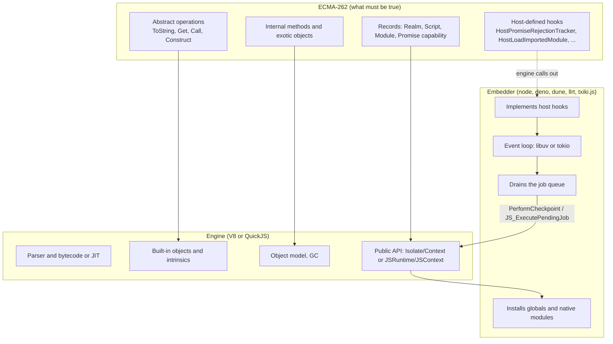

### 13.2 Run a program end to end

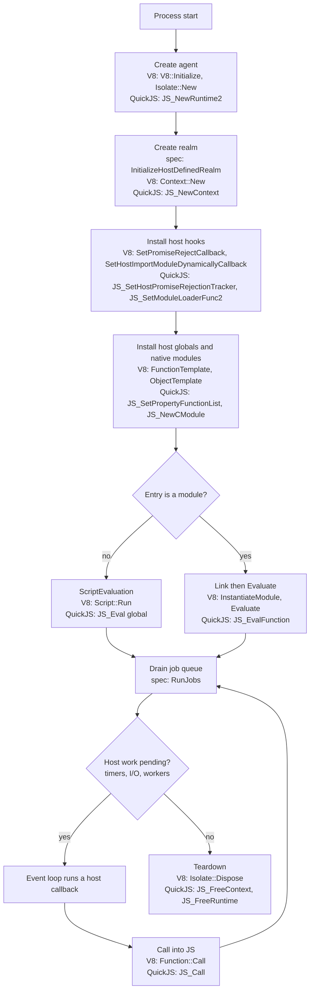

Loop details and exit rules for each runtime are in `js-runtime-event-loop.md`.

### 13.3 Creating a realm

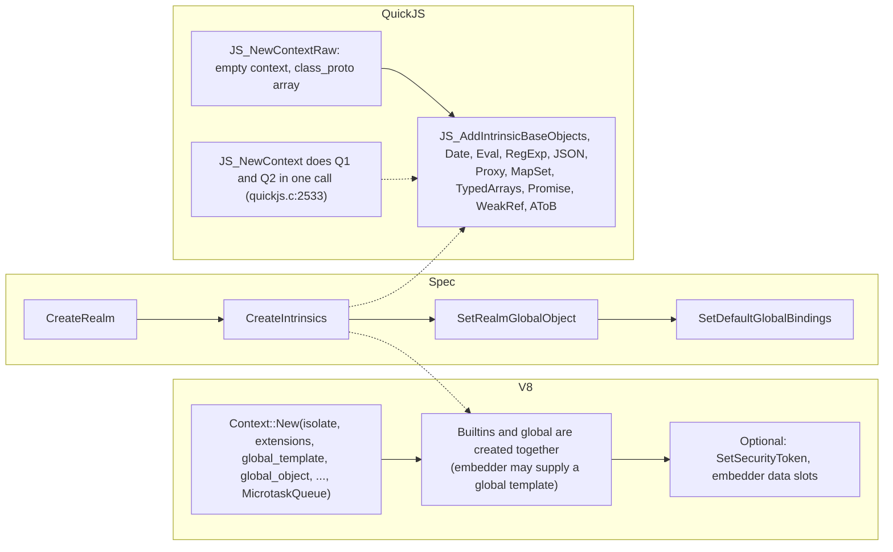

The QuickJS split lets a host choose its intrinsics, which is how a minimal realm (for example no `eval`, no RegExp compiler) is built.

### 13.4 A fallible call (completion record handling)

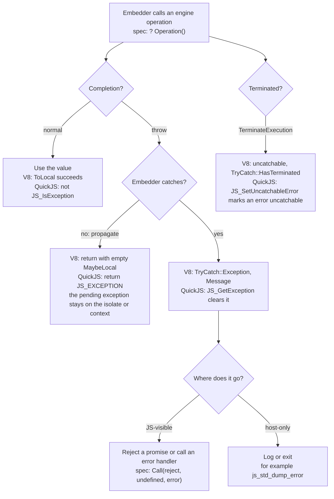

### 13.5 `[[Get]]` on QuickJS (OrdinaryGet as a loop)

This follows `JS_GetPropertyInternal` ([`quickjs.c:8703-8851`](https://github.com/quickjs-ng/quickjs/blob/bf8988fc401e737f9946cd10a3463b48aab0fd7e/quickjs.c#L8703-L8851)). The spec defines `OrdinaryGet` recursively: look at own property, else ask the prototype. QuickJS implements it as a loop over the prototype chain.

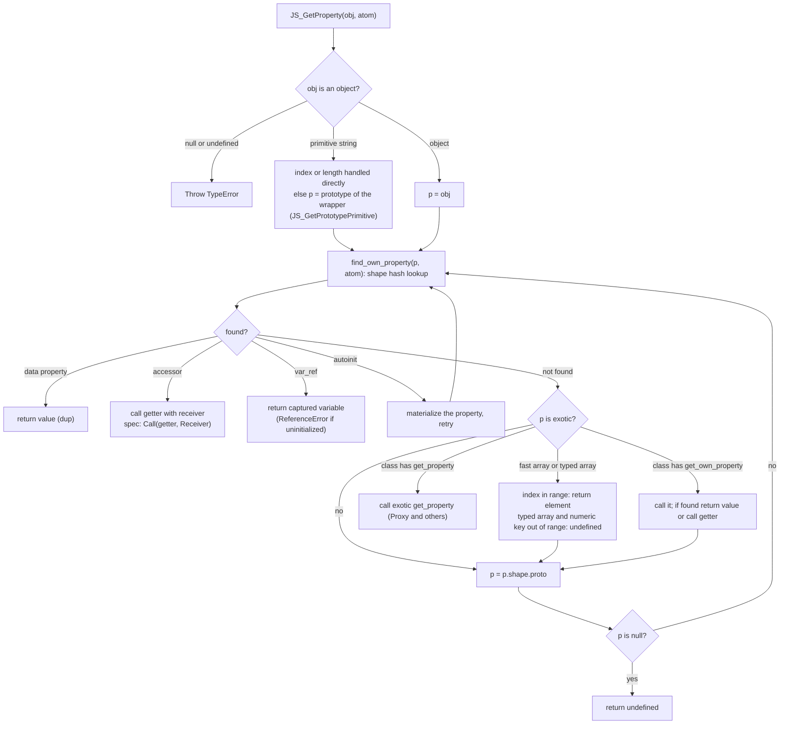

In V8 the same operation is a Map check plus a feedback-vector inline cache on hot paths, falling back to a slower lookup that walks the prototype chain and consults interceptors. That description rests on the object model in section 5, not on a read of V8's lookup code.

### 13.6 Evaluating a script

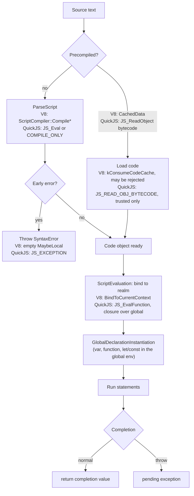

### 13.7 Static `import`: who drives loading (V8)

In V8 the embedder owns the module graph. V8 only asks it to resolve each request when linking.

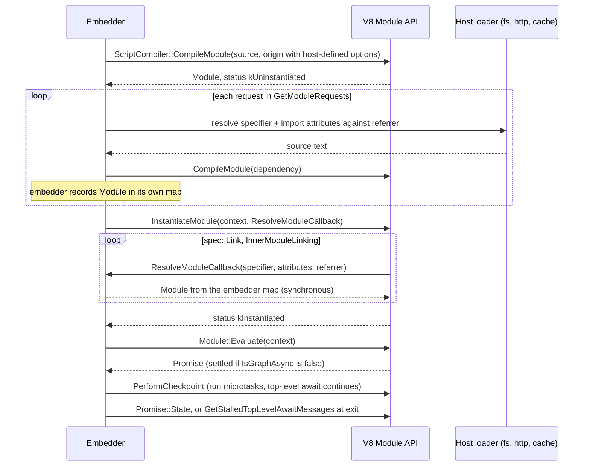

### 13.8 Static `import`: who drives loading (QuickJS)

In QuickJS the engine owns the graph and calls back into the host for names and bytes (`js_host_resolve_imported_module`, [`quickjs.c:30031`](https://github.com/quickjs-ng/quickjs/blob/bf8988fc401e737f9946cd10a3463b48aab0fd7e/quickjs.c#L30031)).

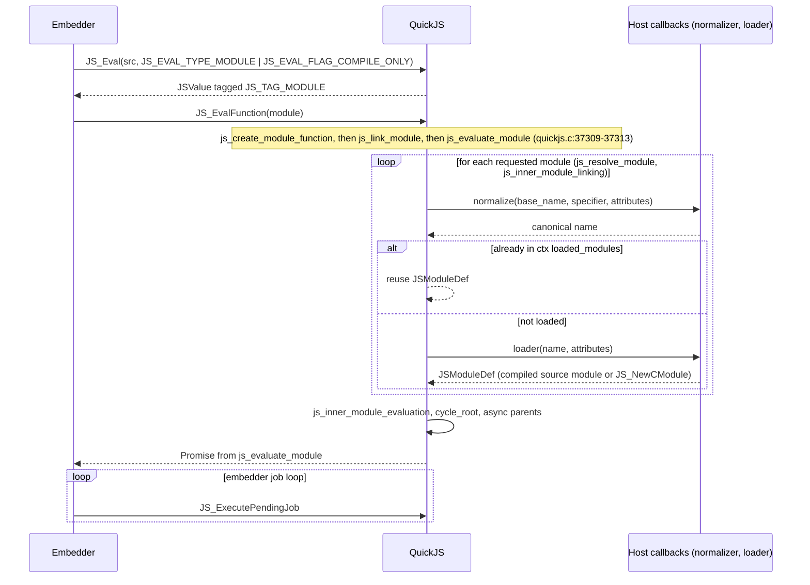

### 13.9 Module record states

The spec's Cyclic Module Record `[[Status]]` and the engine enumerators:

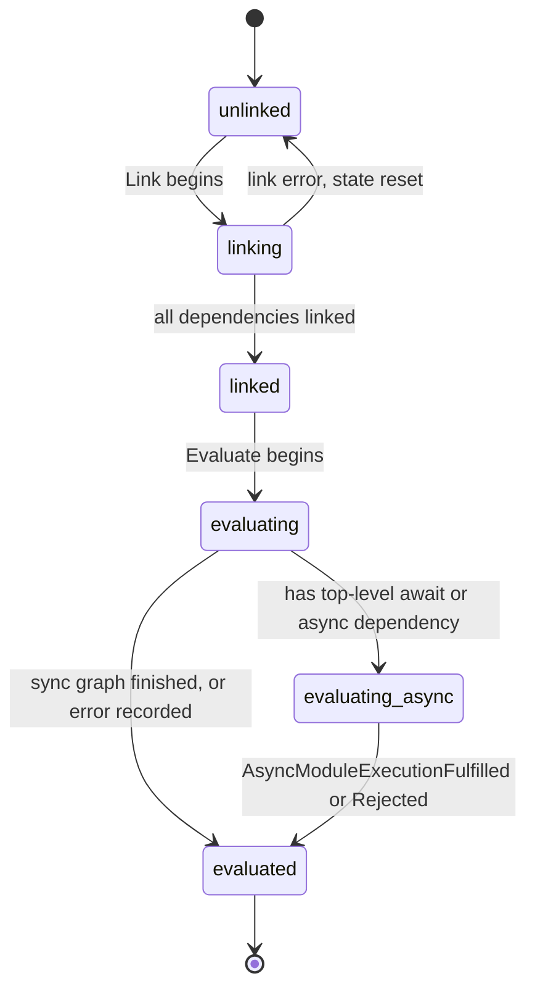

| Spec status | V8 `Module::Status` | QuickJS `JSModuleStatus` |
|---|---|---|
| unlinked | `kUninstantiated` | `JS_MODULE_STATUS_UNLINKED` |
| linking | `kInstantiating` | `JS_MODULE_STATUS_LINKING` |
| linked | `kInstantiated` | `JS_MODULE_STATUS_LINKED` |
| evaluating | `kEvaluating` | `JS_MODULE_STATUS_EVALUATING` |
| evaluating-async | none: use `IsGraphAsync` / `HasTopLevelAwait` | `JS_MODULE_STATUS_EVALUATING_ASYNC` |
| evaluated, no error | `kEvaluated` | `JS_MODULE_STATUS_EVALUATED` |
| evaluated, with `[[EvaluationError]]` | `kErrored` (`GetException`) | `JS_MODULE_STATUS_EVALUATED` with `eval_has_exception` |

V8's header says so directly: its states "correspond to the states used in ECMAScript except that evaluated is split into kEvaluated and kErrored" ([`v8-script.h:192-194`](https://github.com/nodejs/node/blob/bc2e01dcf6acd5cf7d169b5f26cf89abaaeb41f1/deps/v8/include/v8-script.h#L192-L194)).

### 13.10 Dynamic `import()`

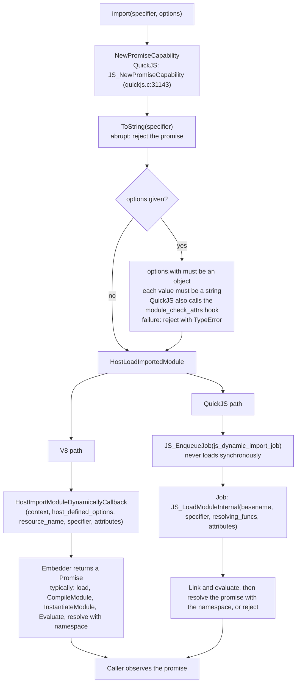

QuickJS defers the loading into a job because, per the comment at [`quickjs.c:31210`](https://github.com/quickjs-ng/quickjs/blob/bf8988fc401e737f9946cd10a3463b48aab0fd7e/quickjs.c#L31210), running `JS_LoadModuleInternal` synchronously "would cause an unexpected recursion in `js_evaluate_module()`".

### 13.11 Promise resolution and job creation

The resolve function's decision tree is `CreateResolvingFunctions` in the spec. Engine job entry points are shown where verified.

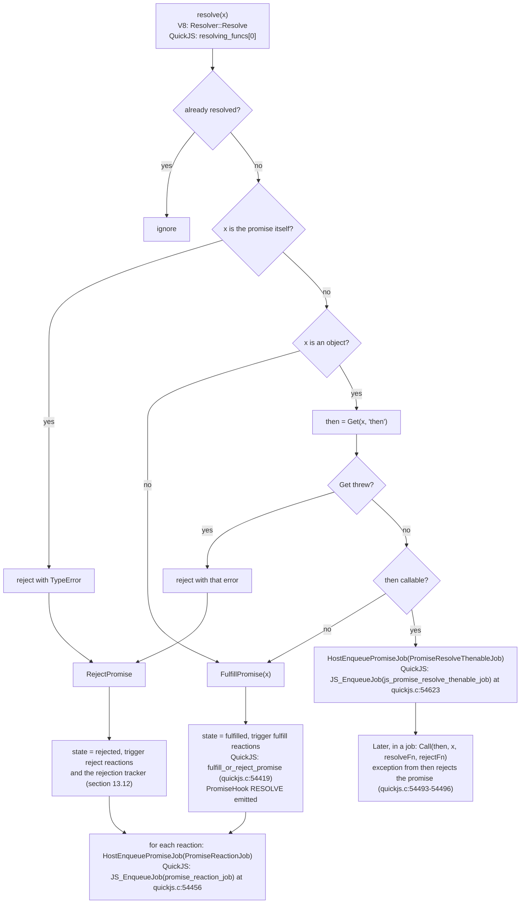

### 13.12 Rejection tracking

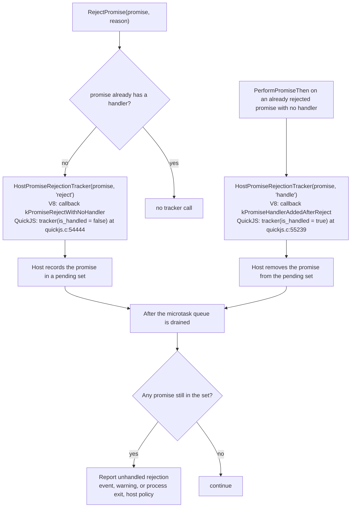

The "after the queue is drained" step is the host's choice, not the engine's. txiki.js, for instance, keeps `pending_rejections` and reports after the microtask batch ([`vm.c:322-376`](https://github.com/saghul/txiki.js/blob/1a230d31183f062fae7a6c4fd2cff466cecc1787/src/vm.c#L322-L376), as read by the research pass), while node and deno route through their own JS-level tick handling.

### 13.13 Draining the job queue (host side of `RunJobs`)

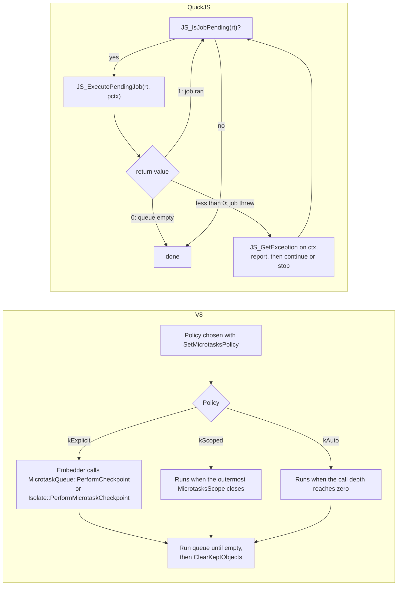

The return codes are documented at [`quickjs.c:2173-2174`](https://github.com/quickjs-ng/quickjs/blob/bf8988fc401e737f9946cd10a3463b48aab0fd7e/quickjs.c#L2173-L2174). node, deno and dune all set the V8 policy to explicit, so the embedder decides when jobs run (for example after each callback into JS) and can order them against its own queues; how each runtime does so is covered in `js-runtime-event-loop.md`.

### 13.14 Native function, from JS call to host code

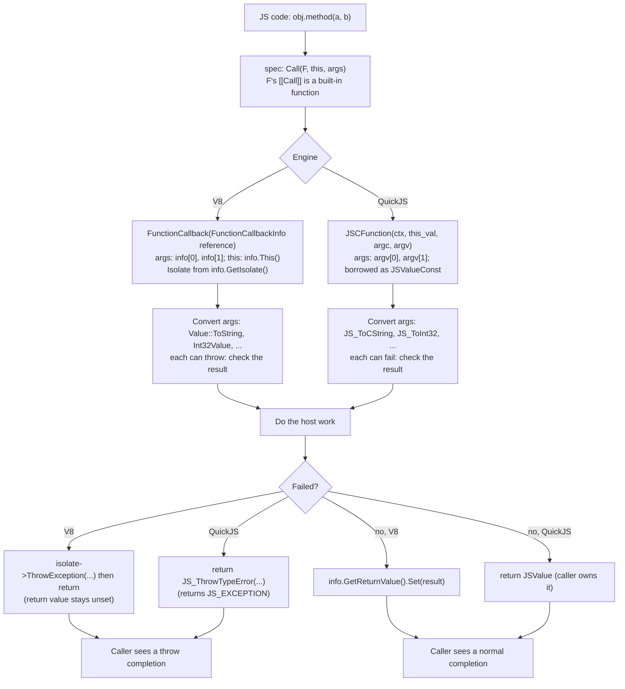

---

## 14. Evidence Index

Every location below is a GitHub permalink pinned to a commit SHA, so line numbers stay valid. The commit for each project is the one checked out in `~/github` (or recorded by Cargo for the `rquickjs` crate), not the latest upstream commit.

### 14.1 Pinned sources and how they were verified

| Project | Pinned commit | Where the commit came from |
|---|---|---|
| node (and its bundled V8 14.6) | [`nodejs/node@bc2e01d`](https://github.com/nodejs/node/commit/bc2e01dcf6acd5cf7d169b5f26cf89abaaeb41f1) | local `git rev-parse HEAD`, tag `v26.12.1` |
| QuickJS-ng (the `deps/quickjs` submodule of txiki.js; also the engine inside llrt's `rquickjs-sys`) | [`quickjs-ng/quickjs@bf8988f`](https://github.com/quickjs-ng/quickjs/commit/bf8988fc401e737f9946cd10a3463b48aab0fd7e) | submodule HEAD; `git describe` gives `v0.15.1-11-gbf8988f`, so 11 commits after the `v0.15.1` tag |
| txiki.js | [`saghul/txiki.js@1a230d3`](https://github.com/saghul/txiki.js/commit/1a230d31183f062fae7a6c4fd2cff466cecc1787) | local HEAD, tag `v26.6.0` |
| llrt | [`awslabs/llrt@0a10758`](https://github.com/awslabs/llrt/commit/0a10758f31eec3e5421a6b8ff1f459df1f4354c4) | local HEAD, tag `v0.9.0-beta` |
| deno | [`denoland/deno@fe7ed01`](https://github.com/denoland/deno/commit/fe7ed012d92c642fd8e5607ac5a45d517538b5c5) | local HEAD, tag `v2.9.8` |
| dune | [`aalykiot/dune@5958b64`](https://github.com/aalykiot/dune/commit/5958b6460d4a567a41e6194f637a86a45b265f95) | local HEAD, tag `v0.11.4` |
| `rquickjs-core` 0.12.2 | [`DelSkayn/rquickjs@635f932`](https://github.com/DelSkayn/rquickjs/commit/635f9322ccc875e3f9851e7f75ec538cf3274fd5), path `core/` | `sha1` recorded in the crate's `.cargo_vcs_info.json` under `~/.cargo/registry/src/` |
| `v8` crate 150.4.0 (used by deno) | [`denoland/rusty_v8@5c15a69`](https://github.com/denoland/rusty_v8/commit/5c15a6995c9bb4bacd3e341b59fff32c909c80bf) | `sha1` recorded in the crate's `.cargo_vcs_info.json` (marked `dirty`; cited files compared with GitHub and identical), also the commit the tag `v150.4.0` points to |

Verification done for each cited file:

1. The working tree of each repository is clean (`git status --porcelain` is empty), and the file's content hash equals the blob at that commit (`git hash-object` against `git rev-parse HEAD:path`).
2. The commit exists on GitHub (`gh api repos/<owner>/<repo>/commits/<sha>`).
3. GitHub's blob SHA for the file at that commit equals the local file's hash (`gh api repos/<owner>/<repo>/contents/<dir>?ref=<sha>`). For the `rquickjs-core` crate files this compares the file under `~/.cargo` with the file under `core/` at the recorded commit.

All 35 tracked files cited here passed. The one exception is node's `config.gypi`, which `./configure` generates and git does not track, so its row has no permalink.

The example commit `640ce854c52f4acae0c615aa04350707df23fe64` (nodejs/node, "deps: update zlib", 2026-10-27) was **not** used. It is not in the local clone, it has diverged from the local commit (2,882 commits ahead, 2,532 behind), and 18 of the 21 cited node files have different content there (V8 headers, `src/node.h`, `src/api/environment.cc` and others), so the line numbers in this document would not hold.

### 14.2 Sections 12 and 13

| Claim | Where |
|---|---|
| V8 `Module::Status` corresponds to the spec states, with evaluated split | [`deps/v8/include/v8-script.h:189-203`](https://github.com/nodejs/node/blob/bc2e01dcf6acd5cf7d169b5f26cf89abaaeb41f1/deps/v8/include/v8-script.h#L189-L203) |
| V8 `Evaluate` returns a Promise; `IsGraphAsync`; `HasTopLevelAwait` cites `#sec-cyclic-module-records` | [`deps/v8/include/v8-script.h:273-320`](https://github.com/nodejs/node/blob/bc2e01dcf6acd5cf7d169b5f26cf89abaaeb41f1/deps/v8/include/v8-script.h#L273-L320) |
| `InstantiateModule` takes the resolve callback per call | [`deps/v8/include/v8-script.h:238-271`](https://github.com/nodejs/node/blob/bc2e01dcf6acd5cf7d169b5f26cf89abaaeb41f1/deps/v8/include/v8-script.h#L238-L271) |
| `ClearKeptObjects` run automatically after microtasks | [`deps/v8/include/v8-isolate.h:760-771`](https://github.com/nodejs/node/blob/bc2e01dcf6acd5cf7d169b5f26cf89abaaeb41f1/deps/v8/include/v8-isolate.h#L760-L771); [`deps/v8/include/v8-isolate.h:1396`](https://github.com/nodejs/node/blob/bc2e01dcf6acd5cf7d169b5f26cf89abaaeb41f1/deps/v8/include/v8-isolate.h#L1396) |
| `PromiseRejectEvent` values | [`deps/v8/include/v8-promise.h:158-163`](https://github.com/nodejs/node/blob/bc2e01dcf6acd5cf7d169b5f26cf89abaaeb41f1/deps/v8/include/v8-promise.h#L158-L163) |
| `PropertyAttribute` is `ReadOnly`, `DontEnum`, `DontDelete` | [`deps/v8/include/v8-object.h:154-163`](https://github.com/nodejs/node/blob/bc2e01dcf6acd5cf7d169b5f26cf89abaaeb41f1/deps/v8/include/v8-object.h#L154-L163) |
| Code generation from strings hooks | [`deps/v8/include/v8-context.h:361-367`](https://github.com/nodejs/node/blob/bc2e01dcf6acd5cf7d169b5f26cf89abaaeb41f1/deps/v8/include/v8-context.h#L361-L367); [`deps/v8/include/v8-isolate.h:1712`](https://github.com/nodejs/node/blob/bc2e01dcf6acd5cf7d169b5f26cf89abaaeb41f1/deps/v8/include/v8-isolate.h#L1712) |
| `MarkAsUndetectable` | [`deps/v8/include/v8-template.h:923`](https://github.com/nodejs/node/blob/bc2e01dcf6acd5cf7d169b5f26cf89abaaeb41f1/deps/v8/include/v8-template.h#L923) |
| V8 flag groups in progress, staged, shipping | [`deps/v8/src/flags/flag-definitions.h:298-343`](https://github.com/nodejs/node/blob/bc2e01dcf6acd5cf7d169b5f26cf89abaaeb41f1/deps/v8/src/flags/flag-definitions.h#L298-L343) |
| QuickJS spec comment on module evaluation | [`quickjs.c:31453`](https://github.com/quickjs-ng/quickjs/blob/bf8988fc401e737f9946cd10a3463b48aab0fd7e/quickjs.c#L31453) |
| QuickJS "spec bug" comments | [`quickjs.c:31558`](https://github.com/quickjs-ng/quickjs/blob/bf8988fc401e737f9946cd10a3463b48aab0fd7e/quickjs.c#L31558); [`quickjs.c:31597`](https://github.com/quickjs-ng/quickjs/blob/bf8988fc401e737f9946cd10a3463b48aab0fd7e/quickjs.c#L31597) |
| `JS_EvalFunction` on a module: create function, link, evaluate | [`quickjs.c:37304-37313`](https://github.com/quickjs-ng/quickjs/blob/bf8988fc401e737f9946cd10a3463b48aab0fd7e/quickjs.c#L37304-L37313) |
| `JS_ExecutePendingJob` return codes | [`quickjs.c:2173-2174`](https://github.com/quickjs-ng/quickjs/blob/bf8988fc401e737f9946cd10a3463b48aab0fd7e/quickjs.c#L2173-L2174) |
| Rejection tracker calls (reject, handle) | [`quickjs.c:54444`](https://github.com/quickjs-ng/quickjs/blob/bf8988fc401e737f9946cd10a3463b48aab0fd7e/quickjs.c#L54444); [`quickjs.c:55239`](https://github.com/quickjs-ng/quickjs/blob/bf8988fc401e737f9946cd10a3463b48aab0fd7e/quickjs.c#L55239) |
| Job enqueue sites | [`quickjs.c:54456`](https://github.com/quickjs-ng/quickjs/blob/bf8988fc401e737f9946cd10a3463b48aab0fd7e/quickjs.c#L54456); [`quickjs.c:54623`](https://github.com/quickjs-ng/quickjs/blob/bf8988fc401e737f9946cd10a3463b48aab0fd7e/quickjs.c#L54623); [`quickjs.c:55249`](https://github.com/quickjs-ng/quickjs/blob/bf8988fc401e737f9946cd10a3463b48aab0fd7e/quickjs.c#L55249) |
| `js_dynamic_import`, deferred loading job | [`quickjs.c:31090-31215`](https://github.com/quickjs-ng/quickjs/blob/bf8988fc401e737f9946cd10a3463b48aab0fd7e/quickjs.c#L31090-L31215) |
| `js_host_resolve_imported_module` | [`quickjs.c:30031`](https://github.com/quickjs-ng/quickjs/blob/bf8988fc401e737f9946cd10a3463b48aab0fd7e/quickjs.c#L30031) |
| `JSModuleStatus` enumerators | [`quickjs.c:933-940`](https://github.com/quickjs-ng/quickjs/blob/bf8988fc401e737f9946cd10a3463b48aab0fd7e/quickjs.c#L933-L940) |
| `JS_GetPropertyInternal` loop | [`quickjs.c:8703-8851`](https://github.com/quickjs-ng/quickjs/blob/bf8988fc401e737f9946cd10a3463b48aab0fd7e/quickjs.c#L8703-L8851) |
| `js_weakref_deref` without kept-objects list | [`quickjs.c:61727-61734`](https://github.com/quickjs-ng/quickjs/blob/bf8988fc401e737f9946cd10a3463b48aab0fd7e/quickjs.c#L61727-L61734) |
| `JS_SetIsHTMLDDA` and `==` handling | [`quickjs.c:11813`](https://github.com/quickjs-ng/quickjs/blob/bf8988fc401e737f9946cd10a3463b48aab0fd7e/quickjs.c#L11813); [`quickjs.c:15775`](https://github.com/quickjs-ng/quickjs/blob/bf8988fc401e737f9946cd10a3463b48aab0fd7e/quickjs.c#L15775) |
| QuickJS skipped test262 features (`=skip` lines) | [`test262.conf`](https://github.com/quickjs-ng/quickjs/blob/bf8988fc401e737f9946cd10a3463b48aab0fd7e/test262.conf) |
| `$262` wiring | [`run-test262.c:526-947`](https://github.com/quickjs-ng/quickjs/blob/bf8988fc401e737f9946cd10a3463b48aab0fd7e/run-test262.c#L526-L947) |

### 14.3 Sections 1 to 11

| Claim | Where |
|---|---|
| V8 version 14.6.202.34 | [`deps/v8/include/v8-version.h:11-14`](https://github.com/nodejs/node/blob/bc2e01dcf6acd5cf7d169b5f26cf89abaaeb41f1/deps/v8/include/v8-version.h#L11-L14) |
| Node: pointer compression off, sandbox off, Maglev on | `config.gypi:558-571` (local file generated by `./configure`; not tracked in git, so no permalink) |
| `Isolate::New`, `CreateParams` | [`deps/v8/include/v8-isolate.h:734`](https://github.com/nodejs/node/blob/bc2e01dcf6acd5cf7d169b5f26cf89abaaeb41f1/deps/v8/include/v8-isolate.h#L734); [`deps/v8/include/v8-isolate.h:311-370`](https://github.com/nodejs/node/blob/bc2e01dcf6acd5cf7d169b5f26cf89abaaeb41f1/deps/v8/include/v8-isolate.h#L311-L370) |
| `MicrotasksPolicy` | [`deps/v8/include/v8-microtask.h:24`](https://github.com/nodejs/node/blob/bc2e01dcf6acd5cf7d169b5f26cf89abaaeb41f1/deps/v8/include/v8-microtask.h#L24) |
| Node default policy `kExplicit`, where it is applied | [`src/node.h:437`](https://github.com/nodejs/node/blob/bc2e01dcf6acd5cf7d169b5f26cf89abaaeb41f1/src/node.h#L437); [`src/api/environment.cc:257`](https://github.com/nodejs/node/blob/bc2e01dcf6acd5cf7d169b5f26cf89abaaeb41f1/src/api/environment.cc#L257) |
| `SnapshotCreator`; node use | [`deps/v8/include/v8-snapshot.h:135`](https://github.com/nodejs/node/blob/bc2e01dcf6acd5cf7d169b5f26cf89abaaeb41f1/deps/v8/include/v8-snapshot.h#L135); [`src/node_snapshotable.cc:1209`](https://github.com/nodejs/node/blob/bc2e01dcf6acd5cf7d169b5f26cf89abaaeb41f1/src/node_snapshotable.cc#L1209) |
| `CFunction` | [`deps/v8/include/v8-fast-api-calls.h:384`](https://github.com/nodejs/node/blob/bc2e01dcf6acd5cf7d169b5f26cf89abaaeb41f1/deps/v8/include/v8-fast-api-calls.h#L384) |
| Smi / heap-object tags | [`deps/v8/include/v8-internal.h:58-74`](https://github.com/nodejs/node/blob/bc2e01dcf6acd5cf7d169b5f26cf89abaaeb41f1/deps/v8/include/v8-internal.h#L58-L74) |
| `CodeKind` order | [`deps/v8/src/objects/code-kind.h:30-42`](https://github.com/nodejs/node/blob/bc2e01dcf6acd5cf7d169b5f26cf89abaaeb41f1/deps/v8/src/objects/code-kind.h#L30-L42) |
| `Map`, `DescriptorArray`, `JSObject` | [`deps/v8/src/objects/map.h:240`](https://github.com/nodejs/node/blob/bc2e01dcf6acd5cf7d169b5f26cf89abaaeb41f1/deps/v8/src/objects/map.h#L240); [`deps/v8/src/objects/descriptor-array.h:88`](https://github.com/nodejs/node/blob/bc2e01dcf6acd5cf7d169b5f26cf89abaaeb41f1/deps/v8/src/objects/descriptor-array.h#L88); [`deps/v8/src/objects/js-objects.h:371`](https://github.com/nodejs/node/blob/bc2e01dcf6acd5cf7d169b5f26cf89abaaeb41f1/deps/v8/src/objects/js-objects.h#L371) |
| String representations | [`deps/v8/src/objects/string.h`](https://github.com/nodejs/node/blob/bc2e01dcf6acd5cf7d169b5f26cf89abaaeb41f1/deps/v8/src/objects/string.h) |
| QuickJS version (0.15.1) | [`quickjs.h:1410-1412`](https://github.com/quickjs-ng/quickjs/blob/bf8988fc401e737f9946cd10a3463b48aab0fd7e/quickjs.h#L1410-L1412) |
| `JSValue` layouts and tags | [`quickjs.h:161-375`](https://github.com/quickjs-ng/quickjs/blob/bf8988fc401e737f9946cd10a3463b48aab0fd7e/quickjs.h#L161-L375) |
| Ownership rules | [`quickjs.h:188-204`](https://github.com/quickjs-ng/quickjs/blob/bf8988fc401e737f9946cd10a3463b48aab0fd7e/quickjs.h#L188-L204) |
| `JS_NewContext` intrinsics | [`quickjs.c:2533-2550`](https://github.com/quickjs-ng/quickjs/blob/bf8988fc401e737f9946cd10a3463b48aab0fd7e/quickjs.c#L2533-L2550) |
| `JSRuntime`, `JSContext` | [`quickjs.c:270`](https://github.com/quickjs-ng/quickjs/blob/bf8988fc401e737f9946cd10a3463b48aab0fd7e/quickjs.c#L270); [`quickjs.c:481`](https://github.com/quickjs-ng/quickjs/blob/bf8988fc401e737f9946cd10a3463b48aab0fd7e/quickjs.c#L481) |
| `JSObject`, `JSShape`, `JSString` | [`quickjs.c:1043`](https://github.com/quickjs-ng/quickjs/blob/bf8988fc401e737f9946cd10a3463b48aab0fd7e/quickjs.c#L1043); [`quickjs.c:1026`](https://github.com/quickjs-ng/quickjs/blob/bf8988fc401e737f9946cd10a3463b48aab0fd7e/quickjs.c#L1026); [`quickjs.c:618`](https://github.com/quickjs-ng/quickjs/blob/bf8988fc401e737f9946cd10a3463b48aab0fd7e/quickjs.c#L618) |
| `JSModuleDef` | [`quickjs.c:942`](https://github.com/quickjs-ng/quickjs/blob/bf8988fc401e737f9946cd10a3463b48aab0fd7e/quickjs.c#L942) |
| `JS_RunGC`, `js_trigger_gc` | [`quickjs.c:7079`](https://github.com/quickjs-ng/quickjs/blob/bf8988fc401e737f9946cd10a3463b48aab0fd7e/quickjs.c#L7079); [`quickjs.c:1583`](https://github.com/quickjs-ng/quickjs/blob/bf8988fc401e737f9946cd10a3463b48aab0fd7e/quickjs.c#L1583) |
| `JS_CallInternal` | [`quickjs.c:17580`](https://github.com/quickjs-ng/quickjs/blob/bf8988fc401e737f9946cd10a3463b48aab0fd7e/quickjs.c#L17580) |
| No inline caches: `rg` for `inline cache`, `JSInlineCache`, `get_field_ic` found no matches | [`quickjs.c`](https://github.com/quickjs-ng/quickjs/blob/bf8988fc401e737f9946cd10a3463b48aab0fd7e/quickjs.c); [`quickjs-opcode.h`](https://github.com/quickjs-ng/quickjs/blob/bf8988fc401e737f9946cd10a3463b48aab0fd7e/quickjs-opcode.h) |
| Opcodes: 252 `DEF(` lines, 19 `def(` lines | [`quickjs-opcode.h`](https://github.com/quickjs-ng/quickjs/blob/bf8988fc401e737f9946cd10a3463b48aab0fd7e/quickjs-opcode.h) |
| Unsafe bytecode warning | [`quickjs.h:1224`](https://github.com/quickjs-ng/quickjs/blob/bf8988fc401e737f9946cd10a3463b48aab0fd7e/quickjs.h#L1224) |
| txiki.js runtime setup | [`src/vm.c:415-465`](https://github.com/saghul/txiki.js/blob/1a230d31183f062fae7a6c4fd2cff466cecc1787/src/vm.c#L415-L465) |
| txiki.js `TJSRuntime` | [`src/private.h:70`](https://github.com/saghul/txiki.js/blob/1a230d31183f062fae7a6c4fd2cff466cecc1787/src/private.h#L70) |
| llrt VM construction | [`llrt_core/src/vm.rs:114-134`](https://github.com/awslabs/llrt/blob/0a10758f31eec3e5421a6b8ff1f459df1f4354c4/llrt_core/src/vm.rs#L114-L134) |
| `rquickjs` `Value`, `Ctx`, `Persistent` | [`core/src/value.rs:39`](https://github.com/DelSkayn/rquickjs/blob/635f9322ccc875e3f9851e7f75ec538cf3274fd5/core/src/value.rs#L39); [`core/src/context/ctx.rs:82`](https://github.com/DelSkayn/rquickjs/blob/635f9322ccc875e3f9851e7f75ec538cf3274fd5/core/src/context/ctx.rs#L82); [`core/src/persistent.rs:37`](https://github.com/DelSkayn/rquickjs/blob/635f9322ccc875e3f9851e7f75ec538cf3274fd5/core/src/persistent.rs#L37) |
| `deno_v8` feature facade | [`libs/deno_v8/Cargo.toml:15-21`](https://github.com/denoland/deno/blob/fe7ed012d92c642fd8e5607ac5a45d517538b5c5/libs/deno_v8/Cargo.toml#L15-L21) |
| deno `JsRuntime`, `poll_event_loop` | [`libs/core/runtime/jsruntime.rs:456`](https://github.com/denoland/deno/blob/fe7ed012d92c642fd8e5607ac5a45d517538b5c5/libs/core/runtime/jsruntime.rs#L456); [`libs/core/runtime/jsruntime.rs:2390`](https://github.com/denoland/deno/blob/fe7ed012d92c642fd8e5607ac5a45d517538b5c5/libs/core/runtime/jsruntime.rs#L2390) |
| dune runtime init | [`src/runtime.rs:114-160`](https://github.com/aalykiot/dune/blob/5958b6460d4a567a41e6194f637a86a45b265f95/src/runtime.rs#L114-L160) |
| node `BaseObject`, `NewIsolate` | [`src/base_object.h:46`](https://github.com/nodejs/node/blob/bc2e01dcf6acd5cf7d169b5f26cf89abaaeb41f1/src/base_object.h#L46); [`src/api/environment.cc:347-376`](https://github.com/nodejs/node/blob/bc2e01dcf6acd5cf7d169b5f26cf89abaaeb41f1/src/api/environment.cc#L347-L376) |

Unverified or inferred items (see section 1). The size, speed, startup and memory rows in sections 2 and 10.2 are qualitative statements from general knowledge, not measurements from this source tree. Also: V8 double boxing as `HeapNumber`, the "Orinoco" label, `HandleScopeData` field names, and anything about V8 algorithm behavior that rests on file layout and not on `.cc` bodies. The `v8` crate versions (150.x) do not match node's V8 14.6, so section 8.1 describes the Rust API only and says nothing about V8 headers in deno or dune.

Sections 1 to 13 cite locations as links to the same pinned commits. The labels inside the Mermaid diagrams in section 13 are plain `file:line` text, because Mermaid on GitHub does not render links in node labels; the prose around each diagram carries the links. The `v8` crate files cited in section 8.1 are pinned to [`denoland/rusty_v8@5c15a69`](https://github.com/denoland/rusty_v8/commit/5c15a6995c9bb4bacd3e341b59fff32c909c80bf), the commit recorded in that crate's `.cargo_vcs_info.json`. The crate was published from a modified tree (`dirty: true`), so each cited file was compared with GitHub and matches.

