# Promise Scheduling and Process Exit in JS Runtimes: A Source Code Analysis

Analysis model: GPT 6 Astra. Date: 2026-10-23 (source snapshots and sample outputs re-verified against the release tags on 2026-10-26).

Subjects of analysis: Node.js, Deno, LLRT, txiki.js, and Dune in this directory, plus the local dependency sources pinned by Cargo.lock.

## Table of Contents

<!-- toc -->
- [1. Key Conclusions](#1-key-conclusions)
- [2. Scope of Analysis and Verifiability](#2-scope-of-analysis-and-verifiability)
  - [2.1 Source Snapshots](#21-source-snapshots)
  - [2.2 Source Analysis and Experiments](#22-source-analysis-and-experiments)
- [3. Terminology and the Complete Execution Chain](#3-terminology-and-the-complete-execution-chain)
  - [3.1 Which English Terms Are Used](#31-which-english-terms-are-used)
  - [3.2 The Typical Path of `await readFile()`](#32-the-typical-path-of-await-readfile)
  - [3.3 `resolve()` Does Not Mean "Never Runs User Code"](#33-resolve-does-not-mean-never-runs-user-code)
- [4. libuv and Tokio: Programming Model and Underlying Mechanisms](#4-libuv-and-tokio-programming-model-and-underlying-mechanisms)
  - [4.1 First, Separate the Layers Where the Mechanisms Live](#41-first-separate-the-layers-where-the-mechanisms-live)
  - [4.2 Reactor and Proactor: The Difference Between Readiness and Completion](#42-reactor-and-proactor-the-difference-between-readiness-and-completion)
  - [4.3 libuv: Explicit Event Loop + Callback-Based Continuation](#43-libuv-explicit-event-loop--callback-based-continuation)
  - [4.4 Rust `Future` / `async` / `await`: Suspendable State Machines](#44-rust-future--async--await-suspendable-state-machines)
  - [4.5 Tokio: executor + I/O driver + timer driver + blocking pool](#45-tokio-executor--io-driver--timer-driver--blocking-pool)
  - [4.6 Platform Backends and Public APIs Can Use Different Models](#46-platform-backends-and-public-apis-can-use-different-models)
  - [4.7 Direct Impact on JS Runtimes](#47-direct-impact-on-js-runtimes)
  - [4.8 Waking, Completing, Canceling, and Keep-Alive Are Different Operations](#48-waking-completing-canceling-and-keep-alive-are-different-operations)
  - [4.9 The Keep-Alive Handoff from Native Operation to JS Job](#49-the-keep-alive-handoff-from-native-operation-to-js-job)
- [5. Architecture of the Five JS Runtimes](#5-architecture-of-the-five-js-runtimes)
  - [5.1 Node.js: native request + resolver + callback-scope checkpoint](#51-nodejs-native-request--resolver--callback-scope-checkpoint)
  - [5.2 txiki.js: the QuickJS job queue explicitly wired into libuv](#52-txikijs-the-quickjs-job-queue-explicitly-wired-into-libuv)
  - [5.3 Dune: crabuv resources + JS completion queue](#53-dune-crabuv-resources--js-completion-queue)
  - [5.4 Deno: PromiseId correlation + async-op driver + host liveness state](#54-deno-promiseid-correlation--async-op-driver--host-liveness-state)
  - [5.5 LLRT: rquickjs-owned futures and QuickJS jobs driven cooperatively](#55-llrt-rquickjs-owned-futures-and-quickjs-jobs-driven-cooperatively)
- [6. End-to-End Implementation Comparison of Four Scenarios](#6-end-to-end-implementation-comparison-of-four-scenarios)
  - [6.1 `fs.readFile`: From File Operation to JS Continuation](#61-fsreadfile-from-file-operation-to-js-continuation)
  - [6.2 Enqueue, Execution, and Keep-Alive of `queueMicrotask()`](#62-enqueue-execution-and-keep-alive-of-queuemicrotask)
  - [6.3 `nextTick`: Different Queue Policies Under the Same Name](#63-nexttick-different-queue-policies-under-the-same-name)
  - [6.4 Dynamic import: Loading, Evaluation, and Exit Are Three Separate Problems](#64-dynamic-import-loading-evaluation-and-exit-are-three-separate-problems)
- [7. Behavioral Experiments](#7-behavioral-experiments)
  - [7.1 Summary of Results](#71-summary-of-results)
  - [7.2 Key Reproduction Code](#72-key-reproduction-code)
- [8. A Unified View of Exit Determination](#8-a-unified-view-of-exit-determination)
  - [8.1 Host States and What the Host Should Do](#81-host-states-and-what-the-host-should-do)
  - [8.2 Per-Project Policies](#82-per-project-policies)
- [9. Implications for Implementing a New Runtime](#9-implications-for-implementing-a-new-runtime)
<!-- /toc -->

## 1. Key Conclusions

**libuv / Tokio mainly determine how native asynchronous operations advance, complete, and wake the host; neither directly implements JavaScript Promises / `await`.**

Four states need to be distinguished:

```text
pending Promise object
    ≠ runnable Promise job
    ≠ pending Rust Future
    ≠ work that keeps the JS runtime alive
```

- **Promise state / reactions** are managed by V8 or QuickJS. A Promise that has not settled can have only pending reactions and no runnable job at all.
- **Engine job queue / microtask queue** holds work that is already ready to run, and the host chooses when to drive it.
- **In-flight native operations** are tracked by libuv handles / requests, or by Rust futures and their scheduler.
- **Runtime liveness policy** decides which work must complete before JS execution may end. It is not "how many pending Promises are left in the heap".

Therefore:

1. `new Promise(() => {})`, or even an ordinary async function that keeps `await`ing it, usually cannot keep the process alive on its own.
2. `readFile(...).then(...)` can still keep the process alive through the native request / future, even if the user never `await`s it.
3. `unref()` changes the keep-alive policy; it does not cancel the operation and does not make the Promise settle.
4. An unsettled **top-level await (TLA)** is an additional module-lifecycle problem, and each runtime handles it differently.
5. **Deno and LLRT both use Tokio, and Node and txiki.js both use libuv, yet their checkpoint policies are not identical.** These differences cannot all be attributed to the underlying event loop.
6. `import()` returns a Promise, which does not mean source loading is necessarily asynchronous; **module loading, module evaluation, and host keep-alive** must also be distinguished. In the current snapshots, the Node main thread, txiki.js, and LLRT all have paths that load local modules synchronously.

## 2. Scope of Analysis and Verifiability

### 2.1 Source Snapshots

| Project | Checked-out tag and commit | JS engine | Async infrastructure for main JS execution |
|---|---|---|---|
| Node.js | `v26.12.1`, [`bc2e01dcf6acd5cf7d169b5f26cf89abaaeb41f1`](https://github.com/nodejs/node/commit/bc2e01dcf6acd5cf7d169b5f26cf89abaaeb41f1) | V8 | libuv + Node host queues |
| Deno | `v2.9.8`, [`fe7ed012d92c642fd8e5607ac5a45d517538b5c5`](https://github.com/denoland/deno/commit/fe7ed012d92c642fd8e5607ac5a45d517538b5c5) | V8 | Tokio + deno_core op driver + uv compatibility layer |
| LLRT | `v0.9.0-beta`, [`0a10758f31eec3e5421a6b8ff1f459df1f4354c4`](https://github.com/awslabs/llrt/commit/0a10758f31eec3e5421a6b8ff1f459df1f4354c4) | QuickJS-ng, bound via rquickjs | Tokio + rquickjs private future scheduler |
| txiki.js | `v26.6.0`, [`1a230d31183f062fae7a6c4fd2cff466cecc1787`](https://github.com/saghul/txiki.js/commit/1a230d31183f062fae7a6c4fd2cff466cecc1787) | QuickJS-ng | libuv |
| Dune | `v0.11.4`, [`5958b6460d4a567a41e6194f637a86a45b265f95`](https://github.com/aalykiot/dune/commit/5958b6460d4a567a41e6194f637a86a45b265f95) | V8 | crabuv: Mio + Rayon + completion callbacks |

When the sources were checked, each of the five working copies was checked out (detached HEAD) at the release tag listed in the table above and had no uncommitted changes in its top-level repository.

**Deno's local `origin` is `https://github.com/denoland/deno`, and HEAD is the detached tag `v2.9.8`.** This snapshot contains the `uv_compat` and Node compatibility implementations, and this document analyzes their behavior based on the source snapshot above.

Rust dependencies follow Cargo.lock:

| Project | Dependencies checked this time |
|---|---|
| Deno | Tokio `1.47.1`, Mio `1.0.3`, deno_unsync `0.4.4`; deno_core is pinned to the same commit as the Deno repository |
| LLRT | rquickjs / rquickjs-core / rquickjs-sys `0.12.2`, Tokio `1.53.1`, Mio `1.2.0` |
| Dune | crabuv `2fda099a374bccf6d928bd59aa576be944ed2b39`; Tokio `1.53.1` is used for auxiliary code such as the inspector; crabuv itself uses Mio `1.2.2` |

**Source references are GitHub permalinks pinned to the full 40-character commit SHA, with a `#Lstart-Lend` line range appended (`#Lline` for a single line).** Non-contiguous line ranges are split into separate links.

The commits of the dependency sources have also been located individually:

| Dependency source | Pinned GitHub commit | Basis for locating |
|---|---|---|
| rquickjs-core `0.12.2` | [DelSkayn/rquickjs@`635f9322ccc875e3f9851e7f75ec538cf3274fd5`](https://github.com/DelSkayn/rquickjs/commit/635f9322ccc875e3f9851e7f75ec538cf3274fd5) | The crate's `.cargo_vcs_info.json`; the relative directory in the repository is `core/` |
| QuickJS embedded in rquickjs-sys | [quickjs-ng/quickjs@`fd0a0210b7be00957751871e7e01b8291268fc29`](https://github.com/quickjs-ng/quickjs/commit/fd0a0210b7be00957751871e7e01b8291268fc29) | The `sys/quickjs` submodule gitlink of the rquickjs commit above |
| QuickJS pinned by txiki.js | [quickjs-ng/quickjs@`bf8988fc401e737f9946cd10a3463b48aab0fd7e`](https://github.com/quickjs-ng/quickjs/commit/bf8988fc401e737f9946cd10a3463b48aab0fd7e) | The `deps/quickjs` gitlink at the txiki.js tag commit; the submodule is checked out locally at `deps/quickjs` |
| deno_unsync `0.4.4` | [denoland/deno_unsync@`eefd38ef5a1d51f97666f2ced1476a7244ba90c7`](https://github.com/denoland/deno_unsync/commit/eefd38ef5a1d51f97666f2ced1476a7244ba90c7) | The crate's `.cargo_vcs_info.json` |
| Tokio `1.53.1` source referenced in this document | [tokio-rs/tokio@`75fef53d0a8590c2d1dbb63672aa7b7d1ef51155`](https://github.com/tokio-rs/tokio/commit/75fef53d0a8590c2d1dbb63672aa7b7d1ef51155) | The crate's `.cargo_vcs_info.json`; the relative directory in the repository is `tokio/` |
| Mio `1.2.0` source referenced in this document (LLRT's version) | [tokio-rs/mio@`ce39a6be2cc739165daaeb10cce609b9b77242ac`](https://github.com/tokio-rs/mio/commit/ce39a6be2cc739165daaeb10cce609b9b77242ac) | LLRT's Cargo.lock and the crate's `.cargo_vcs_info.json` |
| crabuv | [aalykiot/crabuv@`2fda099a374bccf6d928bd59aa576be944ed2b39`](https://github.com/aalykiot/crabuv/commit/2fda099a374bccf6d928bd59aa576be944ed2b39) | Dune's Cargo.lock matches the HEAD of the local git checkout |

To verify the links, first check `git status --short` and `git rev-parse HEAD`, then compare the file contents or Git blob hash at the corresponding GitHub commit. The locally available referenced sources match the contents of the corresponding versions; txiki.js's QuickJS source was read from its checked-out `deps/quickjs` submodule, which is at the commit pinned by the gitlink above. The line ranges cited were also verified against their respective versions, and line numbers from the two QuickJS snapshots are not mixed. Tokio and Mio statements are cited from the LLRT-locked versions (Tokio `1.53.1`, Mio `1.2.0`); Deno builds with Tokio `1.47.1` / Mio `1.0.3` and Dune with Mio `1.2.2`. For the APIs cited here the text is the same in those versions, but line numbers can differ; version-specific claims name the version in the prose.

### 2.2 Source Analysis and Experiments

The behavioral evidence in this document comes from "binary × sample" runs, each in its own process: baseline experiments, a four-scenario extension, and two samples for queue handling after a LLRT job execution error. The extended experiments include recursive enqueueing of `queueMicrotask()`, that API's arguments / return value / exceptions, a mixed nextTick queue, dynamic import of a timer-based TLA, and dynamic import of a no-progress TLA, each run on the 4 binaries of the result tables (Node*, Deno, LLRT, Dune). The experiments use existing binaries with these versions:

- Deno: `target/debug/deno` in this directory, `2.9.8`.
- Dune: `target/debug/dune` in this directory, `0.11.4`.
- LLRT: `target/aarch64-apple-darwin/release/llrt` in this directory, `0.9.0-beta`.
- Node (`Node*` in the result tables): the Homebrew-packaged `v26.12.1` (`/opt/homebrew/bin/node`), the same release and the same V8 (`14.6.202.34`) as the checked-out Node tag, but **not a build of the tag's source tree**: it links the system libuv `1.53.0` instead of the bundled libuv `1.52.1` of the tag.
- txiki.js: `build/tjs` (`v26.6.0`, built from the tag) was used only for spot re-runs (for example the section 3.3 sample and the section 6.4.6 cases); it is not part of the result tables, whose rows come from Node*, Deno, LLRT and Dune. The txiki.js analysis is source-based: the local dependency submodule `deps/quickjs` is checked out at the commit pinned by the gitlink, so this document analyzes the host source and that QuickJS source.

The experiments verify semantics and exit behavior, and are not used to compare performance. The infinite-microtask experiment was terminated by the external test process after 2 seconds.

The tag binaries of LLRT (`v0.9.0-beta`), Deno (`2.9.8`), Dune (`0.11.4`) and txiki.js (`v26.6.0`, `build/tjs`) were re-run on the sample programs of sections 3.3, 6 and 7, and the recorded outputs and exit codes matched (for the section 7.1 table, spot checks of the pending-TLA, bare-rejection and unref-timer rows; the txiki.js runs are not part of the result tables, and its analysis here stays source-based). The Node results were re-measured with the Homebrew `v26.12.1` binary above on the samples of sections 3.3, 6.2, 6.2.6, 6.3, 6.4.6, 7.1 and 7.2, each in its own process under a 10-second external timeout; every recorded Node* output and exit code was reproduced. The two LLRT samples confirmed the difference in LLRT's error branch described in section 6.2.6.

## 3. Terminology and the Complete Execution Chain

### 3.1 Which English Terms Are Used

| Term | Meaning | Caveats |
|---|---|---|
| **Promise state / reaction records** | A Promise's pending / fulfilled / rejected state and its registered reactions | A reaction attached to a pending Promise is not yet a runnable job |
| **Engine job queue / microtask queue** | Already-runnable Promise reactions, thenable assimilation, `queueMicrotask`, and similar jobs | Does not include all pending Promises |
| **In-flight operation registry** | Native operations whose completion result has not yet been delivered to JS | May include operations whose I/O has completed but whose result has not yet been delivered |
| **Completion dispatch** | Sending a native completion to an execution context that has access to the JS engine | Can be a callback, a completion queue, or a polled future |
| **Promise resolution / rejection** | Calling the resolver / reject function to feed the result into the JS Promise machinery | Resolution does not guarantee the Promise becomes fulfilled immediately |
| **Microtask checkpoint** | The boundary at which the host drives the engine to run microtasks | In QuickJS usually implemented by looping over pending jobs |
| **Host task queues** | Extra host queues such as `nextTick`, immediate, and native completion | Should not all be called microtasks |
| **Liveness predicate** | The criterion for whether the host still needs to keep driving the JS runtime | Kept separate from GC reachability and from whether an operation is ready |

**Completion dispatch + Promise resolution/rejection** together deliver a native result to a JS Promise; this describes an execution path, not a separate pending-operation registry.

### 3.2 The Typical Path of `await readFile()`

The sequence diagram below shows the logical handoff when waiting for native I/O is required; the fast path for immediate completion can skip the waiting phase. The participants in the diagram represent logical components and need not each occupy a thread. The order of Promise creation, native work registration, and the first poll is determined by the binding; there is no "create the Promise first, then start the I/O" order that every runtime must follow, and registering a future does not mean its underlying I/O has started.

```mermaid
sequenceDiagram
    participant J as JS async function
    participant H as Host runtime
    participant E as JS engine
    participant N as Native I/O machinery
    J->>H: readFile()
    Note over H,N: The binding associates the Promise with native work<br/>The exact order of creation, registration, and first poll varies by implementation
    H-->>J: Return Promise
    J->>E: await: register reaction, suspend continuation
    Note over J,E: Promise pending; the continuation is not yet a runnable job
    Note over H,N: Request awaits completion; or the driver polls the Future<br/>After the Future returns Pending, it waits to be woken
    N-->>H: callback is dispatched / native future is polled to Ready
    H->>E: resolve / reject Promise
    E->>E: enqueue Promise reaction job
    H->>E: Run microtask checkpoint
    E-->>J: Run await continuation
```

A JS `async function` is not a Rust future created automatically by Tokio; a JS Promise is not a `tokio::task::JoinHandle`. The adaptation happens at the native API boundary.

Direct evidence in V8: in [`node/deps/v8/src/builtins/promise-abstract-operations.tq:452–488`][code-001], `PerformPromiseThenImpl` only stores a `PromiseReaction` when the Promise is pending; it creates and enqueues a reaction job only when the Promise is already fulfilled / rejected.

Direct evidence in QuickJS: in [`quickjs/quickjs.c:2138–2202`][code-002], `JS_IsJobPending()` only checks `rt->job_list`, and `JS_ExecutePendingJob()` dequeues and runs one job; neither traverses all Promise objects.

All three V8-based runtimes here are configured with the **Explicit microtask policy**, so the host schedules the checkpoint: Node through the default `IsolateSettings::policy` at [`node/src/node.h:437`][code-003] (installed by `isolate->SetMicrotasksPolicy(s.policy)` in `node/src/api/environment.cc:257`), Deno at [`deno/libs/core/runtime/setup.rs:284`][code-004], and Dune at [`dune/src/runtime.rs:148`][code-005]. This describes the configuration of these hosts, not that every V8 embedding can only adopt this policy.

### 3.3 `resolve()` Does Not Mean "Never Runs User Code"

Normally a `.then` callback / `await` continuation runs later in a job, but `resolve(thenable)` reads `thenable.then`; if that property is a getter, it can **run user JS synchronously**.

```js
let resolve;
const p = new Promise(r => resolve = r);
p.then(v => console.log('reaction', v));

console.log('before-resolve');
resolve({
  get then() {
    console.log('getter');
    return r => { console.log('then-call'); r(42); };
  }
});
console.log('after-resolve');
```

The output of all five binaries (Node*, Deno, LLRT, txiki.js, Dune) is the same (Dune prints the number `42` with ANSI colour):

```text
before-resolve
getter
after-resolve
then-call
reaction 42
```

Sources: V8 [`node/deps/v8/src/builtins/promise-resolve.tq:160–186`][code-006]; QuickJS [`quickjs/quickjs.c:54502–54555`][code-007].

So the accurate statement is: **Promise reactions run through jobs; the resolution path itself must still account for synchronous re-entrancy.** If it resolves to another pending Promise, the outer Promise may also remain pending.

## 4. libuv and Tokio: Programming Model and Underlying Mechanisms

### 4.1 First, Separate the Layers Where the Mechanisms Live

To understand these two models, work through four questions: "who waits, who schedules, who stores the continuation, who executes JS".

| Layer / concept | Responsibility | Typical entities |
|---|---|---|
| **OS I/O notification** | Notifies that a resource is ready, or that an I/O operation has completed | epoll, kqueue, IOCP, io_uring |
| **Reactor / Proactor** | Turns OS notifications into events the program can handle | readiness dispatcher / completion dispatcher |
| **Event loop** | Repeatedly processes runnable work, advances timers, waits for and dispatches external events | `uv_run()`; cooperation between the Tokio scheduler and its drivers |
| **Executor / scheduler** | Chooses which task runs and calls its future's `poll()` | Tokio task scheduler, rquickjs scheduler |
| **Callback / Future** | Expresses the follow-up logic of an async operation and stores state across waiting stages | function pointer + context; compiler-generated state machine |
| **JS host integration** | Hands the native result to a Promise and drives engine jobs | resolver, completion dispatch, microtask checkpoint |

**The event loop is a coordination procedure, Reactor / Proactor are I/O event-handling patterns, and callback / Future are ways of expressing control flow.** They do not sit at the same level of abstraction, and they are not mutually exclusive options.

Running asynchronously means that when an operation cannot make progress for the moment, the scheduling thread can go work on something else. It does not require a separate thread for every operation, nor does it guarantee that all computation is automatically parallelized. An event loop may block in the OS poller when there is no runnable work; this is a different situation from performing long-running blocking I/O inside a callback: the former waits for an event that can wake the whole loop, while the latter occupies the current execution thread.

When reading an implementation, map the core terms onto concrete questions:

- **Callback / continuation**: after the operation advances to some step, which piece of code runs next? Where is the local state across waiting stages stored?
- **Event loop / executor**: who chooses the next piece of code to execute? When there is no executable work, who goes into waiting?
- **Reactor / Proactor**: does the external event tell us "you may try the operation now", or "a given operation already has a result"?
- **Liveness policy**: even if there is nothing to do right now, is there still work that must be waited for?

libuv exposes the loop and the callback API explicitly to the caller; Tokio usually lets the application write futures, with the scheduler and drivers cooperating to drive them. **Tokio did not eliminate the event loop's responsibilities; it organized scheduling, waiting, and waking inside the executor/driver implementation.** Both architectures need the JS engine to be wired in separately.

### 4.2 Reactor and Proactor: The Difference Between Readiness and Completion

#### Reactor: Notifies "You May Try I/O"

The typical path is: register read/write interest for a socket → wait for readiness → run the handler → the handler or I/O library performs a non-blocking `read` / `write`.

- Readable does not guarantee that a complete application-level message can be read in one go; it may also mean EOF or an error.
- The notification may be stale or a spurious readiness; the actual syscall may still return `EAGAIN` / `WouldBlock`.
- Therefore the state machine must advance based on the **actual syscall result**, and correctly retain or re-arm the next readiness wait.

#### Proactor: Notifies "The Submitted I/O Operation Has Completed"

The typical path is: submit an async request carrying a buffer / operation context → the OS or async I/O backend executes the request → a completion is received → the completion handler consumes the result.

- The notification corresponds to a specific operation, usually carrying the number of bytes completed or an error status.
- A completion may still be a short read / short write; the completion of one I/O request does not mean the whole protocol message has been processed.
- The submitted buffer and operation context must satisfy the lifetime required by the backend; they cannot be released merely because the submit function returned.

The following shows the general path that requires waiting; both patterns may also have an immediate-success fast path.

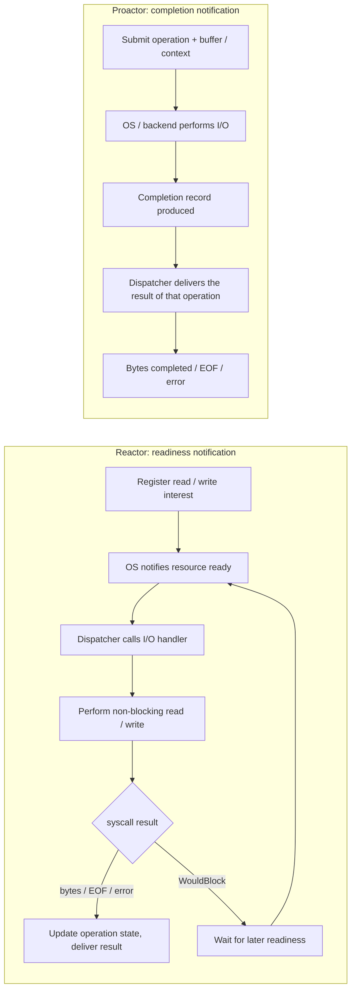

**A callback can handle readiness as well as completion; a Future can also wrap either.** Equating callbacks with Proactor, or Futures with Reactor, misses the adaptation layers in real implementations.

For the precise readiness contract, see [Mio's notes on spurious events, draining readiness, and EOF/error][model-002].

The following table helps check which layer you are observing:

| Question | Reactor / readiness | Proactor / completion |
|---|---|---|
| What is registered in advance? | The resource and its read/write interest | A specific operation and its buffer / context |
| What does a notification mean? | I/O may be attempted; the syscall result still needs to be checked | The operation has completed; the result can be consumed |
| Who actually moves the data? | After the notification, the handler / I/O library issues non-blocking I/O | After submission, the async backend advances the operation |
| Why is a state machine still needed? | `WouldBlock` is possible, and only part of the data may be read or written | A completion may also be a partial success, EOF, or an error |
| Can it be wrapped as a callback or Future? | Both | Both |

For example, on Unix libuv can internally receive readiness, then perform the `read`, and only then hand the **data that was read** to the upper-layer callback. Therefore, the fact that an upper-layer callback receives an operation result does not imply that the underlying layer must be a Proactor. Similarly, a future returning `Ready(bytes)` does not imply whether those bytes came from a readiness syscall, a kernel async request, or a blocking pool.

### 4.3 libuv: Explicit Event Loop + Callback-Based Continuation

#### Handles, Requests, and Callback Context

libuv gives the caller a loop plus two main abstractions, handles and requests:

| Abstraction | Typical use | State kept across async stages |
|---|---|---|
| `uv_loop_t` | Drives a loop's I/O, timers, pending/close callbacks | poller, native work state, per-phase queues |
| **Handle**, such as `uv_tcp_t`, `uv_timer_t` | Relatively long-lived; can keep receiving events or fire repeatedly | resource state, callbacks, user context |
| **Request**, such as `uv_fs_t`, `uv_write_t`, `uv_work_t` | A single file operation, write, or worker-pool job | operation parameters, result, completion callback, user context |

A call to `start/read/write/...` registers the operation and then returns; the later state is retained through the handle/request and fields such as its `data`. When the event loop invokes a callback, it retrieves the state from these objects and continues the follow-up logic. **The original C/C++ call stack does not need to stay hanging on that I/O.**

A stream callback that reads continuously may fire many times; a one-shot request has its own completion boundary. The lifetimes of request / handle / buffer must also be managed separately; for example, handle memory can only be reclaimed after the close callback.

Source: [libuv handles, requests, and loop-thread design][model-001].

#### Callbacks Store the Follow-Up Logic; Request/Context Stores State Across Stages

Consider an abstract callback API for "open file → read → close → deliver result". It can take the structure below; this is an illustration of the programming model with error handling omitted, and does not mean all five runtimes implement `readFile()` with this function sequence.

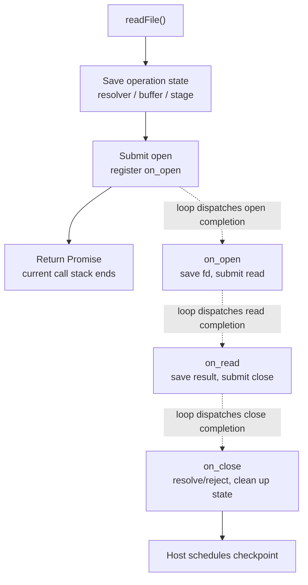

There are three distinct lifetimes here: **the stack frame of one function call, one native request, and the context of the whole logical operation**. The context can outlive multiple requests; a later callback is a fresh function call, rather than the original C call stack staying blocked and waiting.

Note the invocation context of callbacks:

- Normal event dispatch for a given libuv loop runs sequentially on that loop's thread; this does not mean every callback has its own thread.
- The `work_cb` of `uv_queue_work` is an explicit exception: it runs on the worker pool, and only `after_work_cb` returns to the loop thread.
- If a loop callback does not return for a long time, it delays other callbacks on that loop; an async API does not automatically move time-consuming computation inside a callback onto the worker pool.
- Submission failure and async completion are two separate paths; clean up state according to the specific API's return-value contract, and do not assume that a completion callback will still arrive after a failure.

For the actual distinction between request and worker callbacks, see [`uv_queue_work()` and `uv__queue_done()`][model-006]; when a Node file operation fails at submission, it explicitly goes into `after` handling, see [`AsyncDestCall()`][model-019].

#### How `uv_run()` Loops

The diagram below corresponds to the **main Unix `UV_RUN_DEFAULT` path** in the Node snapshot used in this document, omitting auxiliary code such as statistics. Callbacks execute within each phase, not all together after every phase has finished.

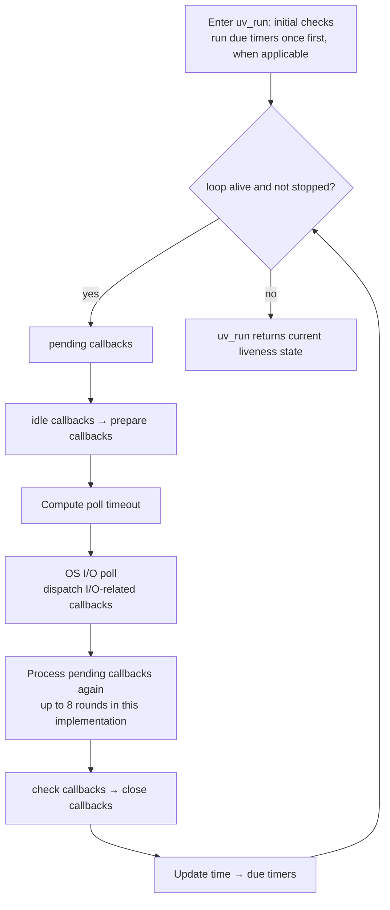

Source: [the complete `uv_run()` loop and timer ordering][model-003]. This version keeps one timer pass before entering the default loop, and timers within the normal loop run after the I/O poll; the phase diagram cannot be applied directly to other versions.

The other two modes change how the loop is driven: `UV_RUN_ONCE` advances at most one iteration and may wait; `UV_RUN_NOWAIT` advances at most one iteration without blocking to wait for events. If the loop is already not alive on entry, or the stop flag prevents iteration, the loop body may also not be entered. `uv_run()` returning does not equal the OS process exiting; the caller may continue running or enter the loop again.

The poll timeout coordinates "how long can we sleep right now": it avoids blocking when there are native callbacks awaiting dispatch (`pending_queue` is non-empty), active idle handles, or handles waiting to be closed; otherwise it is usually bounded by the nearest timer deadline, and with no deadline it can wait on I/O. These are the main cases: the timeout is also 0 when the stop flag is set, when nothing is active, or when child reaping is pending. **An uncompleted active request is itself a keep-alive condition; it is not the same as the existence of a ready callback, and it does not mean the poll timeout must be 0.** The name of an idle callback does not mean it "runs only when idle"; an active idle handle fires during in-progress loop iterations.

Source: [`uv__backend_timeout()`][model-004].

#### How Worker Completion Returns to the Loop

The following uses `uv_queue_work()` to show the thread switch. `work_cb` runs on the worker pool and `after_work_cb` runs back on the loop thread; the two kinds of callbacks must not be conflated.

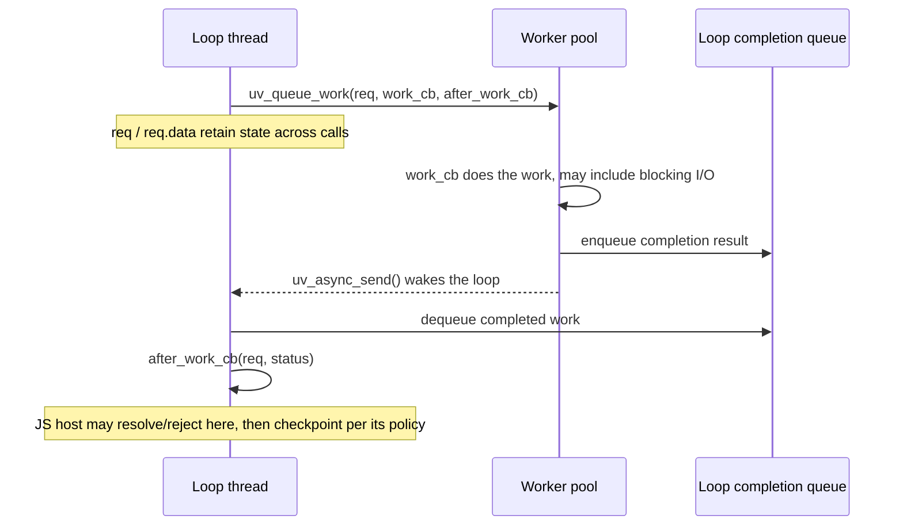

Source: [worker execution and completion enqueue / wake][model-005], [loop consuming the result and the after-work callback][model-006].

This path also shows a keep-alive detail: `uv_queue_work()` registers an active request, and when the worker finishes it merely sends the result back to the loop; the request is not unregistered and `after_work_cb` is not called until the loop's `uv__queue_done()`. Therefore **the interval in which "the worker has finished but the loop has not yet consumed the result" is still covered by an active request**. The unregistration happens before the callback, but the callback runs to completion within that dispatch, after which the host still has to process the JS jobs it produced.

#### Liveness and JS Integration

The Unix liveness criterion in the libuv bundled with the current Node is:

```c
// https://github.com/nodejs/node/blob/bc2e01dcf6acd5cf7d169b5f26cf89abaaeb41f1/deps/uv/src/unix/core.c#L393-L398
return uv__has_active_handles(loop) ||
       uv__has_active_reqs(loop) ||
       !uv__queue_empty(&loop->pending_queue) ||
       loop->closing_handles != NULL;
```

Source: [`uv__loop_alive()`][code-008]. The `active_handles` count is controlled by **two flags, ACTIVE and REF**. `uv_ref()` / `uv_unref()` are idempotent flag operations, not increments or decrements of an object-ownership reference count on every call. Source: [active/ref and request count implementation][code-009].

The libuv loop above does not include JS Promise jobs. The host can checkpoint at the end of a callback scope, drain jobs in the check phase, or use a referenced idle handle to express "there is ready JS work, so keep iterating and do not block". Cross-thread notification can use [`uv_async_send()`][code-010]. The specific checkpoint and keep-alive mapping is decided by each JS runtime.
### 4.4 Rust `Future` / `async` / `await`: Suspendable State Machines

#### The Future Interface and Driving Responsibility

The core interface of `Future` can be simplified as:

```rust
// Interface sketch, not an excerpt from any JS runtime's source.
fn poll(self: Pin<&mut Self>, cx: &mut Context<'_>) -> Poll<Output>;

enum Poll<T> {
    Ready(T),
    Pending,
}
```

- **`Ready(value)`**: this future has completed; an I/O failure usually appears as `Ready(Err(error))`.
- **`Pending`**: it cannot complete this time and must be polled again later; this does not mean blocking the current OS thread.
- **`Context` / `Waker`**: conveys "there is a chance to continue" to whoever is driving the current work. A Tokio task's Waker usually notifies the task scheduler; a nested scheduler may also notify its own ready queue first.
- **`Pin`**: constrains the movement of futures that need a stable location during poll and over the rest of their lifetime, working with the compiler to store state across `await`; it does not mean binding to a particular CPU or thread.

Calling a Rust `async fn` first constructs a future, and its body runs when polled; argument expressions are still evaluated at call time. The compiler stores into the state machine the local variables, sub-futures, and resume position that must survive across `await`.

The `Future` trait itself does not require Tokio, nor `Send`, `'static`, or that each future own a task. A future can be polled by a parent future, a custom scheduler, or an executor; it is the specific scheduling API that adds constraints, for example `tokio::spawn` requires `Future + Send + 'static`. Source: [type constraints of `spawn`][model-020].

**JS `async` and Rust `async` also differ in when they start:**

| Operation | JavaScript | Rust |
|---|---|---|
| Calling an `async function` / `async fn` | The body starts executing immediately until it suspends or ends, and returns a Promise | Constructs a future; the body does not execute until it is polled |
| Awaiting an already-completed value | The continuation after `await` is still resumed via a Promise job | When the child future returns `Ready`, the parent future can continue directly within the same `poll` |
| Not awaiting the return value | A native API that was already called has usually registered its work and may keep executing | An `async fn` future that was only constructed and never polled never starts executing its body |

The Rust lazy semantics in the table apply to the bodies of `async fn` / `async` blocks. An ordinary function can start the operation first and then return a future; a `JoinHandle` can also correspond to an already-submitted task. LLRT's async bindings actively register the produced Rust future with the rquickjs scheduler, so **a JS user who does not write `await readFile()` does not stop the host from continuing to advance it**. See [`Promise::wrap_future()`][code-089].

#### `.await` Is Composition Between State Machines

At an `.await`, the outer future polls the child future: if the child is Ready it continues executing; if Pending, it keeps its state and returns Pending upward, to continue on the next poll. **One `.await` need not produce one suspension; a child future also need not become an independent task.**

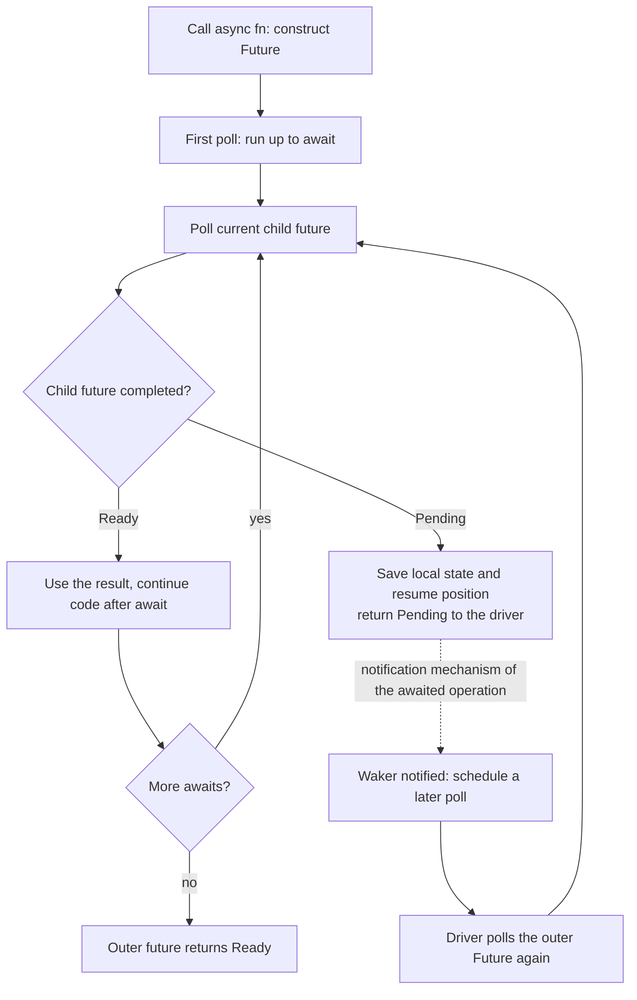

The wake / scheduling in the diagram is provided by a driver, executor, or custom scheduler; a future does not resume on its own just because it returned Pending. Hand-written futures must correctly handle the race between Waker registration and state changes.

Compared with callback style, both store "what to execute next": callback style usually puts the continuation and state in function pointers, closures, and request contexts; `async/await` organizes them into a compiler-generated composable state machine.

#### `.await` and `spawn` Have Different Scheduling Boundaries

`tokio::spawn(future)` creates an independently schedulable Tokio task, and the returned `JoinHandle` is in turn a future whose result can be awaited. The diagram below contrasts `child().await` with `tokio::spawn(child()).await`; a task in the diagram does not represent an OS thread.

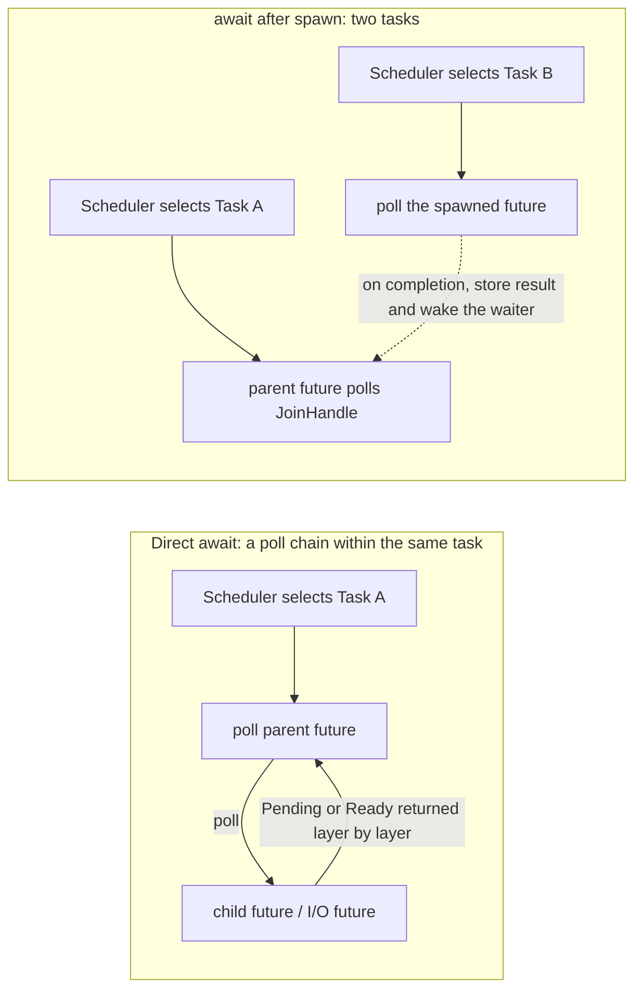

- A direct `.await` does not automatically add a Tokio task; parent and child futures share the current task's execution opportunities and can pass the Waker along the await chain.
- After `spawn`, even if the `JoinHandle` is not awaited, the task can still run whenever the runtime is being driven. `spawn` itself guarantees that the new task is not polled synchronously on the current call stack; in a multi-thread runtime, another worker may still begin executing it very soon.
- `FuturesUnordered`, the rquickjs scheduler, and similar can manage multiple child futures under an outer driver; each child future may have its own notification state, but need not each become a Tokio task.
- Tasks use **cooperative scheduling**: if one `poll` does not return for a long time, it occupies the execution thread. Writing synchronous computation inside an `async fn` does not automatically turn it into preemptible work; and when `.await` gets Ready all the way through, execution is not necessarily yielded either.

Source: [Tokio task model][model-007], [`spawn` startup and the no-synchronous-poll contract][model-021], [Deno's aggregating driver][code-059], [rquickjs scheduler][code-091].

### 4.5 Tokio: executor + I/O driver + timer driver + blocking pool

The Tokio runtime combines several kinds of mechanisms:

| Component | What it does | Concepts not to conflate with it |
|---|---|---|
| **Task scheduler / executor** | Schedules runnable tasks and polls root futures | The number of tasks is not the number of JS Promises |
| **I/O driver** | Receives events via a backend such as Mio, records readiness, wakes waiters | A readiness notification is not necessarily an operation result |
| **Timer driver** | Waits for deadlines and wakes waiters such as `Sleep` | Each timer does not need its own thread |
| **Blocking pool** | Runs blocking work that should not occupy async scheduler threads | While a blocking function runs, it still occupies one OS thread |

These are logical components. The I/O and timer drivers do not need threads of their own (they run when a worker or `block_on` parks); the blocking pool does use separate OS threads. A current-thread runtime can also interleave the progress of many async tasks; a multi-thread runtime can schedule eligible tasks across multiple workers, but does not automatically make a single JS isolate execute in parallel.

#### The Scheduler Handles Runnable Work; Drivers Provide Opportunities to Become Runnable Again

The diagram below shows the scheduling skeleton for spawned tasks, omitting details such as the local queues and work stealing of Tokio's different schedulers. The root future driven directly by `block_on` has its own path, so "a task completes" in the diagram should not be read as the whole runtime having to exit.

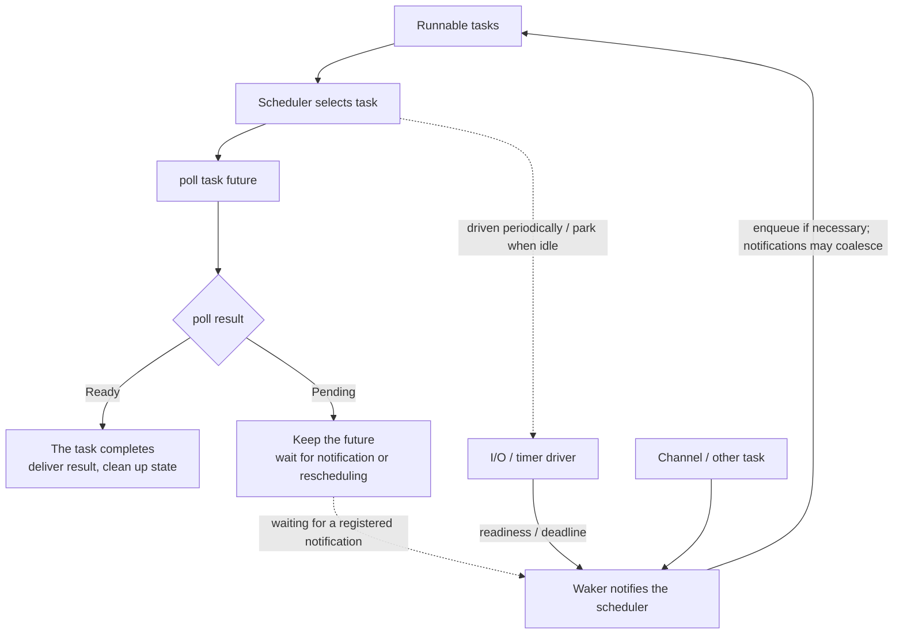

**An empty runnable queue only indicates that there are currently no scheduled execution opportunities.** Futures waiting on sockets, timers, or channels may still exist; Tokio also checks the drivers according to its scheduling policy, rather than necessarily waiting until all tasks are Pending before handling I/O. Source: [Tokio's notes on scheduling and I/O/timer driving][model-024].

A Waker can be understood as a small notification callback, but it is usually responsible only for "please reschedule this task". The business continuation is still stored in the future's state machine and only continues on the next poll. Tokio's task Waker decides from the state whether to call `schedule()`, and does not run JS directly. Source: [`wake_by_ref()`][model-011].

#### The Wake-Up Chain of a Readiness-Based Socket Read

The following is a simplified path with no cached readiness. `poll` is called layer by layer from the outer future → child future → I/O primitive, and Pending is returned layer by layer.

```mermaid
sequenceDiagram
    participant S as Executor / task scheduler
    participant F as Task future and its child futures
    participant D as I/O driver / registration
    participant K as OS selector
    S->>F: poll(cx)
    F->>D: check read readiness, register Waker
    D-->>F: Pending
    F-->>S: Pending
    Note over S: run other tasks; park when there is no runnable work
    K-->>D: readiness event
    D->>D: update readiness state
    D-->>S: call the task Waker, mark / queue as runnable work
    S->>F: poll(cx) again
    F->>D: check readiness and attempt non-blocking read
    alt data, EOF, or error obtained
        D-->>F: Ready(result)
        F->>F: continue code after await
        F-->>S: run to the next Pending or the final Ready
    else WouldBlock
        D->>D: clear the consumed readiness, wait again
        D-->>F: Pending (if there is no new readiness yet)
        F-->>S: Pending
    end
```

In the source, this chain is split across several places:

1. The [I/O driver][model-008] calls Mio poll, and when handling events does `set_readiness(...)` and then `wake(ready)`.
2. The [I/O registration][model-009] attempts the operation; on `WouldBlock` it clears the corresponding readiness and re-enters the wait / attempt loop.
3. [ScheduledIo][model-010] stores the caller's Waker and re-checks readiness after registration, so that state changes during registration are not missed.
4. The [Task Waker][model-011] notifies the task and calls `schedule()` when needed. It does not run the JS continuation directly on the call stack of the I/O notification.

**`Future::poll()` and `epoll` / `Mio::Poll::poll()` are operations at different levels.** The former advances a Rust state machine, while the latter receives OS events; normal use of Wakers does not require continuously scanning all pending futures.

#### Why "Check State, Register Waker, Check Again" Is Needed

A common bug: the future checks and finds it not ready, then the event occurs, but the Waker has not been registered yet; finally the future registers the Waker and returns Pending, and no new event ever comes to wake it. This problem is called **lost wake-up**.

The following shows one timing of this kind of race, and how a persistent readiness state plus a re-check avoids losing progress:

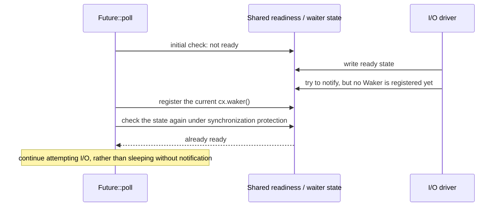

Tokio's `ScheduledIo::poll_readiness()` includes exactly this post-registration re-check; if the event occurs later still, the registered Waker is notified. The concrete implementation needs a lock or an atomic state protocol, and cannot rely on two unsynchronized reads. Source: [`poll_readiness()`][model-010].

This also shows that:

- A Waker is not where the result is stored; the result or readiness must be kept in separate state.
- Multiple wakes can coalesce, so the wake count cannot be treated as the number of I/O completions.
- Returning Pending does not guarantee it will become Ready some day; for a future that may be advanced by external events, the follow-up notification path must be set up correctly.
- After returning Ready, the driver should treat the future as completed, and must not assume that polling again will return the same result.

#### Waiting and Completion Policy

Two independent conditions must both be satisfied:

1. **Liveness**: should the JS runtime still continue to exist?
2. **Wake-up / progress**: when will it be polled next?

`Poll::Pending` only means this poll has no final result; **it does not automatically guarantee it will be polled again in the future**. If there is ready work, keep processing it or arrange a self-wake; if waiting on I/O, register a Waker that can be notified.

`block_on(root_future)` waits for the root future to complete, not for "all Tokio tasks to be drained". After the root returns, spawned tasks may still exist, and how they are handled afterward is decided by the runtime lifecycle and shutdown policy. Source: [Tokio shutdown][code-011], [`block_on`][code-012].

Therefore a Tokio-based JS runtime needs to define its own **JS-work completion policy**, for example Deno's op-driver in-flight count (`pending_ops.len()`, compared with `unrefed_ops` in `EventLoopPendingState`), or LLRT/rquickjs's all-tasks list. They can drive a set of child futures, and do not need to create a Tokio task for every JS Promise.

Two ways of running Tokio must also be distinguished here: if the runtime is kept, spawned tasks in multi-thread mode can keep running after `block_on` returns; the ordinary current-thread mode needs further calls to keep driving the runtime before earlier tasks can continue to advance. Finally, dropping the runtime / shutdown is a separate step, and its task-cleanup policy is likewise not the same as "wait for all JS Promises to complete". See [`block_on`'s notes on the two schedulers][code-012].

### 4.6 Platform Backends and Public APIs Can Use Different Models

| Scenario | Typical underlying path | How to understand it |
|---|---|---|
| libuv Unix socket I/O | epoll / kqueue etc. readiness → non-blocking I/O → callback | A public callback API can be built on a Reactor |
| libuv Windows I/O | overlapped operations + IOCP completion dispatch | Has a completion-based backend, but specific operations may still mix in readiness-style handling |
| Tokio socket I/O | Tokio registration → Mio selector → readiness state / Waker | Exposes a Future upward, while internally still driven by a Reactor |
| Mio Windows backend | Adapts underlying mechanisms such as IOCP to Mio's readiness API | The OS completion model does not force upper layers to expose completion records directly |
| libuv default / fallback file I/O | Worker pool performs blocking operations, calls back into the loop on completion | Completion-style delivery, which is not the same as kernel-native async file I/O |
| Ordinary path of Tokio `fs::read` | `spawn_blocking` → blocking filesystem call → a future that awaits the result | For an operation wrapped by a Future, the actual execution can still occur on a blocking thread |
| Conditionally enabled Linux io_uring path | Submit operation, read completion | Can be hidden beneath the same callback / Future API |

Source: [libuv I/O model][model-001], [Mio platform adaptation notes][model-015], [libuv IOCP dispatch][model-016].

A concrete hybrid example is the current libuv Windows TCP read: it first submits a [zero-byte overlapped read][model-017] and waits for notification, then performs [nonblocking reads][model-018] in the completion handling path. So "using IOCP" also does not mean each upper-layer `read_cb` corresponds to a kernel async read that fills the user buffer directly.

File I/O must also be viewed with version and configuration conditions:

- The current libuv documentation states that Linux uses the thread pool by default, and certain file operations can try io_uring after `UV_LOOP_USE_IO_URING_SQPOLL` is configured. Source: [libuv filesystem backend][model-014].
- The ordinary path of Tokio `1.53.1`'s `fs::read` calls `spawn_blocking` via `asyncify`; there is also an experimental io_uring branch constrained by `tokio_unstable`, the `io-uring` feature, the platform, and runtime configuration. Source: [`fs::read` routing][model-012], [`asyncify`][model-013].

This also shows that **looking only at whether an API returns a callback or a Future cannot tell you whether the I/O is Reactor, Proactor, or thread-pool offloading.** All three may ultimately complete the same JS Promise.

### 4.7 Direct Impact on JS Runtimes

| Dimension | libuv / crabuv style | Tokio style |
|---|---|---|
| Expressing native work | handle / request + callback | `Future::poll()` + `Waker`, possibly also resource handles |
| Storing continuation state | callback context, request wrapper, closure | future state machine, child futures, task state |
| native → JS completion | loop callback, or re-posting to a JS completion queue | future resolves in a legal context, or re-posts to a result queue |
| Where blocking waits happen | the loop's OS poller; blocking work goes to the worker pool | driver / scheduler park; blocking work goes to the blocking pool |
| Basis for natural termination | native loop liveness + host policy | custom completion policy of the root future / JS driver |
| Who implements JS Promise / await | JS engine | JS engine |
| microtask checkpoint | host chooses at boundaries such as callback / phase | host chooses at boundaries such as poll / completion |
| unref | libuv has native flags; crabuv does not adopt an equivalent mechanism | host can maintain refed / unrefed work itself |

For Promise-based APIs, restoring JS `.then` / `await` continuations requires both models to go through **Promise resolution/rejection → engine job queue → checkpoint**. Ordinary timer / event callbacks can also enter JS directly, without first creating a Promise. Reactor / Proactor decide how the native result is obtained; callback / Future decide how the native continuation is expressed; the JS host decides when to deliver results, when to run microtasks, and whether to keep the process alive.

### 4.8 Waking, Completing, Canceling, and Keep-Alive Are Different Operations

These actions often appear within a few adjacent lines of code, but act on different objects:

| Action | What it directly changes | What it does not guarantee |
|---|---|---|
| `Waker::wake()` / `uv_async_send()` | Notifies the scheduler / loop that there is a chance to make progress | Not equal to operation success, and does not directly resume a JS `await` |
| native future returns Ready / completion callback | Obtains the result of a native operation | Not equal to its JS reactions having executed |
| `resolve` / `reject` | Feeds into the Promise state machine and produces jobs according to engine rules | Does not run the reactions inside the resolver call; they run as jobs at the next microtask checkpoint (resolving with a thenable adds extra jobs) |
| `unref` | Changes whether the host must keep running because of that work | Does not cancel I/O, release ownership, or make the Promise complete automatically |
| cancel / abort | Requests that some work stop, or stops advancing a future | Does not guarantee immediate interruption of an already-started syscall / blocking function |
| `block_on(root)` returns | The root future has completed | Does not mean all spawned tasks or JS Promises have completed |

In Rust especially, **dropping a future you own, dropping a `JoinHandle`, and calling `abort()` are different operations**:

- Dropping a future destroys its state and stops further progress driven by that future; whether the underlying work already submitted elsewhere stops depends on the specific API's cancellation contract.
- Dropping a Tokio `JoinHandle` detaches the task; as long as the runtime keeps driving and the task has not been canceled, it can still run.
- `abort()` requests cancellation of an async task; a `spawn_blocking` function that has already started running generally cannot be interrupted this way. Runtime shutdown also has its own separate waiting policy.

Source: [the `JoinHandle` detach contract][model-022], [the boundary between Tokio cancellation and blocking tasks][model-023], [runtime shutdown][code-011].

Tokio does not automatically understand JS `unref()` semantics. Deno implements them itself through `unrefed_ops`, timer ref state, uv-compatible handle flags, and so on; this state answers "does the host still need to wait", while the Waker answers "how will it get an opportunity to run again later".

### 4.9 The Keep-Alive Handoff from Native Operation to JS Job

For the process-exit question this document focuses on, the most useful way to inspect is to follow the **lifecycle of the same logical operation**, rather than merely looking for collections whose names contain `pending`. The discussion below covers the normal path with no explicit stop or job execution error, takes an operation that needs keep-alive and has not been unref'd or canceled as the example, and assumes the native API successfully returns ordinary data and that a `.then` / `await` reaction has already been registered:

| Moment | Promise / job state | Host state that must cover this period |
|---|---|---|
| Operation registered, waiting on I/O | Promise pending; no runnable reaction yet | active request / resource / uncompleted future, etc. |
| I/O completed, result not yet delivered to JS | Promise still pending; job queue may still be empty | a not-yet-unregistered request, the count for the completed-op queue, or a guaranteed current dispatch path |
| Resolver called, checkpoint not yet run | For ordinary data, runnable reactions have been produced | the engine job queue, and a checkpoint the host guarantees will execute |
| Executing the `.then` / `await` continuation | The job is consumed, and may produce new I/O / jobs | the current execution path and newly registered work |
| The current operation and its ready jobs are all processed | This operation no longer requires keep-alive | continue checking other keep-alive sources, module lifecycle, and exit hooks |

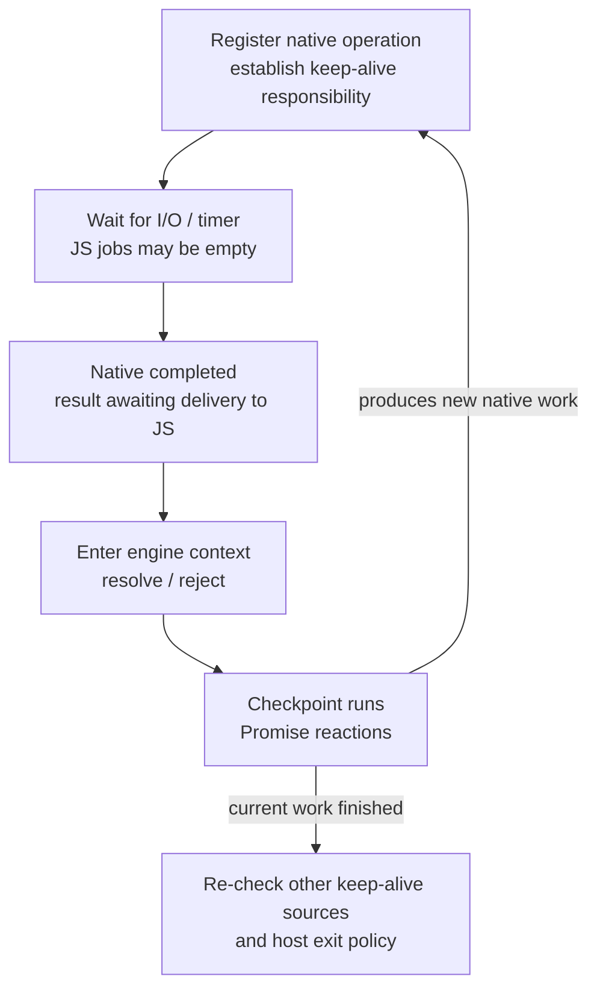

The key invariant here is: **the host must not wrongly observe that all work has ended between "the result has been produced" and "JS gets the chance to handle the result".** It is not required that every runtime use the same global counter; counts, queues, and call ordering can all provide this guarantee:

- **Deno**: the op driver's `len` covers completed ops that have not yet been taken by `poll_ready()`; once taken, they are delivered to JS within the current event-loop tick, and only then is pending state evaluated. See [driver count][code-060] · [completion result dequeue][code-061] · [JS dispatch][code-062].
- **LLRT/rquickjs**: the wrapper future waits for the native result and finishes only after calling the resolver; after the scheduler reports progress, `idle()` runs JS jobs again and then checks whether any futures remain. See [wrapper future][code-089] · [`idle()`][code-094].
- **Node / txiki.js / Dune**: rely on the registration of native work and on their respective callback/check/tick boundaries for the handoff. Node has a callback-scope checkpoint; txiki.js drains jobs in the check phase and updates an idle handle; Dune processes the completion batch after the native loop returns for the round. See [Node][code-016], [txiki.js][code-030], [Dune][code-046].

Finally, note that same-named APIs differ in scope: QuickJS's `JS_IsJobPending()` only checks the engine job queue; rquickjs's `AsyncRuntime::is_job_pending()` also takes **uncompleted Rust futures** into account. See [QuickJS][code-002], [rquickjs][code-114]. So before analyzing whether "pending jobs is empty", you must first confirm which kind of work the interface actually counts.

## 5. Architecture of the Five JS Runtimes

This section covers each runtime's state organization, driving entry points, and termination policy. Section 6 then traces the complete call chains along the same kinds of user operations.

| Runtime | Main owner of native work | Execution boundary of JS continuations | Main exit criterion |
|---|---|---|---|
| Node.js | libuv handles / requests, Node wrappers | callback scope, timer / immediate batch boundaries | libuv liveness, plus platform tasks and exit hooks |
| txiki.js | libuv handles / requests, Promise capability | check phase, plus job drain after some callbacks | libuv liveness; ready jobs are connected via an idle handle |
| Dune | crabuv resources / requests; ready completion Vec | nextTick / V8 checkpoint after each completion entry (in `run_pending_futures`, once per `tick_event_loop` round) | native resources plus imports, ticks, rejections, etc. |
| Deno | async-op driver; separate module state; uv-compatible handles | event-loop phases and some callback boundaries | multiple kinds of keep-alive state in `EventLoopPendingState` |
| LLRT | rquickjs-owned futures and QuickJS jobs | `idle()`, `async_with()`, timer callbacks | on the normal CLI path, wait until both jobs and scheduler futures finish; job execution errors take a separate branch |
### 5.1 Node.js: native request + resolver + callback-scope checkpoint

#### 5.1.1 Promise-based filesystem API

[`node/src/node_file-inl.h:193–207`][code-013] · [`node/src/node_file-inl.h:226–256`][code-014] · [`node/src/node_file-inl.h:282–292`][code-015] show the complete key structure:

1. `FSReqPromise::New()` creates a `v8::Promise::Resolver` and stores it in the JS object of the request wrapper.
2. `SetReturnValue()` returns the Promise corresponding to the resolver.
3. Native completion calls `Resolve()` / `Reject()`.
4. These two methods establish an `InternalCallbackScope` and then call the V8 resolver.

```text
uv_fs request ── completion ──> FSReqPromise::Resolve/Reject
                                      │
                                      ├─ update Promise / enqueue reactions
                                      └─ InternalCallbackScope::Close
                                           → nextTick / microtask processing
```

Keep-alive comes from in-flight requests or other referenced native work, not from a strong reference held by the resolver. An ordinary file descriptor that is open but idle does not amount to an active libuv handle.

This is the per-operation file path that `FSReqPromise` serves. In the current snapshot, whole-file `readFile()` also has a `ReadFileJob` fast path whose resolver is held in a JS closure; see Section 6.1.

#### 5.1.2 Microtasks and `nextTick` are two separate mechanisms

`InternalCallbackScope::Close()` processes the task queues when the outermost effective callback scope ends:

- A nested scope or `skip_task_queues_` skips this processing;
- When no nextTick is scheduled, it performs a V8 checkpoint first;
- When nextTick / rejection work is pending, it calls the JS `processTicksAndRejections()`.

Source: [`node/src/api/callback.cc:138–213`][code-016].

The JS drain algorithm can be summarized as:

```text
drain nextTick queue, including newly added nextTicks
→ perform microtask checkpoint
→ if new ticks / rejection work appeared, repeat
```

Source: [`node/lib/internal/process/task_queues.js:63–109`][code-017].

The priority of nextTick here applies at the corresponding drain boundaries; **it does not mean nextTick can preempt a microtask checkpoint that is already running**. When observing ordering inside ESM evaluation or a `.then` callback, you need to consider which execution context is currently active.

Also, not every native→JS call uses a function named `MakeCallback`: `Environment::RunTimers()` establishes an `InternalCallbackScope` directly and calls the JS function; the JS timer / immediate batches in turn call `runNextTicks()` internally.

Source: [`node/src/env.cc:1748–1771`][code-018]; [`node/lib/internal/timers.js:525–644`][code-019].

#### 5.1.3 `check + idle` serves the immediate queue

`CheckImmediate()` and `ToggleImmediateRef()` are used mainly for `setImmediate` / native immediate callbacks. The idle handle both keeps the loop alive and prevents poll from blocking.

**This is not how the V8 microtask queue is represented.** Ordinary Promise reactions still run through the checkpoint described above.

Source: [`node/src/env.cc:1809–1845`][code-020].

#### 5.1.4 Natural termination and TLA

Main flow of `SpinEventLoopInternal()`:

```text
uv_run(UV_RUN_DEFAULT)
→ platform->DrainTasks(isolate)
→ uv_loop_alive()
→ if already idle, emit beforeExit
→ re-check uv_loop_alive()
→ not kept alive again by new work: enter exit event / cleanup
```

Source: [`node/src/api/embed_helpers.cc:23–77`][code-021].

`EmitProcessExitInternal()` also checks for unsettled TLA; when there is no existing non-zero exit code, it can set the exit code to **13**. Source: [`node/src/api/hooks.cc:52–83`][code-022], [`node/src/node_exit_code.h:30`][code-023].

### 5.2 txiki.js: the QuickJS job queue explicitly wired into libuv

#### 5.2.1 How a native request stores a Promise capability

`TJSFsReq` contains (among other fields) `uv_fs_t req`, `JSContext *ctx`, a duplicated reference to the JS wrapper object `obj`, and `TJSPromise result`.

- `TJS_InitPromise()` uses `JS_NewPromiseCapability()` to obtain the Promise and the resolve/reject functions.
- When the `uv_fs_t` request completes, libuv invokes `uv__fs_req_cb()`, which calls `TJS_SettlePromise()` and then frees the request.
- `TJS_SettlePromise()` calls `p->rfuncs[is_reject]` and then releases its references to this capability.

Source: [`txiki.js/src/mod_fs.c:114–131`][code-024] · [`txiki.js/src/mod_fs.c:281–288`][code-025] · [`txiki.js/src/mod_fs.c:408–416`][code-026]; [`txiki.js/src/utils.c:200–222`][code-027].

Whole-file `tjs.readFile()` uses a different wrapper: `TJSReadFileReq` together with `uv_work_t`, which puts the entire synchronous read into the worker pool; its Promise capability and settlement work on the same principle. See Section 6.1.

#### 5.2.2 Checkpoint granularity depends on the call path

| Path | checkpoint timing |
|---|---|
| timer callback | `tjs_call_handler()` drains jobs after the JS callback returns |
| filesystem Promise completion | `TJS_SettlePromise()` itself does not drain; a later checkpoint, usually this round's check callback, runs the reactions |
| libuv check phase | `uv__check_cb()` → `tjs__execute_jobs()`, which drains jobs and handles deferred rejections |
| EventTarget listeners | the JS implementation calls `core.drainMicrotasks()` after each listener; the corresponding C entry point has a re-entrancy guard |

Source: [`txiki.js/src/timers.c:78–95`][code-028], [`txiki.js/src/utils.c:184–222`][code-029], [`txiki.js/src/vm.c:691–781`][code-030], [`txiki.js/src/js/polyfills/event-target.js:588–600`][code-031].

Therefore txiki.js cannot be simplified to "checkpoint after every C→JS call", nor can one conclude from this that its timing is identical to Node's.

#### 5.2.3 How jobs affect libuv liveness
Source: [`txiki.js/src/vm.c:676–681`][code-032]. The function is `uv__maybe_idle()`, reproduced verbatim:
```c
// https://github.com/saghul/txiki.js/blob/1a230d31183f062fae7a6c4fd2cff466cecc1787/src/vm.c#L676-L681
static void uv__maybe_idle(TJSRuntime *qrt) {
    if (JS_IsJobPending(qrt->rt) || !list_empty(&qrt->pending_rejections)) {
        CHECK_EQ(uv_idle_start(&qrt->jobs.idle, uv__idle_cb), 0);
    } else {
        CHECK_EQ(uv_idle_stop(&qrt->jobs.idle), 0);
    }
}
```

The prepare / check handles are unref'd; `jobs.idle` toggles its active state according to jobs / rejections. This does convert ready JS work into keep-alive and non-blocking-poll conditions visible to libuv.

`TJS_Run()` updates the idle state before entering `uv_run`, and after `uv_run` returns it checks whether any QuickJS jobs remain. If the main runtime's `beforeunload` is canceled and there really are new jobs / native work, it re-enters the loop; a worker is kept alive by a referenced async stop handle.

Source: [`txiki.js/src/vm.c:806–849`][code-033].

In the normal idle case where the current jobs / rejections have been processed, the termination condition is, in direction:

```text
!uv_loop_alive(loop) && !JS_IsJobPending(rt)
```

This is not a substitute formula for all lifecycle branches: beforeunload, workers, and abnormal stops must also be considered. The return value of `uv_run()` reflects whether the loop is still alive at the time of return, not a dedicated flag for "whether a stop ever occurred".

#### 5.2.4 TLA and explicit exit

txiki.js supports TLA: the startup code itself contains a top-level `await` and does `await core.evalFile(filename)`. However, `TJS_Run()` does not separately count all pending module-evaluation Promises toward liveness, and no Node / Deno-style stalled-TLA diagnostic was seen on the natural termination path above.

Source: [`txiki.js/src/js/run-main/index.js:159`][code-034] · [`txiki.js/src/js/run-main/index.js:306`][code-035], [`txiki.js/src/eval.c:44–64`][code-036].

The public `tjs.exit(status)` calls C `exit(status)` directly; the internal `TJS_Stop()` → `uv_async_send()` → `uv_stop()` is a separate path for stopping the loop.

Source: [`txiki.js/src/mod_os.c:31–38`][code-037], [`txiki.js/src/vm.c:383`][code-038] · [`txiki.js/src/vm.c:859–862`][code-039].

### 5.3 Dune: crabuv resources + JS completion queue

#### 5.3.1 `JsFuture` is not a Rust `Future`
Source: [`dune/src/runtime.rs:44–48`][code-040].
```rust
// https://github.com/aalykiot/dune/blob/5958b6460d4a567a41e6194f637a86a45b265f95/src/runtime.rs#L44-L48
pub trait JsFuture {
    fn run(&mut self, scope: &mut v8::PinScope);
}
```

It has no `poll()` / `Waker`; it is "an action that must be executed inside a V8 scope after native work completes". So `pending_futures: Vec<Box<dyn JsFuture>>` is more accurately described as a **ready completion queue**.

The truly in-flight work is managed by crabuv:

```text
resources map
request queue
thread pool pending count
```

`next_tick_queue` is yet another separate host queue; the two Vecs must not be treated as a registry of all of Dune's native pending operations.

#### 5.3.2 Ownership and wake-up chain of one filesystem operation

```text
JS native binding creates v8::Global<PromiseResolver>
  → LoopHandle::spawn(work, callback)
  → request_queue_empty = false
  → process_requests() inserts the Task into resources
  → Rayon worker executes work
  → event_sender.send(ThreadPool(id, result))
  → Mio waker.wake()
  → run_poll() receives the completion
  → process_finished_task() removes the Task resource and runs the callback
  → callback pushes FsReadFuture { promise (a v8::Global<PromiseResolver>), result } onto pending_futures
  → event_loop.run(Once) returns
  → run_pending_futures(): resolve/reject, then run the tick / microtask checkpoint
```

Source: [`dune/src/file.rs:187–273`][code-041]; [`crabuv/src/event_loop.rs:273–284`][code-042] · [`crabuv/src/event_loop.rs:350–358`][code-043] · [`crabuv/src/event_loop.rs:445–466`][code-044] · [`crabuv/src/event_loop.rs:732–770`][code-045].

Particularly important: **worker completion does not rely on `thread_pool.pending_count()` alone for keep-alive; the Task resource is retained until the loop consumes the completion. The FS path also already wakes inside crabuv, so there is no need to write another interrupt in every Dune completion callback.**

#### 5.3.3 Tick order
Source: [`dune/src/runtime.rs:427–432`][code-046].
```rust
// https://github.com/aalykiot/dune/blob/5958b6460d4a567a41e6194f637a86a45b265f95/src/runtime.rs#L427-L432
self.with_scope(run_next_tick_callbacks);
self.fast_forward_imports();
self.event_loop.run(RunMode::Once);
self.run_pending_futures();
```

`run_pending_futures()` takes the current completion batch, executes the entries one by one, and runs `run_next_tick_callbacks()` after each.

The latter obtains the **current nextTick snapshot** via `mem::take`, runs through that batch, and then performs the V8 checkpoint. Unlike Node, it does not keep dequeuing recursively added nextTicks within a single drain until the queue is empty. Different orderings are therefore observable; see Section 6.3 and Section 7.

Source: [`dune/src/runtime.rs:479–504`][code-047] · [`dune/src/runtime.rs:685–718`][code-048].

#### 5.3.4 Why timers get an extra interrupt

crabuv's timer phase comes before poll. After a timer callback enqueues a JS completion, if other resources remain, the subsequent poll may wait. The Dune timer path therefore explicitly interrupts, ensuring that this round returns as soon as possible and runs the JS completions that are already ready.

The worker wake of an FS completion and network readiness already cause poll to return; they occur at different phases, so a missing wake-up cannot be inferred merely from the absence of `interrupt()` in the upper-level callback.

Source: [`dune/src/timers.rs:88–104`][code-049]; [`crabuv/src/event_loop.rs:169–180`][code-050] · [`crabuv/src/event_loop.rs:235–284`][code-051].

#### 5.3.5 Liveness and TLA

crabuv's criterion:

```rust
!resources.is_empty()
    || !request_queue_empty.get()
    || thread_pool.pending_count() != 0
```

Dune's outer layer ORs in more: unhandled rejections, V8 background tasks, pending imports, nextTick callbacks.

Source: [`crabuv/src/event_loop.rs:657–661`][code-052]; [`dune/src/runtime.rs:442–465`][code-053].

The outer layer indeed does not check `pending_futures` separately. On the native completion paths that were traced, they are processed before liveness is re-checked in the same round; the inline module source path also registers a pending module graph. This is a control-flow invariant that must be preserved, and **does not constitute a confirmed premature-exit bug**.

In addition, `has_pending_imports()` only checks module graphs that are waiting to be loaded. `fast_forward_imports()` moves a ready graph out of the pending list and ignores the Promise returned by `module.evaluate()`. It is not equivalent to Deno's tracking of pending module evaluation. In testing, a TLA that makes no progress exits with code 0.

Source: [`dune/src/modules.rs:120–123`][code-054], [`dune/src/runtime.rs:522–579`][code-055].

Dune also implements `process.exit(code)`, which calls `std::process::exit` directly, unlike the natural termination path. Source: [`dune/src/process.rs:121–127`][code-056].

### 5.4 Deno: PromiseId correlation + async-op driver + host liveness state

#### 5.4.1 How a JS Promise is associated with a Rust future

In the generic async-op path:

- JS allocates a `PromiseId`;
- `promiseRing` (4096 slots) stores `[resolve, reject, promiseId]`, and conflicting older entries are moved to `promiseMap`;
- The Rust driver holds `(PromiseId, OpId)` and the native future / result;
- The completion result is handed to JS `__resolvePromise(promiseId, res, isOk)`, which takes out and deletes the resolver entry and then calls resolve/reject.

Source: [`deno/libs/core/00_infra.js:32–41`][code-057] · [`deno/libs/core/00_infra.js:146–196`][code-058].

This is the **correlation table for native op Promises**, not a global registry of all user JS Promises. `op_ctxs` indexes op metadata by `OpId`; the real in-flight registry is the `pending_ops` driver.

#### 5.4.2 Not every native future needs to be spawned as its own Tokio task

`FuturesUnorderedDriver` aggregates operations with `FuturesUnordered`, advanced by one on-demand driver task:

```text
submit op
  → eager first poll, or lazy enqueue
  → FuturesUnordered
  → driver task poll_task
  → completed_ops: VecDeque<PendingOp>
  → completed_waker
  → JS event loop poll_ready
  → batch __eventLoopTick(id, isOk, result, ...)
  → __resolvePromise
  → checkpoint
```

**`len` increases after submission and decreases only when the JS loop's `poll_ready()` takes the result.** An operation whose I/O has completed but has not yet been delivered to JS is still counted, which avoids judging the loop idle too early during the completion handoff.

Source: [`deno/libs/core/runtime/op_driver/futures_unordered_driver.rs:33–68`][code-059] · [`deno/libs/core/runtime/op_driver/futures_unordered_driver.rs:100–124`][code-060] · [`deno/libs/core/runtime/op_driver/futures_unordered_driver.rs:212–231`][code-061]; [`deno/libs/core/runtime/jsruntime.rs:3551–3618`][code-062].

There is also an eager fast path: if the first poll completes immediately and the op is not a deferred op, the result can be returned to the JS stub synchronously, and the stub returns `PromiseResolve(result)` without entering the long-lived pending registry.

Source: driver [`deno/libs/core/runtime/op_driver/futures_unordered_driver.rs:128–209`][code-063]; [`deno/libs/core/00_infra.js:218–235`][code-064].

#### 5.4.3 `'static`, `Send`, and V8 handles are distinct constraints

`OpDriver` requires `Future + 'static` and does not generally require `Send`. The actual driver uses `Rc<RefCell<...>>` and `deno_unsync::spawn()`; the latter explicitly allows non-Send futures, but must only be used on a current-thread executor (a documented safety contract that is checked only by a debug assertion, not enforced in release builds).

`'static` cannot borrow a short-lived `Local` / `HandleScope`, but this does not mean it cannot own a persistent V8 handle. Deno's Rust code does store `v8::Global<v8::Promise>` and `PromiseResolver`, for example in rejection state and dynamic imports.

Therefore PromiseId is an implementation design of this op pipeline, and one cannot infer from it that "Tokio or `'static` forces the resolver to live on the JS side". The core constraints on accessing the engine are the isolate / context, threading, and exclusive-access rules.

Source: [`deno/libs/core/runtime/op_driver/mod.rs:56–98`][code-065]; [`deno_unsync/src/tokio/task.rs:49–64`][code-066]; [`deno/libs/core/runtime/exception_state.rs:17–25`][code-067]; [`deno/libs/core/modules/map/dynamic.rs:33–38`][code-068].

#### 5.4.4 Checkpoints and uv compatibility

In this snapshot, `poll_event_loop_inner()` explicitly organizes the timers, pending work, idle/prepare, I/O, check, and close phases. Most phase boundaries have a checkpoint, and some are guarded by the nextTick flag.

But it is not the case that draining happens "only after a phase": JS `processTimers()` also calls `runNextTicks()` between multiple timer callbacks; there is corresponding handling between immediate callbacks as well.

Source: [`deno/libs/core/runtime/jsruntime.rs:2425–2643`][code-069]; [`deno/libs/core/01_core.js:356–472`][code-070]; [`deno/libs/core/02_timers.js:285–289`][code-071].

`uv_compat` implements libuv-compatible handle behavior using Tokio's readiness mechanism. A refed `setImmediate` is kept alive by an active idle handle, the check handle itself is always unref'd, and the event-loop Waker is responsible for scheduling again. This shows that callback phases / handle flags can be built on top of Tokio; the two are not mutually exclusive architectures.

Source: [`deno/libs/core/uv_compat.rs:359–427`][code-072] · [`deno/libs/core/uv_compat.rs:577`][code-073], [`deno/libs/core/uv_compat.rs:1380–1441`][code-074]; [`deno/libs/core/runtime/jsruntime.rs:2709–2724`][code-075].

#### 5.4.5 The complete liveness criterion

After each round of work and checkpoints, `EventLoopPendingState::is_pending()` checks:

```text
has_pending_refed_ops
OR pending dynamic imports
OR pending dynamic module evaluation
OR pending main module evaluation
OR V8 background tasks
OR scheduled nextTick
OR pending promise-rejection events
OR external tracked operations
OR alive uv-compatible handles
```

Where:

```text
has_pending_refed_ops =
    task_spawner_factory.has_pending_tasks()
    OR user_timer.is_refed()
    OR pending_ops.len() > unrefed_ops.len()
```

Source: [`deno/libs/core/runtime/jsruntime.rs:3050–3137`][code-076].

Three easily confused points:

1. `has_tick_scheduled` is a flag for the **nextTick queue**, not the length of the V8 microtask queue. Microtasks are advanced through checkpoints before the determination is made.
2. In this version, JS user timer ref/unref goes through `timerInfo` → `op_timer_schedule(-1/-2)` → `user_timer.ref_timer()/unref_timer()`; **timers are not written into `unrefed_ops` as PromiseIds**.
3. `ExternalOpsTracker` is an explicit keep-alive counter for embedders, used by N-API / IPC and others; it is not a cppgc or V8 external-memory counter.

Source: [`deno/libs/core/02_timers.js:198–207`][code-077] · [`deno/libs/core/02_timers.js:396–407`][code-078], [`deno/libs/core/ops_builtin_v8.rs:55–64`][code-079] · [`deno/libs/core/ops_builtin_v8.rs:127–143`][code-080], [`deno/libs/core/ops.rs:366–389`][code-081], [`deno/ext/napi/uv.rs:240–253`][code-082], [`deno/ext/process/ipc.rs:40–104`][code-083].

#### 5.4.6 TLA, exit hooks, and Tokio shutdown

Pending module evaluation is tracked explicitly. If there is no remaining work that could advance it, Deno tries an extra checkpoint and reports a stalled TLA; there is also a bounded retry plus a `ModuleEvaluationDeadlock` fallback to avoid waiting forever.

Source: [`deno/libs/core/runtime/jsruntime.rs:2727–2827`][code-084].

After the core event loop returns `Ready`, the CLI layer also runs `beforeunload` / the Node-compatible `beforeExit`, re-running the loop if necessary; finally it dispatches unload / exit.

Source: [`deno/cli/lib/worker.rs:1021–1043`][code-085].

**The JS loop completing does not mean all Tokio work has completed.** After the outermost `block_on(join_handle)` returns, Deno calls `shutdown_background()` so that unrefed blocking work still in progress does not prevent termination. This action does not forcibly interrupt a blocking function that is already running.

Source: [`deno/runtime/tokio_util.rs:124–130`][code-086]; [Tokio's shutdown documentation][code-011] (cited at the LLRT-locked Tokio 1.53.1; Deno builds with Tokio 1.47.1, where the `# Shutdown` text relied on here is identical).
### 5.5 LLRT: rquickjs-owned futures and QuickJS jobs driven cooperatively

#### 5.5.1 How a Rust async function becomes a JS Promise

Taking `fs/promises.readFile` as an example:

```text
Func::from(Async(read_file))
  → call the Rust async fn, obtaining a Future
  → Promised(future).into_js(ctx)
  → Promise::wrap_future(ctx, future)
  → create the Promise + resolve/reject functions
  → ctx.spawn(async { await native future; resolve/reject(...) })
```

Source: [`llrt/modules/llrt_fs/src/lib.rs:150–153`][code-087]; [`rquickjs/src/value/function/into_func.rs:35–54`][code-088]; [`rquickjs/src/value/promise.rs:48–79`][code-089] · [`rquickjs/src/value/promise.rs:243–250`][code-090].

These futures can capture `Function<'js>` / `Ctx<'js>`, with rquickjs managing their validity. What `Ctx::spawn()` puts the future into is **rquickjs's private scheduler**, not a direct `tokio::spawn()` for each JS Promise.

#### 5.5.2 The scheduler's two collections

`Schedular` (spelled that way in the source) keeps two collections:

- **all-tasks list**: all futures that have not yet completed;
- **should_poll queue**: futures that should be polled again now. The outer scheduling Waker is registered in this queue, and each task gets its own Waker when it is polled.

An empty ready queue does not mean an empty all-tasks list. The former may just mean "waiting on I/O"; only the latter means the scheduler has no work left.

Source: [`rquickjs/src/runtime/schedular.rs:37–85`][code-091] · [`rquickjs/src/runtime/schedular.rs:130–210`][code-092]; [`rquickjs/src/runtime/spawner.rs:15–47`][code-093].

#### 5.5.3 The actual control flow of `idle()`
Source: [`rquickjs/src/runtime/async.rs:313–359`][code-094].
```rust
// Simplified from https://github.com/DelSkayn/rquickjs/blob/635f9322ccc875e3f9851e7f75ec538cf3274fd5/core/src/runtime/async.rs#L313-L359
loop {
    // Keep draining while jobs execute successfully; after an error, fall through to the scheduler branch below.
    match execute_pending_job() {
        Ok(true) => continue,
        Ok(false) => {},
        Err(error) => report_job_error(error),
    }

    // Only then advance the rquickjs-owned Rust futures.
    match scheduler.poll(cx) {
        Empty => return Ready(()),
        Pending | ShouldYield => return Pending,
        PendingProgress => continue,
    }
}
```

It is not a strict round-robin of "run one JS job, then run one Rust future".

The error branch must also be distinguished: `Ok(true)` immediately continues to the next JS job; `Err(error)` only reports the error and then still enters `scheduler.poll()`. If the scheduler is Empty at that point, `idle()` returns even though there are still unexecuted jobs in the QuickJS queue. Therefore "both queues are empty when `idle()` returns" holds only on the normal path with no job execution errors. Section 6.2.6 gives a reproduction.

A job execution error here means `JS_ExecutePendingJob()` reports an error directly, such as the `queueMicrotask` callback throwing in that reproduction; it is not the same as every Promise rejection. The bare `Promise.reject(...)` in Section 7.1 is a different error-reporting path.

`ShouldYield` bounds the **self-waking / poll work of the Rust scheduler**. A pure-JS infinite Promise chain stays in `Ok(true) => continue` and never reaches that branch, so it cannot solve microtask starvation.

Source: [`rquickjs/src/runtime/async.rs:343–351`][code-095], [`rquickjs/src/runtime/schedular.rs:193–206`][code-096]; Section 7 has measured results.

#### 5.5.4 Engine access and extra checkpoints

LLRT enables rquickjs's `parallel` feature. `AsyncRuntime` serializes engine access with a per-runtime `Arc<async_lock::Mutex<InnerRuntime>>`; this does not mean multiple JS callbacks run in parallel within the same QuickJS runtime.

The entry point uses the default `#[tokio::main]`, so the native runtime can be multi-threaded; JS/QuickJS access is still protected by the lock above.

Source: [`llrt/llrt_core/Cargo.toml:58–62`][code-097]; [`rquickjs/src/runtime/async.rs:76–97`][code-098]; [`llrt/llrt/src/main.rs:115–133`][code-099].

`idle()` is also not the only entry point that drives JS: the `WithFuture` of `AsyncContext::async_with()` advances the host future, the scheduler, and JS jobs together. In a normal timer batch, LLRT drains jobs once before the first callback and again after each successfully returning callback; it does not run an additional standalone drain before every callback.

Source: [`rquickjs/src/context/async/future.rs:106–149`][code-100]; [`llrt/modules/llrt_timers/src/lib.rs:363–385`][code-101].

#### 5.5.5 Timers and `nextTick`

LLRT's timer state is a data structure such as `Vec<Timeout>`; when timers exist, it starts one driver future that waits on a `select!` over Tokio `Notify` and `Sleep` and processes due timers in batches. The driver is spawned with `ctx.spawn_exit_simple`, a thin wrapper over `Ctx::spawn`, so it is a task in the rquickjs scheduler, not a Tokio task. It must not be understood as "every JS timer necessarily corresponds to its own Tokio task".

Source: [`llrt/modules/llrt_timers/src/lib.rs:35–41`][code-102] · [`llrt/modules/llrt_timers/src/lib.rs:138–152`][code-103] · [`llrt/modules/llrt_timers/src/lib.rs:270–295`][code-104].

`queueMicrotask()` calls `Function::defer()`; `process.nextTick()` calls `defer_arg()`; both enter the QuickJS job queue. **LLRT does not implement a Node-style separate, high-priority nextTick queue on these two paths.**

Source: [`llrt/modules/llrt_timers/src/lib.rs:80–90`][code-105]; [`llrt/modules/llrt_process/src/lib.rs:30–36`][code-106]; [`rquickjs/src/value/function/args.rs:149–165`][code-107].

#### 5.5.6 Termination conditions and host modes

Ordinary CLI: after `start_cli()` returns, it calls `vm.idle().await`. On the normal path with no job execution errors, it returns when jobs have been drained and the scheduler has no remaining futures, finally producing an `ExitCode`; an error path may end with remaining jobs undrained, see Section 5.5.3.

An explicit `process.exit(code)` calls `std::process::exit` directly and does not wait for `idle()`. Source: [`llrt/modules/llrt_process/src/lib.rs:85–90`][code-108].

```text
Normal path (no JS job execution error encountered):
QuickJS job queue empty
AND rquickjs scheduler all-tasks list empty
    → idle() completes
```

A purely pending JS Promise is not automatically registered as a scheduler future. The CLI's `run_file()` adds `.catch(...)` to the dynamic import, but does not await that import Promise as a Rust root future that must complete; a TLA that makes no progress was observed in testing to exit with 0.

Source: [`llrt/llrt_core/src/vm.rs:158–196`][code-109]; [`llrt/llrt/src/main.rs:125–133`][code-110].

The Lambda path instead runs a long-lived invocation loop inside `async_with()`, waiting for the handler result via `Promise::into_future().await`. **The same pending JS Promise, if explicitly included in the wait chain of a Rust root future, produces a different lifecycle outcome.** The invocation loop also has a configurable iteration limit, so it cannot be described as "never returns under any circumstances".

Source: [`llrt/llrt_core/src/runtime_client.rs:408–441`][code-111] · [`llrt/llrt_core/src/runtime_client.rs:464–477`][code-112].

The timer / scheduler examined here has no Node-style unref accounting; `dgram.Socket.unref()` does exist, but the source explicitly marks it as a compatibility no-op.

Source: [`llrt/modules/llrt_dgram/src/socket.rs:527–538`][code-113].

## 6. End-to-End Implementation Comparison of Four Scenarios

Starting from real APIs, the sections below answer: **which object holds the waiting state, who advances the native work, how the result returns to JS, when the callback runs, and who keeps the process alive.** A runtime that does not implement a given capability is skipped in that scenario; no other API is substituted to simulate it.

The `fs.readFile` scenario compares the capability "asynchronously read an entire file", and each project's real entry point is listed explicitly; `queueMicrotask()` and `nextTick` refer to the corresponding JavaScript APIs. Dynamic import focuses on evaluation-phase `import()` of ordinary local ESM; special loader hooks, HTTP imports, and source/defer imports are not mixed into the default path.

### 6.1 `fs.readFile`: From File Operation to JS Continuation

Take the Node.js Promise API as the example, assuming the file exists and read permission is granted:

```js
import { readFile } from 'node:fs/promises';

readFile('./data.txt').then(data => {
  console.log('bytes', data.byteLength);
  queueMicrotask(() => console.log('after-read'));
});
console.log('submitted');
```

| Runtime | Actual async whole-file read entry point | Native path traced in this section |
|---|---|---|
| Node.js | `fs.readFile(path, callback)`; `node:fs/promises.readFile` | `ReadFileJob` fast path; step-by-step requests for large files and similar cases |
| txiki.js | `tjs.readFile(path)` | `TJSReadFileReq` + `uv_queue_work` |
| Dune | `readFile(path)` exported by the `fs` module | JS step-by-step reads + crabuv work/completion callbacks |
| Deno | `Deno.readFile(path)` | async op + `RealFs::read_file_async` + blocking pool |
| LLRT | `readFile(path)` exported by the `fs/promises` module | rquickjs wrapper future + `tokio::fs::read` |

#### 6.1.1 Node.js: Distinguish the Callback API, the Promise API, and the Fast Path

In the v26.12.1 tag, the Promise version of `readFile()` enters `readFileInOneRoundTrip()` when the argument is a path, there is no user buffer, and there is no VFS handler:

1. JS creates a Promise, constructs `binding.ReadFileJob`, and stores `resolve/reject` in the `job.ondone` closure.
2. `job.run()` keeps the wrapper alive on the C++ side and calls `ThreadPoolWork::ScheduleWork()`; the latter registers the work through `uv_queue_work()`.
3. The worker's `DoThreadPoolWork()` performs open, fstat, read, and close synchronously. Here the callback argument of `uv_fs_*` is `nullptr`, so the synchronous operations run on the worker thread rather than the JS thread.
4. For a file whose known size exceeds the limit, the worker hands back the opened fd and the size; JS then switches to chunked reading in `readFileHandle()`. Cases such as a user-supplied FileHandle/buffer may also use the step-by-step path.
5. On the loop thread, `AfterThreadPoolWork()` enters JS through `MakeCallback(...ondone...)`; the closure resolves a helper Promise, the continuation of the JS `async readFile()` then handles the returned value, and finally advances the user's `.then()`.

Sources: [JS entry and resolver closure][code-116], [`ReadFileJob` worker / completion][code-117], [thread-pool scheduling bridge][code-118], [chunked `readFileHandle()`][code-119].

**Therefore, this snapshot cannot be drawn as "every `readFile()` holds exactly one C++ `FSReqPromise`".** The fast path stores the resolver in a JS closure; only step-by-step calls such as `binding.read(..., kUsePromises)` use the `FSReqPromise` described in Section 5.1.

The callback version `fs.readFile(path, cb)` likewise uses `ReadFileJob` / the chunked reader, but what it stores is `ReadFileContext.callback`, and it ultimately invokes the user callback without creating an extra Promise. If the callback enqueues a microtask, it is still handled by the callback-scope checkpoint. Source: [callback API and `readFileAfterOneShot()`][code-115].

Keep-alive comes from the active request of the `uv_work_t` or the step-by-step `uv_fs_t`. After the result returns to the loop, the callback scope processes the nextTicks/microtasks it produced; these continuations may submit the next read/close, so completion cannot be declared by skipping the JS checkpoint between two requests.

#### 6.1.2 txiki.js: The Whole-File Work Request Holds the Promise Capability

`tjs_fs_readfile()` allocates a `TJSReadFileReq`, stores the path, buffer, `JSContext*`, and `TJSPromise result`, submits `uv_queue_work()`, and returns the Promise created by `TJS_InitPromise()`.

- The worker callback calls `tjs__load_file()`. Internally it reads the file synchronously using `uv_fs_open/read/close` with a `NULL` callback.
- The worker uses a raw buffer; only after control returns to the after-work callback on the loop thread is the QuickJS-owned `Uint8Array` constructed and `TJS_SettlePromise()` called.
- `TJS_SettlePromise()` invokes the resolver/reject function and releases the capability references; it does not drain jobs itself.
- The Promise reaction is executed at a later checkpoint, usually the check callback of the current libuv iteration; if another path triggers a drain earlier, it can run there first.

Sources: [`TJSReadFileReq` work / after-work / submission path][code-120], [synchronous read helper][code-121], [settlement][code-027], [check-phase drain][code-030].

On this path, keep-alive is first carried by the active work request. After the resolver produces ready jobs, the job drain of the current iteration and the `jobs.idle` state switch take over from there. Even if the Promise from `tjs.readFile()` is never awaited by the user, the request still exists.

#### 6.1.3 Dune: Two-Layer State Machine of a JS Read Loop and a Native Completion Vec

JS `fs.readFile()` is itself an async function: `file.open()` → `file.stat()` → `for await (chunk of file)` → `file.close()` → return the complete data. It does not hand the whole file to a single Rust future in one call. Source: [JS `readFile()`][code-122].

Take one native read as the example:

1. The Rust binding creates a `v8::Global<PromiseResolver>` and hands the actual file-read closure and the loop-thread completion closure to `LoopHandle::spawn()`.
2. Crabuv's request queue / resources map tracks the task; the Rayon worker only performs the file work and produces the result.
3. The worker sends `ThreadPool(id, result)` into the event queue and wakes the loop via the Mio Waker.
4. The loop consumes the completion event, removes the Task resource, and calls the completion closure; the closure puts `FsReadFuture { promise, result }` into `pending_futures`.
5. After this iteration's `event_loop.run(Once)` returns, Dune runs this ready completion, then the nextTick snapshot and the V8 checkpoint. The JS file iterator resumes as a result and may submit the next read.

Sources: [read binding][code-041], [crabuv work/completion][code-042] · [code-043] · [code-044] · [code-045], [completion batch and checkpoint][code-047].

Keep-alive coverage has to be read across the full chain: the native wait is tracked by crabuv; a completion action that has already entered `pending_futures` is consumed before this iteration's exit decision. The elements of this Vec are completion actions that can be run directly with `run(scope)`; they are not unfinished futures that need a Tokio poll.

#### 6.1.4 Deno: The File Future's Result Is Delivered via PromiseId

`Deno.readFile()` calls `op_fs_read_file_async` and can also associate an AbortSignal with a cancel resource. The Rust op checks permissions, selects the file-system implementation, and awaits `fs.read_file_async(...)`. The default `RealFs` puts open and `read_to_end` together into the blocking pool. Sources: [JS API][code-123], [async op][code-124], [`RealFs`][code-125].

This native wait is wrapped by the generic async-op pipeline. The following expands the branch where the eager first poll returns Pending and later waiting is required:

```text
JS op stub: pick a PromiseId, call the native op
  → eager first poll: start / try to advance the read, cannot complete yet
  → pending_ops: register the op future and PromiseId / OpId
  → after the native call returns: JS setPromise(id) stores the resolver entry
  → driver task keeps polling: wait for the blocking read to finish
  → native future Ready: result enters completed_ops
  → completed_waker: notify the JS event loop
  → poll_ready: take the result and decrement driver.len
  → __eventLoopTick → __resolvePromise(PromiseId, result)
  → checkpoint: resume Deno.readFile() and the user continuation
```

Two collections serve different purposes here: JS `promiseRing/promiseMap` is responsible for locating the resolver; the Rust driver's future/completion state is responsible for advancing the operation and keeping the process alive. **I/O completion does not decrement `len` immediately; it is decremented only when the JS loop takes the result**, so completed-but-undelivered operations are also covered. Sources: [resolver table][code-058], [driver submission and dequeue][code-060] · [code-061], [batch delivery][code-062].

If the eager first poll is already Ready and the op is not deferred, the stub can return `PromiseResolve(result)` directly without creating this long-lived pending entry; a lazy op is registered first and polled for the first time by the driver afterwards. Sources: [dispatch branch][code-063], [JS fast path][code-064].

An ordinary refed read makes `has_pending_refed_ops` true; the user not awaiting it does not remove it from the driver. Cancellation and keep-alive remain separate mechanisms: cancellation ends the wait on the op future, but does not guarantee that a blocking function that has already started running is interrupted.

#### 6.1.5 LLRT: A Wrapper Future Holding Engine Values Resolves Directly

LLRT registers `readFile` using `Func::from(Async(read_file))`. Rquickjs wraps the Rust future in `Promise::wrap_future()`, creates a Promise capability, and registers the wrapper future in its own scheduler. Sources: [binding][code-087] · [code-088], [wrapper][code-089].

The Rust `read_file` runs `tokio::fs::read(&path).await`, and after obtaining the bytes, converts them to a Buffer or string within a valid QuickJS context. The ordinary Tokio file-read path then performs the underlying read via `asyncify` / `spawn_blocking`. Sources: [LLRT `read_file`][code-126], [Tokio routing][model-012] · [model-013].

The main difference from Deno is how the completion result is delivered:

- The LLRT wrapper future itself holds `Ctx` and the resolve/reject functions; once the native future is Ready, the wrapper calls the resolver directly in the context where it is polled.
- Until it completes, the wrapper stays in the scheduler's all-tasks list; while waiting for I/O it may be absent from the should-poll queue.
- The native Waker makes the future pollable again; on the normal path with no job execution error, the QuickJS jobs produced after the wrapper resolves are continued by `idle()`, and only afterwards does it check whether it can finish.
- This is not "Tokio automatically running JS async functions", nor does every user Promise correspond to a Tokio task. What is registered is the wrapper future produced by a native binding.

#### 6.1.6 Two Delivery Models in the File Scenario

The diagram below highlights the callback delivery of Node/txiki.js and the future delivery of Deno/LLRT; Dune uses the crabuv callback → ready completion Vec path described earlier.

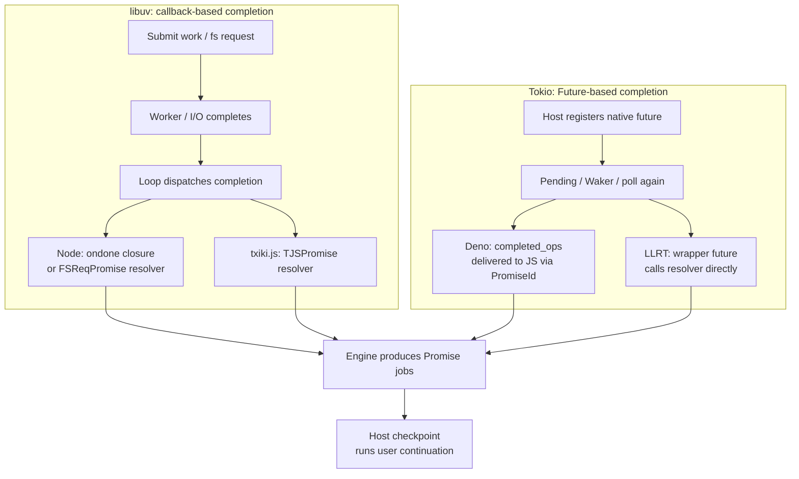

What they share is that the host holds the native work while it waits; what differs is where the continuation state and resolver live and how many queue layers the result passes through. Both models may use a blocking pool for ordinary file I/O, so callback/Future alone cannot tell you whether the underlying I/O is kernel-native async I/O.

### 6.2 Enqueue, Execution, and Keep-Alive of `queueMicrotask()`

This section specifically discusses the JavaScript **`queueMicrotask(callback)` API**. A call registers the callback and returns `undefined` normally, rather than returning a Promise for the user to await. The callback's return value is not used by this API to decide whether the task is complete.

First, observe the enqueue order with a sample that also includes a Promise reaction:

```js
queueMicrotask(() => {
  console.log('micro-1');
  queueMicrotask(() => console.log('micro-2'));
});
Promise.resolve().then(() => console.log('promise'));
console.log('sync');
```

Node*, Deno, Dune, LLRT, and txiki.js were all measured to output `sync → micro-1 → promise → micro-2`, exiting with 0. (Node* is the Homebrew-packaged v26.12.1 binary described in section 2.2: same release and V8 as the tag, but system libuv 1.53.0.) The explanation: before the drain starts the queue already holds `[micro-1, promise]`; the `micro-2` enqueued while running `micro-1` lands behind `promise`. For txiki.js the source path is given below.

#### 6.2.1 Node.js: JS Argument Check, Native Binding Enqueues into the V8 Queue

`queueMicrotask(callback)` first calls `validateFunction()`; depending on the async context/hooks state it may wrap the callback in an `AsyncResource` callback, and then calls the `enqueueMicrotask` binding. The C++ binding ultimately executes `GetMicrotaskQueue()->EnqueueMicrotask(...)`. Sources: [JS API][code-159], [native enqueue / checkpoint][code-127].

It does not create a libuv timer, request, or idle handle for each callback. The task is actually held by V8 and runs at a checkpoint chosen by Node: for example, a V8 microtask checkpoint performed by `InternalCallbackScope::Close()` (C++ `PerformCheckpoint`) or by the JS `runMicrotasks()` binding inside `runNextTicks()` / `processTicksAndRejections()`. If nextTicks already exist at the same drain boundary, Node processes the nextTick queue first; once a V8 checkpoint is running, a nextTick cannot preempt it.

Correctness before exit depends on these drain boundaries. This API creates runnable JS work; if the callback then initiates a file read, the new native request takes over subsequent keep-alive.

#### 6.2.2 txiki.js: Uses QuickJS's `queueMicrotask` Directly

In the pinned QuickJS snapshot, `js_global_queueMicrotask()` checks that the callback is a function, then calls `JS_EnqueueJob(ctx, js_microtask_job, ...)`; when the job runs, it does `JS_Call` on the user callback. No Promise is created separately for this API. Source: [txiki.js's pinned QuickJS API implementation][code-131].

Such jobs are executed in a loop by `tjs__drain_microtasks()`. The prepare/check path maps `JS_IsJobPending()` (or a non-empty pending-rejection list) to the active state of a referenced idle handle, which both keeps libuv iterating and avoids blocking in poll when ready jobs exist; drains after timer callbacks and similar paths may also consume it. Sources: [job drain][code-030], [idle mapping][code-032].

Therefore a ready `queueMicrotask` callback can be advanced further by the host; a Promise that is merely pending, with no corresponding runnable job, does not trigger the same idle condition.

#### 6.2.3 Dune: Wrap Exception Handling, Then Call V8 Enqueue

Dune's global `queueMicrotask` is a JS wrapper: it first checks the function type, then hands a `try/catch`-wrapped callback to `$$queueMicro`; the Rust `global_queue_micro()` calls the V8 context's `enqueue_microtask`. Sources: [JS wrapper][code-130], [Rust binding][code-129].

This callback is kept in the V8 queue, not in the `pending_futures` Vec. `run_event_loop()` executes `run_next_tick_callbacks()` before the first keep-alive check, and that includes a V8 checkpoint; it runs again later at module and native-completion boundaries. Hence a simple program that has only such ready jobs and no native I/O can also finish its callbacks and then exit. Sources: [startup drain and main loop][code-053], [nextTick/checkpoint][code-048].

#### 6.2.4 Deno: The Current Snapshot Uses the V8 Native API, Not an Async Op Each Time

`01_core.js` captures the native `queueMicrotask` provided by V8 and uses a JS wrapper for the function check and callback exception reporting; the snapshot restore path may also lazily capture the native function on first use. Source: [current `queueMicrotask()` implementation][code-128].

Calling this API **allocates no PromiseId, puts no new future into `pending_ops`, and does not need to spawn a Tokio task for each callback**. Execution still happens at V8 checkpoints, which Deno schedules at event-loop phases and some callback boundaries. The drain before the exit decision can keep producing ops, nextTicks, or module work, and then `EventLoopPendingState` decides whether it must keep running.

#### 6.2.5 LLRT: `Function::defer()` Puts the Callback into QuickJS Jobs

LLRT's Rust `queue_microtask` accepts an argument of type `Function` and calls `cb.defer(())`. Rquickjs's deferred-call mechanism ultimately uses `JS_EnqueueJob(...defer_call_job...)`. Sources: [LLRT API][code-105], [rquickjs enqueue][code-107].

This differs from `Async(read_file)`: `queueMicrotask()` directly produces a QuickJS job and no wrapper future. On the path where jobs execute successfully, the CLI's `idle()` first runs QuickJS jobs until empty and only then polls the rquickjs scheduler. If an API callback enqueues another callback, it is consumed by the same job drain; unbounded recursive enqueueing can keep `idle()` from ever reaching the poll of Rust futures. Job execution errors take the branch described in the next subsection.

#### 6.2.6 Return Values, Exceptions, and Keep-Alive Boundaries

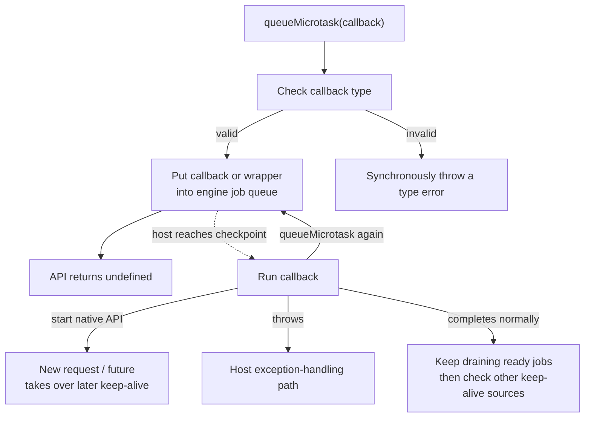

The following program separates "the API's synchronous return" from "the callback throwing later":

```js
try {
  queueMicrotask(123);
} catch (error) {
  console.log('invalid', error.name);
}
const result = queueMicrotask(() => {
  console.log('microtask');
  throw new Error('microtask-boom');
});
console.log('return', String(result));
console.log('sync');
```

The five measured binaries (Node*, Deno, Dune, LLRT, txiki.js) first output `invalid TypeError → return undefined → sync → microtask`. In this CLI case, with no extra exception handler installed:

| Runtime | Result after the callback throws | Corresponding handling path |
|---|---|---|
| Node* | Reports the error, exits 1 | The microtask callback exception enters the host's uncaught-exception handling |
| Deno | Reports `Uncaught Error`, exits 1 | The JS wrapper's `reportExceptionCallback` |
| Dune | Reports `Uncaught Error`, exits 1 | `reportError` → catch the exception → `check_exceptions` |
| LLRT | Prints `error executing job: ...`, exits 0 | rquickjs `AsyncRuntime::idle()` logs the error and then checks the scheduler; it can return when Empty |
| txiki.js | Prints the error report (`Error: microtask-boom` with a stack line), exits 1 | `JS_ExecutePendingJob()` returns an error → `TJS_Stop()` (see below) |

Sources: [Deno wrapper][code-128], [Dune report binding][code-160], [rquickjs idle error branch][code-094]. The LLRT result is limited to the CLI `idle()` path in this example; other entry points such as `Ctx::execute_pending_job()` handle errors differently, so it cannot be generalized to say all microtask exceptions behave the same. See [Ctx job execution][code-161].

**LLRT's "log the job error" does not guarantee that the remaining jobs keep draining.** The following verification sample was added for the current CLI:

```js
queueMicrotask(() => {
  console.log('first');
  throw new Error('queue-failure');
});
queueMicrotask(() => console.log('second'));
console.log('scheduled');
```

| LLRT verification condition | Actual output (blank lines omitted) | Exit code |
|---|---|---|
| Run only the code above | `scheduled` → `first` → `error executing job: Error: queue-failure`; no `second` | 0 |
| Add `setTimeout(() => console.log('timer'), 30)` at the start of the file | `scheduled` → `first` → the same error log → `second` → `timer` | 0 |

In the first case, the scheduler is already empty after the error, so `idle()` returns directly; in the second, the newly spawned timer-driver task is polled for the first time, which makes `Schedular::poll` return `PendingProgress`, so `idle()` loops back into the job drain. Had the driver already been polled with nothing ready, `poll` would return `Pending`, `idle()` would suspend with the job still queued, and it would run only at the next unrelated wake-up. This was observed with a variant that awaits a 50 ms timer and a `readFile` first (so the driver has been polled), then queues the failing job and a second job, with a 400 ms timer pending: `second` printed only at about 350 ms, together with the 400 ms timer. This is the behavior of the error path in the current implementation; the second sample cannot be used to infer that "adding a timer is a general way to recover from exceptions". The source basis remains [the Err branch and scheduler branch of `idle()`][code-094].

The corresponding source path in txiki.js is `JS_ExecutePendingJob()` returns an error → `TJS_Stop()` → `TJS_Run()` reports the retained exception. The txiki.js tag binary (`build/tjs`, v26.6.0) was also run on the first sample of this subsection (the one that prints `invalid` / `return` / `sync`) and matched this path: the error report is printed and the exit code is 1.

Finally, `queueMicrotask(async () => { ... })` also does not make the host automatically await the Promise returned by the callback. Whether execution can continue depends on whether the callback registers native work, produces other jobs, or is required to be waited on by the host's module/root-future policy.
### 6.3 `nextTick`: Different Queue Policies Under the Same Name

This section covers Node.js, Deno's Node compatibility layer, Dune, and LLRT, which actually provide `process.nextTick()`. It is not a same-named phase of libuv, nor a built-in Tokio scheduling API.

Below, the tasks are registered inside a timer callback, to rule out interference with priority observation from the execution context of top-level ESM evaluation:

```js
const processApi = typeof Deno === 'undefined'
  ? process
  : (await import('node:process')).default;

setTimeout(() => {
  const order = [];
  Promise.resolve().then(() => order.push('promise'));
  queueMicrotask(() => order.push('microtask'));
  processApi.nextTick(() => {
    order.push('tick-1');
    processApi.nextTick(() => order.push('tick-2'));
  });
  setTimeout(() => console.log(order.join(',')), 30);
}, 1);
```

| Runtime | Measured order | Explanation |
|---|---|---|
| Node* | `tick-1,tick-2,promise,microtask` | Drain the nextTick queue until empty, then checkpoint |
| Deno | `tick-1,tick-2,promise,microtask` | core implements a separate nextTick queue and the corresponding drain priority |
| Dune | `tick-1,promise,microtask,tick-2` | Drain the current snapshot; recursive ticks wait for the next drain |
| LLRT | `promise,microtask,tick-1,tick-2` | All three entry points use the same QuickJS job queue |

#### 6.3.1 Node.js: A Separate FIFO Queue and a Shared Tick Flag

`process.nextTick()` creates a TickObject containing the callback, args, and async context and puts it into the JS `FixedQueue`; when the queue goes from empty to non-empty it sets the scheduled flag in `tickInfo`, which the C++ callback scope uses for its decision. Source: [nextTick enqueue][code-134].

The inner `while (queue.shift())` of `processTicksAndRejections()` processes everything, including new ticks recursively added by callbacks, until the queue is empty, and then runs V8 microtasks; if the microtasks add more ticks, the outer loop drains again. That is why `tick-2` in this example still comes before the Promise reaction. Source: [drain algorithm][code-017].

No TickObject needs a libuv request. It runs promptly because of the control flow in which Node processes the host task queues before returning to the native loop; unbounded nextTick recursion can likewise keep control flow from returning to the I/O loop for a long time.

#### 6.3.2 Deno: A Node-Style Host Queue Implemented on Tokio

`ext/node/polyfills/_next_tick.ts` constructs a TickObject, stores the async context, and calls `core.queueNextTick()`. The core JS queue and `tickInfo` hold the pending state, and `processTicksAndRejections()` uses a drain algorithm of ticks first, microtasks afterwards. Sources: [Node-compatible API][code-132], [core enqueue/flag][code-135], [core drain][code-070].

`has_tick_scheduled` also enters Deno's liveness criteria; when another round is needed, the event-loop Waker arranges a re-poll. What gets woken here is the outer work driving the JS runtime, not a Tokio task created per nextTick. Some phase/callback boundaries already process it within the current poll, with no need to wait for another round of OS I/O notification.

#### 6.3.3 Dune: `mem::take` Leaves Recursive Ticks for the Next Batch

The Rust `next_tick()` puts the persistent callback and its arguments into `next_tick_queue`. During execution, `run_next_tick_callbacks()` takes the entire Vec via `mem::take`, runs that batch, and then performs a V8 checkpoint. Sources: [enqueue][code-133], [snapshot drain][code-048].

The `tick-2` added while `tick-1` runs lands in the new Vec in state, not in the current snapshot. So this checkpoint's `promise,microtask` run first, and a later call to `run_next_tick_callbacks()` handles `tick-2`. **"The next batch" does not necessarily mean the next full event-loop iteration**: other boundaries within the same outer tick may also call drain again.

`has_next_tick_callbacks()` participates in the outer keep-alive decision; this host queue is distinct from crabuv's OS poller, its native resources, and the ready completion Vec.

#### 6.3.4 LLRT: `nextTick` Is a Deferred QuickJS Job

LLRT puts the callback arguments into `Args` and then calls `cb.defer_arg(args)`; underneath it is still `JS_EnqueueJob`. There is no additional high-priority nextTick queue. Sources: [LLRT API][code-106], [defer enqueue][code-107].

In this example the Promise reaction is registered first, then the `queueMicrotask` callback, and last the nextTick callback, so the order is `promise,microtask,tick-1`; `tick-1` then puts `tick-2` at the tail of the queue. What CLI keep-alive sees is ready QuickJS jobs, not a dedicated nextTick counter.

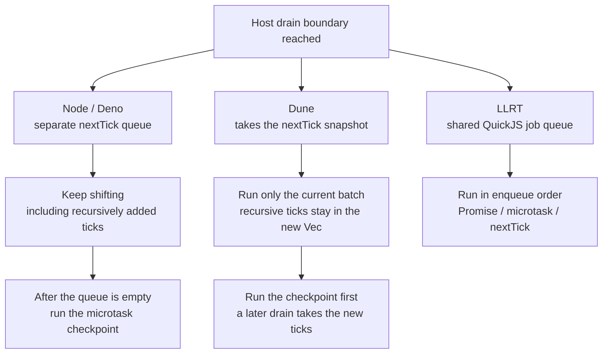

These results show in particular that Node and Deno have different native scheduling models yet can implement the same host-queue priority; and that Deno and LLRT both use Tokio yet do not thereby share the same `nextTick` semantics.

### 6.4 Dynamic import: Loading, Evaluation, and Exit Are Three Separate Problems

None of the module samples below exports a callable `then`. If such an export existed on the namespace, resolving the namespace would also trigger thenable assimilation, and the value with which `import()` finally fulfills would not necessarily be the namespace; this follows the Promise resolution rules described in Section 3.3.

For `import('./dep.mjs')`, at least the following must be distinguished:

1. **Resolve/load**: locate the module and obtain its source, possibly via synchronous reads, caches, native work, or futures.
2. **Link/instantiate**: build the dependency graph and bindings.
3. **Evaluate**: execute the module; on encountering TLA, the evaluation Promise can stay pending.
4. **Deliver the import result**: on the normal evaluation-phase path, the namespace should be delivered after successful evaluation, and rejected on failure.
5. **Liveness**: while the above stages have not finished, the host chooses to keep waiting, report that it cannot make progress, or end execution.

The public import Promise and the internal evaluation Promise are two logical roles, and real implementations may have more Promise wrappers. **A "ModuleJob" may also be just a loader state object; it is not an engine job, much less a Tokio task.**

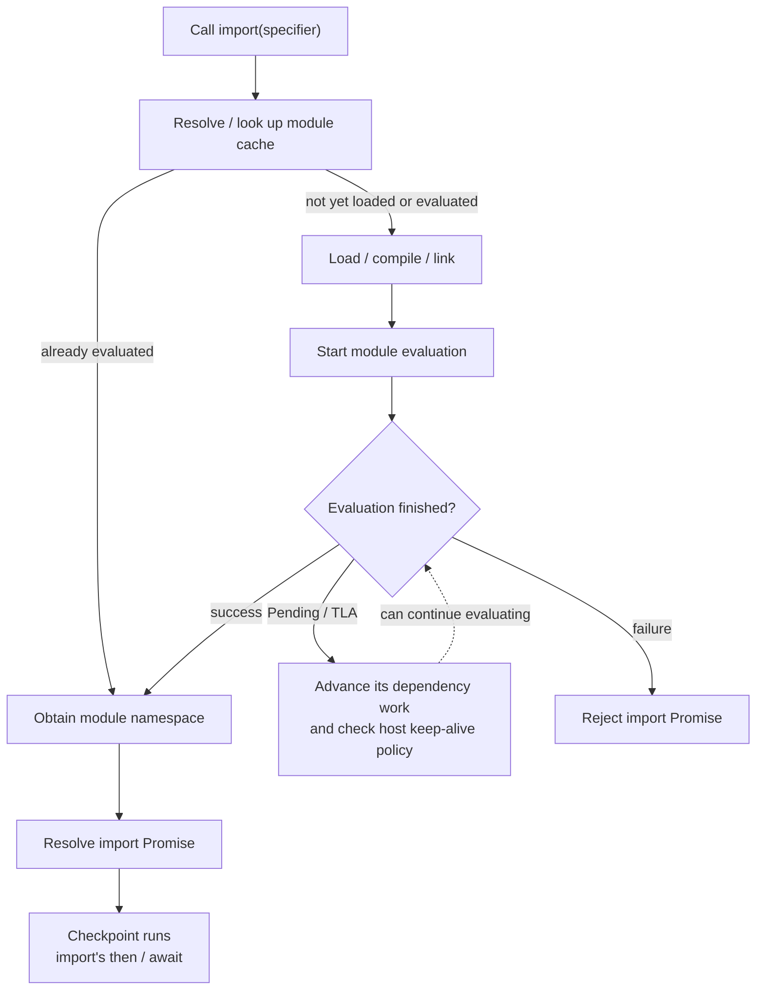

The diagram shows the path that waits for evaluation to finish before delivering; Dune's current snapshot, which delivers the namespace early, is explained separately below.

#### 6.4.1 Node.js: The Main Thread Uses ModuleJob with Synchronous Loading/Linking

An ordinary local ESM import enters `getOrCreateModuleJob()` from `import()` in the Node loader: it looks up `loadCache` by the resolved URL / attributes, and only on a miss loads the module and constructs a job. **In the current snapshot, the main thread creates an ordinary `ModuleJob`; `ModuleJobSync` is chosen only for `kImportInRequiredESM` (a module reached through `require(esm)`). Resolution, loading and linking still run synchronously unless the async loader-hook worker is involved (`link()` takes the async path only on that worker, otherwise `syncLink()`), and default `file:` sources are read through `loaderMethods.readFileSync()`.** Therefore this cannot be drawn directly as the asynchronous request chain of `fs.promises.readFile()` shown earlier. Sources: [job cache and type selection][code-136], [local source read][code-138].

`ModuleLoader.import()` is still an async API: it awaits `job.run()` and then returns the namespace. `ModuleJob.run()` awaits `#instantiate()` (the dependency jobs are already linked, so it only walks them and calls `module.instantiate()`), and then awaits `this.module.evaluate()`; that evaluation Promise stays pending while the graph has TLA. `ModuleJobSync.run()` matters when a module that was first loaded by `require(esm)` is imported again: it rethrows a cached error, waits on a stored `evaluationPromise` (or returns directly) if the module is already evaluated, and calls `evaluate()` itself only if the module was left instantiated (for example because of TLA) or uninstantiated. Sources: [public import flow][code-137], [evaluation and TLA][code-139].

Keep-alive has to be examined separately for the native work produced during evaluation:

- When a module awaits a timer / file operation, the related handle/request can continue to keep the process alive, and completion and checkpoints advance the evaluation Promise.
- Merely caching a job or holding a pending Promise does not automatically create active libuv work.
- Node's exit diagnostics first check whether the entry-point Promise is pending, then check the entry module for a stalled TLA. **A detached dynamic import that is not awaited by the entry point cannot directly reuse the "exit 13" conclusion.** Source: [entry-point check][code-140]; a measurement of this distinction is given below.

What is described here is the default main-thread path at the specified tag (v26.12.1); the async loader-hook worker is a separate path. The measurements on Node* (a Homebrew-packaged v26.12.1 binary, not a build of this tag's source tree) only verify sample behavior and are not evidence of loader internals at this tag.

#### 6.4.2 txiki.js: A Synchronous Module Loader Called Inside a QuickJS Import Job

In the pinned QuickJS snapshot, `js_dynamic_import()` creates the import Promise capability and puts the resolver, referrer, specifier, and so on into `js_dynamic_import_job`; it enqueues the job first and then returns the Promise, to avoid unwanted recursion inside module evaluation. After that:

```text
QuickJS job drain
  → js_dynamic_import_job
  → JS_LoadModuleInternal
  → txiki.js normalizer / tjs_module_loader
  → local tjs__load_file: read the source synchronously
  → compile-only module, build dependencies and start evaluation
  → install fulfilled/rejected handlers on the evaluation Promise
  → on successful evaluation, resolve import Promise(namespace)
  → a later job runs the user continuation
```

Sources: [txiki.js's pinned QuickJS import/evaluation logic][code-142], [host module loader][code-141], [synchronous file helper][code-121].

A particularly easy point of confusion: `tjs.readFile()` places `tjs__load_file()` in the worker pool, whereas **the local module loader calls this helper directly in the engine's call path**. The same read function becomes the work body of an async API in one calling context and part of a synchronous loader in another.

While the import job can still run, QuickJS jobs / the idle handle can keep driving the loop; if module TLA depends on a timer/readFile, that native work keeps the process alive. If all that remains is an evaluation Promise with no source of progress, the host `TJS_Run()` has no separate keep-alive registration for a pending dynamic evaluation. The engine waiting for TLA before resolving the import, and whether the host keeps existing, are two independent questions.

#### 6.4.3 Dune: Asynchronously Loads the Graph, but Does Not Wait for the Evaluation Promise Before Delivering

`host_import_module_dynamically_cb()` creates a persistent resolver. If the same root is already loading, the new resolver is added to `same_origin`; otherwise it builds a `ModuleGraph::dynamic_import`, registers it in `module_map.pending`, and submits a crabuv loading task. Source: [dynamic import entry and deduplication][code-146].

The loading task obtains the source in a worker; the completion enters `EsModuleFuture`. This ready action compiles the module on the V8 thread, checks dependencies, and then submits loading tasks for new dependencies. A graph being `Ready` means the source graph can proceed to instantiation/evaluation; it does not mean TLA has finished. Sources: [compile/register][code-147], [recursive dependency loading][code-148].

The key order in the current `fast_forward_imports()` is:

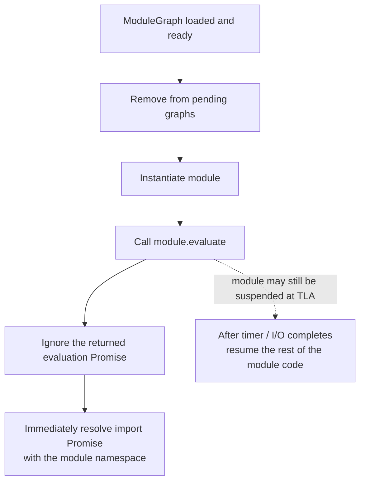

Source: [evaluate and namespace resolution][code-149].

Therefore, in the current snapshot the import Promise can resolve before TLA completes; the cached path also does not separately wait for a pending evaluation. The live bindings of the namespace do not remove this difference in delivery timing: a user may first observe export values whose asynchronous initialization has not yet finished.

The loading stage is kept alive by the pending graph and crabuv resources; once evaluation starts, the graph has already been removed from pending. If the TLA internally creates timer/file tasks, those native tasks can still keep execution going; a bare pending Promise has no equivalent keep-alive. The two cases below verify these two situations respectively.

#### 6.4.4 Deno: A Separate Module Pipeline That Explicitly Distinguishes Loading from Evaluation

Deno's dynamic modules do not correlate results through the ordinary async-op `promiseRing`. The V8 host callback creates a `Global<PromiseResolver>` and hands it to `ModuleMap::load_dynamic_import()`; the latter stores the resolver in `dynamic_import_map` keyed by load ID. A new load also notifies the event-loop Waker. Sources: [host callback][code-150], [module registry][code-152], [wake-up entry][code-158].

The general path involves three independent kinds of pending state:

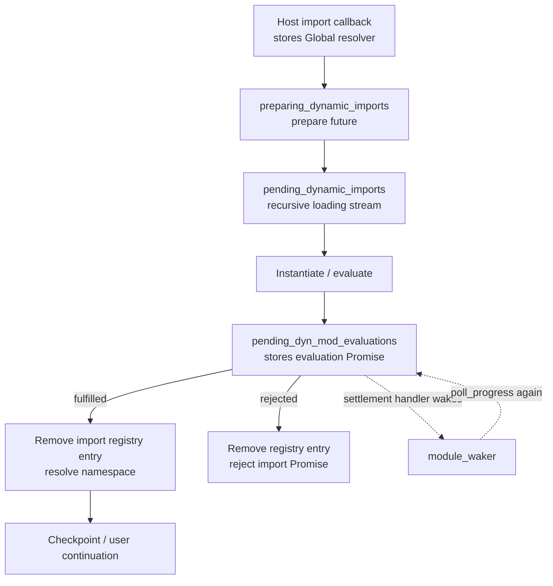

`poll_progress(cx, scope)` advances the prepare and load futures/streams, registers modules, and checks evaluation Promises; it is called directly by the JS event-loop tick, which does not mean every import spawns its own Tokio task. The underlying `ModuleLoader` may return a `Sync` or `Async` source; the CLI also has its own preparation, caching, and async loading paths. Sources: [module progress][code-155], [loader interface][code-156], [CLI loading][code-157].

During evaluation, Deno holds the internal evaluation Promise and installs fulfilled/rejected handlers to wake the module driver; only after observing that Promise fulfilled does it resolve the user's import Promise, and on rejection it forwards the exception. Sources: [evaluation tracking][code-153], [namespace delivery][code-154].

A cache hit also cannot be judged by "the module already exists" alone: in the fast path for an already-loaded module, this snapshot also checks whether that module is still listed in `pending_dyn_mod_evaluations`; if so, the new resolver goes into `pending_tla_waiters` instead of delivering the namespace too early. Source: [cache and TLA waiters][code-151].

These loading/evaluation states enter `EventLoopPendingState` independently. So even when `pending_ops.len() == 0`, the runtime may still stay running because of dynamic modules; if there is no work that can advance, it enters stalled-TLA detection. This is handled differently from an ordinary pending Promise, and it is not the same count as "how many tasks Tokio currently has".

#### 6.4.5 LLRT: import Goes Through the QuickJS Loader, Not the `Async(read_file)` Pipeline

LLRT's QuickJS likewise first creates the import capability and enqueues a dynamic-import job, and the job then drives loading and evaluation; only after the evaluation Promise is fulfilled does the internal handler resolve the namespace. The QuickJS used here is a different commit pinned by rquickjs-sys; see [LLRT's QuickJS import path][code-143] for the source.

Rquickjs `Loader::load()` is an interface that returns `Result<Module>` synchronously. LLRT's ordinary ESM `PackageLoader` looks up the module cache, and on a miss reads the source with `std::fs::read()` and calls `Module::declare()`; it does not call the Tokio future binding of `fs/promises.readFile` described earlier. Sources: [loader interface and hookup][code-144], [LLRT local ESM loader][code-145].

Therefore a single LLRT program can contain all of the following at once:

- `readFile()`: native Rust future → rquickjs scheduler → resolver.
- The local source read of `import()`: QuickJS job → synchronous Rust loader → module evaluation Promise.
- Timer/readFile inside a module's TLA: produces rquickjs-owned futures anew, which drive the evaluation Promise to completion.

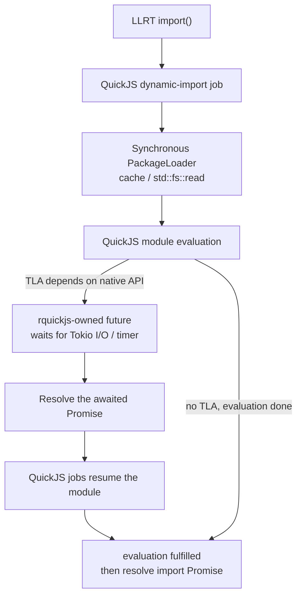

The CLI's final `idle()` checks jobs and scheduler futures. **The engine correctly waiting for TLA before settling the import does not mean the CLI will wait indefinitely for a pending evaluation Promise that has no native work.** Host modes such as Lambda, which fold JS Promises into a Rust root future, are a different matter; see Section 5.5.6.

#### 6.4.6 Two Cases to Separate "Waiting for Evaluation" from "Process Keep-Alive"

Case A: the caller does not await the import, but the imported module contains a timer TLA that can make progress.

```js
// main-timer.mjs
console.log('main:start');
import('./dep-timer.mjs').then(ns => console.log('import:resolved', ns.phase));
console.log('main:end');
```

```js
// dep-timer.mjs
export let phase = 'before';
console.log('module:start');
await new Promise(resolve => setTimeout(resolve, 30));
phase = 'after';
console.log('module:end');
```

Case B: swap the import target for `dep-never.mjs`, a module with only a Promise that can never make progress:

```js
// main-never.mjs
console.log('main:start');
import('./dep-never.mjs').then(ns => console.log('import:resolved', ns.phase));
console.log('main:end');
```

```js
// dep-never.mjs
export const phase = 'before';
console.log('module:start');
await new Promise(() => {});
console.log('module:end');
```

In both cases, the four measured binaries first print `main:start,main:end,module:start`. The subsequent results are:

| Runtime | Case A subsequent output | A exit code | Case B subsequent result | B exit code |
|---|---|---|---|---|
| Node* | `module:end` → `import:resolved after` | 0 | Import continuation does not run | 0 |
| Deno | `module:end` → `import:resolved after` | 0 | `Top-level await promise never resolved` | 1 |
| Dune | `import:resolved before` → `module:end` | 0 | `import:resolved before`; the module's post-await code never runs | 0 |
| LLRT | `module:end` → `import:resolved after` | 0 | Import continuation does not run | 0 |

Each run was a separate process with a 10-second external timeout; all these cases ended on their own without timing out. Node* is the Homebrew-packaged v26.12.1 binary described in section 2.2, and txiki.js has no row in this table. Spot runs of the tag binary `build/tjs` (`v26.6.0`) on the same two samples gave the same result as the Node / LLRT rows (Case A: `module:end` then `import:resolved after`; Case B: no continuation; both exit code 0). The txiki.js analysis in this section remains source-based.

They can be reproduced as follows, swapping the main file:

```sh
node main-timer.mjs
./deno/target/debug/deno run --no-config --no-lock --allow-read main-timer.mjs
./dune/target/debug/dune run main-timer.mjs
./llrt/target/aarch64-apple-darwin/release/llrt main-timer.mjs
```

The core differences are:

- In **Node / txiki.js / LLRT**, the import Promise can wait for module evaluation, but an ordinary pending import with no source of progress is not automatically equivalent to native work that must keep the process alive; entry TLA / embedder root futures need separate analysis.
- **Deno** explicitly counts dynamic loading and evaluation as host state, and detects evaluation that makes no progress.
- **Dune** tracks the loading graph; the current snapshot also exhibits the behavior of delivering the namespace before TLA completes.

This shows both that the asynchronous result of `import()` does not guarantee that internal loading is non-blocking I/O, and that **a pending import Promise, a pending module evaluation, and a pending native operation cannot be replaced by one shared "pending jobs" count**.

## 7. Behavioral Experiments

### 7.1 Summary of Results

`Node*` is the run on the Homebrew-packaged Node v26.12.1 binary described in section 2.2 (same release as the checked-out tag, linked against system libuv 1.53.0; not a build of the tag's source tree). All samples are ESM; the nextTick sample runs inside a timer callback, which excludes the scheduling differences of top-level ESM itself.

The table below keeps the summary of the baseline experiments; the code and results of the scenario-extension experiments are in Sections 6.2, 6.3, and 6.4, covering the order/exceptions of `queueMicrotask()`, mixed nextTick queues, and two dynamic-import cases respectively. The two LLRT job error-branch samples added during content verification are in Section 6.2.6.

| Experiment | Node* | Deno | Dune | LLRT |
|---|---|---|---|---|
| Store a pending Promise globally; a plain async function awaits it | Exits 0; code after the await does not run | Same as left | Same as left | Same as left |
| Only schedule `.then` and `queueMicrotask` | All run, then exits 0 | Same as left | Same as left | Same as left |
| Plain async function awaits a 30ms timer | Continuation runs, then exits 0 | Same as left | Same as left | Same as left |
| Read a file without await, only attach `.then` | Prints `READ 5`, exits 0 | Same as left | Same as left | Same as left |
| `await new Promise(() => {})` as TLA | Exits 13, diagnostic: unsettled TLA | Exits 1, diagnostic: never resolved | Exits 0, no such diagnostic | Exits 0, no such diagnostic |
| `resolve(thenable)` getter | Synchronous getter, asynchronous then/reaction | Same as left | Same as left | Same as left |
| Bare `Promise.reject(new Error(...))`, no handler | Exits 1, reports the error | Exits 1, reports the error | Exits 1, reports the error | Exits 0, rejection not reported |
| Order of recursive nextTick vs. Promise | `tick-1,tick-2,promise` | `tick-1,tick-2,promise` | `tick-1,promise,tick-2` | `promise,tick-1,tick-2` |
| Two timers, first one schedules `.then` | `timer-1,then-1,timer-2` | Same as left | Same as left | Same as left |
| Infinite Promise chain + 10ms timer | Timer did not run within 2 seconds; terminated by external timeout | Same as left | Same as left | Same as left |
| Only a 60-second unref timer remains | Exits normally right away; timer not executed | Same as left | No equivalent timer API, not run | No equivalent timer API, not run |

The conclusion from the first three "all exit" rows shows that **keep-alive depends on advanceable host/native work, not on whether a pending Promise object is still reachable.**

LLRT's raw rejection experiment also cannot be generalized to "all exceptions are ignored": a module-load rejection, a rejection of an awaited Promise, a spawn error handler, and an error thrown by a JS job itself are different error paths.
### 7.2 Key Reproduction Code

#### A. A Pending Promise Does Not Keep the Process Alive

```js
globalThis.pending = new Promise(() => {});
globalThis.pending.then(() => console.log('unexpected reaction'));
(async () => {
  console.log('async-start');
  await globalThis.pending;
  console.log('unexpected resumed');
})();
console.log('sync-end');
```

#### B. nextTick Differences with the Same Test Logic

```js
// Deno: add `import process from 'node:process';` at the top of the file. Without it, the first
// access to the lazily initialized global `process` inside the callback appears to run a
// microtask checkpoint, and Deno prints `promise,tick-1,tick-2` (measured) instead of `tick-1,tick-2,promise`.
setTimeout(() => {
  const order = [];
  Promise.resolve().then(() => order.push('promise'));
  process.nextTick(() => {
    order.push('tick-1');
    process.nextTick(() => order.push('tick-2'));
  });
  setTimeout(() => console.log(order.join(',')), 30);
}, 1);
```

This difference comes from the **host queue design**: Node / Deno drain until empty; Dune drains a snapshot; LLRT puts the ticks into the ordinary engine job queue. The Deno result in Section 7.1 is the one with the `node:process` import; section 6.3 binds `process` through `(await import('node:process')).default`. txiki.js has no global `process`, so this sample cannot run on it.

#### C. `ShouldYield` Cannot Preempt a JS Job Drain

```js
console.log('started');
setTimeout(() => console.log('timer-fired'), 10);
function spin() { Promise.resolve().then(spin); }
spin();
```

A timeout must be set externally. This experiment verifies that "the timer gets no chance to run"; the process continuing to exist is not itself taken as proof of fairness.

Form of the reproduction commands (run from this directory):

```sh
./deno/target/debug/deno run --no-config --no-lock example.mjs
./dune/target/debug/dune run example.mjs
./llrt/target/aarch64-apple-darwin/release/llrt example.mjs
node example.mjs
./txiki.js/build/tjs run example.mjs   # samples A and C only; B needs a global `process`
```

## 8. A Unified View of Exit Determination

### 8.1 Host States and What the Host Should Do

| State | What the host should do |
|---|---|
| Ready JS / host work exists | Advance immediately, or schedule the next dispatch; avoid sleeping without a notification |
| No ready work, but referenced pending native work exists | Wait for I/O / timer / Waker |
| Only unrefed work remains | May enter the shutdown flow; unrefed work may still run while other work keeps the process alive |
| Only ordinary pending Promises, no native work | Usually can finish; do not derive liveness from the number of Promise objects |
| A module evaluation / host root future that must complete exists | Wait or report inability to progress per host policy; different from an ordinary Promise |

The following connects these states into an abstract flow. It represents the decisions a host must make, and does not prescribe that the five runtimes adopt the same queue priorities or exit hooks.

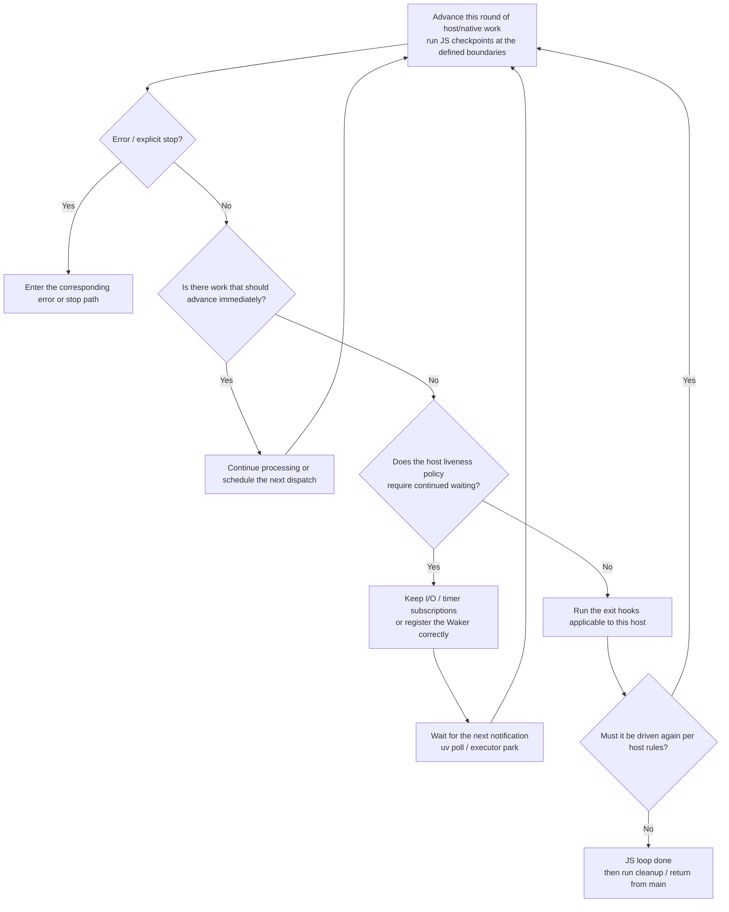

`Pending` corresponds to the phase of continuing to wait or rescheduling, and cannot substitute for a liveness decision. If the host requires TLA / root evaluation to complete, it also needs to check, when "advancing this round of work", whether any source of progress exists; Deno's stalled-TLA detection is exactly such an additional policy. Exit hooks may also produce new work; whether to continue running and how to avoid busy-spinning is up to the host.

### 8.2 Per-Project Policies

| Runtime | Primary liveness state | Extra handling after idle |
|---|---|---|
| Node | referenced active handles, active requests, pending / closing native work | platform tasks, beforeExit, exit, unsettled-TLA check |
| txiki.js | libuv liveness; ready jobs / deferred rejections attached via an idle handle | beforeunload; worker-specific keep-alive; abnormal stop |
| Dune | crabuv resources / requests / threadpool + imports / nextTick / rejections / V8 background tasks | same-tick completion drain on the traced paths; no Node-style stalled-TLA check |
| Deno | refed ops / timers / tasks + module state + nextTick / rejection events + external ops + uv-compatible handles | stalled TLA, optional inspector waiting, CLI exit hooks, Tokio shutdown |
| LLRT CLI | On the normal path, checks QuickJS jobs + rquickjs-owned futures | Continues the exit flow after `idle()`; a job execution error may make it return early, see Section 6.2.6; Lambda uses a different host root future |

**End of the JS event loop, runtime cleanup, and OS process exit are three phases and should not be conflated into one API.** Explicit `process.exit()` / `Deno.exit()` / `tjs.exit()`, abnormal exits, and external signals take other branches as well.

Draining the currently runnable jobs before exit matters, because they may produce new I/O. But there is no single "microtasks first, then nextTick, then beforeExit" formula that every runtime must copy; Node's queue priorities, txiki.js's beforeunload, and LLRT's `idle()` already demonstrate different policies.

## 9. Implications for Implementing a New Runtime

1. **Separate waiting from runnable work**: model pending Promise reactions, ready JS jobs, and pending native operations separately.
2. **Define completion ownership**: either design works: the native operation can hold the resolver itself, or it can hold a correlation ID that JS maps back to the resolver. Which is better depends on the engine API and lifecycle design, not on the name Tokio.
3. **Preserve completion handoff liveness**: when a result is already ready but has not yet been delivered to JS, it must still be covered by some registry / runnable queue / control-flow invariant.
4. **Define checkpoints explicitly**: state which native callbacks, host batches, and module transitions are followed by a jobs drain; test reentrancy and recursive scheduling.
5. **Keep liveness separate from wake-up**: a correct keep-alive count without a wake will hang; a correct wake with a missed keep-alive will exit prematurely.
6. **Specify unref and TLA policies**: they are host lifecycle contracts, equal neither to Promise state nor to cancelling a Rust future.
7. **Check fairness at each layer**: the yield budget of a Rust scheduler cannot preempt code the JS engine is executing or an infinite microtask drain; a libuv callback loop likewise needs to consider starvation.

The whole can be summarized in one sentence: **libuv-based runtimes usually express native work as handles/requests and callbacks; Tokio-based runtimes usually express it as futures and Wakers. Execution of Promise/await is still done by the JS engine; checkpoint timing and exit policy are defined by the host.**

<!-- Source permalinks: exact local revision and line ranges. Tokio and Mio permalinks cite the versions locked by LLRT (tokio 1.53.1, mio 1.2.0); Deno locks tokio 1.47.1 / mio 1.0.3 and Dune locks mio 1.2.2, and the cited text is identical in the diffed versions. -->
[code-001]: https://github.com/nodejs/node/blob/bc2e01dcf6acd5cf7d169b5f26cf89abaaeb41f1/deps/v8/src/builtins/promise-abstract-operations.tq#L452-L488
[code-002]: https://github.com/quickjs-ng/quickjs/blob/fd0a0210b7be00957751871e7e01b8291268fc29/quickjs.c#L2138-L2202
[code-003]: https://github.com/nodejs/node/blob/bc2e01dcf6acd5cf7d169b5f26cf89abaaeb41f1/src/node.h#L437
[code-004]: https://github.com/denoland/deno/blob/fe7ed012d92c642fd8e5607ac5a45d517538b5c5/libs/core/runtime/setup.rs#L284
[code-005]: https://github.com/aalykiot/dune/blob/5958b6460d4a567a41e6194f637a86a45b265f95/src/runtime.rs#L148
[code-006]: https://github.com/nodejs/node/blob/bc2e01dcf6acd5cf7d169b5f26cf89abaaeb41f1/deps/v8/src/builtins/promise-resolve.tq#L160-L186
[code-007]: https://github.com/quickjs-ng/quickjs/blob/fd0a0210b7be00957751871e7e01b8291268fc29/quickjs.c#L54502-L54555
[code-008]: https://github.com/nodejs/node/blob/bc2e01dcf6acd5cf7d169b5f26cf89abaaeb41f1/deps/uv/src/unix/core.c#L393-L398
[code-009]: https://github.com/nodejs/node/blob/bc2e01dcf6acd5cf7d169b5f26cf89abaaeb41f1/deps/uv/src/uv-common.h#L243-L323
[code-010]: https://github.com/nodejs/node/blob/bc2e01dcf6acd5cf7d169b5f26cf89abaaeb41f1/deps/uv/src/unix/async.c#L93-L109
[code-011]: https://github.com/tokio-rs/tokio/blob/75fef53d0a8590c2d1dbb63672aa7b7d1ef51155/tokio/src/runtime/runtime.rs#L30-L54
[code-012]: https://github.com/tokio-rs/tokio/blob/75fef53d0a8590c2d1dbb63672aa7b7d1ef51155/tokio/src/runtime/runtime.rs#L283-L314
[code-013]: https://github.com/nodejs/node/blob/bc2e01dcf6acd5cf7d169b5f26cf89abaaeb41f1/src/node_file-inl.h#L193-L207
[code-014]: https://github.com/nodejs/node/blob/bc2e01dcf6acd5cf7d169b5f26cf89abaaeb41f1/src/node_file-inl.h#L226-L256
[code-015]: https://github.com/nodejs/node/blob/bc2e01dcf6acd5cf7d169b5f26cf89abaaeb41f1/src/node_file-inl.h#L282-L292
[code-016]: https://github.com/nodejs/node/blob/bc2e01dcf6acd5cf7d169b5f26cf89abaaeb41f1/src/api/callback.cc#L138-L213
[code-017]: https://github.com/nodejs/node/blob/bc2e01dcf6acd5cf7d169b5f26cf89abaaeb41f1/lib/internal/process/task_queues.js#L63-L109
[code-018]: https://github.com/nodejs/node/blob/bc2e01dcf6acd5cf7d169b5f26cf89abaaeb41f1/src/env.cc#L1748-L1771
[code-019]: https://github.com/nodejs/node/blob/bc2e01dcf6acd5cf7d169b5f26cf89abaaeb41f1/lib/internal/timers.js#L525-L644
[code-020]: https://github.com/nodejs/node/blob/bc2e01dcf6acd5cf7d169b5f26cf89abaaeb41f1/src/env.cc#L1809-L1845
[code-021]: https://github.com/nodejs/node/blob/bc2e01dcf6acd5cf7d169b5f26cf89abaaeb41f1/src/api/embed_helpers.cc#L23-L77
[code-022]: https://github.com/nodejs/node/blob/bc2e01dcf6acd5cf7d169b5f26cf89abaaeb41f1/src/api/hooks.cc#L52-L83
[code-023]: https://github.com/nodejs/node/blob/bc2e01dcf6acd5cf7d169b5f26cf89abaaeb41f1/src/node_exit_code.h#L30
[code-024]: https://github.com/saghul/txiki.js/blob/1a230d31183f062fae7a6c4fd2cff466cecc1787/src/mod_fs.c#L114-L131
[code-025]: https://github.com/saghul/txiki.js/blob/1a230d31183f062fae7a6c4fd2cff466cecc1787/src/mod_fs.c#L281-L288
[code-026]: https://github.com/saghul/txiki.js/blob/1a230d31183f062fae7a6c4fd2cff466cecc1787/src/mod_fs.c#L408-L416
[code-027]: https://github.com/saghul/txiki.js/blob/1a230d31183f062fae7a6c4fd2cff466cecc1787/src/utils.c#L200-L222
[code-028]: https://github.com/saghul/txiki.js/blob/1a230d31183f062fae7a6c4fd2cff466cecc1787/src/timers.c#L78-L95
[code-029]: https://github.com/saghul/txiki.js/blob/1a230d31183f062fae7a6c4fd2cff466cecc1787/src/utils.c#L184-L222
[code-030]: https://github.com/saghul/txiki.js/blob/1a230d31183f062fae7a6c4fd2cff466cecc1787/src/vm.c#L691-L781
[code-031]: https://github.com/saghul/txiki.js/blob/1a230d31183f062fae7a6c4fd2cff466cecc1787/src/js/polyfills/event-target.js#L588-L600
[code-032]: https://github.com/saghul/txiki.js/blob/1a230d31183f062fae7a6c4fd2cff466cecc1787/src/vm.c#L676-L681
[code-033]: https://github.com/saghul/txiki.js/blob/1a230d31183f062fae7a6c4fd2cff466cecc1787/src/vm.c#L806-L849
[code-034]: https://github.com/saghul/txiki.js/blob/1a230d31183f062fae7a6c4fd2cff466cecc1787/src/js/run-main/index.js#L159
[code-035]: https://github.com/saghul/txiki.js/blob/1a230d31183f062fae7a6c4fd2cff466cecc1787/src/js/run-main/index.js#L306
[code-036]: https://github.com/saghul/txiki.js/blob/1a230d31183f062fae7a6c4fd2cff466cecc1787/src/eval.c#L44-L64
[code-037]: https://github.com/saghul/txiki.js/blob/1a230d31183f062fae7a6c4fd2cff466cecc1787/src/mod_os.c#L31-L38
[code-038]: https://github.com/saghul/txiki.js/blob/1a230d31183f062fae7a6c4fd2cff466cecc1787/src/vm.c#L383
[code-039]: https://github.com/saghul/txiki.js/blob/1a230d31183f062fae7a6c4fd2cff466cecc1787/src/vm.c#L859-L862
[code-040]: https://github.com/aalykiot/dune/blob/5958b6460d4a567a41e6194f637a86a45b265f95/src/runtime.rs#L44-L48
[code-041]: https://github.com/aalykiot/dune/blob/5958b6460d4a567a41e6194f637a86a45b265f95/src/file.rs#L187-L273
[code-042]: https://github.com/aalykiot/crabuv/blob/2fda099a374bccf6d928bd59aa576be944ed2b39/src/event_loop.rs#L273-L284
[code-043]: https://github.com/aalykiot/crabuv/blob/2fda099a374bccf6d928bd59aa576be944ed2b39/src/event_loop.rs#L350-L358
[code-044]: https://github.com/aalykiot/crabuv/blob/2fda099a374bccf6d928bd59aa576be944ed2b39/src/event_loop.rs#L445-L466
[code-045]: https://github.com/aalykiot/crabuv/blob/2fda099a374bccf6d928bd59aa576be944ed2b39/src/event_loop.rs#L732-L770
[code-046]: https://github.com/aalykiot/dune/blob/5958b6460d4a567a41e6194f637a86a45b265f95/src/runtime.rs#L427-L432
[code-047]: https://github.com/aalykiot/dune/blob/5958b6460d4a567a41e6194f637a86a45b265f95/src/runtime.rs#L479-L504
[code-048]: https://github.com/aalykiot/dune/blob/5958b6460d4a567a41e6194f637a86a45b265f95/src/runtime.rs#L685-L718
[code-049]: https://github.com/aalykiot/dune/blob/5958b6460d4a567a41e6194f637a86a45b265f95/src/timers.rs#L88-L104
[code-050]: https://github.com/aalykiot/crabuv/blob/2fda099a374bccf6d928bd59aa576be944ed2b39/src/event_loop.rs#L169-L180
[code-051]: https://github.com/aalykiot/crabuv/blob/2fda099a374bccf6d928bd59aa576be944ed2b39/src/event_loop.rs#L235-L284
[code-052]: https://github.com/aalykiot/crabuv/blob/2fda099a374bccf6d928bd59aa576be944ed2b39/src/event_loop.rs#L657-L661
[code-053]: https://github.com/aalykiot/dune/blob/5958b6460d4a567a41e6194f637a86a45b265f95/src/runtime.rs#L442-L465
[code-054]: https://github.com/aalykiot/dune/blob/5958b6460d4a567a41e6194f637a86a45b265f95/src/modules.rs#L120-L123
[code-055]: https://github.com/aalykiot/dune/blob/5958b6460d4a567a41e6194f637a86a45b265f95/src/runtime.rs#L522-L579
[code-056]: https://github.com/aalykiot/dune/blob/5958b6460d4a567a41e6194f637a86a45b265f95/src/process.rs#L121-L127
[code-057]: https://github.com/denoland/deno/blob/fe7ed012d92c642fd8e5607ac5a45d517538b5c5/libs/core/00_infra.js#L32-L41
[code-058]: https://github.com/denoland/deno/blob/fe7ed012d92c642fd8e5607ac5a45d517538b5c5/libs/core/00_infra.js#L146-L196
[code-059]: https://github.com/denoland/deno/blob/fe7ed012d92c642fd8e5607ac5a45d517538b5c5/libs/core/runtime/op_driver/futures_unordered_driver.rs#L33-L68
[code-060]: https://github.com/denoland/deno/blob/fe7ed012d92c642fd8e5607ac5a45d517538b5c5/libs/core/runtime/op_driver/futures_unordered_driver.rs#L100-L124
[code-061]: https://github.com/denoland/deno/blob/fe7ed012d92c642fd8e5607ac5a45d517538b5c5/libs/core/runtime/op_driver/futures_unordered_driver.rs#L212-L231
[code-062]: https://github.com/denoland/deno/blob/fe7ed012d92c642fd8e5607ac5a45d517538b5c5/libs/core/runtime/jsruntime.rs#L3551-L3618
[code-063]: https://github.com/denoland/deno/blob/fe7ed012d92c642fd8e5607ac5a45d517538b5c5/libs/core/runtime/op_driver/futures_unordered_driver.rs#L128-L209
[code-064]: https://github.com/denoland/deno/blob/fe7ed012d92c642fd8e5607ac5a45d517538b5c5/libs/core/00_infra.js#L218-L235
[code-065]: https://github.com/denoland/deno/blob/fe7ed012d92c642fd8e5607ac5a45d517538b5c5/libs/core/runtime/op_driver/mod.rs#L56-L98
[code-066]: https://github.com/denoland/deno_unsync/blob/eefd38ef5a1d51f97666f2ced1476a7244ba90c7/src/tokio/task.rs#L49-L64
[code-067]: https://github.com/denoland/deno/blob/fe7ed012d92c642fd8e5607ac5a45d517538b5c5/libs/core/runtime/exception_state.rs#L17-L25
[code-068]: https://github.com/denoland/deno/blob/fe7ed012d92c642fd8e5607ac5a45d517538b5c5/libs/core/modules/map/dynamic.rs#L33-L38
[code-069]: https://github.com/denoland/deno/blob/fe7ed012d92c642fd8e5607ac5a45d517538b5c5/libs/core/runtime/jsruntime.rs#L2425-L2643
[code-070]: https://github.com/denoland/deno/blob/fe7ed012d92c642fd8e5607ac5a45d517538b5c5/libs/core/01_core.js#L356-L472
[code-071]: https://github.com/denoland/deno/blob/fe7ed012d92c642fd8e5607ac5a45d517538b5c5/libs/core/02_timers.js#L285-L289
[code-072]: https://github.com/denoland/deno/blob/fe7ed012d92c642fd8e5607ac5a45d517538b5c5/libs/core/uv_compat.rs#L359-L427
[code-073]: https://github.com/denoland/deno/blob/fe7ed012d92c642fd8e5607ac5a45d517538b5c5/libs/core/uv_compat.rs#L577
[code-074]: https://github.com/denoland/deno/blob/fe7ed012d92c642fd8e5607ac5a45d517538b5c5/libs/core/uv_compat.rs#L1380-L1441
[code-075]: https://github.com/denoland/deno/blob/fe7ed012d92c642fd8e5607ac5a45d517538b5c5/libs/core/runtime/jsruntime.rs#L2709-L2724
[code-076]: https://github.com/denoland/deno/blob/fe7ed012d92c642fd8e5607ac5a45d517538b5c5/libs/core/runtime/jsruntime.rs#L3050-L3137
[code-077]: https://github.com/denoland/deno/blob/fe7ed012d92c642fd8e5607ac5a45d517538b5c5/libs/core/02_timers.js#L198-L207
[code-078]: https://github.com/denoland/deno/blob/fe7ed012d92c642fd8e5607ac5a45d517538b5c5/libs/core/02_timers.js#L396-L407
[code-079]: https://github.com/denoland/deno/blob/fe7ed012d92c642fd8e5607ac5a45d517538b5c5/libs/core/ops_builtin_v8.rs#L55-L64
[code-080]: https://github.com/denoland/deno/blob/fe7ed012d92c642fd8e5607ac5a45d517538b5c5/libs/core/ops_builtin_v8.rs#L127-L143
[code-081]: https://github.com/denoland/deno/blob/fe7ed012d92c642fd8e5607ac5a45d517538b5c5/libs/core/ops.rs#L366-L389
[code-082]: https://github.com/denoland/deno/blob/fe7ed012d92c642fd8e5607ac5a45d517538b5c5/ext/napi/uv.rs#L240-L253
[code-083]: https://github.com/denoland/deno/blob/fe7ed012d92c642fd8e5607ac5a45d517538b5c5/ext/process/ipc.rs#L40-L104
[code-084]: https://github.com/denoland/deno/blob/fe7ed012d92c642fd8e5607ac5a45d517538b5c5/libs/core/runtime/jsruntime.rs#L2727-L2827
[code-085]: https://github.com/denoland/deno/blob/fe7ed012d92c642fd8e5607ac5a45d517538b5c5/cli/lib/worker.rs#L1021-L1043
[code-086]: https://github.com/denoland/deno/blob/fe7ed012d92c642fd8e5607ac5a45d517538b5c5/runtime/tokio_util.rs#L124-L130
[code-087]: https://github.com/awslabs/llrt/blob/0a10758f31eec3e5421a6b8ff1f459df1f4354c4/modules/llrt_fs/src/lib.rs#L150-L153
[code-088]: https://github.com/DelSkayn/rquickjs/blob/635f9322ccc875e3f9851e7f75ec538cf3274fd5/core/src/value/function/into_func.rs#L35-L54
[code-089]: https://github.com/DelSkayn/rquickjs/blob/635f9322ccc875e3f9851e7f75ec538cf3274fd5/core/src/value/promise.rs#L48-L79
[code-090]: https://github.com/DelSkayn/rquickjs/blob/635f9322ccc875e3f9851e7f75ec538cf3274fd5/core/src/value/promise.rs#L243-L250
[code-091]: https://github.com/DelSkayn/rquickjs/blob/635f9322ccc875e3f9851e7f75ec538cf3274fd5/core/src/runtime/schedular.rs#L37-L85
[code-092]: https://github.com/DelSkayn/rquickjs/blob/635f9322ccc875e3f9851e7f75ec538cf3274fd5/core/src/runtime/schedular.rs#L130-L210
[code-093]: https://github.com/DelSkayn/rquickjs/blob/635f9322ccc875e3f9851e7f75ec538cf3274fd5/core/src/runtime/spawner.rs#L15-L47
[code-094]: https://github.com/DelSkayn/rquickjs/blob/635f9322ccc875e3f9851e7f75ec538cf3274fd5/core/src/runtime/async.rs#L313-L359
[code-095]: https://github.com/DelSkayn/rquickjs/blob/635f9322ccc875e3f9851e7f75ec538cf3274fd5/core/src/runtime/async.rs#L343-L351
[code-096]: https://github.com/DelSkayn/rquickjs/blob/635f9322ccc875e3f9851e7f75ec538cf3274fd5/core/src/runtime/schedular.rs#L193-L206
[code-097]: https://github.com/awslabs/llrt/blob/0a10758f31eec3e5421a6b8ff1f459df1f4354c4/llrt_core/Cargo.toml#L58-L62
[code-098]: https://github.com/DelSkayn/rquickjs/blob/635f9322ccc875e3f9851e7f75ec538cf3274fd5/core/src/runtime/async.rs#L76-L97
[code-099]: https://github.com/awslabs/llrt/blob/0a10758f31eec3e5421a6b8ff1f459df1f4354c4/llrt/src/main.rs#L115-L133
[code-100]: https://github.com/DelSkayn/rquickjs/blob/635f9322ccc875e3f9851e7f75ec538cf3274fd5/core/src/context/async/future.rs#L106-L149
[code-101]: https://github.com/awslabs/llrt/blob/0a10758f31eec3e5421a6b8ff1f459df1f4354c4/modules/llrt_timers/src/lib.rs#L363-L385
[code-102]: https://github.com/awslabs/llrt/blob/0a10758f31eec3e5421a6b8ff1f459df1f4354c4/modules/llrt_timers/src/lib.rs#L35-L41
[code-103]: https://github.com/awslabs/llrt/blob/0a10758f31eec3e5421a6b8ff1f459df1f4354c4/modules/llrt_timers/src/lib.rs#L138-L152
[code-104]: https://github.com/awslabs/llrt/blob/0a10758f31eec3e5421a6b8ff1f459df1f4354c4/modules/llrt_timers/src/lib.rs#L270-L295
[code-105]: https://github.com/awslabs/llrt/blob/0a10758f31eec3e5421a6b8ff1f459df1f4354c4/modules/llrt_timers/src/lib.rs#L80-L90
[code-106]: https://github.com/awslabs/llrt/blob/0a10758f31eec3e5421a6b8ff1f459df1f4354c4/modules/llrt_process/src/lib.rs#L30-L36
[code-107]: https://github.com/DelSkayn/rquickjs/blob/635f9322ccc875e3f9851e7f75ec538cf3274fd5/core/src/value/function/args.rs#L149-L165
[code-108]: https://github.com/awslabs/llrt/blob/0a10758f31eec3e5421a6b8ff1f459df1f4354c4/modules/llrt_process/src/lib.rs#L85-L90
[code-109]: https://github.com/awslabs/llrt/blob/0a10758f31eec3e5421a6b8ff1f459df1f4354c4/llrt_core/src/vm.rs#L158-L196
[code-110]: https://github.com/awslabs/llrt/blob/0a10758f31eec3e5421a6b8ff1f459df1f4354c4/llrt/src/main.rs#L125-L133
[code-111]: https://github.com/awslabs/llrt/blob/0a10758f31eec3e5421a6b8ff1f459df1f4354c4/llrt_core/src/runtime_client.rs#L408-L441
[code-112]: https://github.com/awslabs/llrt/blob/0a10758f31eec3e5421a6b8ff1f459df1f4354c4/llrt_core/src/runtime_client.rs#L464-L477
[code-113]: https://github.com/awslabs/llrt/blob/0a10758f31eec3e5421a6b8ff1f459df1f4354c4/modules/llrt_dgram/src/socket.rs#L527-L538
[code-114]: https://github.com/DelSkayn/rquickjs/blob/635f9322ccc875e3f9851e7f75ec538cf3274fd5/core/src/runtime/async.rs#L264-L272
[code-115]: https://github.com/nodejs/node/blob/bc2e01dcf6acd5cf7d169b5f26cf89abaaeb41f1/lib/fs.js#L422-L516
[code-116]: https://github.com/nodejs/node/blob/bc2e01dcf6acd5cf7d169b5f26cf89abaaeb41f1/lib/internal/fs/promises.js#L2266-L2322
[code-117]: https://github.com/nodejs/node/blob/bc2e01dcf6acd5cf7d169b5f26cf89abaaeb41f1/src/node_file.cc#L3591-L3756
[code-118]: https://github.com/nodejs/node/blob/bc2e01dcf6acd5cf7d169b5f26cf89abaaeb41f1/src/threadpoolwork-inl.h#L33-L59
[code-119]: https://github.com/nodejs/node/blob/bc2e01dcf6acd5cf7d169b5f26cf89abaaeb41f1/lib/internal/fs/promises.js#L1315-L1413
[code-120]: https://github.com/saghul/txiki.js/blob/1a230d31183f062fae7a6c4fd2cff466cecc1787/src/mod_fs.c#L1298-L1381
[code-121]: https://github.com/saghul/txiki.js/blob/1a230d31183f062fae7a6c4fd2cff466cecc1787/src/vm.c#L868-L900
[code-122]: https://github.com/aalykiot/dune/blob/5958b6460d4a567a41e6194f637a86a45b265f95/src/js/fs.js#L409-L437
[code-123]: https://github.com/denoland/deno/blob/fe7ed012d92c642fd8e5607ac5a45d517538b5c5/ext/fs/30_fs.js#L827-L851
[code-124]: https://github.com/denoland/deno/blob/fe7ed012d92c642fd8e5607ac5a45d517538b5c5/ext/fs/ops.rs#L1557-L1603
[code-125]: https://github.com/denoland/deno/blob/fe7ed012d92c642fd8e5607ac5a45d517538b5c5/ext/fs/std_fs.rs#L489-L503
[code-126]: https://github.com/awslabs/llrt/blob/0a10758f31eec3e5421a6b8ff1f459df1f4354c4/modules/llrt_fs/src/read_file.rs#L9-L19
[code-127]: https://github.com/nodejs/node/blob/bc2e01dcf6acd5cf7d169b5f26cf89abaaeb41f1/src/node_task_queue.cc#L131-L143
[code-128]: https://github.com/denoland/deno/blob/fe7ed012d92c642fd8e5607ac5a45d517538b5c5/libs/core/01_core.js#L559-L593
[code-129]: https://github.com/aalykiot/dune/blob/5958b6460d4a567a41e6194f637a86a45b265f95/src/bindings.rs#L90-L102
[code-130]: https://github.com/aalykiot/dune/blob/5958b6460d4a567a41e6194f637a86a45b265f95/src/js/main.js#L18-L36
[code-131]: https://github.com/quickjs-ng/quickjs/blob/bf8988fc401e737f9946cd10a3463b48aab0fd7e/quickjs.c#L40224-L40237
[code-132]: https://github.com/denoland/deno/blob/fe7ed012d92c642fd8e5607ac5a45d517538b5c5/ext/node/polyfills/_next_tick.ts#L48-L100
[code-133]: https://github.com/aalykiot/dune/blob/5958b6460d4a567a41e6194f637a86a45b265f95/src/process.rs#L152-L175
[code-134]: https://github.com/nodejs/node/blob/bc2e01dcf6acd5cf7d169b5f26cf89abaaeb41f1/lib/internal/process/task_queues.js#L126-L151
[code-135]: https://github.com/denoland/deno/blob/fe7ed012d92c642fd8e5607ac5a45d517538b5c5/libs/core/01_core.js#L298-L324
[code-136]: https://github.com/nodejs/node/blob/bc2e01dcf6acd5cf7d169b5f26cf89abaaeb41f1/lib/internal/modules/esm/loader.js#L529-L621
[code-137]: https://github.com/nodejs/node/blob/bc2e01dcf6acd5cf7d169b5f26cf89abaaeb41f1/lib/internal/modules/esm/loader.js#L634-L657
[code-138]: https://github.com/nodejs/node/blob/bc2e01dcf6acd5cf7d169b5f26cf89abaaeb41f1/lib/internal/modules/esm/load.js#L29-L50
[code-139]: https://github.com/nodejs/node/blob/bc2e01dcf6acd5cf7d169b5f26cf89abaaeb41f1/lib/internal/modules/esm/module_job.js#L558-L658
[code-140]: https://github.com/nodejs/node/blob/bc2e01dcf6acd5cf7d169b5f26cf89abaaeb41f1/src/env.cc#L1577-L1609
[code-141]: https://github.com/saghul/txiki.js/blob/1a230d31183f062fae7a6c4fd2cff466cecc1787/src/modules.c#L136-L206
[code-142]: https://github.com/quickjs-ng/quickjs/blob/bf8988fc401e737f9946cd10a3463b48aab0fd7e/quickjs.c#L31008-L31219
[code-143]: https://github.com/quickjs-ng/quickjs/blob/fd0a0210b7be00957751871e7e01b8291268fc29/quickjs.c#L30978-L31189
[code-144]: https://github.com/DelSkayn/rquickjs/blob/635f9322ccc875e3f9851e7f75ec538cf3274fd5/core/src/loader.rs#L94-L144
[code-145]: https://github.com/awslabs/llrt/blob/0a10758f31eec3e5421a6b8ff1f459df1f4354c4/llrt_modules/src/package/loader.rs#L119-L167
[code-146]: https://github.com/aalykiot/dune/blob/5958b6460d4a567a41e6194f637a86a45b265f95/src/hooks.rs#L148-L242
[code-147]: https://github.com/aalykiot/dune/blob/5958b6460d4a567a41e6194f637a86a45b265f95/src/modules.rs#L292-L340
[code-148]: https://github.com/aalykiot/dune/blob/5958b6460d4a567a41e6194f637a86a45b265f95/src/modules.rs#L349-L418
[code-149]: https://github.com/aalykiot/dune/blob/5958b6460d4a567a41e6194f637a86a45b265f95/src/runtime.rs#L522-L615
[code-150]: https://github.com/denoland/deno/blob/fe7ed012d92c642fd8e5607ac5a45d517538b5c5/libs/core/runtime/bindings.rs#L1244-L1303
[code-151]: https://github.com/denoland/deno/blob/fe7ed012d92c642fd8e5607ac5a45d517538b5c5/libs/core/modules/map/dynamic.rs#L46-L105
[code-152]: https://github.com/denoland/deno/blob/fe7ed012d92c642fd8e5607ac5a45d517538b5c5/libs/core/modules/map/dynamic.rs#L164-L201
[code-153]: https://github.com/denoland/deno/blob/fe7ed012d92c642fd8e5607ac5a45d517538b5c5/libs/core/modules/map/dynamic.rs#L203-L328
[code-154]: https://github.com/denoland/deno/blob/fe7ed012d92c642fd8e5607ac5a45d517538b5c5/libs/core/modules/map/dynamic.rs#L394-L427
[code-155]: https://github.com/denoland/deno/blob/fe7ed012d92c642fd8e5607ac5a45d517538b5c5/libs/core/modules/map/dynamic.rs#L429-L577
[code-156]: https://github.com/denoland/deno/blob/fe7ed012d92c642fd8e5607ac5a45d517538b5c5/libs/core/modules/loaders.rs#L33-L43
[code-157]: https://github.com/denoland/deno/blob/fe7ed012d92c642fd8e5607ac5a45d517538b5c5/cli/module_loader.rs#L1518-L1574
[code-158]: https://github.com/denoland/deno/blob/fe7ed012d92c642fd8e5607ac5a45d517538b5c5/libs/core/runtime/jsruntime.rs#L3159-L3164
[code-159]: https://github.com/nodejs/node/blob/bc2e01dcf6acd5cf7d169b5f26cf89abaaeb41f1/lib/internal/process/task_queues.js#L167-L181
[code-160]: https://github.com/aalykiot/dune/blob/5958b6460d4a567a41e6194f637a86a45b265f95/src/bindings.rs#L71-L88
[code-161]: https://github.com/DelSkayn/rquickjs/blob/635f9322ccc875e3f9851e7f75ec538cf3274fd5/core/src/context/ctx.rs#L400-L408

<!-- Programming-model sources, pinned to the same analyzed revisions. -->
[model-001]: https://github.com/nodejs/node/blob/bc2e01dcf6acd5cf7d169b5f26cf89abaaeb41f1/deps/uv/docs/src/design.rst#L24-L78
[model-002]: https://github.com/tokio-rs/mio/blob/ce39a6be2cc739165daaeb10cce609b9b77242ac/src/poll.rs#L93-L133
[model-003]: https://github.com/nodejs/node/blob/bc2e01dcf6acd5cf7d169b5f26cf89abaaeb41f1/deps/uv/src/unix/core.c#L427-L491
[model-004]: https://github.com/nodejs/node/blob/bc2e01dcf6acd5cf7d169b5f26cf89abaaeb41f1/deps/uv/src/unix/core.c#L401-L418
[model-005]: https://github.com/nodejs/node/blob/bc2e01dcf6acd5cf7d169b5f26cf89abaaeb41f1/deps/uv/src/threadpool.c#L122-L130
[model-006]: https://github.com/nodejs/node/blob/bc2e01dcf6acd5cf7d169b5f26cf89abaaeb41f1/deps/uv/src/threadpool.c#L319-L395
[model-007]: https://github.com/tokio-rs/tokio/blob/75fef53d0a8590c2d1dbb63672aa7b7d1ef51155/tokio/src/task/mod.rs#L5-L68
[model-008]: https://github.com/tokio-rs/tokio/blob/75fef53d0a8590c2d1dbb63672aa7b7d1ef51155/tokio/src/runtime/io/driver.rs#L179-L219
[model-009]: https://github.com/tokio-rs/tokio/blob/75fef53d0a8590c2d1dbb63672aa7b7d1ef51155/tokio/src/runtime/io/registration.rs#L162-L180
[model-010]: https://github.com/tokio-rs/tokio/blob/75fef53d0a8590c2d1dbb63672aa7b7d1ef51155/tokio/src/runtime/io/scheduled_io.rs#L303-L347
[model-011]: https://github.com/tokio-rs/tokio/blob/75fef53d0a8590c2d1dbb63672aa7b7d1ef51155/tokio/src/runtime/task/harness.rs#L93-L108
[model-012]: https://github.com/tokio-rs/tokio/blob/75fef53d0a8590c2d1dbb63672aa7b7d1ef51155/tokio/src/fs/read.rs#L33-L94
[model-013]: https://github.com/tokio-rs/tokio/blob/75fef53d0a8590c2d1dbb63672aa7b7d1ef51155/tokio/src/fs/mod.rs#L306-L324
[model-014]: https://github.com/nodejs/node/blob/bc2e01dcf6acd5cf7d169b5f26cf89abaaeb41f1/deps/uv/docs/src/fs.rst#L7-L22
[model-015]: https://github.com/tokio-rs/mio/blob/ce39a6be2cc739165daaeb10cce609b9b77242ac/src/poll.rs#L233-L260
[model-016]: https://github.com/nodejs/node/blob/bc2e01dcf6acd5cf7d169b5f26cf89abaaeb41f1/deps/uv/src/win/core.c#L466-L498
[model-017]: https://github.com/nodejs/node/blob/bc2e01dcf6acd5cf7d169b5f26cf89abaaeb41f1/deps/uv/src/win/tcp.c#L549-L579
[model-018]: https://github.com/nodejs/node/blob/bc2e01dcf6acd5cf7d169b5f26cf89abaaeb41f1/deps/uv/src/win/tcp.c#L1098-L1136
[model-019]: https://github.com/nodejs/node/blob/bc2e01dcf6acd5cf7d169b5f26cf89abaaeb41f1/src/node_file-inl.h#L333-L349
[model-020]: https://github.com/tokio-rs/tokio/blob/75fef53d0a8590c2d1dbb63672aa7b7d1ef51155/tokio/src/task/spawn.rs#L173-L185
[model-021]: https://github.com/tokio-rs/tokio/blob/75fef53d0a8590c2d1dbb63672aa7b7d1ef51155/tokio/src/task/spawn.rs#L8-L33
[model-022]: https://github.com/tokio-rs/tokio/blob/75fef53d0a8590c2d1dbb63672aa7b7d1ef51155/tokio/src/runtime/task/join.rs#L11-L36
[model-023]: https://github.com/tokio-rs/tokio/blob/75fef53d0a8590c2d1dbb63672aa7b7d1ef51155/tokio/src/task/mod.rs#L119-L150
[model-024]: https://github.com/tokio-rs/tokio/blob/75fef53d0a8590c2d1dbb63672aa7b7d1ef51155/tokio/src/runtime/mod.rs#L263-L337
