# JS Runtime Module Management

## dune vs. LLRT vs. txiki.js vs. Deno vs. Node.js

> Analyzes how five JavaScript runtimes resolve, load, link, and execute modules, from three angles: **data structures, dependency graphs, and engine APIs**.
>
> Taking **static import, dynamic import, and Node `require()`** as entry points, it separates four layers of responsibility: loading strategy, module identity and caching, engine linking and evaluation, and API/Promise bridging. It covers core data structures, V8/QuickJS APIs, the roles of dependency libraries, and reproducible runtime verification.
>
> Analysis date: 2026-10-24 (re-verified against the release tags on 2026-10-26).

---

## Table of Contents

- [Primer: How CommonJS and ES modules work](#primer-how-commonjs-and-es-modules-work)
  - [CommonJS: execute a file and get back the value it hands out](#commonjs-execute-a-file-and-get-back-the-value-it-hands-out)
  - [ES modules: wire up the exported names first, then execute the module code](#es-modules-wire-up-the-exported-names-first-then-execute-the-module-code)
  - [Dynamic import: start when needed, and hand you the module interface when done](#dynamic-import-start-when-needed-and-hand-you-the-module-interface-when-done)
  - [Caching and circular dependencies: why a file cannot be re-executed every time](#caching-and-circular-dependencies-why-a-file-cannot-be-re-executed-every-time)
  - [Which are module rules and which are decided by the runtime itself](#which-are-module-rules-and-which-are-decided-by-the-runtime-itself)
- [0. Scope of Analysis, Source Snapshots, and Verification Method](#0-scope-of-analysis-source-snapshots-and-verification-method)
  - [0.1 Source snapshots](#01-source-snapshots)
  - [0.2 Runtime verification environment](#02-runtime-verification-environment)
  - [0.3 Related documents](#03-related-documents)
- [1. Unified Lifecycle and Four Layers of Responsibility](#1-unified-lifecycle-and-four-layers-of-responsibility)
  - [1.1 Distinguishing the Load Graph, the Semantic Graph, and CJS Call Relationships](#11-distinguishing-the-load-graph-the-semantic-graph-and-cjs-call-relationships)
  - [1.2 Contracts of the Three APIs](#12-contracts-of-the-three-apis)
  - [1.3 Division of Labor in the Five Runtimes](#13-division-of-labor-in-the-five-runtimes)
- [2. Engine API Contracts: V8 and QuickJS](#2-engine-api-contracts-v8-and-quickjs)
  - [2.1 V8: The Host Organizes Loading, the Engine Performs Linking and Evaluation](#21-v8-the-host-organizes-loading-the-engine-performs-linking-and-evaluation)
  - [2.2 QuickJS: The Engine Owns the Module Graph Itself](#22-quickjs-the-engine-owns-the-module-graph-itself)
  - [2.3 Comparing the Two Contracts](#23-comparing-the-two-contracts)
- [3. Overview of Data Structures and Tree Structures](#3-overview-of-data-structures-and-tree-structures)
  - [3.1 Five Sets of Core Structures](#31-five-sets-of-core-structures)
  - [3.2 The Shapes of Four Kinds of "Tree"](#32-the-shapes-of-four-kinds-of-tree)
  - [3.3 Module Identity, Cache Keys, and Deduplication](#33-module-identity-cache-keys-and-deduplication)
- [4. dune: the host maintains an explicit module tree itself](#4-dune-the-host-maintains-an-explicit-module-tree-itself)
  - [4.1 Positioning](#41-positioning)
  - [4.2 Core data structures](#42-core-data-structures)
  - [4.3 Static loading: two entry points, one tree](#43-static-loading-two-entry-points-one-tree)
    - [4.3.1 builtin: 19 JS ESM modules form a real dependency graph](#431-builtin-19-js-esm-modules-form-a-real-dependency-graph)
    - [4.3.2 resolver and loader](#432-resolver-and-loader)
  - [4.4 Dynamic import: `ModuleGraph` + `same_origin`](#44-dynamic-import-modulegraph--same_origin)
  - [4.5 `fast_forward()`: bottom-up state convergence](#45-fast_forward-bottom-up-state-convergence)
  - [4.6 V8 API call inventory](#46-v8-api-call-inventory)
  - [4.7 Dependency library roles: crabuv's `spawn` and the rayon thread pool](#47-dependency-library-roles-crabuvs-spawn-and-the-rayon-thread-pool)
  - [4.8 Verification and boundaries](#48-verification-and-boundaries)
- [5. LLRT: QuickJS Owns the Graph, the Host Provides a Resolver/Loader Chain](#5-llrt-quickjs-owns-the-graph-the-host-provides-a-resolverloader-chain)
  - [5.1 Positioning and Assembly](#51-positioning-and-assembly)
  - [5.2 Core Data Structures](#52-core-data-structures)
  - [5.3 The Resolver / Loader Chain](#53-the-resolver--loader-chain)
  - [5.4 Native Modules and JS Bytecode](#54-native-modules-and-js-bytecode)
  - [5.5 CJS Compatibility: `__cjs:` / `__cjsm:` and `RequireState`](#55-cjs-compatibility-__cjs--__cjsm-and-requirestate)
  - [5.6 QuickJS API Call Inventory](#56-quickjs-api-call-inventory)
  - [5.7 Async Model](#57-async-model)
  - [5.8 Verification Runs](#58-verification-runs)
- [6. txiki.js: a normalizer/loader, with the graph entirely inside QuickJS](#6-txikijs-a-normalizerloader-with-the-graph-entirely-inside-quickjs)
  - [6.1 Positioning](#61-positioning)
  - [6.2 The normalizer: name normalization + import map + internal gate](#62-the-normalizer-name-normalization--import-map--internal-gate)
  - [6.3 The loader: dispatch by protocol/module type](#63-the-loader-dispatch-by-protocolmodule-type)
  - [6.4 QuickJS dependency graph, linking, and evaluation](#64-quickjs-dependency-graph-linking-and-evaluation)
  - [6.5 Builtin delivery: esbuild → tjsc → C array](#65-builtin-delivery-esbuild--tjsc--c-array)
  - [6.6 The role of libuv: synchronous loader, asynchronous job queue](#66-the-role-of-libuv-synchronous-loader-asynchronous-job-queue)
  - [6.7 Verification by running](#67-verification-by-running)
- [7. Deno: deno_graph + deno_core ModuleMap two-layer graph](#7-deno-deno_graph--deno_core-modulemap-two-layer-graph)
  - [7.1 Division of labor between the two layers](#71-division-of-labor-between-the-two-layers)
  - [7.2 Data structures of `deno_core::ModuleMap`](#72-data-structures-of-deno_coremodulemap)
  - [7.3 `RecursiveModuleLoad`: parallel loading + three-level deduplication](#73-recursivemoduleload-parallel-loading--three-level-deduplication)
  - [7.4 V8 API: link and evaluate](#74-v8-api-link-and-evaluate)
  - [7.5 Dynamic import and TLA](#75-dynamic-import-and-tla)
  - [7.6 The CLI's `deno_graph`](#76-the-clis-deno_graph)
  - [7.7 Extension builtin](#77-extension-builtin)
  - [7.8 The role of tokio](#78-the-role-of-tokio)
  - [7.9 Runtime verification](#79-runtime-verification)
  - [7.10 Node compat: CJS loader and bidirectional ESM bridging](#710-node-compat-cjs-loader-and-bidirectional-esm-bridging)
- [8. Node.js: JS-Layer ESM Loader + Separate CJS Loader](#8-nodejs-js-layer-esm-loader--separate-cjs-loader)
  - [8.1 Two loaders](#81-two-loaders)
  - [8.2 ESM data structures](#82-esm-data-structures)
  - [8.3 ESM loading flow: distinguishing static requests from the dynamic callback](#83-esm-loading-flow-distinguishing-static-requests-from-the-dynamic-callback)
  - [8.4 CJS data structures and the require flow](#84-cjs-data-structures-and-the-require-flow)
  - [8.5 C++ `ModuleWrap` and the V8 API](#85-c-modulewrap-and-the-v8-api)
  - [8.6 CJS/ESM bridge](#86-cjsesm-bridge)
  - [8.7 builtin: `BuiltinModule` map + ESM facade](#87-builtin-builtinmodule-map--esm-facade)
  - [8.8 The role of libuv: synchronous fs, bypassing the event loop](#88-the-role-of-libuv-synchronous-fs-bypassing-the-event-loop)
  - [8.9 Runtime verification](#89-runtime-verification)
- [9. Cross-Runtime Comparison](#9-cross-runtime-comparison)
  - [9.1 What the three APIs share, and where they diverge](#91-what-the-three-apis-share-and-where-they-diverge)
  - [9.2 static import: load and link path](#92-static-import-load-and-link-path)
  - [9.3 dynamic import: who completes the Promise](#93-dynamic-import-who-completes-the-promise)
  - [9.4 require: the separate CJS loader and the ESM bridge](#94-require-the-separate-cjs-loader-and-the-esm-bridge)
  - [9.5 Bidirectional interop, resolution conditions, and live binding](#95-bidirectional-interop-resolution-conditions-and-live-binding)
  - [9.6 Module identity and cache layers](#96-module-identity-and-cache-layers)
  - [9.7 builtin delivery and compile cache](#97-builtin-delivery-and-compile-cache)
  - [9.8 The actual role of dependency libraries in the module path](#98-the-actual-role-of-dependency-libraries-in-the-module-path)
  - [9.9 Cycles, errors, and process liveness](#99-cycles-errors-and-process-liveness)
- [10. Behavior Verification: Environment, Scripts, and Results](#10-behavior-verification-environment-scripts-and-results)
  - [10.1 Scope of this round of verification](#101-scope-of-this-round-of-verification)
  - [10.2 A directly reproducible script](#102-a-directly-reproducible-script)
  - [10.3 Observed results](#103-observed-results)
  - [10.4 How the observations map to the source](#104-how-the-observations-map-to-the-source)
- [11. Mapping to rsvim](#11-mapping-to-rsvim)
  - [11.1 Original structure and reusable patterns](#111-original-structure-and-reusable-patterns)
  - [11.2 Minimal extension for dynamic import](#112-minimal-extension-for-dynamic-import)
  - [11.3 New responsibilities when CJS is needed](#113-new-responsibilities-when-cjs-is-needed)
- [12. Evidence Index](#12-evidence-index)
  - [Key evidence for the three APIs](#key-evidence-for-the-three-apis)
  - [dune](#dune)
  - [LLRT](#llrt)
  - [txiki.js](#txikijs)
  - [Deno](#deno)
  - [Node.js](#nodejs)
  - [QuickJS / rquickjs common](#quickjs--rquickjs-common)
- [13. Conclusion](#13-conclusion)

### Reading Routes

| To learn about | Suggested reading |
|---|---|
| First understand how require / import basically work | Start with the "Primer": exported values, exported bindings, execution timing, caching, and circular dependencies |
| Differences among static import / dynamic import / require | §1.2, §9.1–§9.6; for Deno require see §7.10, for LLRT require see §5.5 |
| Core data structures of the five runtimes | §3.1, then §4.2 / §5.2 / §6.1 / §7.2 / §8.2 |
| How the module tree/graph grows | §3.2, then §4.3 / §5.3 / §6.4 / §7.3 / §8.3 / §8.4 |
| Which built-in V8 / QuickJS APIs are used | §2 (overall contracts), then §4.6 / §5.6 / §6.4 / §7.4 / §8.5 |
| What the dependency libraries (crabuv/tokio/libuv) do | §4.7 / §5.7 / §6.6 / §7.8 / §8.8, summarized in §9.8 |
| Diagrams / flowcharts | The Mermaid diagrams in §2–§8 and each runtime's ASCII structure diagrams |
| What the actual runtime behavior is | §10 |

---

## Primer: How CommonJS and ES modules work

Modules solve a very practical problem: **splitting code across files, stating clearly what is exposed to others, and which files supply what a file itself needs.** Each module has its own variable scope, so you do not have to put every name into the global object.

The two most common module systems in the JavaScript ecosystem are CommonJS (CJS) and ES modules (ESM). CommonJS is an older module convention; this document mainly discusses Node's `require` / `module.exports` usage, and it is not module syntax built into the JavaScript language. ES modules are the module mechanism officially provided by the JavaScript language, using `import` / `export`, and engines such as V8 and QuickJS understand it.

The following describes the usual way of working first, omitting details such as loader hooks and special module types. The CJS examples are explained using Node's behavior; the compatibility levels and exceptions of the five runtimes are covered in the later implementation sections and §9.

### CommonJS: execute a file and get back the value it hands out

You can think of a CJS file as a function call that the runtime wraps around it: ordinary variables in the file stay internal, and the public interface is handed out through `module.exports`. The interface can be an object, or directly a function or another value.

```js
// counter.cjs
exports.count = 0;
exports.increment = function () {
  exports.count += 1;
};
```

```js
// main.cjs
const counter = require("./counter.cjs");
const { count } = counter;

counter.increment();
console.log(counter.count); // 1
console.log(count);         // 0
```

Here `require()` returns the exports object. `counter.count` reads the property from the object each time, so it sees the update; `const { count } = counter` is ordinary JavaScript destructuring assignment, which stores the number 0 at that moment into a local variable.

Therefore, it is not accurate to simply say "all CommonJS exports are copies": **objects can be shared, but taking a number out of an object and assigning it to a local variable does not make that variable automatically follow the object's property.**

`exports` is initially a shorthand reference to `module.exports`, so `exports.count = 0` can add an export. To replace the whole interface with a function or a new object, you must assign to `module.exports`; writing only `exports = newObject` just changes the local reference.

`require()` is a real function call: it can be placed inside a function or a conditional branch, and its argument can also be computed at run time. The first time a CJS module is loaded, it usually goes through the following:

```text
Execution reaches require("./counter.cjs")
  → find the target file
  → create the module object and put it into the cache first
  → execute the code in the file, filling in module.exports along the way
  → return module.exports
  → the caller continues with the next line
```

This is a synchronous interface: require returns only after the top-level code of an ordinary CJS file has finished executing. A module may also start timers or network requests internally, but require does not automatically wait for that work to finish; the module needs to export a Promise, an initialization function, or a callback interface itself.

### ES modules: wire up the exported names first, then execute the module code

ESM writes "what is provided" and "what is depended on" directly into the language syntax. In the example below, `export` declares two named exports, and `import` connects them to the caller.

```js
// counter.mjs
export let count = 0;

export function increment() {
  count += 1;
}
```

```js
// main.mjs
import { count, increment } from "./counter.mjs";

console.log(count); // 0
increment();
console.log(count); // 1
```

The `import { count }` here is **not object destructuring**. It establishes a connection to the exported variable: every time count is read, it sees the current value of that variable in the exporting module. This is the **live binding** referred to later in this document.

The caller cannot modify the exported variable by assigning to the imported name; the modification must be done by the exporting module itself. If the export is an object, the caller may still modify the object's properties; "the imported name cannot be reassigned" does not mean "the object is deeply frozen".

The three common ESM forms can be understood as follows:

| Form | Intuitive meaning |
|---|---|
| `export const x = 1` / `import { x } from "m"` | The module provides an interface named x, and the caller connects to it by that name |
| `export default ...` / `import value from "m"` | The module provides an interface named default, and the caller can give it its own name |
| `import * as ns from "m"` | Obtains a namespace accessed by export name, such as `ns.x`, `ns.default` |

A namespace can be understood as "a window onto all the exports of this module"; it is not Node's `module.exports` object. A default import also just takes the default item, and does not automatically collect all the named exports.

For an ordinary static import, the core flow is:

```text
Read the entry file
  → find dependencies from import / export-from statements
  → keep fetching the dependency modules, forming the dependency relationships
  → match imported names with exported names (link)
  → execute the module code in dependency order (evaluate)
```

So a static import is not an ordinary statement that "loads only when execution reaches this line". In the example below, even though the import is written after console.log, the dependency module still executes before the entry module's ordinary code:

```js
// dep.mjs
console.log("dep");

// order.mjs, another file
console.log("main");
import "./dep.mjs";

// Running order.mjs, output order: dep, then main.
```

Separating "wiring up names" from "executing code" lets the runtime discover dependencies early, and also makes it easier for tools to analyze which exports are used. "Static" here means that dependency declarations are visible ahead of time; it does not mean the module is necessarily executed at build time, nor that reading the source must use synchronous I/O.

### Dynamic import: start when needed, and hand you the module interface when done

`import()` is the run-time entry point of ESM. It can be written inside a conditional branch or a function, its specifier can be decided dynamically, and it returns a Promise.

```js
async function runFeature() {
  const feature = await import("./feature.mjs");
  feature.run();
}
```

The import is initiated only when runFeature is called. Under normal conditions, await waits until the target module and its necessary dependencies have been loaded, linked, and evaluated, and then obtains the namespace; if a failure occurs in the meantime, it is thrown at this await, and the caller can handle it with try/catch.

It usually goes into the same ESM module system as static import, and shares modules that have already been loaded. It can also appear in a Node CJS file, as an entry point for loading ESM.

Note that `const { count } = await import("./counter.mjs")` goes back to **ordinary object destructuring**: what is saved here is the value read at that moment. To keep observing the exported variable, keep the namespace and read `ns.count`.

ESM also allows a module to use await at the top level, which is called **top-level await (TLA)**. For example, a configuration module can first wait for the configuration to load and then finish initializing; modules that statically depend on it need to wait for it to finish, and `await import()` also needs to wait for it to finish. This waiting rule does not disappear just because the underlying file read is synchronous.

### Caching and circular dependencies: why a file cannot be re-executed every time

Normally, the same module instance is initialized only once. When multiple callers load it, they reuse its exports and internal state; static import and dynamic import also usually share the ESM instance. Therefore, a module can both organize functions and be used to hold shared state.

The "same" here depends on the module identity that the runtime finally resolves, not just the file name written in the code. Whether two different spellings map to the same instance depends on the path, URL, package resolution, and caching rules; §3 and §9 explain this further.

Caching also makes the following kind of mutual reference possible:

```text
A depends on B
B in turn depends on A
```

**CommonJS** usually puts A's module object into the cache first, and then starts executing A. When A loads B and B then requires A, B can get the A that is still being initialized, instead of re-running endlessly. The cost is that B may see only part of A's exports: assignments that A has not yet reached are naturally not visible for the time being.

**ESM** first establishes the import/export connections between the two modules, and then handles the execution order within the cycle. A connection already existing does not mean the variable has been assigned: if B reads a const/let in A that has not yet been initialized too early, an error is raised; this is the TDZ discussed later. If it only sets up a function reference first and calls it after the module is initialized, the cycle may well work correctly.

So to judge whether a cycle is correct, you need to look both at whether the runtime creates the module repeatedly and at whether the program reads a value that is not yet ready too early. You cannot simply interpret "has a cycle" as "will necessarily error".

### Which are module rules and which are decided by the runtime itself

ESM specifies how imports and exports are connected, executed, and waited on; but where `import "some-package"` actually looks for the file is not entirely decided by the language. `node_modules`, package.json, HTTP URLs, import maps, and permission checks are all policies that the runtime needs to provide. This also explains why all five runtimes support import, yet cannot necessarily run the same npm package directly.

The examples in this document use `.cjs` and `.mjs` to distinguish the two formats clearly; in Node, `.js` is also affected by rules such as the `type` field in package.json. These are the runtime's file-recognition rules, not "JavaScript naturally gaining all module behaviors upon seeing a certain extension".

Modern Node and Deno also allow require of some ESM modules, but require that the dependency graph can be evaluated synchronously, and reject it when it contains TLA. LLRT's implementation approach differs, and dune and txiki have no built-in Node CJS loader. The architecture analysis that follows unfolds along three questions: **how a module is found, how a module is reused, and when the result is handed to the caller.**

---

## 0. Scope of Analysis, Source Snapshots, and Verification Method

### 0.1 Source snapshots

| Runtime | Repo | Tag commit | Date | Engine | Host language |
|---|---|---|---|---|---|
| **dune** | `aalykiot/dune` | `5958b64` (v0.11.4) | 2026-10-15 | V8 (`rusty_v8` 150.2.0) | Rust |
| **LLRT** | `awslabs/llrt` | `0a10758` (v0.9.0-beta) | 2026-09-06 | QuickJS-NG 0.15.1 via `rquickjs` 0.12.2 | Rust |
| **txiki.js** | `saghul/txiki.js` | `1a230d31` (v26.6.0) | 2026-06-22 | QuickJS-NG (`bf8988f`) | C |
| **Deno** | `denoland/deno` | `fe7ed012d9` (v2.9.8) | 2026-10-21 | V8 via `deno_core` | Rust |
| **Node.js** | `nodejs/node` | `bc2e01dcf6a` (v26.12.1) | 2026-10-21 | V8 | C++ / JavaScript |

Dependency library sources:

| Dependency | Snapshot | Role in this document |
|---|---|---|
| `crabuv` | `aalykiot/crabuv@2fda099` | dune's libuv-shaped event loop + rayon thread pool |
| `tokio` | Version pinned in Deno's `Cargo.lock` | Async runtime of the Deno CLI; module loading itself mainly uses `FuturesUnordered` |
| `libuv` | txiki `deps/libuv` / Node `deps/uv` | txiki's event loop and synchronous fs; Node's synchronous fs wrapper and the message channel of the loader hook worker |
| `rquickjs` | 0.12.2 | LLRT's Rust wrapper around the QuickJS module loader |
| `deno_graph` | 0.111.1 | Static dependency graph of the Deno CLI |

> The table shows the release tags checked in this round. The Node `a232998e0`, Deno `d7205acbed`, and LLRT `d2ae1d9` recorded in the original draft now differ from the tag commits. Prefer searching by function name over relying on line numbers; in Node v26.12.1, ordinary ESM loading (`import`, dynamic `import()`) goes through `ModuleJob`, while `ModuleJobSync` is used for `require(esm)` and for imports inside a required ESM graph.

This round checked the host sources of the five runtimes, txiki's `deps/quickjs` (the actual checkout is `bf8988f`), and LLRT's Cargo dependency `rquickjs-sys-0.12.2/quickjs`. Both QuickJS sources confirmed the key paths: recursive dependency resolution during the compile-only phase, marking resolved before recursing, and dynamic import waiting for evaluation; line numbers follow the sources designated in §12 respectively.
### 0.2 Runtime verification environment

dune and Deno use local debug binaries built by the user with `cargo build`, LLRT uses a local release binary built the same way; txiki uses `build/tjs` built by the user with `make`. Node was not built locally: the Homebrew release binary `/opt/homebrew/bin/node` (v26.12.1, the same release as the checked-out Node tag) is used for the behavioral runs:

| Runtime | How it was run | Version/notes |
|---|---|---|
| dune | Local `target/debug/dune` | `dune 0.11.4` |
| LLRT | Local `target/aarch64-apple-darwin/release/llrt` | `LLRT v0.9.0-beta` |
| txiki.js | Local `build/tjs` | `v26.6.0` |
| Deno | Local `target/debug/deno` | `deno 2.9.8 (stable, debug)` |
| Node.js | Homebrew release binary `/opt/homebrew/bin/node` | `node v26.12.1` (V8 14.6.202.34, same as the tag; links the system libuv 1.53.0, whereas the tag bundles libuv 1.52.1) |

The verification scripts and outputs are in [§10](#10-behavior-verification-environment-scripts-and-results). **The source tag and the test binary version are recorded separately**: the Node binary is the v26.12.1 release, the same release as the checked-out tag, and the `ModuleJobSync` path was confirmed from the tag's source. The binary is a Homebrew bottle, not a build of the tag's source tree; its one known difference is the system libuv 1.53.0 instead of the bundled 1.52.1. Outputs from the original draft (made with Deno 2.9.7 and an earlier Node 26.12.1 run) are not used as verification evidence; every result in this document was re-run in this round with the binaries in the table above.

### 0.3 Related documents

| Document | Content used in this document |
|---|---|
| [`js-runtime-event-loop.md`](js-runtime-event-loop.md) | libuv/Tokio programming model, module work and event loop liveness, end-to-end path of dynamic import |
| This document §2, §3 | New: V8/QuickJS module API contracts, overview of the five data structures and tree models |
| This document §4–§8 | New: per-runtime structure definitions, field relationships, load/link/evaluate flow diagrams |
| This document §10 | New: reproducible runtime experiments and outputs |

---

## 1. Unified Lifecycle and Four Layers of Responsibility

### 1.1 Distinguishing the Load Graph, the Semantic Graph, and CJS Call Relationships

The conceptual ESM flow is:

```text
specifier → resolve → load/transform → compile → link/instantiate → evaluate
                ↕ module identity and instance cache                       ↓
                    deduplication throughout loading                bindings / namespace
```

This is not a set of strictly separate API steps in every engine. QuickJS's `JS_Eval(MODULE | COMPILE_ONLY)` recursively resolves and loads static dependencies during compilation; CJS is usually compiled into a function wrapper and has no ESM-style pre-linking phase. Caches are also not written only after evaluation completes: to handle cycles, instances are usually registered before recursive loading or evaluation begins.

| Layer | Responsibility | Typical data structures / entry points |
|---|---|---|
| Resolution and loading policy | Package resolution, URLs, import maps, permissions, format detection, source/bytecode retrieval | runtime resolver/loader, Node translators, Deno CLI graph |
| Module identity and cache | Map normalized names to instances; register in-flight modules; hold load tasks | dune `ModuleMap`, Node `loadCache`, Deno `ModuleMapData`, QuickJS `loaded_modules`; CJS has its own separate cache |
| Engine linking and evaluation | import/export bindings, TDZ, SCCs for circular dependencies, TLA dependency propagation | V8 `SourceTextModule`; QuickJS `JSModuleDef` |
| API and Promise bridging | Entry points and return values of static import, `import()`, and `require()`; error propagation, jobs/event loop | Node `ModuleJob`, Deno `pending_*`, dune dynamic resolver, QuickJS import jobs, LLRT require pump |

The **load dependency graph** answers "which sources have not been fetched yet"; the **engine semantic graph** answers "which bindings have been established, and which modules are still waiting on asynchronous dependencies". A CJS `require(expr)` produces its dependency only at execution time, so it cannot, and usually need not, be fully expressed in advance as a static ESM request graph. Node/Deno `module.children` and LLRT `RequireState` serve CJS and must not be equated with static import edges.

### 1.2 Contracts of the Three APIs

| API | When dependencies are discovered | Return / binding form | Completion and error semantics |
|---|---|---|---|
| `import { x } from "m"` | Static requests are discovered while resolving the module | ESM import binding; a default import is also just a binding | Linking precedes module body execution; asynchronous evaluation of a dependency delays its dependents; errors propagate through entry evaluation |
| `import(expr)` | The specifier is computed when the expression is executed | Promise; an ordinary evaluation-phase import usually completes with a namespace | Succeeds only after loading, linking, and evaluation (including TLA completion); failure should reject |
| `require(expr)` | When the function call is executed | CJS usually returns `module.exports`; ESM interop is decided by the runtime | Returns synchronously or throws; Node/Deno reject ESM graphs containing TLA, LLRT uses a synchronous waiting mechanism |

This document compares ordinary evaluation-phase imports; source/defer phases are outside this comparison (the API inventory in §2.1 lists only `GetPhase()` and does not cover the phase-aware callbacks), and their return forms are not mixed into the default flow above. When a module has an export named `then` (so its namespace is a thenable), Promise resolution assimilates the namespace and calls that function, so the user-visible result of every `import()` cannot be unconditionally treated as a namespace.

Static import and dynamic import usually share the ESM registry, resolution rules, and instances; their entry points, scheduling, and error delivery differ. `require()` resolves packages using require conditions, which may hit a different file than import conditions. One can talk about "the same instance" only when identity and cache bridging are both consistent.

### 1.3 Division of Labor in the Five Runtimes

| Runtime | Host's load/cache responsibilities | Engine responsibilities | CJS |
|---|---|---|---|
| dune | Rust `ModuleMap`, `EsModule` load tree and `fast_forward`; bridges the dynamic Promise itself | V8 linking, SCC, evaluation, and TLA | No built-in Node CJS loader |
| LLRT | resolver/loader chain, `ModuleCache.esm`, `RequireState` | QuickJS registry, static dependency graph, link and evaluation, dynamic import jobs | Emulates exports and synchronous require on top of the ESM engine |
| txiki.js | C normalizer/loader, builtin table, import map, event loop | QuickJS registry, static dependency graph, link and evaluation, dynamic import jobs | No built-in Node CJS loader |
| Deno | CLI `deno_graph`, core `ModuleMap` and load futures; a separate CJS loader | V8 linking, SCC, evaluation, and TLA | Node-style function wrapper with a separate cache |
| Node.js | JS `ModuleLoader`/`ModuleJob`/`loadCache`; C++ `ModuleWrap` bridges V8 | V8 linking, SCC, evaluation, and TLA | Separate synchronous loader and cache |

Both V8 and QuickJS implement the ESM semantic graph. The main difference is that QuickJS also has a built-in registry keyed by module name and a recursive loader driver; a V8 host must organize module identity and loading on its own. Choosing V8 does not mean having to reimplement ESM cycle handling or the TLA algorithm.

---

## 2. Engine API Contracts: V8 and QuickJS

Before understanding the module data structures, first distinguish the semantics the engine already implements from the loading policy the host must provide.

### 2.1 V8: The Host Organizes Loading, the Engine Performs Linking and Evaluation

V8 implements compilation, binding, circular dependencies, and TLA evaluation for ES modules, but it provides no module registry keyed by URL/specifier, no package resolution, and no I/O loader. The embedder provides module identity, loading policy, and the following callbacks/calls:

| API | Caller | Purpose |
|---|---|---|
| `v8::ScriptCompiler::CompileModule(isolate, &source)` | embedder | Compile source into a `v8::Module` without executing it |
| `v8::Module::GetModuleRequests()` | embedder | Get the static import edges, returned as a `FixedArray` |
| `v8::ModuleRequest::GetSpecifier()` | embedder | Get the raw specifier |
| `v8::ModuleRequest::GetImportAttributes()` / `GetPhase()` | embedder | Get import attributes / phase |
| `v8::Module::InstantiateModule(context, resolve_cb)` | embedder | Instantiate; for each import edge, `resolve_cb` is called back and must return a `v8::Module`. (The tagged V8 also accepts a second `ResolveSourceCallback` for source-phase imports; not covered here) |
| `v8::Module::Evaluate(context)` | embedder | Evaluate, returning a `v8::Promise` (pending under TLA) |
| `v8::Module::GetStatus()` | embedder | `Uninstantiated / Instantiating / Instantiated / Evaluating / Evaluated / Errored` |
| `v8::Module::GetException()` | embedder | Get the exception when the status is `Errored`; for instantiation failures, also check the call's return value / the captured exception |
| `v8::Module::GetModuleNamespace()` | embedder | Get the namespace object, used as the resolve value of `import()` |
| `v8::Module::GetIdentityHash()` | embedder | Get the module identity hash, often used as an auxiliary map key |
| `v8::Module::CreateSyntheticModule(...)` | embedder | Create a synthetic module (Node CJS/JSON/builtin, Deno synthetic ESM) |
| `v8::Module::SetSyntheticModuleExport(...)` | embedder | Set a synthetic export |
| `v8::Module::IsGraphAsync()` | embedder | Determine whether the graph contains TLA (underlies Node `hasAsyncGraph`) |
| `v8::PromiseResolver::New/Resolve/Reject` | embedder | Bridging for the dynamic import Promise and TLA |
| `Isolate::SetHostImportModuleDynamicallyCallback(cb)` | embedder | Register the `import()` callback, which must return a Promise |
| `Isolate::SetHostInitializeImportMetaObjectCallback(cb)` | embedder | Populate the object on the first access to `import.meta` |
| `ResolveModuleCallback` of `Module::InstantiateModule` | V8 → embedder | Parameters include `specifier`, `import_attributes`, and `referrer`; returns the depended-on `v8::Module` |

A simplified diagram of V8's internal state machine follows (names use the public API naming, with the internal async state expanded additionally):

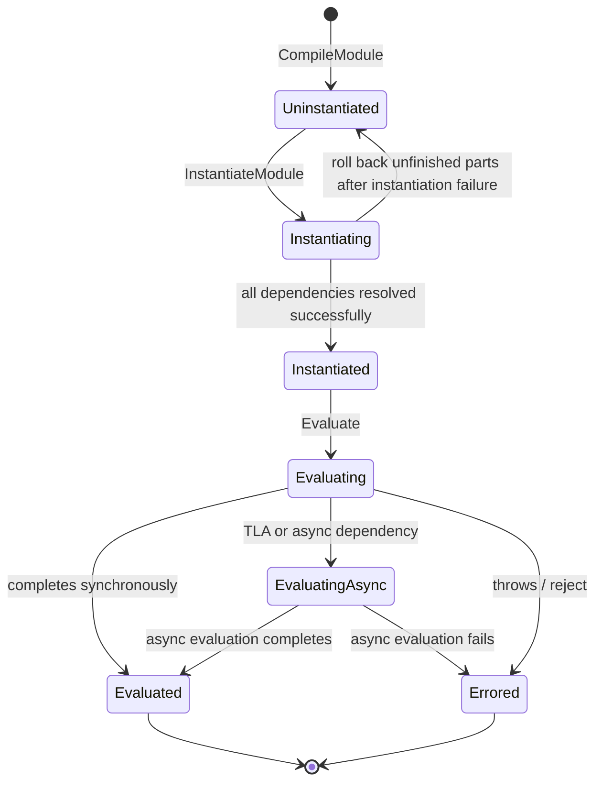

`GetStatus()` maps both the internal `kEvaluatingAsync` and `kEvaluated` to the public `kEvaluated`, so **`Evaluated` does not mean the evaluation Promise has been fulfilled**. A failed `Module::Instantiate` calls `ResetGraph`; a link failure also cannot always be drawn as `Errored`. Evidence: `src/api/api.cc::Module::GetStatus`, `src/objects/module.cc::Instantiate`, and `src/objects/source-text-module.cc::MaybeTransitionComponent` in Node's vendored V8 (14.6). Deno and Dune bind a newer V8 (15.0) through rusty_v8, whose `Module` API has the same shape; the behaviour described here was checked against Node's V8 source.

The complete call chain of a static import (using dune as the example; Deno/Node have the same shape):

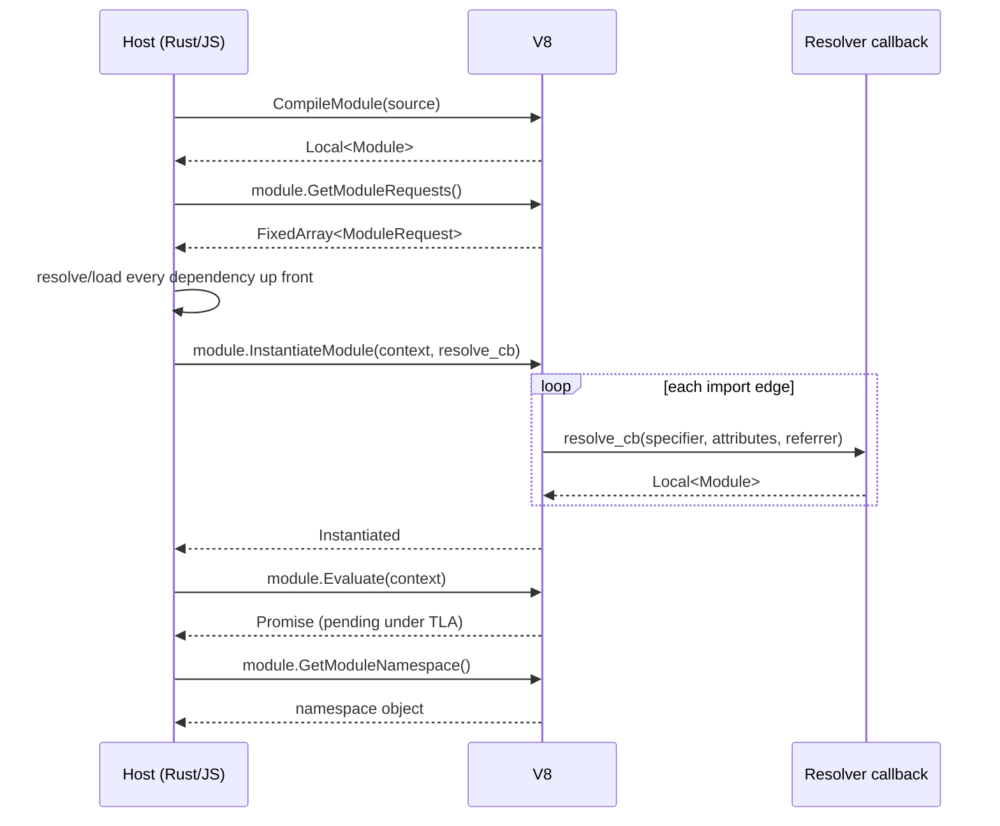

An ordinary dynamic import triggers a different host callback, which returns a Promise. The host must bridge the success/failure of the evaluation Promise onto it: complete with the namespace on success, reject on failure. Obtaining the namespace does not by itself prove that evaluation has finished.

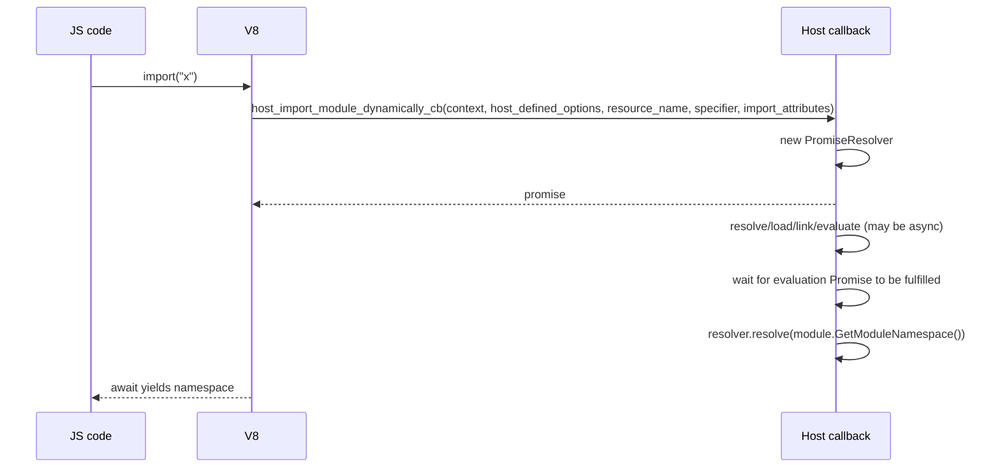

Key points:

- V8 has no host registry keyed by specifier; whether the same identity returns the same `v8::Module` is up to the host. For a given module, V8 retains its state and evaluation result.
- The host must avoid creating duplicate instances during recursive loading and must return the existing module from `resolve_cb`; V8 itself runs the DFS, SCC, and TLA propagation for linking/evaluation.
- `Evaluate` returns a Promise; if the host discards it, V8's asynchronous evaluation is not cancelled, but the host loses the means to wait for completion, propagate errors to `import()`, and judge liveness. dune's problem lies in this bridging layer.
- `import.meta` is also a host callback; V8 is only responsible for calling it on first access.

### 2.2 QuickJS: The Engine Owns the Module Graph Itself

QuickJS has a built-in module registry and recursive loading driver; the host registers a normalizer, a loader, and an attribute checker, supplies the file/package/builtin policy, and is responsible for advancing jobs and external I/O. CJS compatibility still has to be implemented separately by the host.

| API | Caller | Purpose |
|---|---|---|
| `JS_SetModuleLoaderFunc2(rt, normalize, load, check_attrs, opaque)` | host | Register the module loader trio in one call |
| `JS_SetModuleNormalizeFunc2(rt, normalize)` | host (optional) | Register a normalizer with attributes separately |
| `normalize(ctx, base_name, name, opaque)` | QuickJS → host | Convert `(base, specifier)` into a canonical module name |
| `load(ctx, name, opaque, attributes)` | QuickJS → host | Return a `JSModuleDef *` |
| `JS_Eval(ctx, src, len, filename, JS_EVAL_TYPE_MODULE \| JS_EVAL_FLAG_COMPILE_ONLY)` | host | Compile and recursively resolve/load static dependencies without executing the module body |
| `JS_ReadObject(ctx, buf, len, JS_READ_OBJ_BYTECODE)` | host | Deserialize bytecode into a module |
| `JS_ResolveModule(ctx, obj)` | host (optional) | Resolve the dependencies of a module returned by `JS_ReadObject` (a no-op after `JS_Eval`, which has already resolved them); on failure it frees modules that were not yet resolved |
| `JS_EvalFunction(ctx, module_val)` | host | Performs link + evaluate internally and returns the evaluation Promise |
| `JS_GetModuleNamespace(ctx, m)` | host | Get the namespace |
| `JS_GetImportMeta(ctx, m)` | host | Get/create the `import.meta` object |
| `JS_NewCModule` / `JS_AddModuleExport` / `JS_SetModuleExport` | host | Create a C/native module and declare/set its exports |
| `JS_SetModulePrivateValue` / `JS_GetModulePrivateValue` | host | Bind private data to a C module |
| `JS_NewPromiseCapability` | host/engine | Create the Promise for dynamic import / TLA |
| `JS_ExecutePendingJob(rt, &ctx)` | host | Drive the QuickJS job queue (dynamic import jobs run here too) |
| `JS_LoadModule(ctx, base, filename)` | host | Start loading/evaluation directly and return a Promise; unlike JS `import()`, which first enqueues a job |
| `JS_GetScriptOrModuleName(ctx, level)` | host | Get the current module name (LLRT CJS uses it to index exports) |

`COMPILE_ONLY` does not mean dependencies are not loaded: `__JS_EvalInternal` calls `js_resolve_module` before it checks this flag. This differs from V8's `CompileModule`, which only produces the boundary of static requests; LLRT's `Module::declare` and txiki's source loader both enter this path.

`JSModuleDef` is a node of QuickJS's ESM semantic graph. The listing below is abridged and its comments are this document's own: the `JSRefCountHeader header` field, the `export_entries_count/_size`, `star_export_entries_count/_size`, `import_entries_count/_size` and `async_parent_modules_count/_size` fields, and `int64_t async_evaluation_timestamp` are omitted (`deps/quickjs/quickjs.c:942-985`):

```c
struct JSModuleDef {
    JSAtom module_name;
    struct list_head link;              /* ctx->loaded_modules list */

    JSReqModuleEntry *req_module_entries;   /* static dependency edges */
    int req_module_entries_count;
    int req_module_entries_size;

    JSExportEntry *export_entries;          /* this module's exports */
    JSStarExportEntry *star_export_entries; /* export * */
    JSImportEntry *import_entries;          /* import bindings */

    JSValue module_ns;                  /* namespace */
    JSValue func_obj;                   /* compiled product of a JS module */
    JSModuleInitFunc *init_func;        /* initialization function of a C module */
    bool has_tla;
    bool resolved;
    bool func_created;
    JSModuleStatus status : 8;          /* UNLINKED..EVALUATED */

    int dfs_index, dfs_ancestor_index;  /* Tarjan SCC for link/eval */
    JSModuleDef *stack_prev;

    JSModuleDef **async_parent_modules; /* TLA reverse edges */
    int pending_async_dependencies;
    bool async_evaluation;
    JSModuleDef *cycle_root;            /* root of the cycle */
    JSValue promise;
    JSValue resolving_funcs[2];

    bool eval_has_exception;
    JSValue eval_exception;
    JSValue meta_obj;                  /* import.meta */
    JSValue private_value;              /* private data of a C module */
};
```

Dependency edges (fields as in the source; the comments are this document's):

```c
typedef struct JSReqModuleEntry {
    JSAtom module_name;
    JSModuleDef *module;   /* points to the depended-on module after resolve */
    JSValue attributes;
} JSReqModuleEntry;
```

QuickJS's built-in instance registry is the per-`JSContext` doubly linked list `ctx->loaded_modules`; `js_find_loaded_module()` does a linear lookup by module name atom only. The host can still add caches, for example LLRT's `ModuleCache.esm` and `RequireState`.

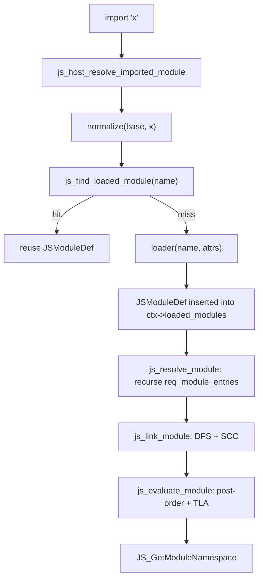

QuickJS's linking and evaluation both use a Tarjan-style DFS:

- **link**: `js_inner_module_linking()` marks `LINKING`, records `dfs_index/dfs_ancestor_index`, recurses into dependencies, binds imports/exports, and finally, when the SCC root is popped off the stack, sets them all to `LINKED` together;
- **evaluate**: `js_inner_module_evaluation()` traverses in post-order, dependencies before dependents; a TLA module enters `EVALUATING_ASYNC` and delays its parent modules through `async_parent_modules`;
- **cycle**: each SCC has exactly one `cycle_root`, and the evaluation Promise is created only on the entry module (or on the `cycle_root` it maps to); the other modules of the cycle just point at `cycle_root`, and a later `JS_EvalFunction` on any of them returns the `cycle_root`'s Promise.

The corresponding `JSModuleStatus` state machine:

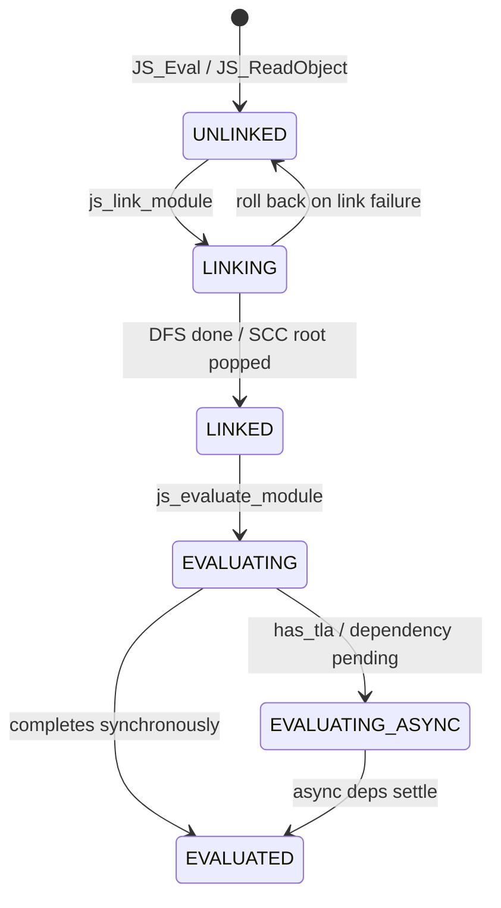

There is no `ERRORED` state, unlike V8's `Errored`: a synchronous throw, an async rejection or a failed dependency also ends in `EVALUATED`, with `eval_has_exception` set and the error stored in `eval_exception`, so `EVALUATED` does not mean success (`js_evaluate_module`, quickjs.c:31590-31598). The `EVALUATING --> EVALUATED` and `EVALUATING_ASYNC --> EVALUATED` transitions above therefore cover both outcomes.

Note: this state machine lives **inside the engine**; the host sees only `JSModuleDef*` and the Promise returned by `JS_EvalFunction`. LLRT/txiki cannot read `status` directly and can only observe it indirectly through the QuickJS API.

### 2.3 Comparing the Two Contracts

| Dimension | V8 | QuickJS-NG (the version this document depends on) |
|---|---|---|
| module object | `v8::Module`; the host holds it via `Global` | `JSModuleDef *`; held by the context registry |
| instance registry by name | built by the host | `ctx->loaded_modules`; the host may add further caches |
| compile boundary | `CompileModule` produces static requests and does not read dependencies itself | `JS_Eval(MODULE \| COMPILE_ONLY)` also recursively resolves/loads dependencies |
| resolve/load policy | host; the static resolve callback returns a module | host normalizer/loader; the engine drives the recursion |
| linking, cycles, live bindings | implemented by V8; the host calls `InstantiateModule` | implemented by QuickJS; entered via `JS_EvalFunction` |
| evaluation, TLA dependency propagation | implemented by V8; `Evaluate` returns a Promise | implemented by QuickJS; `JS_EvalFunction` returns a Promise |
| dynamic import | host callback bridges loading, evaluation, and the namespace | engine creates the Promise, enqueues a job, and waits for evaluation |
| jobs and external I/O | host advances microtasks/event loop | host advances `JS_ExecutePendingJob` and external I/O |
| synthetic/native module | `CreateSyntheticModule` + exports | `JS_NewCModule` + export declaration/assignment |
| compile cache | `CreateCodeCache` etc.; Node/Deno have real usage paths | `JS_WriteObject` / `JS_ReadObject` bytecode |

Do not conflate the three kinds of cache: the **resolve cache** stores resolution results, the **module instance cache** stores module identity, state, and exports, and the **code/bytecode cache** caches compilation products. That V8 has no general host policy for the first two kinds does not mean it has no module state, evaluation reuse, or compile cache.

---
## 3. Overview of Data Structures and Tree Structures
### 3.1 Five Sets of Core Structures

| Runtime | Global registry / cache | Tree/graph node | Dependency edge | State / concurrency |
|---|---|---|---|---|
| **dune** | `ModuleMap`: `by_path: HashMap<path, Global<Module>>`, `by_id: HashMap<i32, Vec<(path, Global<Module>)>>`, `seen: HashMap<path, ModuleStatus>`, `pending: Vec<Rc<RefCell<ModuleGraph>>>` | `EsModule { path, status, dependencies: Vec<Rc<RefCell<EsModule>>>, exception, is_dynamic_import }` | `EsModule.dependencies` (`Rc` tree) | `ModuleStatus::{Fetching,Resolving,Duplicate,Ready}`; `EsModuleFuture` is advanced in the event loop |
| **LLRT** | QuickJS `ctx->loaded_modules`; host side `ModuleResolver.modules: HashSet`, `ModuleLoader.modules: HashMap<name, fn>`, `BYTECODE_CACHE: phf::Map`, `NODE_MODULES_PATHS_CACHE`, `ModuleCache.esm`, `RequireState` | `JSModuleDef` (engine) | `JSReqModuleEntry[]` (engine) | QuickJS `JSModuleStatus`; `RequireState{cache,exports,progress}` handles CJS cycles |
| **txiki.js** | QuickJS `ctx->loaded_modules`; the host has only `builtins[]` and `qrt->builtins.import_map_resolver` | `JSModuleDef` (engine) | `JSReqModuleEntry[]` (engine) | QuickJS state machine; the import map is a JS closure |
| **Deno** | `ModuleMap`: `data: ModuleMapData { handles, handles_inverted, info, by_name, main_module_id, lazy_esm_sources, ... }` + `dynamic_import_map` + four tracked collections (`preparing_dynamic_imports`, `pending_dynamic_imports`, `pending_dyn_mod_evaluations`, `code_cache_ready_futs`; the first three concern dynamic-import loading); CJS `Module._cache` | `ModuleInfo { id, main, name, requests, module_type, is_internal }`; `v8::Global<Module>` stored separately in `handles[id]` | `ModuleInfo.requests: Vec<ModuleRequest>`; at runtime mapped back to a handle via the V8 resolve callback | `ModuleId = usize`; `RecursiveModuleLoad{state,pending,visited,visited_as_alias}`; `pending_tla_waiters` |
| **Node.js** | `ModuleLoader.loadCache: LoadCache` (`url → {type → ModuleJobBase}`), `#resolveCache`; CJS `Module._cache: filename → Module`, `_pathCache`, `_extensions`; `BuiltinModule.map` | ESM `ModuleJobBase/ModuleJob/ModuleJobSync` + C++ `ModuleWrap`; CJS `Module { id, path, exports, filename, loaded, children, paths }` | `ModuleJob` recursively calls `getOrCreateModuleJob` via `ModuleWrap.getModuleRequests()`; CJS `module.children` is merely an observation tree | V8 `ModuleStatus` + job state; CJS `loaded`, placeholder exports for circular dependencies |

### 3.2 The Shapes of Four Kinds of "Tree"

The static dependencies of ES modules form a **directed graph that may contain cycles**. Deduplication does not eliminate cycles; only after contracting strongly connected components (SCCs) into nodes do you get a DAG. The "tree" here refers to the loader's traversal view:

- dune really builds it as a tree of `EsModule`, using a `Duplicate` leaf to mean "this path has already appeared";
- QuickJS stores graph edges in `JSModuleDef.req_module_entries`, and traversal looks like a DFS tree;
- Deno stores `ModuleInfo.requests` edges + a `by_name` index, and the tree is expanded temporarily at resolve time;
- Node stores a graph of `ModuleJob` objects, and `ModuleWrap` holds only the binding relationships on the V8 side.

**(a) dune: a host-written `Rc<RefCell<EsModule>>` tree + a global `seen` table**

```text
ModuleMap
 ├─ by_path: "main.js" -> v8::Global<Module>
 ├─ seen:    "main.js" -> Resolving, "a.js" -> Ready, ...
 └─ pending: [ ModuleGraph{kind: Static, root_rc} ]

ModuleGraph.root_rc
   EsModule(main)
     ├─ EsModule(a)  ── Rc ──> EsModule(shared)
     └─ EsModule(b)  ── Rc ──> EsModule(shared)   // two Rc nodes, same path
```

Note: `EsModule` nodes are **not deduplicated**, and the same path may appear in multiple `Rc` nodes; deduplication happens in the `seen` table, where a dependency node uses `ModuleStatus::Duplicate` to mean "the path is already in `seen` but not yet `Ready`, so this node only waits for it".

**(b) QuickJS: a directed graph inside the engine, handed over to the host via `JSModuleDef*`**

```text
ctx->loaded_modules (doubly linked list)
  [main] <-> [a] <-> [shared] <-> [b] <-> ...      // creation order (depth-first loading)

main.req_module_entries
  ├─ { name:"a", module:*a }
  └─ { name:"b", module:*b }
a.req_module_entries -> *shared
b.req_module_entries -> *shared       // the same JSModuleDef
```

The engine looks up existing nodes by the normalized module name only (`js_find_loaded_module()` compares `module_name` atoms; import attributes are passed to the loader callback, and in LLRT/rquickjs also to the normalizer, but are not part of the lookup key); a module is registered first, and the `resolved` flag is set before its dependencies are resolved, so cycles can close without infinite recursion. The linking and evaluation phases then handle cycles with the engine's SCC algorithm.

**(c) Deno: index tables + a separate handle array**

```text
ModuleMap
 ├─ data.handles: Vec<Global<Module>>           // indexed by ModuleId
 ├─ data.info:    Vec<ModuleInfo>               // same index
 ├─ data.by_name: ModuleNameTypeMap<SymbolicModule>
 │      "file:///main.js" -> Mod(0)
 │      "file:///a.js"    -> Mod(1)
 │      "npm:foo"         -> Alias("file:///.../foo.js")
 ├─ data.handles_inverted: HashMap<Global<Module>, usize>
 ├─ dynamic_import_map: HashMap<ModuleLoadId, DynImportState>
 └─ pending_dynamic_imports: TrackedFutures<StreamFuture<RecursiveModuleLoad>>
```

`ModuleId` is a **registration index** allocated from `handles.len()`, not a content hash; the string-to-id mapping lives in `by_name`, and the reverse lookup from V8 handle to id lives in `handles_inverted`.

**(d) Node: two graphs**

```text
ESM:
 ModuleLoader.loadCache
   "file:///main.mjs" -> { "javascript": ModuleJob }
   "file:///a.json"   -> { "json": ModuleJob }
        │
        └─ ModuleJob.module: ModuleWrap
              └─ C++ ModuleWrap: module_ (v8::Global<v8::Module>), and the same module in internal field kModuleSlot

CJS:
 Module._cache
   "/abs/a.js" -> Module { id, exports, loaded, children:[...] }
 Module._pathCache
   "a\0/abs/node_modules\0..." -> "/abs/a.js"
```

Node's ESM graph is expressed jointly by `ModuleJob` objects and V8 `ModuleWrap`; the CJS graph is expressed by `Module` objects and the `children` array, but what actually decides reuse and cycle handling is `Module._cache`.

### 3.3 Module Identity, Cache Keys, and Deduplication

| Runtime | Module identity | Cache key | Concurrent import deduplication |
|---|---|---|---|
| **dune** | The resolved path string | `ModuleMap.by_path[path]`; `seen[path]` | For concurrent `import()` calls of the same path, extra `PromiseResolver`s are appended to `same_origin` of the pending graph; the `Duplicate` status avoids duplicate loading |
| **LLRT** | QuickJS module name (attributes are not part of the key); the host additionally has a path identity | `ctx->loaded_modules` + `ModuleCache.esm[path]` + `RequireState` | QuickJS looks up instances; the host cache bridges different entry points; the native loader's `remove` is a one-shot loading constraint, not a general deduplication algorithm |
| **txiki.js** | The string returned by the normalizer | `ctx->loaded_modules` | Same as above; the import map is resolved synchronously in the normalizer |
| **Deno** | `ModuleId`; on the string side it is `(ModuleName, RequestedModuleType)` | `handles[id]` + `by_name`; redirects use `SymbolicModule::Alias` | `RecursiveModuleLoad.visited: HashSet<ModuleReference>` + `visited_as_alias` |
| **Node ESM** | URL + import type | `loadCache[url][type]`; `#resolveCache[parentURL][specifier+attrs]` | Repeated imports hit the `loadCache.get(url, type)` check in `#getOrCreateModuleJobAfterResolve`, which sets the entry right after the `ModuleJob` is constructed; for cycles, `syncLink` temporarily registers the job in `loadCache` (removed in `finally` unless an entry already existed) before linking recursively |
| **Node CJS** | Absolute filename | `Module._cache[filename]`; `Module._pathCache[request+paths]` | `new Module` first and insert it into the cache immediately, then execute |

A difference that is easy to overlook:

- **dune uses the path string returned by resolve**. Appending file extensions happens in the load layer and is not written back into the identity; `./a` and `./a.js` may point to the same physical file yet form two instances (§10);
- **Deno uses `ModuleSpecifier` + `RequestedModuleType`**, with redirects as aliases;
- **Node ESM uses a two-level key of URL + type**, so `import './a.json' with {type:'json'}` and an ordinary JS import do not overwrite each other;
- **The QuickJS lookup key is the normalized name only**: attributes reach the loader callback (and, in LLRT/rquickjs, also the normalizer; txiki.js's normalizer receives only the base and the name), but the loader runs only on the first load of a name, so importing an already-loaded name with different attributes returns the existing `JSModuleDef` instead of producing a second instance (measured on txiki.js v26.6.0 and LLRT 0.9.0-beta: `import('./a.json', {with:{type:'json'}})` followed by a plain `import('./a.json')` yields the same namespace object).

Deno CJS and Node CJS both have a separate filename → `Module` cache; `ModuleId` is an ESM registration index, not a CJS module ID. Cache reuse is also affected by context/realm boundaries, alias normalization, and import/require condition resolution.

---

## 4. dune: the host maintains an explicit module tree itself

### 4.1 Positioning

dune is V8 + Rust + its own libuv-shaped event loop (`crabuv`). The two V8 callbacks that matter for loading here are:

- `module_resolve_cb`: during `instantiate_module`, the embedder must return a `v8::Module` for every static import;
- `host_import_module_dynamically_cb`: on `import()`, the embedder must return a Promise.

dune maintains the module cache, loads the dependency tree, tracks loading state, and deduplicates concurrent loads in the Rust host; V8 remains responsible for the semantic state machine of linking and evaluation. `src/modules.rs` and `src/runtime.rs` are the entry points for studying its host loading flow.

### 4.2 Core data structures

`src/modules.rs`:

```rust
pub struct ModuleMap {
    pub main: Option<ModulePath>,
    pub by_path: HashMap<ModulePath, ModuleRef>,
    pub by_id: HashMap<i32, Vec<(ModulePath, ModuleRef)>>,
    pub seen: HashMap<ModulePath, ModuleStatus>,
    pub pending: Vec<Rc<RefCell<ModuleGraph>>>,
}

pub type ModuleRef = v8::Global<v8::Module>;
```

| Field | Type | Purpose |
|---|---|---|
| `main` | `Option<String>` | Entry module path; assigned in `insert()` if it is empty and the path is an existing file or an http(s) URL. `import.meta.main` compares against it |
| `by_path` | `HashMap<path, Global<Module>>` | path → compiled V8 module; the final lookup table for `module_resolve_cb` |
| `by_id` | `HashMap<i32, Vec<(path, Global<Module>)>>` | V8 `identity_hash` → module; V8 does not guarantee hash uniqueness, so a `Vec` handles collisions |
| `seen` | `HashMap<path, ModuleStatus>` | Global loading state; shared by static and dynamic graphs, used for deduplication |
| `pending` | `Vec<Rc<RefCell<ModuleGraph>>>` | Static/dynamic import graphs that are not yet ready; scanned by the event loop on every tick |

`ModuleStatus`:

```rust
pub enum ModuleStatus {
    Fetching,   // The module is being read/compiled
    Resolving,  // Compiled; waiting for/resolving dependencies
    Duplicate,  // This path is already in `seen` but not Ready (being fetched/resolved, possibly by the same or another graph); this node only waits for seen[path] == Ready
    Ready,      // All dependencies are ready; can instantiate/evaluate
}
```

Dependency tree node:

```rust
pub struct EsModule {
    pub path: ModulePath,
    pub status: ModuleStatus,
    pub dependencies: Vec<Rc<RefCell<EsModule>>>,
    pub exception: Rc<RefCell<Option<String>>>,
    pub is_dynamic_import: bool,
}
```

Graph object:

```rust
pub struct ModuleGraph {
    pub kind: ImportKind,                 // Static | Dynamic(Global<PromiseResolver>)
    pub root_rc: Rc<RefCell<EsModule>>,
    pub same_origin: LinkedList<Global<PromiseResolver>>,
}
```

Async loading task:

```rust
pub struct EsModuleFuture {
    pub path: ModulePath,
    pub module: Rc<RefCell<EsModule>>,
    pub result: Result<ModuleSource>,
}
```

Relationship diagram:

```text
JsRuntimeState
 ├─ module_map: ModuleMap
 │    ├─ by_path: path ──────────────► v8::Global<v8::Module>
 │    ├─ by_id:   identity_hash ─────► Vec<(path, module)>
 │    ├─ seen:    path ──────────────► ModuleStatus
 │    └─ pending: Vec<Rc<RefCell<ModuleGraph>>>
 │                         │
 │                         ▼
 │                    ModuleGraph
 │                     ├─ kind: Static | Dynamic(resolver)
 │                     ├─ root_rc ──► EsModule
 │                     │                ├─ path
 │                     │                ├─ status
 │                     │                └─ dependencies: Vec<Rc<RefCell<EsModule>>>
 │                     └─ same_origin: LinkedList<Global<PromiseResolver>>
 │
 └─ pending_futures: Vec<Box<dyn JsFuture>>
      └─ EsModuleFuture { path, module, result }   // source in hand, awaiting compilation
```

### 4.3 Static loading: two entry points, one tree

dune has two static loading paths:

1. **`fetch_module_tree()`**: synchronous recursion, used for the startup builtin environment (`dune:environment/main`) and the REPL;
2. **`execute_module()` + `EsModuleFuture`**: asynchronous, used for the user entry script; source reading goes through the crabuv thread pool, and compilation returns to the loop thread.

`execute_module()` first creates the graph and registers it:

```rust
let graph = ModuleGraph::static_import(&path);
let graph_rc = Rc::new(RefCell::new(graph));
state.module_map.pending.push(Rc::clone(&graph_rc));
state.module_map.seen.insert(path.clone(), ModuleStatus::Fetching);

state.handle.spawn(
    move || load_import(&specifier, true),       // read file/HTTP on a rayon thread
    Some(move |_, result| {                      // back on the loop thread
        state.pending_futures.push(Box::new(EsModuleFuture { ... }));
    }),
);
```

`EsModuleFuture::run()` executes during an event loop tick, with this flow:

```text
EsModuleFuture::run(scope)
  ├─ if module.exception has already been set: clean up seen, return
  ├─ take the source result
  ├─ create_origin(path, is_module=true)
  ├─ v8::script_compiler::compile_module
  ├─ ModuleMap.insert(path, identity_hash, Global<Module>)
  ├─ seen[path] = Resolving
  ├─ for each request in module.get_module_requests():
  │    ├─ resolve_import(base=path, specifier, import_map)
  │    ├─ match seen[specifier]:
  │    │    Ready    -> continue (no node is created)
  │    │    Some(_)  -> status = Duplicate
  │    │    None     -> status = Fetching
  │    ├─ new EsModule { path, status, deps: [], ... }
  │    ├─ dependencies.push(Rc<...>)
  │    └─ if unseen: seen.insert(specifier, Fetching); handle.spawn(load, cb)
  └─ self.module.status = Resolving
     self.module.dependencies = dependencies
```

`fast_forward_imports()` scans `pending` on every tick and calls `fast_forward()` on each root; once the root is `Ready` (seen at the next tick's pass, since readiness is checked and the graph executed in separate passes), it removes the graph from `pending` and executes:

```rust
module.instantiate_module(tc_scope, module_resolve_cb)
let _ = module.evaluate(tc_scope);
```

For a dynamic import, it then uses `module.get_module_namespace()` to resolve all waiting Promises.

Tree expansion process:

```text
t0: root(main) Fetching ──compile──► Resolving
      request "./a.js" unseen -> create node a(Fetching), seen[a]=Fetching, spawn load
      request "./b.js" unseen -> create node b(Fetching), seen[b]=Fetching, spawn load

t1: a finishes compiling -> insert, seen[a]=Resolving
      request "./shared.js" unseen -> create shared(Fetching), spawn

t2: b finishes compiling -> insert, seen[b]=Resolving
      request "./shared.js" already seen (Fetching) -> create Duplicate node shared(Duplicate)
      (no repeated load)

t3: shared finishes compiling -> insert, seen[shared]=Resolving
      no dependencies -> becomes Ready in fast_forward

t4: fast_forward(root)
      a -> shared Ready -> a Ready
      b -> shared Duplicate, seen[shared]=Ready -> b Ready
      all of root's deps Ready -> root Ready
t5: (next tick) fast_forward_imports sees root Ready, removes the graph from pending
      -> instantiate_module + evaluate
```

`fetch_module_tree()` is the synchronous version: it compiles the current module, inserts it into `ModuleMap`, and iterates over the requests, calling itself recursively. It has no `ModuleGraph`/`pending`, does not maintain `ModuleStatus`, and deduplicates only via `by_path.contains_key()`. dune's builtin entry `src/js/main.js` is bootstrapped with it.

#### 4.3.1 builtin: 19 JS ESM modules form a real dependency graph

dune's builtins are not native modules but JS ESM source files embedded into the binary with `include_str!`:

```rust
CORE_MODULES: HashMap<&str, &str> = [
  "console", "events", "process", "timers", "assert", "util",
  "fs", "perf_hooks", "colors", "dns", "net", "test",
  "stream", "http", "sqlite",
  "@web/abort", "@web/text_encoding", "@web/clone", "@web/fetch",
]
```

The entry `src/js/main.js`:

```js
import process from 'process';
import timers from 'timers';
import fetch from '@web/fetch';
import structuredClone from '@web/clone';
import { Console, prompt, wrapConsole } from 'console';
import { AbortController, AbortSignal } from '@web/abort';
import { TextEncoder, TextDecoder } from '@web/text_encoding';
```

These imports are real ESM dependencies:

```text
main
 ├─ process -> events, util
 ├─ timers -> assert
 ├─ @web/fetch -> http -> net -> dns
 │                    -> assert, events
 ├─ console -> perf_hooks, colors
 ├─ @web/abort -> events
 ├─ @web/text_encoding
 └─ @web/clone

test -> fs, perf_hooks, colors
stream -> assert, events
```

So dune's builtins form a **real builtin dependency graph**, not a "collection of independent small modules". `fetch_module_tree()` loads dependencies recursively precisely so that `module_resolve_cb` can find all submodules in `module_map` during `instantiate_module`. There is no CJS and no npm; a bare specifier resolves only if it hits `CORE_MODULES` or is rewritten by the import map.

#### 4.3.2 resolver and loader

`resolve_import()` picks a loader based on the specifier:

```text
resolve_import(base, specifier, import_map)
  ├─ import map lookup (optional)
  ├─ is_core_module_import = CORE_MODULES.contains_key(specifier)
  ├─ is_url_import = URL_REGEX(specifier) || URL_REGEX(base)
  └─ match (core, url):
       (true, _) -> CoreModuleLoader
       (_, true) -> UrlModuleLoader
       _         -> FsModuleLoader
```

The three loaders:

| Loader | resolve | load |
|---|---|---|
| `CoreModuleLoader` | Recognizes only the 19 names in `CORE_MODULES` | Source from `include_str!` |
| `FsModuleLoader` | Absolute path / relative `./` `../` / CWD; tries `js/jsx/ts/tsx/json/wasm` extensions and `index.*` | `fs::read_to_string`; JSON is wrapped as `export default JSON.parse(...)`; TS/JSX/WASM are handed to SWC/Wasm for transpilation |
| `UrlModuleLoader` | `Url::parse` / resolves relative paths against the base URL | Downloaded with `ureq`; SHA-1 hashed and cached in `.cache` (debug) or `~/.dune/cache` (release) |

`ImportMap` is a subset of the WICG spec:

```rust
pub struct ImportMap { map: Vec<(String, String)> }
```

- Parses the `imports` object;
- Sorts keys in reverse lexicographic order (so a longer key sharing a prefix is tried before the shorter one), to support package prefixes with a trailing slash;
- `lookup()` does prefix matching with `starts_with`;
- Supports extensionless specifiers;
- No scopes, no `node_modules`, no CJS.

So a dune bare specifier has only two possible fates: hit `CORE_MODULES`, or be rewritten by the import map; otherwise `FsModuleLoader` reports `Module not found`.
### 4.4 Dynamic import: `ModuleGraph` + `same_origin`


The steps of `host_import_module_dynamically_cb()`:

```text
import("x")
  ├─ resolve_import(base, "x", import_map)       // on failure: resolver.reject(exception)
  ├─ if by_path already has x and there is no pending graph with the same root:
  │     resolver.resolve(x.get_module_namespace())   // fast path; the status of x is not checked (see below)
  ├─ if pending already has root.path == x:
  │     graph.same_origin.push_back(resolver)        // merge into the same graph
  ├─ otherwise:
  │     graph = ModuleGraph::dynamic_import(x, resolver)
  │     pending.push(graph)
  │     seen[x] = Fetching
  │     handle.spawn(load_import(x), cb -> EsModuleFuture)
  └─ return the resolver's Promise
```

`same_origin` exists to handle the case where "the same module is `import()`ed multiple times concurrently": when the concurrent calls name the same root, it is loaded only once, and all resolvers are resolved together once the root graph is ready. When a loading task records a failure in `exception`, `fast_forward_imports()` iterates over the main promise and `same_origin` and rejects each one. This does not cover all link/evaluation failures: on the instantiation failure path the error is reported and the process exits, while the evaluation Promise is discarded.

The fast path has a measured hole. `by_path` holds every module that has been compiled, including non-root dependencies of a still-loading graph that have not been instantiated yet, while the `pending` check compares only the graph roots. If `import("./c2.mjs")` is called while a graph rooted at `./c1.mjs` (which statically depends on `c2`) is still loading, `by_path` already contains the compiled-but-uninstantiated `c2`, so the fast path calls `get_module_namespace()` on it. V8 treats this as a fatal error (the API requires an instantiated module), and the process aborts (SIGTRAP, exit 133 in the measured runs; 6 of 6 runs with a 60-module chain, release and debug builds).

Key semantic differences:

- A dynamic import's graph resolves the namespace **immediately** after `evaluate()`, without waiting for the evaluation Promise;
- So if the module has TLA, `await import()` may return before the module has finished executing;
- Accessing an uninitialized export triggers a TDZ error; even without reading any export, one can observe that the import has completed while the side effects after the module's TLA have not yet happened;
- When the module body throws, `import()` may also be fulfilled first, with the error then reported through the global unhandled rejection path, so the caller's `catch` does not receive the expected failure.

This is exactly dune's measured result in §10.

### 4.5 `fast_forward()`: bottom-up state convergence

```rust
pub fn fast_forward(&mut self, seen_modules: &mut HashMap<ModulePath, ModuleStatus>) {
    if self.status == ModuleStatus::Ready { return; }

    if self.status == ModuleStatus::Duplicate {
        let status_ref = seen_modules.get(&self.path).unwrap();
        if status_ref == &ModuleStatus::Ready {
            self.status = ModuleStatus::Ready;
        }
        return;
    }

    self.dependencies.iter_mut()
        .for_each(|dep| dep.borrow_mut().fast_forward(seen_modules));

    if self.dependencies.is_empty() && self.status == ModuleStatus::Resolving {
        self.status = ModuleStatus::Ready;
        seen_modules.insert(self.path.clone(), self.status);
        return;
    }

    if self.dependencies.is_empty() { return; }

    if !self.dependencies.iter_mut()
        .map(|m| m.borrow().status)
        .any(|status| status != ModuleStatus::Ready)
    {
        self.status = ModuleStatus::Ready;
        seen_modules.insert(self.path.clone(), self.status);
    }
}
```

The algorithm itself is a post-order traversal: first advance all children to `Ready`, then judge itself. `Duplicate` nodes do not recurse; they only consult the `seen` table.

But it has a structural flaw: **circular dependencies deadlock**.

```text
c1 -> c2 -> c1

c1: Resolving, deps=[c2]
c2: Resolving, deps=[c1(Duplicate)]
seen[c1] = Resolving
seen[c2] = Resolving

fast_forward(c1):
  fast_forward(c2):
    c2.deps = [c1(Duplicate)] -> seen[c1] = Resolving
    -> c2 stays Resolving
  not all of c1.deps are Ready -> c1 stays Resolving
```

As a result `pending` is never empty and the event loop keeps running. A legal static cycle that does not trigger TDZ in this round was terminated by a 3-second timeout (§10). The deadlock occurs in the host's Ready convergence stage, before V8 `InstantiateModule` is ever called; the problem is not that V8 lacks cycle handling. The builtin synchronous `fetch_module_tree` path does not use this Ready algorithm, so it cannot be said across the board that every dune path lacks cycle support.

Another flaw is TLA:

```rust
let _ = module.evaluate(tc_scope);
```

The evaluation Promise is discarded, and `has_pending_imports()` checks only the loading graph. V8's TLA can still be advanced by microtasks and timers/I/O, but the evaluation Promise itself is not tracked by this liveness path; `import()` also neither waits for it correctly nor propagates its rejection.

dune's `ModuleStatus` convergence diagram (normal path and cycle). `Duplicate` is not a transition target of `Resolving`: it is the initial status chosen for a child node when its parent builds the dependency list (a child whose `seen` entry is already `Ready` gets no node at all):

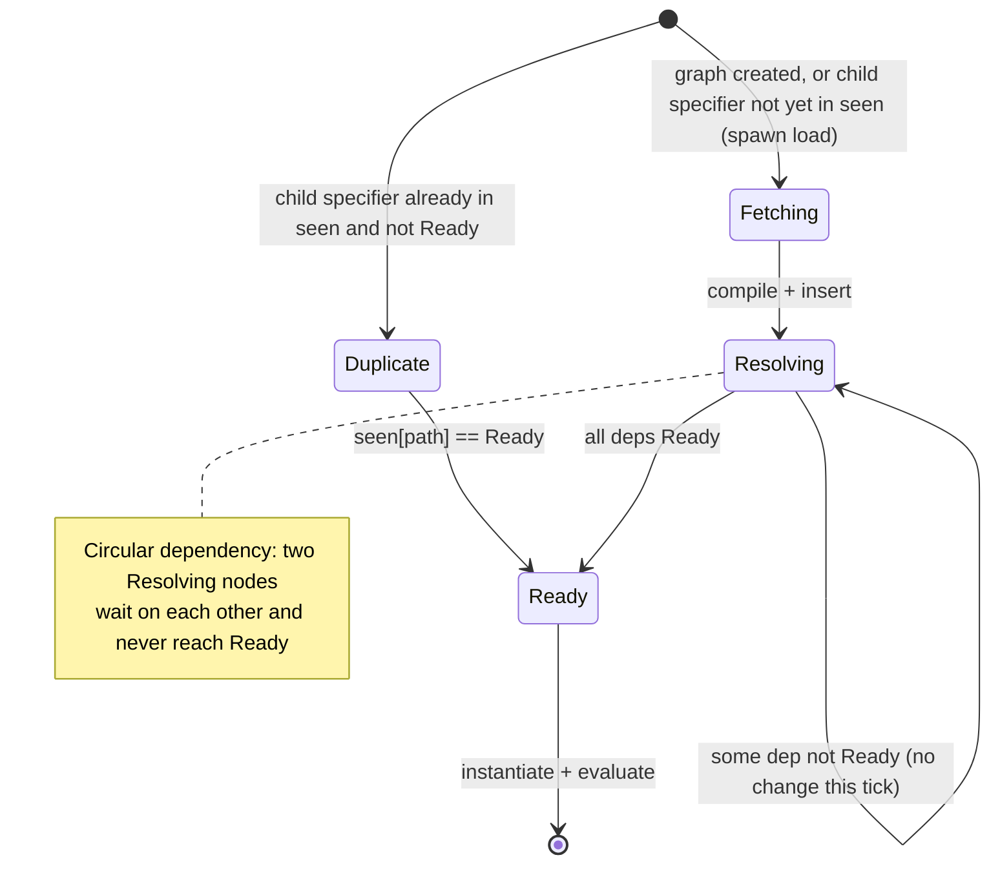

`fast_forward()` only does "if the children are Ready then the parent is Ready", with no SCC merging; this is the root cause of the cycle spinning idle.

### 4.6 V8 API call inventory

In the paired rows, the first location is the asynchronous path (`EsModuleFuture::run`, used for the user entry and for static and dynamic imports alike) and the second is the synchronous path (`fetch_module_tree`, used for the environment bundle `dune:environment/main` and the REPL).

| Location | API | Purpose |
|---|---|---|
| `runtime.rs:151` | `isolate.set_host_import_module_dynamically_callback` | Register `import()` |
| `runtime.rs:154` | `set_host_initialize_import_meta_object_callback` | Register `import.meta` initialization |
| `modules.rs:320` / `561` | `v8::script_compiler::compile_module` | Compile source into a module (async path / sync path) |
| `modules.rs:334` / `581` | `module.get_identity_hash()` | Module id, used for `by_id` |
| `modules.rs:335` / `582` | `v8::Global::new(scope, module)` | Hold the module long-term |
| `modules.rs:351` / `588` | `module.get_module_requests()` | Static import edges |
| `modules.rs:361` / `596` | `ModuleRequest::get_specifier()` | Original specifier |
| `runtime.rs:242` / `570` | `module.instantiate_module(scope, module_resolve_cb)` | Instantiate + resolve callback (environment module / ready root graphs) |
| `hooks.rs:30` | `referrer.get_identity_hash()` | Look up path from the referrer module |
| `hooks.rs:65` | `ModuleMap.get_module_path(identity_hash, module)` | Look up path from the referrer module (`import.meta`) |
| `runtime.rs:251` | `module.evaluate(scope)` | Evaluate, discarding the Promise (environment module) |
| `runtime.rs:579` | `module.evaluate(tc_scope)` | Evaluate the ready root graph (static or dynamic), discarding the Promise |
| `runtime.rs:603` | `module.get_module_namespace()` | Resolve value for dynamic import (dynamic roots only) |
| `hooks.rs:160` | `v8::PromiseResolver::new` | dynamic import Promise |
| `hooks.rs:194` | `resolver.resolve(namespace)` | Resolve directly for an already-loaded module |
| `hooks.rs:175` | `resolver.reject(exception)` | Resolution failed |
| `runtime.rs:253` | `module.get_status()` | Check for `Errored` |
| `runtime.rs:254` | `module.get_exception()` | Get the exception |
| `hooks.rs:71/76` | `meta.create_data_property("url"/"main")` | Populate `import.meta` |

An easily overlooked point: dune uses `get_identity_hash()` rather than an auto-incrementing id. V8 does not guarantee hash uniqueness, so the value in `by_id` is a `Vec`, and on a collision `get_module_path()` needs to linearly compare `Global<Module>` for equality.

### 4.7 Dependency library roles: crabuv's `spawn` and the rayon thread pool

dune's module loading is asynchronous not because of V8 or JS, but because it treats "reading the source" as another kind of crabuv resource (crabuv is a Rust loop built on mio and rayon that imitates libuv's phases; dune does not link libuv):

```text
handle.spawn(work, callback)
  └─ crabuv::LoopHandle::spawn
       ├─ wrap work into a WorkFn
       ├─ create a Task, send Request::TaskSpawn to the loop through the request channel
       ├─ the loop's task_spawn() registers the Task and hands work to the rayon ThreadPool
       ├─ work runs on a worker thread: fs::read_to_string / ureq
       ├─ on completion, send Event::ThreadPool(id, TaskOutput) to the loop and wake it
       └─ the loop thread (process_finished_task -> Task::run_callback) runs callback: pushes EsModuleFuture into pending_futures
```

Corresponding source: `spawn` at `crabuv/src/event_loop.rs:732`, the rayon `spawn` at `crabuv/src/thread_pool.rs:33`, and `Task { id, on_complete, cancel_tx }` in `crabuv/src/task.rs`.

Sequence:

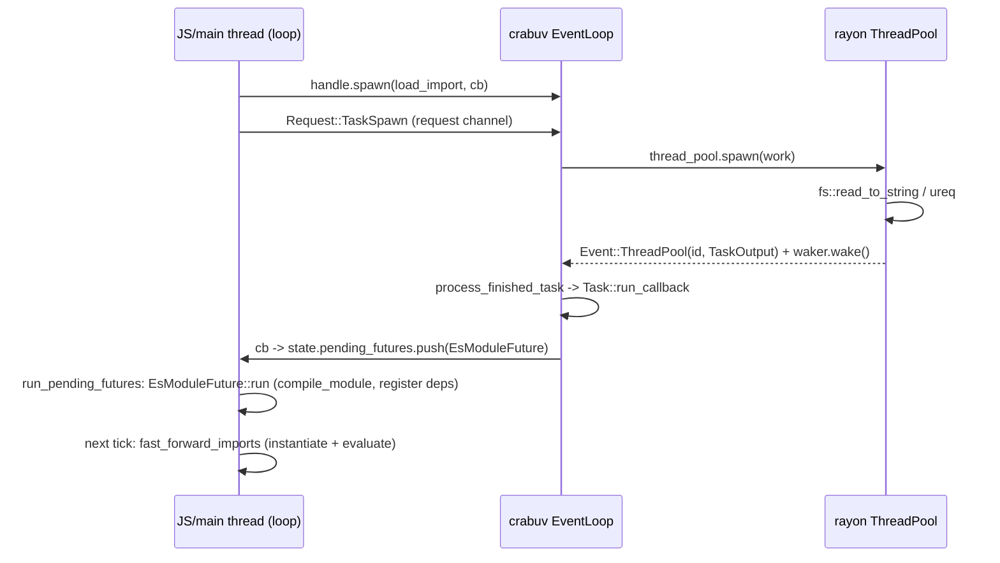

So dune's module loading runs on the same crabuv loop as `fs`, `dns`, and `net`, and uses the same thread-pool `spawn` as `fs` and `dns` (`net` uses crabuv's mio sockets instead); this also explains why its loader can call the synchronous `fs::read_to_string` directly on the Rust side without blocking the JS thread.

Note, however: **the QuickJS-based LLRT/txiki loaders are synchronous, and Node's default main-thread ESM resolve/load is also synchronous (unless async customization hooks are registered)**; what is confirmed here is dune's thread-pool loading path; one cannot infer, merely from Deno core using futures, that its underlying file/network operations do not use a thread pool or async I/O.

### 4.8 Verification and boundaries

The results of this round and the full scripts are in §10: a legal static cycle times out; concurrent dynamic imports reuse the namespace but complete early; when a module throws, the import succeeds first and an unhandled rejection appears afterward; omitting the extension versus giving the explicit extension can produce duplicate instances.

These results correspond respectively to the host's readiness determination for the loading graph, the evaluation Promise bridging, and the path identity rules. The fix direction is to distinguish "fetched/compiled" from "evaluated", to hand the loaded cycle to V8 for linking once it closes, and to keep tracking the evaluation Promise. dune has no built-in Node `require()`, CJS wrapper, or npm package resolver.

---

## 5. LLRT: QuickJS Owns the Graph, the Host Provides a Resolver/Loader Chain

### 5.1 Positioning and Assembly

LLRT is QuickJS-NG + `rquickjs`, targeting AWS Lambda cold starts. QuickJS already has a module loader mechanism, so LLRT does not hand-write a dependency tree; it provides two **independent chains**:

```rust
// llrt_core/src/vm.rs
let resolver = (module_resolver, EmbeddedResolver, PackageResolver, file_resolver);
let loader   = (module_loader, EmbeddedLoader, PackageLoader);
runtime.set_loader(resolver, loader).await;
```

`rquickjs` stuffs this set of trait objects into a `LoaderHolder` and registers it with QuickJS:

```rust
// rquickjs-core/src/loader.rs
JS_SetModuleLoaderFunc2(rt, None, Some(Self::load_raw), None, self.0 as _);
JS_SetModuleNormalizeFunc2(rt, Some(Self::normalize_raw));
```

Note:

- `module_check_attrs = None`, so LLRT does not validate the keys of import attributes;
- The resolver and the loader are **two independent callbacks**, each with its own fallthrough;
- Before calling the loader, QuickJS first runs `js_find_loaded_module(ctx, name)` (keyed by the normalized module name only; import attributes are not part of the lookup); on a hit it reuses the `JSModuleDef` directly.

### 5.2 Core Data Structures

LLRT has no explicit load tree like dune's, but the host is not just a "name → loader" map: it also maintains the path → module `ModuleCache.esm` and the CJS `RequireState`. The static ESM graph lives inside QuickJS, and the runtime require relationships are not the same as this static graph.

**(1) Native module table**

```rust
// llrt_modules/src/module/resolver.rs
#[derive(Debug, Default)]
pub struct ModuleResolver { modules: HashSet<String> }

// llrt_modules/src/module/loader.rs
type LoadFn = for<'js> fn(Ctx<'js>, Vec<u8>) -> Result<Module<'js>>;
#[derive(Debug, Default)]
pub struct ModuleLoader { modules: HashMap<String, LoadFn> }
```

`ModuleBuilder::with_module(ModuleInfo<M>)` (with `M: ModuleDef`; the name comes from the `ModuleInfo`) does three things at once:

```text
module_resolver.add_name(name)          // the resolver recognizes this name
module_loader.with_module(name, M)      // the loader can declare this native module
global_attachment.add_name(name)        // user-visible builtin list
```

On the default native path, `ModuleLoader::load()` takes the function pointer out with `self.modules.remove(name)`, then calls `Module::declare_def::<M, _>()`. This is a one-shot loader table entry; normal repeated requests are intercepted by the context's QuickJS registry. This does not guarantee that repeated native loads across contexts will always succeed; the hook short-circuit has a separate branch.

**(2) Bytecode cache**

```rust
// llrt_core/src/modules/embedded/mod.rs pulls in generated code:
// include!(concat!(env!("OUT_DIR"), "/bytecode_cache.rs"));
// which defines (type shown, initializer omitted):
pub static BYTECODE_CACHE: phf::Map<&'static str, &'static [u8]>;
```

At build time, `llrt_core/build.rs` walks `../bundle/js`, which is already built by the Makefile (esbuild runs there, not in build.rs):

```text
bundle/js/*.js (esbuild output, produced before build.rs)
  -> QuickJS Module::declare + module.write()
  -> OUT_DIR/<name>.lrt (external `zstd` CLI with a trained dictionary; header 10 bytes if compressed, 6 bytes with feature `uncompressed`)
  -> generates bytecode_cache.rs:
       pub static BYTECODE_CACHE: phf::Map<&'static str, &'static [u8]> =
         phf::phf_map! { "llrt:test/index" => include_bytes!("...lrt"), ... };
```

`.lrt` header format:

| Offset | Length | Content |
|---|---|---|
| 0 | 5 | `"lrt01"` |
| 5 | 1 | `b'c'` compressed / `b'u'` uncompressed |
| 6 | 4 | When compressed: original length, u32 LE |
| 10 (compressed) / 6 (uncompressed) | n | zstd frame / QuickJS bytecode |

At runtime, once `EmbeddedLoader` hits in the phf map, it decompresses with `zstd::bulk::Decompressor::with_prepared_dictionary(&DECOMPRESSOR_DICT)`, then calls `Module::load` → `JS_ReadObject(..., JS_READ_OBJ_BYTECODE | JS_READ_OBJ_ROM_DATA)`.

**(3) Node-style package resolution cache**

```rust
// llrt_modules/src/package/resolver.rs
type NodePathListValues = Rc<RefCell<Vec<Rc<str>>>>;
type NodeModulePaths = HashMap<Box<str>, Option<NodePathList>>;
static NODE_MODULES_PATHS_CACHE: Lazy<Mutex<NodeModulePaths>>;
static HOME_NODE_MODULES: Lazy<Vec<Box<str>>>;
```

`require_resolve()` is a step-by-step port of the Node CJS resolution algorithm: `LOAD_AS_FILE`, `LOAD_AS_DIRECTORY`, `LOAD_NODE_MODULES`, `package.json#exports` condition matching, self-reference, and `#imports`.

**(4) CJS state (Ctx userdata)**

```rust
// llrt_modules/src/module/mod.rs
pub struct RequireState<'js> {
    pub cache:    HashMap<Rc<str>, Value<'js>>,   // require result cache
    pub exports:  HashMap<Rc<str>, Value<'js>>,   // CJS module.exports
    pub progress: HashMap<Rc<str>, Object<'js>>,  // placeholder for circular require
}

pub(crate) struct ModuleCache<'js> {
    pub(crate) esm: HashMap<Rc<str>, Module<'js>>,
}

pub struct ModuleHookState<'js> { hooks: Vec<Hook<'js>> }
```

This state is **per-Context**, installed by `module::init` via `ctx.store_userdata(RefCell::new(...))`, not per-Runtime.

Object relationships:

```text
Vm { runtime: AsyncRuntime, ctx: AsyncContext }
 ├─ runtime.raw.loader: LoaderHolder
 │    └─ LoaderOpaque {
 │         resolver: (ModuleResolver, EmbeddedResolver, PackageResolver, FileResolver)
 │         loader:   (ModuleLoader, EmbeddedLoader, PackageLoader)
 │       }
 └─ ctx userdata
      ├─ ModuleNames { list: HashSet<String> }        // isBuiltin/builtinModules
      ├─ ModuleHookState { hooks: Vec<Hook> }         // registerHooks
      ├─ ModuleCache { esm: HashMap<name, Module> }
      └─ RequireState { cache, exports, progress }    // CJS
```

LLRT's static dependency graph can therefore contain several kinds of nodes and allows cycles: the dependencies of a single `main.js` may include native modules, bytecode, file-based ESM, and CJS wrappers all at once.

```text
main.js (PackageLoader -> Module::declare)
  ├─ node:fs        (ModuleResolver + ModuleLoader -> JS_NewCModule)
  ├─ node:path      (ModuleResolver + ModuleLoader -> JS_NewCModule)
  ├─ node:stream    (EmbeddedResolver + EmbeddedLoader -> JS_ReadObject)
  │    ├─ node:events (native)
  │    └─ node:util   (native)
  ├─ ./cjs.cjs      (PackageResolver + PackageLoader -> generated ESM source wrapper)
  │    └─ require("__cjs:...") -> RequireState.exports
  └─ ./local.js     (PackageResolver + PackageLoader -> ModuleCache -> Module::declare)
       └─ shares the same JSModuleDef with main (if imported again)
```

Static import/export-from edges are expressed by `JSModuleDef.req_module_entries`; a `require()` call at execution time is bridged through `RequireState` and the loader, and does not automatically become a static edge in that array.

Call sequence:

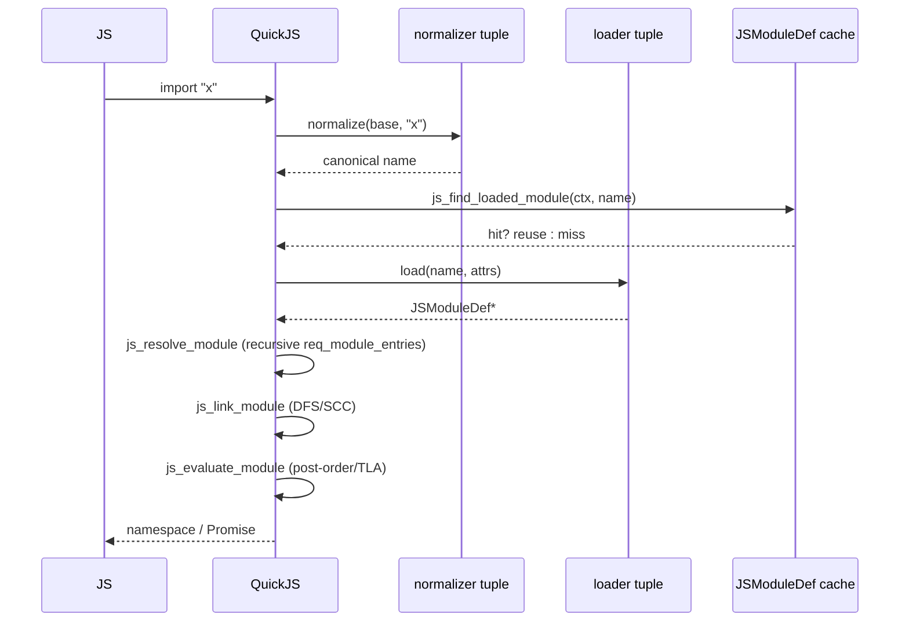
### 5.3 The Resolver / Loader Chain

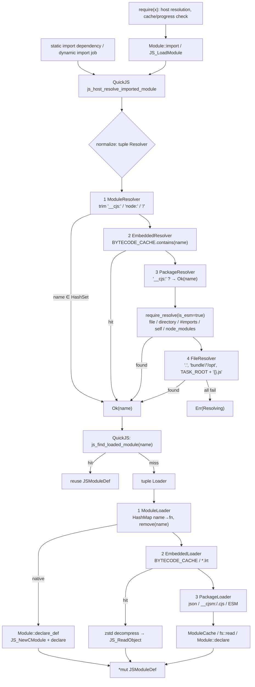

The tuple fallthrough semantics in rquickjs are critical:

- Only `Err(Resolving { .. })` / `Err(Loading { .. })` continues on to the next resolver/loader;
- `Ok` returns immediately;
- Any other error bubbles up directly;
- If all of them fail, the messages from each layer are joined with `\n`.

Therefore a successful resolver does **not imply** a successful loader; each of the two chains must be able to cover its own cases.

Two details the diagram leaves out. (a) Node 1 of both chains (`ModuleResolver`, `ModuleLoader`) first runs the `module.registerHooks` chain (`module_hook_resolve` / `module_hook_load`); a hook that returns `shortCircuit: true` returns `Ok` (resolver) or `Module::declare(source)` (loader) before the `HashSet` / `HashMap` check, and the trim in node D is `trim_end_matches("/")`, i.e. a trailing slash only. (b) On a `BYTECODE_CACHE` miss, `EmbeddedLoader` does `std::fs::read(path)?` on the whole file before it checks for the `.lrt` suffix. For an existing non-`.lrt` file it then returns `Err(Loading)` and falls through to `PackageLoader` (the file is read twice); for a missing file the error is `Error::Io`, which is neither `Resolving` nor `Loading`, so it bubbles up and the tuple does not continue (the third bullet above).

### 5.4 Native Modules and JS Bytecode

LLRT's builtins fall into two categories:

**(1) Native `ModuleDef`**

```rust
impl ModuleDef for FsModule {
    fn declare(declare: &Declarations) -> Result<()> {
        declare.declare("readFile")?;
        declare.declare("default")?;
        Ok(())
    }
    fn evaluate<'js>(ctx: &Ctx<'js>, exports: &Exports<'js>) -> Result<()> {
        export_default(ctx, exports, |default| {
            default.set("readFile", Func::from(...))?;
            Ok(())
        })
    }
}
```

Registration path:

```text
ModuleLoader::load_func::<D>
  -> Module::declare_def::<D, _>
       -> JS_NewCModule(ctx, name, eval_fn)
       -> D::declare(&Declarations)
            -> JS_AddModuleExport
       -> QuickJS calls back eval_fn during evaluation
            -> D::evaluate(&Ctx, &Exports)
                 -> JS_SetModuleExport
```

So to QuickJS, a native module is just a C module: no JS source needs to be parsed; declare registers the export names ahead of time, the linking phase establishes the bindings, and the evaluate callback sets the export values.

**(2) JS builtins + bytecode**

Besides a few builtins written in JS (`node:stream`, `llrt:test`, etc.), the same mechanism also embeds the bundled AWS SDK clients unless LLRT is built with the `no-sdk` feature. Abridged excerpt of one JS builtin (`stream.ts` has seven `readable-stream` imports between these two lines):

```ts
// llrt_core/src/modules/js/stream.ts (abridged)
import { EventEmitter as EE } from "node:events";
// ... readable-stream imports ...
import { inherits } from "node:util";
```

At build time, esbuild bundles them into `bundle/js/*.js`, `llrt_core/build.rs` compiles every `*.js` there (except `__tests__`) with QuickJS into `.lrt` bytecode, and puts them into `BYTECODE_CACHE` keyed by the path without extension, with `@llrt/` rewritten to `llrt:` (for example `llrt:test/index`). At runtime, the first import decompresses and calls `JS_ReadObject`; dependencies are still resolved by QuickJS through the loader.

### 5.5 CJS Compatibility: `__cjs:` / `__cjsm:` and `RequireState`

LLRT uses two magic prefixes to squeeze CJS into the ESM loader:

| Prefix | Produced by | Semantics |
|---|---|---|
| `__cjs:` | `require()` | This import comes from CJS; `PackageResolver` lets it through directly (no filesystem lookup), `PackageLoader` declares it as ESM, and the CJS top-level code is executed directly |
| `__cjsm:` | When ESM resolves to a CJS package | `PackageLoader` first runs require to execute the module and discover its export names, then declares an ESM source wrapper that calls require |

The key flow of `require()`:

```text
require(x)
  ├─ fetch globalThis.__require_hook (embedded_resolve from embedded bytecode)
  ├─ native names hit ModuleNames directly
  ├─ otherwise, using the current module's absolute path as base, require_resolve(..., is_esm=false)
  ├─ results other than .json/.lrt get the __cjs: prefix
  ├─ state.cache[x] hit -> return
  ├─ .json -> fs::read_to_string + json_parse
  ├─ state.progress[x] hit -> return the placeholder object (circular require)
  ├─ create a placeholder Object and put it into progress
  ├─ Module::import(ctx, "__cjs:/abs/x.cjs")   // JS_LoadModule
  ├─ manual pump (busy-wait; no sleeping or awaiting):
  │    loop {
  │      if promise.result::<Object>() { break x? }   // a rejected promise returns the error here
  │      if deadline < Instant::now() { poll_timers(..., Some(&mut deadline)) }
  │      ctx.execute_pending_job()
  │    }
  ├─ state.progress.remove(x)
  └─ read state.exports / the imported namespace, return the value or copy properties depending on the branch, and write to cache
```

`poll_timers` moves `deadline` to the earliest pending timer (at least 4 ms ahead), but nothing in the loop sleeps, so while it waits for a timer the loop spins on the CPU. If evaluation fails, `break x?` returns before `state.progress.remove`, so the placeholder stays in `progress` and a second `require()` of the same file silently returns `{}` instead of throwing again. Run on the release binary: `thr.cjs` containing `throw new Error("boom")` throws `boom` on the first `require("./thr.cjs")` and returns `{}` on the second (Node throws both times).

`globalThis.exports` / `globalThis.module.exports` are a pair of accessors:

```text
get/set exports
  -> ctx.get_script_or_module_name()       // JS_GetScriptOrModuleName
  -> trim "__cjs:"
  -> RequireState.exports[name]
```

So when a `.cjs` file is executed as ESM, `module.exports = ...` is not written into a real CommonJS wrapper function; instead it is written into a global store indexed by module name. This is the core trick that lets LLRT carry CJS semantics on top of the ESM loader.

When a CJS file is `import`ed, `PackageLoader::load_cjs_module()` **first synchronously calls `require("__cjs:" + name)` to execute the CJS and enumerate its export names**, and then generates the ESM source wrapper below. When the wrapper is evaluated it calls require again, which usually hits the result cache. CJS side effects may therefore occur in the loader phase, rather than first occurring only when the ESM wrapper is evaluated:

```js
const value = require("<name>");
export default value.default || value;
const { a, b } = value;
export { a, b };
```

Named exports come from the runtime object's keys; `const { a, b } = value` saves the property values at that moment and does not keep reading the CJS object's properties. The `value.default || value` rule for `default` also differs from Node's usual behavior of treating the whole `module.exports` as the default.

**`require(ESM)` also does not return the original namespace directly.** `require.rs` copies properties or merges them into the default object depending on branches such as the CJS exports and the type of the default export. Take `export let x = 1; export function inc() { x++; }` as an example: the `x` on the object returned by require can still be 1 after `inc()`, whereas the Node/Deno namespace reads 2 (§10).

When the same target is loaded through import/require, `ModuleCache.esm[path]` in `PackageLoader` can reuse the module, and `RequireState.cache` can reuse the require return value. But the two are not the same kind of cache, and the returned object need not equal the namespace. The import/require conditions may also resolve to different files.

### 5.6 QuickJS API Call Inventory

| API | LLRT call site | Purpose |
|---|---|---|
| `JS_SetModuleLoaderFunc2` | rquickjs `LoaderHolder::set_to_runtime` | Register the loader |
| `JS_SetModuleNormalizeFunc2` | same as above | Register the normalizer |
| `JS_Eval(..., MODULE \| COMPILE_ONLY)` | `Module::declare` | Source → module |
| `JS_ReadObject(..., BYTECODE)` | `Module::load` | Bytecode → module |
| `JS_NewCModule` | `Module::declare_def` | Native module |
| `JS_AddModuleExport` | `Declarations::declare` | Declare native exports |
| `JS_SetModuleExport` | `Exports::export` | Set native exports |
| `JS_EvalFunction` | `Module::eval` | link + evaluate |
| `JS_LoadModule` | `Module::import` | Host entry point for require; JS `import()` goes through `js_dynamic_import_job`, which calls the internal load function |
| `JS_GetImportMeta` | `Module::meta` | `import.meta.url` |
| `JS_ExecutePendingJob` | `Ctx::execute_pending_job` | Pump the Job queue |
| `JS_GetScriptOrModuleName` | exports accessor in `module::init` | Current module name |
| `JS_WriteObject` | build.rs `module.write` | Generate `.lrt` |
| `JS_GetModuleNamespace` | `Module::namespace` | namespace |

The synchronous pump in `require()` calls `poll_timers()` and `ctx.execute_pending_job()`, and does not poll rquickjs's general-purpose future scheduler. Therefore Promise jobs and that timer path can drive TLA; if completion also depends on an async future returning to JS through the scheduler, this loop cannot guarantee progress and may wait forever. Measured on the release binary: a required ESM whose TLA awaits `fs/promises.readFile` never completes and burns CPU (user 4.97 s in a 5 s run, killed by the timeout), whereas a microtask-only or timer-based TLA completes (Node and Deno throw `ERR_REQUIRE_ASYNC_MODULE` for any TLA graph). It cannot be regarded as the synchronous ESM check of Node/Deno, nor as a complete asynchronous event loop.

### 5.7 Async Model

- **The module loading path is entirely synchronous**: the loader is invoked from a C ABI trampoline (rquickjs `LoaderHolder::load_raw`, which calls the tuple's `Loader::load`) and does blocking `std::fs::read` / `fs::read_to_string`. The I/O is synchronous, but the nested `require` path (`load_cjs_module` -> `require`) runs the job queue and timers from inside the loader, so loading can execute arbitrary JS jobs;
- `AsyncRuntime` is just a wrapper around `async_lock::Mutex<InnerRuntime>`;
- Futures are driven by rquickjs's own `Spawner`/`Schedular`; `AsyncRuntime::idle()` loops over `JS_ExecutePendingJob` and polls the spawner;
- LLRT's `#[tokio::main]` provides Tokio for application APIs such as networking and timers;
- `Ctx::spawn` pushes a future into the rquickjs scheduler, and `spawn_exit` is responsible for passing results back / reporting errors.

Module source I/O is blocking, but dynamic import job scheduling and TLA evaluation still have asynchronous semantics. In normal operation, `AsyncRuntime::idle()` advances jobs and futures; the nested synchronous require pump covers only jobs and timers, so its reach is smaller.

### 5.8 Verification Runs

This round's §10 verification: a legal ESM cycle works normally; concurrent imports wait on TLA; evaluation errors reject through the import Promise; the property copying in `require(ESM)` leaves `x` at its old value in the test; a timer-driven TLA can complete inside require's synchronous pump.

Partial exports in circular require also differ: Node/Deno expose the module's current exports to the caller in the cycle; in LLRT, the `progress` placeholder object is separate from `state.exports`, so properties written to exports early may not yet have been copied to the placeholder object. In this round, when A first writes `exports.a = "a"` and B reads it within the cycle, Node/Deno get `"a"` while LLRT gets `undefined` (§10).

These conclusions must not be broadened into "fully compatible with Node require". For example, `createRequire` in `node:module` currently just returns the global require; it does not create a new function bound to a specified base URL the way Node does, see `llrt_modules/src/module/mod.rs::create_require`.

---

## 6. txiki.js: a normalizer/loader, with the graph entirely inside QuickJS

### 6.1 Positioning

txiki.js is C + QuickJS-NG + libuv. It targets Web platform APIs plus system capabilities, and explicitly does not aim for Node compatibility. It registers only one set of module callbacks:

```c
/* src/vm.c:462 */
JS_SetModuleLoaderFunc2(rt, tjs_module_normalizer, tjs_module_loader, tjs_module_attr_checker, qrt);
```

Like LLRT, txiki **has no module graph of its own** (`ctx->loaded_modules` is the registry and `JSModuleDef` is the node); unlike LLRT it also has no host-side module cache at all. The host side has only the following (abridged; the comments are annotations added here, not in `src/private.h`):

```c
/* src/private.h (abridged; comments added) */
typedef struct TJSRuntime {
    ...
    struct {
        JSValue promise_event_ctor;
        JSValue dispatch_event_func;
        JSValue import_map_resolver;     /* JS closure, not a C resolver */
        JSValue internal_core;           /* default of tjs:internal/core */
        JSValue internal_message_pipe;   /* default of tjs:internal/worker */
    } builtins;
    ...
} TJSRuntime;
```

and a static builtin table:

```c
/* src/builtins.c (abridged) */
typedef struct {
    const char *name;
    const uint8_t *data;
    uint32_t data_size;
} tjs_builtin_t;

static tjs_builtin_t builtins[] = {
    { "tjs:assert", tjs__assert, sizeof(tjs__assert) },
    /* ... (#ifdef TJS_HAVE_FFI entry) ... */
    { "tjs:getopts", tjs__getopts, sizeof(tjs__getopts) },
    { "tjs:hashing", tjs__hashing, sizeof(tjs__hashing) },
    { "tjs:internal/path", tjs__internal_path, sizeof(tjs__internal_path) },
    /* ... tjs:ipaddr ... */
    { "tjs:path", tjs__path, sizeof(tjs__path) },
    /* ... posix-socket, readline, sqlite, utils, uuid, wasi (some behind #ifdef) ... */
    { NULL, NULL, 0 },
};
```

`tjs__load_builtin()` does a linear lookup using `strncmp(p->name, name, strlen(p->name))` (a prefix comparison against each table name); on a hit it calls `JS_ReadObject(..., JS_READ_OBJ_BYTECODE)`, extracts the `JSModuleDef*`, and releases the JSValue. On a miss it just returns `NULL` without throwing; the loader passes that `NULL` straight to QuickJS with no exception pending, so `import('tjs:nope')` rejects with a non-Error value (printed as `[uninitialized]` in a run on `build/tjs`). Because of the prefix test, `tjs:pathfoo` also resolves to `tjs:path` (observed: `import p from "tjs:pathfoo"` loads, `typeof p` is `object`).

### 6.2 The normalizer: name normalization + import map + internal gate

```c
char *tjs_module_normalizer(JSContext *ctx,
                            const char *base_name,
                            const char *name,
                            void *opaque);
```

Algorithm:

```text
1. If name starts with "tjs:internal/":
      and base_name does not start with "tjs:"
      -> throw ReferenceError("module ... is not exposed to user code")
2. If name[0] != '.':
      a. If qrt->builtins.import_map_resolver is a function:
           call resolver(name, base_name)
           string    -> return the mapped result
           null      -> throw "blocked by import map"
           undefined -> continue
      b. Return name as-is
3. If name starts with '.':
      - take the dirname of base_name
      - collapse only the leading "./" / "../"
      - concatenate, normalizing the platform path separator
      - return the textually normalized path (no URL parsing, no realpath, no file lookup)
```

Key points:

- The import map is implemented entirely on the JS side (`src/js/core/import-map.js`): `imports`/`scopes` are null-prototype objects, `resolveInSpecifierMap` tries an exact `hasOwnProperty` match first, and otherwise scans the keys longest-first, accepting only keys that end with `/` and are a `startsWith` prefix of the specifier (so `"foo"` does not match `"foobar"`); scopes are chosen separately, longest scope key first, by `parentURL.startsWith(scopeKey)`, and top-level `imports` are the fallback; the C side holds only the resolver function.
- The isolation of `tjs:internal/*` is a **name-prefix policy**, not a permission system; it looks only at the original `name`/`base_name` and does not re-check the result of the import map.
- The normalizer cannot see attributes: `module_normalize_has_attr` of `JS_SetModuleLoaderFunc2` is false, and attributes are passed only to the loader and the attr checker.

### 6.3 The loader: dispatch by protocol/module type

```c
JSModuleDef *tjs_module_loader(JSContext *ctx,
                               const char *module_name,
                               void *opaque,
                               JSValueConst attributes);
```

Dispatch:

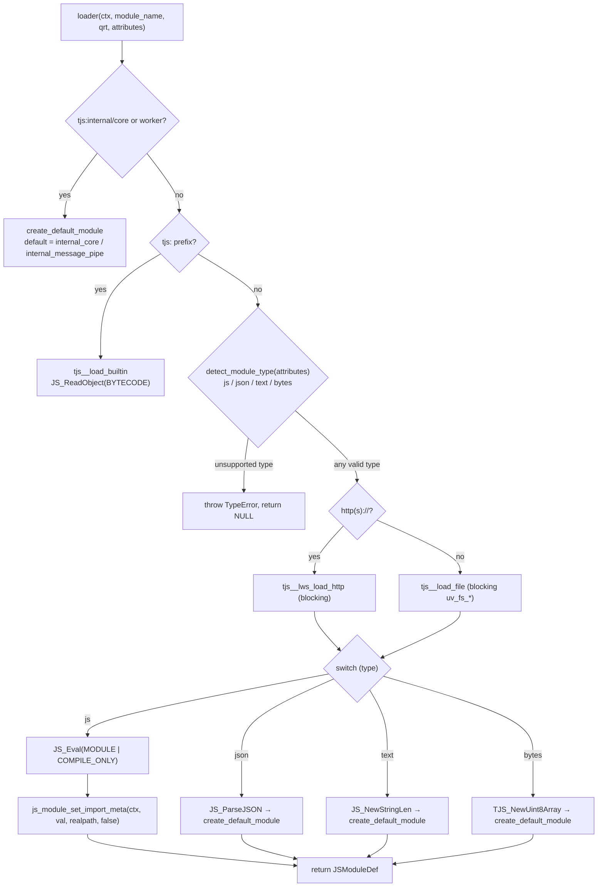

The type is detected first, the file or HTTP read then runs for every type, and the `switch (type)` on the bytes read comes after the read (read errors are thrown as `ReferenceError: could not load '...'`).

Notes:

- JSON is normally requested with `with { type: 'json' }`. `detect_module_type` selects JS when attributes is `undefined`; if an attributes object is passed but `type` is not a string, it decides by the `.json` suffix, so not every request lacking a type can be described as taking the same branch.
- `tjs_module_attr_checker` validates keys only (just `type` is allowed); the value is validated later in the loader, where `detect_module_type` accepts `json` / `text` / `bytes` and otherwise throws `TypeError: unsupported module type: '...'` (for non-`tjs:` modules, before any file or HTTP read).
- Both file and HTTP loading are synchronous and blocking; the loader callback returns `JSModuleDef*` and therefore cannot await.
### 6.4 QuickJS dependency graph, linking, and evaluation

txiki's "tree" is QuickJS's graph:

```text
ctx->loaded_modules (doubly linked list)
  [main] <-> [a] <-> [shared] <-> [util] <-> [b] ...
  (creation order: a module is appended when it is created, and its
   dependencies are resolved depth-first inside its own resolve step)

main.req_module_entries:
  { name:"a", module:*a }
  { name:"b", module:*b }
a.req_module_entries -> *shared
b.req_module_entries -> *shared     // the same JSModuleDef
shared.req_module_entries -> *util
```

Resolution:

```text
js_resolve_module(m)
  if m->resolved: return
  m->resolved = true          // must be set before recursing, to cut off cyclic resolution
  for each rme in m->req_module_entries:
      rme->module = js_host_resolve_imported_module_atom(m->name, rme->name, rme->attrs)
      js_resolve_module(rme->module)
```

The order in `js_host_resolve_imported_module` is: normalize → look up `ctx->loaded_modules` → call the loader only on a miss. A module is inserted into `loaded_modules` before its dependencies are resolved, so cycles close naturally during the resolve phase.

Linking (inside `JS_EvalFunction`):

```text
js_create_module_function(m)     // create func_obj / variable slots for each module
js_link_module(m)
  js_inner_module_linking(m, stack, index)
    - status = LINKING
    - dfs_index = dfs_ancestor_index = index++
    - recurse into each req_module_entries
    - if a child is still LINKING, update dfs_ancestor_index (SCC)
    - bind import/export
    - when the SCC root is popped off the stack, set status = LINKED for the whole SCC
js_evaluate_module(m)            // abridged pseudocode
  js_inner_module_evaluation(m)
    - status = EVALUATING
    - recurse into dependencies in post-order; for each dependency that has
      async_evaluation set: m.pending_async_dependencies++ and push m onto
      dep.async_parent_modules
    - then:
        if pending_async_dependencies > 0:
            async_evaluation = true               // deferred, m is not called yet
        else if has_tla:                          // compile-time flag (fd->has_await)
            async_evaluation = true; js_execute_async_module(m)
        else:
            js_execute_sync_module(m)
              C module:  m->init_func(ctx, m)
              JS module: call func_obj (a pending promise here is a TypeError)
    - when the SCC root is popped off the stack, status = EVALUATED or EVALUATING_ASYNC
```

`JSModuleStatus` (enum order; a module without async evaluation goes from `EVALUATING` straight to `EVALUATED`, and `EVALUATING_ASYNC` applies only to modules with `async_evaluation`):

```text
UNLINKED → LINKING → LINKED → EVALUATING → EVALUATING_ASYNC → EVALUATED
```

A cycle's evaluation Promise is held uniformly by `cycle_root`; TLA defers parent modules through `async_parent_modules` / `pending_async_dependencies`.

Dynamic import:

```text
js_dynamic_import(specifier)
  -> JS_NewPromiseCapability
  -> enqueue [resolve, reject, basename, specifier, attributes] onto the QuickJS job queue
  -> return promise
job: js_dynamic_import_job
  -> JS_LoadModuleInternal
       -> host resolve
       -> js_resolve_module
       -> JS_EvalFunction (link + evaluate)
       -> evaluation promise.then -> resolve(namespace)
```

Source I/O here is still synchronous; the asynchronous boundary includes both the scheduling of the import job and the later wait on the evaluation Promise/TLA. The host must still drive jobs and the timer/network events that TLA depends on.

Inventory of QuickJS API usage:

| API | txiki call site | Purpose |
|---|---|---|
| `JS_SetModuleLoaderFunc2` | `src/vm.c:462` | Register the normalizer/loader/attr checker |
| `JS_Eval(..., MODULE \| COMPILE_ONLY)` | `src/modules.c:202-206`, `src/vm.c:910` | File/HTTP source → module (loader); main-entry module compile |
| `JS_ReadObject(..., BYTECODE)` | `src/builtins.c:90`, `src/eval.c:29` | builtin/core bytecode → module |
| `JS_ResolveModule` | `src/eval.c:36` | Recursively resolve dependencies of a bytecode module |
| `JS_EvalFunction` | `src/eval.c:44`, `src/vm.c:913` | link + evaluate |
| `JS_GetImportMeta` | `src/modules.c:309` | Set `import.meta` |
| `JS_GetModuleName` | `src/modules.c:270` | Source of `import.meta.url` |
| `JS_NewCModule` / `JS_AddModuleExport` / `JS_SetModulePrivateValue` | `src/modules.c:48/54/55` | Default-export-only C modules (inside `create_default_module`): `tjs:internal/core`, `tjs:internal/worker`, and the JSON/text/bytes values below |
| `JS_ParseJSON` | `src/modules.c:209` | JSON modules |
| `JS_NewStringLen` / `TJS_NewUint8Array` | `src/modules.c:212/215` | text / bytes modules |
| `JS_ExecutePendingJob` | `src/vm.c:696` | Job drain (dynamic import/microtask) |
| `JS_GetModuleNamespace` | not called directly | Used internally by dynamic import (`quickjs.c`) |

Note: txiki has no `JS_SetImportMetaCallback` (it does not exist in this version), and no exported `JS_LinkModule`/`JS_EvaluateModule`; link/evaluate are both encapsulated inside `JS_EvalFunction`.

### 6.5 Builtin delivery: esbuild → tjsc → C array


| Layer | Build | Load timing |
|---|---|---|
| polyfills | esbuild `src/js/polyfills/index.js` → `tjsc -n tjs:internal/polyfills` | Eager at startup (`vm.c:479`) |
| core | esbuild `src/js/core/index.js` → `tjsc -n tjs:internal/bootstrap` | Eager at startup (`vm.c:480`) |
| `tjs:internal/core` | Not bytecode; `create_default_module` binds `qrt->builtins.internal_core` | First import (by the polyfills bundle, then the core bundle) |
| `tjs:internal/worker` | Same as above, binds `internal_message_pipe` | Worker bootstrap |
| stdlib `tjs:*` | Each file is compiled to bytecode by `qjsc/tjsc` and goes into `builtins[]` | First import (lazy) |
| `tjs:internal/path` | Likewise in `builtins[]` | First import |

Build pipeline:

```text
src/js/core/index.js
  --esbuild --bundle --external:tjs:*--> src/bundles/js/core/core.js
  --tjsc -m -s -n "tjs:internal/bootstrap" -p tjs__--> src/bundles/c/core/core.c
  --#include in src/builtins.c? No, core.c is compiled directly into the tjs static library
```

`src/builtins.c` includes only the generated C for stdlib and `internal/path`; core/polyfills/run-main/run-repl/worker-bootstrap are compiled directly into `tjs` by CMake and executed from embedded buffers via `tjs__eval_bytecode`.

For a module, `tjs__eval_bytecode()` does:

```c
JS_ResolveModule(ctx, obj);                  // recursively resolve dependencies
js_module_set_import_meta(ctx, obj, false, false);
JS_EvalFunction(ctx, obj);                   // link + evaluate
// only checks whether the promise is already rejected; a pending TLA is not awaited
```

### 6.6 The role of libuv: synchronous loader, asynchronous job queue

txiki's loader is synchronous, but that does not mean it bypasses libuv:

- `tjs__load_file()` calls `uv_fs_open/read/close` with `loop = NULL`, i.e. libuv's **synchronous form**, which executes the syscall directly on the calling thread;
- HTTP loading uses libwebsockets, polling `lws_service(lws_ctx, 250)` until the request is done, with a 10-second deadline per request attempt (redirects that lws does not follow restart it, up to 20 times); the DNS lookup before that is a separate blocking `uv_getaddrinfo` with no deadline;
- The main loop of `TJS_Run()` is `uv_run(UV_RUN_DEFAULT)`; QuickJS jobs are drained by `tjs__execute_jobs()` in a `uv_check` callback;
- The dynamic import job runs inside this drain;
- The TLA evaluation Promise is advanced by the QuickJS job queue. txiki keeps the loop spinning only while jobs are pending (a `uv_idle` handle plus re-entering `uv_run`) and does not otherwise track the TLA Promise, so a never-settling TLA does not keep the process alive.

Static import (the loader runs while the importer is being resolved, inside `JS_Eval` / `JS_ResolveModule`, not when the `import` statement executes) and dynamic import (a QuickJS job drained by the host) are two different flows:

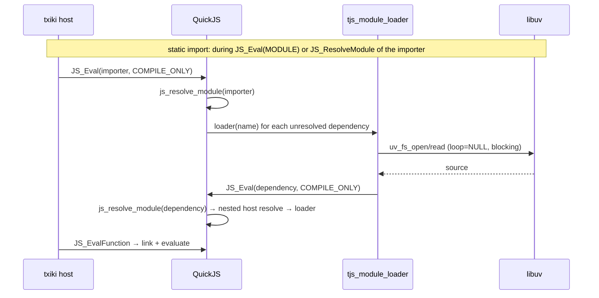

```mermaid
sequenceDiagram
  participant JS as JS
  participant QJS as QuickJS
  participant L as tjs_module_loader
  participant Loop as TJS_Run
  participant UV as libuv
  JS->>QJS: import(x) → JS_EnqueueJob(js_dynamic_import_job)
  QJS-->>JS: promise
  Loop->>UV: uv_run(UV_RUN_DEFAULT)
  UV->>Loop: check callback
  Loop->>QJS: JS_ExecutePendingJob (dynamic import / microtasks)
  QJS->>QJS: js_dynamic_import_job → JS_LoadModuleInternal
  QJS->>L: loader(name), then the same nested resolve as above
  QJS->>QJS: JS_EvalFunction → evaluation promise.then → resolve(namespace)
```

### 6.7 Verification by running

This round ran the local `build/tjs` (v26.6.0) and checked the actual submodule sources under `deps/quickjs`. The four experiments in §10 (namespace reuse, a legal ESM cycle, dynamic import waiting on TLA, and rejection on evaluation exceptions) matched the paths described above, with one exception: when the imported module throws during evaluation, the `import()` rejection is caught as expected, but txiki.js still prints an unhandled-rejection report on stderr and exits with code 1 (see §10.3). This appears to be a QuickJS-ng artifact (the module body's async-function promise is rejected with no handler attached), a host/engine quirk rather than part of the import contract.

There is no built-in Node require/CJS loader. The contract that `import()` waits for evaluation is implemented by QuickJS; whether the process keeps running also depends on txiki's jobs and active libuv work, so process keep-alive cannot be inferred from a pending Promise alone.

---

## 7. Deno: deno_graph + deno_core ModuleMap two-layer graph

### 7.1 Division of labor between the two layers

Deno's ESM loading can first be understood as two layers: the graph built by the CLI and the core registry. In addition there are V8's internal semantic graph and the Node compat CJS loader/cache (§7.10). The two layers below are not a complete inventory of Deno's module state:

```text
┌─────────────────────────────────────────────────────────────────────┐
│ CLI layer (deno_graph)                                              │
│   resolve: import map / npm / JSR / node: / file / http             │
│   graph: ModuleSpecifier → ModuleSlot { Module | Err | Pending }    │
│   dependency edges: Dependency { maybe_code, maybe_type, is_dynamic, ... } │
│   output: source + transpile result + cache info                    │
└──────────────────────────────┬──────────────────────────────────────┘
                               │ ModuleLoader::load()
                               ▼
┌─────────────────────────────────────────────────────────────────────┐
│ Runtime layer (deno_core::ModuleMap)                                │
│   ModuleId = usize → handles[id] (v8::Global<Module>) + info[id]     │
│   by_name: (ModuleName, RequestedModuleType) → SymbolicModule       │
│   RecursiveModuleLoad: FuturesUnordered + visited                   │
│   dynamic import: dynamic_import_map + pending_* + module_waker     │
└─────────────────────────────────────────────────────────────────────┘
```

`deno_graph` is the CLI's static/build graph and `ModuleMap` is the runtime graph; the two hand off at the `resolve/load` boundary of `ModuleLoader` and do not share data structures.

### 7.2 Data structures of `deno_core::ModuleMap`

```rust
// libs/core/modules/map.rs
pub(crate) struct ModuleMap {
    pub(crate) loader: RefCell<Rc<dyn ModuleLoader>>,
    pub(crate) source_mapper: Rc<RefCell<SourceMapper>>,
    exception_state: Rc<ExceptionState>,

    dynamic_import_map: RefCell<HashMap<ModuleLoadId, DynImportState>>,
    preparing_dynamic_imports: TrackedFutures<Pin<Box<PrepareLoadFuture>>>,
    pending_dynamic_imports: TrackedFutures<StreamFuture<RecursiveModuleLoad>>,
    pending_dyn_mod_evaluations: TrackedVec<DynImportModEvaluate>,
    pending_tla_waiters:
        RefCell<HashMap<ModuleId, Vec<v8::Global<v8::PromiseResolver>>>>,

    pending_mod_evaluation: Cell<bool>,
    evaluating_top_level: Cell<bool>,
    code_cache_ready_futs: TrackedFutures<Pin<Box<CodeCacheReadyFuture>>>,
    module_waker: AtomicWaker,

    data: RefCell<ModuleMapData>,
    will_snapshot: bool,
    loading_internal_modules: Cell<bool>,
    pub(crate) dyn_module_evaluate_idle_counter: Cell<u32>,
    pub(crate) import_sync_eval_stack: RefCell<Vec<ModuleId>>,
}
```

The nodes are actually stored in `ModuleMapData`:

```rust
// libs/core/modules/module_map_data.rs (abridged; doc comments paraphrased)
pub(crate) struct ModuleMapData {
    /// V8 handle → index
    pub(crate) handles_inverted: HashMap<v8::Global<v8::Module>, usize>,
    /// index → V8 handle
    pub(crate) handles: Vec<v8::Global<v8::Module>>,
    pub(crate) main_module_callbacks: Vec<v8::Global<v8::Function>>,
    /// index → metadata
    pub(crate) info: Vec<ModuleInfo>,

    /// (ModuleName, RequestedModuleType) → Mod(id) | Alias(name)
    by_name: ModuleNameTypeMap<SymbolicModule>,
    pub(crate) next_load_id: ModuleLoadId,
    pub(crate) main_module_id: Option<ModuleId>,

    pub(crate) synthetic_module_exports_store: SyntheticModuleExportsStore,
    pub(crate) lazy_esm_sources: Rc<RefCell<HashMap<ModuleName, ModuleCodeString>>>,
    pub(crate) residual_lazy_esm_sources: &'static [(&'static str, &'static str)],
    pub(crate) known_lazy_esm: RefCell<HashSet<Cow<'static, str>>>,
    pub(crate) lazy_script_sources: ...,
    pub(crate) loaded_script_results: ...,
    pub(crate) synthetic_esm_modules: ...,
    // ... (lazy_script_loading, captured_bootstrap)
    pub(crate) sources: HashMap<ModuleSourceKey, v8::Global<v8::Object>>,
    // ... (test-only and snapshot-bookkeeping fields)
}

// libs/core/modules/mod.rs
#[derive(Debug, PartialEq, Serialize, Deserialize)]
pub(crate) struct ModuleInfo {
    pub id: ModuleId,
    pub main: bool,
    pub name: ModuleName,
    pub requests: Vec<ModuleRequest>,
    pub module_type: ModuleType,
    /// Whether `name` is an internal (`ext:`/`node:`/`checkin:`) specifier.
    pub is_internal: bool,
}
```

How a `ModuleId` is allocated is key (abridged from `ModuleMapData::create_module_info`, which also converts the name with `into_cheap_copy`, sets `main_module_id` for the main module and computes `is_internal`):

```rust
let id = data.handles.len();
data.handles_inverted.insert(handle.clone(), id);
data.handles.push(handle);
data.by_name.insert(&RequestedModuleType::from(module_type),
                    name,
                    SymbolicModule::Mod(id));
data.info.push(ModuleInfo { id, ... });
```

Therefore:

- `ModuleId` is the **registration-order index**, not a content hash;
- `handles[id]` and `info[id]` must be accessed with the same id;
- the string-to-id mapping lives in `by_name`;
- redirects use `SymbolicModule::Alias(ModuleName)`, and `get_id()` follows the alias chain to `Mod(id)`;
- `next_load_id` numbers each `RecursiveModuleLoad` (main, side-module and dynamic-import loads alike); it is the key of `dynamic_import_map` and is unrelated to `ModuleId`.

```text
ModuleMap
 ├─ data
 │   ├─ handles[0] = Global<v8::Module>(main)
 │   ├─ handles[1] = Global<v8::Module>(a)
 │   ├─ handles[2] = Global<v8::Module>(b)
 │   ├─ info[0] = { id:0, main:true,  name:"file:///main.js", requests:[a,b], ... }
 │   ├─ info[1] = { id:1, main:false, name:"file:///a.js",    requests:[shared], ... }
 │   ├─ info[2] = { id:2, main:false, name:"file:///b.js",    requests:[shared], ... }
 │   ├─ by_name["file:///main.js"] -> Mod(0)
 │   ├─ by_name["file:///a.js"]    -> Mod(1)
 │   ├─ by_name["https://x/y"]    -> Alias("https://x/y.js")   // e.g. an HTTP redirect
 │   └─ handles_inverted[Global(main)] -> 0
 ├─ dynamic_import_map: load_id -> DynImportState { resolver, cped, phase }
 ├─ preparing_dynamic_imports: FuturesUnordered<PrepareLoadFuture>
 ├─ pending_dynamic_imports: FuturesUnordered<StreamFuture<RecursiveModuleLoad>>
 ├─ pending_dyn_mod_evaluations: Vec<DynImportModEvaluate>
 ├─ pending_tla_waiters: ModuleId -> Vec<Global<PromiseResolver>>
 └─ module_waker: AtomicWaker
```
### 7.3 `RecursiveModuleLoad`: parallel loading + three-level deduplication

```rust
pub(crate) struct RecursiveModuleLoad {
    id: ModuleLoadId,
    root_module_id: Option<ModuleId>,
    init: LoadInit,                    // Main | Side | DynamicImport
    state: LoadState,                  // Init | LoadingRoot | LoadingImports | Done
    pub(crate) module_map_rc: Rc<ModuleMap>,
    pending: FuturesUnordered<Pin<Box<ModuleLoadFuture>>>,
    visited: HashSet<ModuleReference>,
    visited_as_alias: Rc<RefCell<HashSet<String>>>,
    root_module_reference: Option<ModuleReference>,
    resolved_specifier: Option<Result<ModuleSpecifier, CoreError>>,
    loader: Rc<dyn ModuleLoader>,
}
```

State machine:

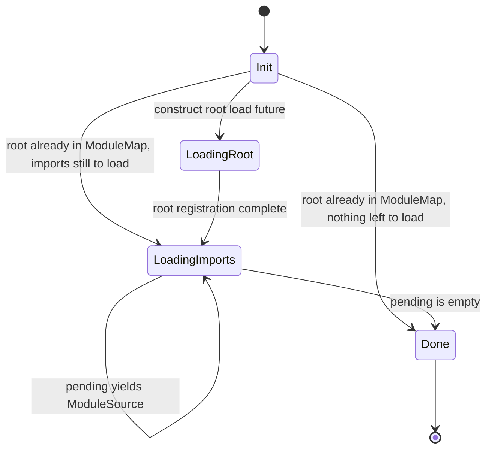

Loading process (the root is resolved and prepared before the load is first polled):

```text
construction (RecursiveModuleLoad::new / new_dynamic_import)
  resolve_root_from_init()
    Main -> ResolutionKind::MainModule, referrer "."
    Side -> Import, referrer "."
    DynamicImport -> the caller passes an already-resolved specifier
                     (resolved with ResolutionKind::DynamicImport)
  root_module_id = get_id(...) if the root is already in the ModuleMap

prepare()   // async; awaited by main()/side(), or run as a
            // preparing_dynamic_imports future for import()
  loader.prepare_load()
    skipped for a lazy ESM source, and for a synthetic ESM module
    that the loader does not ask to load (!should_load_synthetic_esm)

poll_next()
  ├─ Init: consume the stored resolved_specifier
  │        root already in the ModuleMap (Evaluation phase):
  │            register_and_recurse_inner(root) -> LoadingImports or Done
  │        otherwise: construct root future and push into pending
  ├─ LoadingRoot/LoadingImports:
  │        pending.try_poll_next_unpin()
  │        Some(ModuleSource) -> register_and_recurse()
  │        None -> Done
  └─ Done -> Ready(None)

register_and_recurse(source)
  ├─ check redirect / get_id() deduplication
  ├─ new_module_with_pending:
  │    ├─ compile_module2 / compile_module
  │    ├─ get_module_requests → resolve_with_scope → ModuleReference
  │    └─ create_module_info(id = handles.len()), registers itself
  └─ finalize_module → register_and_recurse_inner:
       ├─ visited / visited_as_alias hit -> skip
       ├─ get_id() already registered -> already_registered queue
       └─ otherwise needs_load -> wrap future and push into pending
```

Deduplication happens at three levels, with different keys:

- `visited: HashSet<ModuleReference>` handles normal edges; its key is `(specifier, requested_module_type)`, not the raw string;
- `visited_as_alias: HashSet<String>` handles "the same found URL after a redirect"; it is keyed by the found URL string only (no requested type) and is filled and checked late, inside the load future, so a duplicate load future may already have been dispatched, which is why the stream can yield `Ok(None)`;
- the `ModuleMap` itself looks modules up with `get_id(name, requested_module_type)`; `already_registered` is a synchronous queue that avoids calling `load()` again for modules already in the `ModuleMap`.

### 7.4 V8 API: link and evaluate

Deno's runtime registration/linking flow:

```text
compile:
  v8::script_compiler::compile_module(scope, &mut source)
  (compile_module2 with ConsumeCodeCache when a code cache is supplied)
  -> module.get_module_requests()
  -> pre-resolve each request into ModuleRequest { reference, specifier_key, phase, ... }
  -> create_module_info(...)

instantiate:
  tc_scope.set_slot(self as *const ModuleMap)
  module.instantiate_module2(scope,
                             ModuleMap::module_resolve_callback,
                             ModuleMap::module_source_callback)
  -> V8 calls module_resolve_callback for each edge
       -> look up the pre-resolved reference by (specifier_key, requested_module_type)
       -> resolve_callback: synthetic_esm → loader.resolve → get_id → lazy ESM
       -> return handles[id]
  -> drop_instantiated_requests(...) releases the edges of the linked graph

evaluate:
  module.evaluate(scope) -> Promise
  -> then2(on_fulfilled, on_rejected)
  -> tokio::sync::oneshot bridges the V8 promise back to a Rust future
  -> pending_mod_evaluation = true
```

V8 API inventory:

| API | Location | Purpose |
|---|---|---|
| `v8::script_compiler::compile_module2` / `compile_module` | `map.rs:865` / `map.rs:883` | compile the module (`compile_module2` is used only when a code cache is consumed) |
| `module.get_module_requests()` | `map.rs:965` | collect static edges (with their import attributes) |
| `module.instantiate_module2` | `map.rs:1207` | link + resolve/source callbacks |
| `module.get_module_namespace()` | `map.rs` | get the namespace |
| `module.evaluate()` | `evaluation.rs` | evaluate |
| `v8::PromiseResolver::new` | `map.rs:1802` | synthetic module evaluation steps must return a Promise |
| `v8::Global::<v8::Module>::new` | `map.rs:1072` | hold the module handle; `module_map_data.rs` stores it in its `handles` Vec |

The relationship between Deno's `ModuleMap` and V8 can be summarized as:

```text
V8 module graph  ── handles[id] ──►  ModuleMapData
      ▲                                  │
      │ instantiate_module2              │ by_name / get_id
      └──────── resolve callback ◄───────┘
```

V8 is responsible for "the binding relationships between modules", while `ModuleMap` is responsible for the "id ↔ handle ↔ name ↔ metadata" index, as well as the async loading/evaluation state.

### 7.5 Dynamic import and TLA

```rust
type PrepareLoadFuture = dyn Future<Output = (ModuleLoadId, Result<RecursiveModuleLoad, CoreError>)>;

struct DynImportState {
    resolver: v8::Global<v8::PromiseResolver>,
    cped: v8::Global<v8::Value>,
    phase: ModuleImportPhase,
}

struct DynImportModEvaluate {
    load_id: ModuleLoadId,
    module_id: ModuleId,
    promise: v8::Global<v8::Promise>,
}
```

Fast paths of `load_dynamic_import()` (all of them apply only when `phase == Evaluation`):

1. V8 status is `Evaluated` and the module is not in `pending_dyn_mod_evaluations` → resolve the namespace directly;
2. V8 status is `Evaluated` and the module **is** in `pending_dyn_mod_evaluations` → put the resolver into `pending_tla_waiters[module_id]`;
3. lazy ESM / synthetic ESM (the synthetic path only when the loader does not ask to load it itself, `!should_load_synthetic_esm`) → build and resolve synchronously;
4. Otherwise take the `RecursiveModuleLoad` slow path: build the `DynImportState`, put it into `dynamic_import_map`, and push the `prepare()` future into `preparing_dynamic_imports`.

Which modules "have a pending TLA" is decided only by the membership test in path 2 (`pending_dyn_mod_evaluations.iter().any(|p| p.module_id == id)`), and only evaluations started by `dynamic_import_module_evaluate` are in that queue. So the two paths behave differently depending on how the module was first evaluated:

- **First evaluated by a dynamic import** (a module whose evaluation the `import()` itself started): a later `import()` of it while its TLA is pending takes path 2 and waits in `pending_tla_waiters` until the evaluation Promise settles. A repro with `import("./slow.mjs")` called twice, 50 ms apart, on a module with a 300 ms TLA prints `slow start`, `slow done`, `A got 1`, `B got 1` on Deno 2.9.8.
- **Already in the static graph with its TLA still pending** (evaluated through the main/side module graph via `mod_evaluate`, so it has V8 status `Evaluated` but is not in the queue): `import()` takes path 1 and resolves the namespace immediately, before the TLA finishes. A sibling module that does `await import("./slow.mjs")` (with `slow.mjs` = a 300 ms `await` followed by `export const x = 1`) sees the uninitialized binding: Deno prints `slow start`, then `dyn ERR ReferenceError Cannot access 'x' before initialization`, then `slow done`. Node 26.12.1, LLRT and txiki.js wait for the TLA instead (`dyn got 1`); Dune also resolves early in this scenario.

Evaluation phase:

```text
dynamic_import_module_evaluate()
  -> internal Promise of module.evaluate()
  -> then2(wake_module, wake_module)     // only wakes module_waker
  -> DynImportModEvaluate enqueued into pending_dyn_mod_evaluations

evaluate_dyn_imports()
  -> poll promise state
  -> Fulfilled: dynamic_import_resolve(namespace) + resolve_tla_waiters
  -> Rejected:  dynamic_import_reject(exception) + reject_tla_waiters
```

Event loop liveness:

```text
EventLoopPendingState {
  has_pending_dyn_imports:           // ModuleMap::has_pending_dynamic_imports()
                                     //   = preparing || pending
  has_pending_dyn_module_evaluation: // ModuleMap::has_pending_dyn_module_evaluation()
                                     //   = pending_dyn_mod_evaluations is not empty
  has_pending_module_evaluation:     // pending_mod_evaluation
  ...
}
```

These three items participate in `is_pending()`, letting the event loop track module work; but this does not mean a pending evaluation keeps it alive indefinitely. When there is no work that can make progress, `jsruntime.rs` also detects stalled TLA / evaluation deadlock and reports an error. The slow (`RecursiveModuleLoad`) dynamic import path waits for the evaluation Promise before resolving the namespace; the early-resolve case of fast path 1 for statically imported modules with a pending TLA is described above.

The three-stage pipeline of dynamic import:

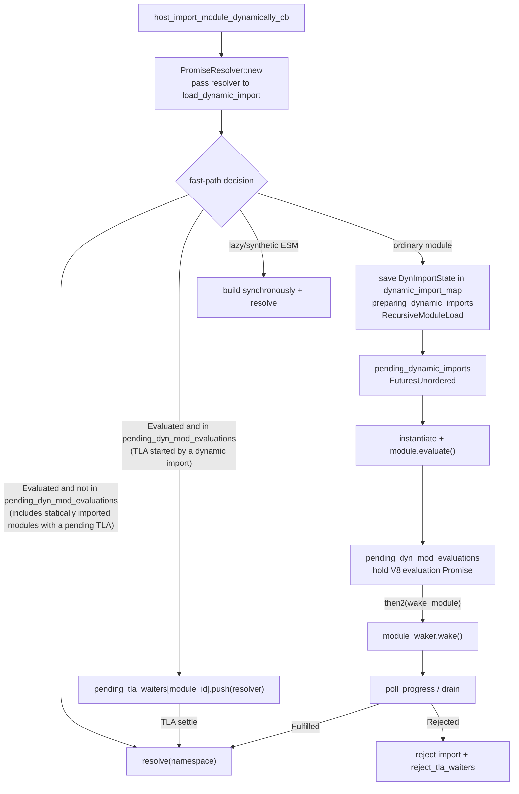

Note: `DynImportState` (kept in `dynamic_import_map`, created only on the slow path) holds the **resolver of the Promise handed to the user code** (the user sees the `.catch(map_err)` derivative of that resolver's promise), while `DynImportModEvaluate` holds the **internal evaluation Promise** and lives in `pending_dyn_mod_evaluations`. Additional `import()` callers that arrive while that evaluation is pending are kept as bare resolvers in `pending_tla_waiters`.

### 7.6 The CLI's `deno_graph`

```rust
pub struct ModuleGraph {
    pub roots: IndexSet<ModuleSpecifier>,
    module_slots: BTreeMap<ModuleSpecifier, ModuleSlot>,
    pub imports: IndexMap<ModuleSpecifier, GraphImport>,
    pub redirects: BTreeMap<ModuleSpecifier, ModuleSpecifier>,
    pub packages: PackageSpecifiers,
    ...
}

enum ModuleSlot {
    Module(Module),
    Err(ModuleError),
    Pending { is_asset: bool },
}

enum Module {
    Js(JsModule),
    Json(JsonModule),
    Wasm(WasmModule),
    Npm(NpmModule),
    Node(BuiltInNodeModule),
    External(ExternalModule),
}

struct JsModule {
    is_script: bool,
    dependencies: IndexMap<String, Dependency>,
    source: ModuleTextSource,
    media_type: MediaType,
    specifier: ModuleSpecifier,
    maybe_types_dependency: ...,
    ...
}

struct Dependency {
    maybe_code: Resolution,
    maybe_type: Resolution,
    is_dynamic: bool,
    maybe_attribute_type: Option<...>,
    imports: ...,
}
```

`MainModuleGraphContainer` uses `Arc<RwLock<Arc<ModuleGraph>>>` for read-heavy, write-light access:

```text
graph() -> Arc<ModuleGraph>              // directly clones the inner Arc
update:
  acquire_update_permit()
  clone graph
  graph.build(...)
  commit() -> atomically swap in
```

Responsibilities of `CliModuleLoader`:

```text
prepare_load(specifier)          // default path; increments in_flight_loads_tracker first
  -> acquire_update_permit
  -> ModuleLoadPreparer::prepare_module_load
  -> graph.build(...) / incremental update

load(specifier)
  -> load_code_source(graph)
  -> deno_resolver::load()
  -> ModuleSource::new_with_redirect(...)
  -> return ModuleLoadResponse::Async/Sync

resolve(specifier, referrer)
  -> resolver.resolve_with_graph(graph, ...)
  -> import map / workspace / npm / JSR / node: resolution
  -> block JSR packages importing non-JSR http(s) modules (not for import.meta.resolve)
```

The default `prepare_load` path above has several exceptions. It returns early without graph work for `Text`/`Bytes`/`Other` requested types, when load hooks are active (best-effort `prepare_hooked_specifier` only), for specifiers inside npm packages, and in eszip (`deno compile`) mode. For a dynamic import whose specifier is already in the graph it deliberately takes no update permit (that would clone the graph) and only runs `maybe_reload_dynamic` and `graph_roots_valid`. `resolve` itself does no permission checking; permissions are checked during graph preparation (`prepare_module_load` with a `PermissionsContainer`) and when files are fetched in `load`.

The output of `deno info --json` is built from the serialized `deno_graph` `ModuleGraph` (roots, modules, redirects) plus fields the CLI adds in `cli/tools/info.rs` (`version`, `npmPackages`, npm specifier rewrites and extra redirects); the CLI also removes `resolutionMode` from `code`/`types`. Abridged sample (output of `deno info --json main1.js` at this tag, with fields elided):

```json
{
  "version": 1,
  "roots": ["file:///.../main1.js"],
  "modules": [
    { "kind": "esm", "local": "/.../a.js", "size": 18, "mediaType": "JavaScript",
      "specifier": "file:///.../a.js" },
    { "kind": "esm", "specifier": "file:///.../main1.js",
      "dependencies": [
        { "specifier": "./a.js",
          "code": { "specifier": "file:///.../a.js",
                    "span": { "start": { "line": 0, "character": 16 },
                              "end":   { "line": 0, "character": 24 } } } }
      ], ... }
  ],
  "redirects": {},
  "npmPackages": {}
}
```

### 7.7 Extension builtin

```rust
pub struct Extension {
    pub name: &'static str,
    pub deps: &'static [&'static str],
    pub js_files: Cow<'static, [ExtensionFileSource]>,
    pub esm_files: Cow<'static, [ExtensionFileSource]>,
    pub lazy_loaded_esm_files: Cow<'static, [ExtensionFileSource]>,
    pub lazy_loaded_js_files: Cow<'static, [ExtensionFileSource]>,
    pub synthetic_esm_modules: Cow<'static, [(&'static str, &'static str)]>,
    pub esm_entry_point: Option<&'static str>,
    pub ops: Cow<'static, [OpDecl]>,
    ...
}
```

Four delivery forms:

| Form | Field | Loading/evaluation |
|---|---|---|
| **ESM extension** | `esm_files` | Registered at startup via `load_side_es_module`, not automatically evaluated; the module named by `esm_entry_point` is evaluated at startup |
| **lazy ESM** | `lazy_loaded_esm_files` | Source is registered into `lazy_esm_sources`; on first import, `LazyEsmModuleLoader` loads and evaluates it synchronously |
| **synthetic ESM** | `synthetic_esm_modules` | First runs the backing IIFE to obtain an exports object, then wraps it into an ESM facade via `new_synthetic_module_from_exports_object` |
| **snapshot** | same as extension | Source and entry point can go into the V8 snapshot; extensions already in the snapshot no longer re-run js/esm; the lazy ESM / lazy JS / `synthetic_esm` mappings are still registered at runtime |

Access restrictions on `ext:`:

```rust
// libs/core/modules/map.rs (impl ModuleMap; impl indentation removed)
fn validate_ext_module_import(
  &self,
  resolved_specifier: &ModuleSpecifier,
  referrer: &str,
) -> Result<(), JsErrorBox> {
  if resolved_specifier.scheme() != "ext" {
    return Ok(());
  }

  if (self.will_snapshot || self.loading_internal_modules.get())
    && referrer == "."
  {
    return Ok(());
  }

  if self.is_internal_referrer(referrer) {
    return Ok(());
  }

  let referrer = if referrer.is_empty() {
    "(no referrer)"
  } else {
    referrer
  };
  let msg = format!(
    "Importing ext: modules is only allowed from ext: and node: modules. Tried to import {} from {}",
    resolved_specifier, referrer
  );
  Err(JsErrorBox::type_error(msg))
}

fn is_internal_referrer(&self, referrer: &str) -> bool {
  if !is_internal_module_specifier(referrer) {
    return false;
  }
  self.will_snapshot || self.loading_internal_modules.get()
}
```

Observed in testing, user code `import("ext:core/mod.js")` is rejected (with the message above plus `Tried to import ext:core/mod.js from file:///...`); `node:fs` is instead a lazy-ESM facade registered by the `ext/node` extension (`"node:fs" = "fs_esm.ts"` in `ext/node/lib.rs`), i.e. the lazy ESM form from the table above, and `import("node:fs")` from user code works.
### 7.8 The role of tokio

Deno core's module tasks are mainly organized as futures; this does not contradict the CLI using Tokio to drive external I/O:

- `RecursiveModuleLoad` keeps its in-flight source fetches in a `FuturesUnordered` and is itself a `Stream`; `ModuleMap` polls dynamic-import loads as `StreamFuture<RecursiveModuleLoad>` inside a `TrackedFutures` (a `FuturesUnordered`-backed collection);
- the prepare future of dynamic import is also held in a `TrackedFutures`;
- `module_waker: AtomicWaker` connects V8 promise callbacks back to the event loop;
- evaluation of the main/side module uses `tokio::sync::oneshot` to bridge the V8 Promise back to a Rust future; dynamic-import evaluation instead keeps the Promise in `pending_dyn_mod_evaluations` and wakes `module_waker` through `then2` (§7.5);
- the CLI's main run path uses a current-thread Tokio runtime, and V8 executes on the thread that owns it; what scheduling approach the underlying network, file fetching, and transpilation use should be analyzed further in the concrete loader implementation, and cannot be inferred from `FuturesUnordered` alone.

`FuturesUnordered` describes how core concurrently polls loading tasks; it does not mean each import creates a separate Tokio task. Synchronous require's `op_import_sync` additionally uses a special path that blocks while waiting for loading.

### 7.9 Runtime verification

The results of this round's local debug build of Deno 2.9.8 are in §10: legal static cycles work normally; dynamic import waits for TLA and propagates evaluation exceptions; the exports of a synchronously required ESM still reflect binding changes; requiring a graph that contains TLA reports `ERR_REQUIRE_ASYNC_MODULE`.

### 7.10 Node compat: CJS loader and bidirectional ESM bridging

`ext/node/polyfills/01_require.js` implements a standalone Node-style CJS loader. It does not manage every CJS module directly as a core `ModuleInfo` node:

```text
CJS Module
 ├─ id / filename / path
 ├─ exports / loaded
 ├─ parent / children / paths
 └─ Module._cache[filename] → Module

require(CJS)
  → Module._load → _resolveFilename
  → cache hit: return exports (in a cycle, may return not-yet-complete exports)
  → cache miss: new Module, written into the cache first
  → module.load → extension/format handling → _compile
  → core.compileFunction(source, ..., [exports, require, module, __filename, __dirname])
  → compiledWrapper.call(exports, require, module, filename, dirname)
  → return module.exports; on failure, delete the incomplete cache entry
```

`op_require_*` provides file, package-info, and path capabilities; `op_require_read_file` reads source through permission checks and `NodeRequireLoader`. require is therefore not an entry point that bypasses Deno's permission model.

**CJS require ESM:** `loadESMFromCJS` converts the filename to a URL and calls `op_import_sync` (when a hook supplies the source, `op_import_sync_with_source` can be used). Core loads/instantiates the graph, checks `is_graph_async()`, evaluates synchronously, and returns the namespace/facade. Async graphs are rejected, even if TLA previously completed via import; the JS layer maps the corresponding error to `ERR_REQUIRE_ASYNC_MODULE`. `import_sync_eval_stack` together with V8 state detects re-entrant cycles across CJS/ESM. When a `'module.exports'` export exists, the JS bridge may choose it as the require return value.

**ESM import CJS:** `libs/node_resolver/analyze.rs::exports_to_wrapper_module` generates ESM source from the export names obtained by static analysis. Simplified shape of the generated wrapper (abridged from the template in that function):

```js
import { createRequire as __internalCreateRequire, Module as __internalModule } from "node:module";
const require = __internalCreateRequire(import.meta.url);
let mod;
if (import.meta.main) {
  mod = __internalModule._load("/absolute/path/module.cjs", null, true)
} else {
  mod = require("/absolute/path/module.cjs");
}
// ... one `export const name = mod["name"];` per statically found export name
//     (reserved words / non-identifier names go through a `__deno_export_N__` temporary
//     and `export { __deno_export_N__ as "name" };`)
export default mod;
// ... plus an export of `mod` under the name "module.exports"
```

The ESM identity of the wrapper is managed by the core ModuleMap, and the CJS instance is managed by `Module._cache`. Its implementation shape differs from Node's synthetic module, but both need to connect the ESM and CJS caches; it also differs from LLRT's strategy of executing the CJS first to enumerate keys.

Evidence: `ext/node/polyfills/01_require.js::{Module._load, wrapSafe, loadESMFromCJS}`, `ext/node/ops/require.rs::op_require_read_file`, `libs/core/ops_builtin.rs::op_import_sync`, `libs/node_resolver/analyze.rs::exports_to_wrapper_module`.

---

## 8. Node.js: JS-Layer ESM Loader + Separate CJS Loader

### 8.1 Two loaders

What is unique about Node: CJS is the native starting point, and ESM was added later and made compatible through a bridge. It is not one loader but two:

```text
ESM:
  static import
    -> compile to get ModuleRequest
    -> ModuleJob.syncLink/link -> getOrCreateModuleJob

  import()
    -> V8 dynamic callback -> src/module_wrap.cc -> esm/utils.js
    -> ModuleLoader.import -> getOrCreateModuleJob

  Common follow-up:
    -> ModuleJob (ModuleJobSync only for require(esm)) + loadCache
    -> ModuleWrap -> V8 instantiate / evaluate
    -> static: bindings and dependency evaluation; dynamic: Promise completes

CJS:
  require()
    -> Module._load
    -> Module._resolveFilename
    -> Module._findPath
    -> Module._cache
    -> compile wrapper
    -> execute
```

An important point in the 2026 snapshot: **`ModuleJobSync` is only used for `kImportInRequiredESM`, i.e. require(esm)** (`loader.js:575-576`). Ordinary ESM entry points, `import()`, and `kRequireInImportedCJS` all use `ModuleJob`; that class links synchronously through `syncLink` (it only uses `#asyncLink` on the loader hook worker). `ModuleJob` normally goes through the asynchronous `run()` (await `#instantiate()`, await `evaluate()`), but it also has `runSync()`, used by the loader-hook worker's re-invented `require()` for `kRequireInImportedCJS` (on the main thread the real `require()` is used) and by `require(esm)` when it hits a job that an earlier `import` created and left in the instantiated state. You cannot judge whether each step is asynchronous from the class name alone.

### 8.2 ESM data structures

```js
// lib/internal/modules/esm/loader.js
class ModuleLoader {
  #defaultConditions = getDefaultConditions();
  #resolveCache = new ResolveCache();
  loadCache = new LoadCache();
  isForAsyncLoaderHookWorker = false;
  #asyncLoaderHooks;
}
```

There is no `moduleJobs` field: all jobs are stored in `loadCache`.

`LoadCache` uses a **two-level key**:

```js
class LoadCache extends SafeMap {
  get(url, type = kImplicitTypeAttribute) {
    return super.get(url)?.[type];
  }
  set(url, type = kImplicitTypeAttribute, job) {
    const cachedJobsForUrl = super.get(url) ?? { __proto__: null };
    cachedJobsForUrl[type] = job;
    return super.set(url, cachedJobsForUrl);
  }
}
```

So:

```text
loadCache: Map<url, { [type]: ModuleJobBase }>
  "file:///a.mjs" -> { "javascript": ModuleJob }
  "file:///a.json" -> { "json": ModuleJob }
```

`type` defaults to `"javascript"`; `import './a.json' with { type: 'json' }` and ordinary JS do not overwrite each other.

`#resolveCache` is a separate key scheme: `specifier + '::' + sorted(JSON(attrs))`, bucketed by `parentURL`; it is bypassed when async `module.register()` hooks are active (and on the loader-hook worker), while sync `module.registerHooks()` hooks that fall through to the default step still hit it.

`ModuleJobBase` / `ModuleJob` / `ModuleJobSync`:

```js
class ModuleJobBase {
  constructor(loader, url, importAttributes, phase, isMain, inspectBrk) {
    this.loader = loader;
    this.importAttributes = importAttributes;
    this.phase = phase;
    this.isMain = isMain;
    this.inspectBrk = inspectBrk;
    this.url = url;
  }

  syncLink(requestType) {
    // Write itself into loadCache first, then link recursively, to handle cycles
    const hadPreviousEntry = this.loader.loadCache.get(this.url, this.type) !== undefined;
    this.loader.loadCache.set(this.url, this.type, this);
    const moduleRequests = this.module.getModuleRequests();
    const modules = Array(moduleRequests.length);
    ...
    this.module.link(modules);
  }
}

class ModuleJob extends ModuleJobBase {
  // module or modulePromise
  // linked: Promise | ModuleJobBase[]
  // instantiated: Promise | undefined
  // commonJsDeps: boolean[]
}

class ModuleJobSync extends ModuleJobBase {
  // module: ModuleWrap
  // linked: ModuleJobBase[]
  // type: string
  // modulePromise getter
  runSync(parent) { this.module.instantiate(); ... evaluateSync() }
}
```

Object relationships:

```text
ModuleLoader
 ├─ loadCache: Map<url, {type: ModuleJobBase}>
 ├─ #resolveCache: Map<parentURL, { [key]: {url, format} }>
 └─ #asyncLoaderHooks: AsyncLoaderHooksProxiedToLoaderHookWorker
      └─ AsyncLoaderHookWorker -> Worker thread -> MessagePort/Atomics

ModuleJobBase
 ├─ url, loader, importAttributes, phase, isMain, inspectBrk
 ├─ ModuleJob: module | modulePromise, linked(Promise or array), instantiated, commonJsDeps
 └─ ModuleJobSync: module(ModuleWrap), linked[], type, commonJsDeps

ModuleWrap (C++ BaseObject)
 ├─ member module_: v8::Global<v8::Module> (made weak; all C++ uses go through it)
 ├─ internal field kModuleSlot: the v8::Module value itself (set in the constructor, not read back)
 ├─ kSyntheticEvaluationStepsSlot: JS callback
 ├─ kContextObjectSlot
 ├─ kLinkedRequestsSlot: Array<ModuleWrap>
 ├─ kModuleSourceObjectSlot
 └─ linked_module_wraps_: std::vector<ModuleWrap*>
```

### 8.3 ESM loading flow: distinguishing static requests from the dynamic callback

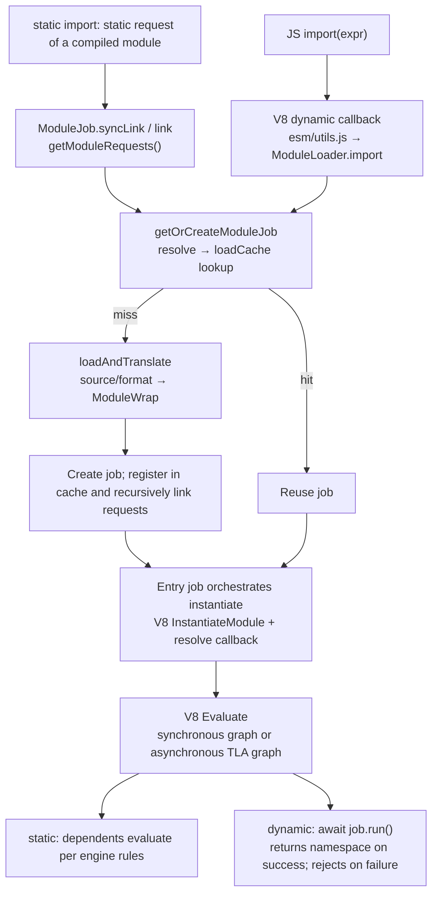

In the diagram, the two entry points share the job/cache, but a static import does not trigger the dynamic callback. `syncLink` first registers itself temporarily, then recursively obtains dependency jobs, and finally `ModuleWrap.link` stores the dependency wrappers; only afterwards does `instantiate()` invoke V8's linking semantics. `ModuleJobSync` (used only by require(esm)) loads and links synchronously; its `run()` (a required module that is later imported again) can still await TLA, while `runSync()` rejects asynchronous graphs.

Key path of `resolve`:

```text
defaultResolve
  ├─ data: -> return directly
  ├─ node: -> return specifier directly
  ├─ entry point: parentURL = CWD
  └─ moduleResolve
       ├─ relative/absolute -> new URL
       ├─ '#' -> packageImportsResolve
       ├─ URL -> directly
       └─ packageResolve
            ├─ BuiltinModule.canBeRequiredWithoutScheme -> node:
            ├─ packageJsonReader.getPackageJSONURL
            └─ packageExportsResolve / legacyMainResolve
```

Key points of `load`:

- The main thread goes through `defaultLoadSync`; `file:` uses `readFileSync`, and `data:` uses `dataURLProcessor`;
- `node:` → `format = 'builtin'`, `source = null`;
- When the format is determined to be `commonjs`, the async version sets source to null so the CJS loader re-reads it itself;
- The translators are a `SafeMap`: `module`, `commonjs-sync`, `require-commonjs`, `builtin`, `json`, `wasm`, `addon`, and so on.

The following are the **orchestration stages of a host job**, not the V8 `GetStatus()` enumeration:

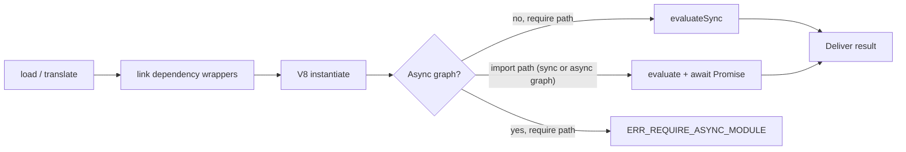

- `ModuleJob.run()` awaits `#instantiate()` and then awaits `module.evaluate()`; `ModuleJobSync.run()` (a required module that is imported again) awaits `module.evaluate()` / the existing `evaluationPromise`; `ModuleJobSync.runSync()` instantiates, calls `throwIfAsyncGraph` (which checks `hasAsyncGraph`, rejecting TLA) and then calls `evaluateSync`.
- `ModuleJob` uses asynchronous linking only on the loader-hook worker (used by the deprecated `module.register()` hooks); everywhere else it links synchronously with `syncLink`.
- The host avoids creating duplicate instances in load cycles by registering the job first; V8 handles final binding, cyclic evaluation, and TDZ. The instantiate flow of an asynchronous job also traverses the dependencies, so that the host wait chains do not wait on each other because of a cycle.
- V8's `Evaluated` may still correspond to a pending TLA, so it cannot replace `evaluationPromise` for judging completion; see §2.1.

### 8.4 CJS data structures and the require flow

```js
function Module(id = '', parent) {
  this.id = id;
  this.path = path.dirname(id);
  setOwnProperty(this, 'exports', {});
  this[kFirstModuleParent] = parent;
  this[kLastModuleParent] = parent;
  updateChildren(parent, this, false);
  this.filename = null;
  this.loaded = false;
  this.children = [];
}
```

Static tables:

```text
Module._cache:     filename -> Module
Module._pathCache: request + '\x00' + paths.join('\x00') -> filename
Module._extensions: '.js' | '.json' | '.node' -> handler
```

`Module._load`:

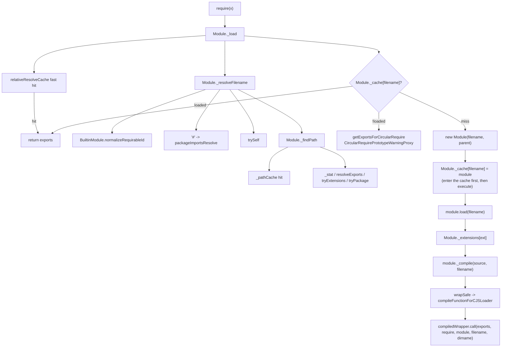

Circular dependencies work because **the `new Module` is created and written to `Module._cache` first, and only then executed**; when a module that has not finished executing is required again, it returns the current placeholder `module.exports` object (and `CircularRequirePrototypeWarningProxy` emits a warning for undefined properties).
### 8.5 C++ `ModuleWrap` and the V8 API

`ModuleWrap` is a `BaseObject`, with the following internal field slots:

```text
kModuleSlot                 -> v8::Global<v8::Module>
kModuleSourceObjectSlot     -> source-phase object
kSyntheticEvaluationStepsSlot -> JS evaluation callback (CJS/JSON/builtin)
kContextObjectSlot
kLinkedRequestsSlot         -> Array<ModuleWrap>
```

| JS side | C++ | V8 API |
|---|---|---|
| `new ModuleWrap(url, ctx, source, ...)` | `ModuleWrap::New` | `ScriptCompiler::CompileModule`; for synthetic, `Module::CreateSyntheticModule` |
| `wrap.link(modules)` | `ModuleWrap::Link` | `Module::GetModuleRequests()` + `ModuleRequest` |
| `wrap.instantiate()` | `ModuleWrap::Instantiate` | `Module::InstantiateModule(context, ResolveModuleCallback, ResolveSourceCallback)` |
| `wrap.evaluate(t, b)` | `ModuleWrap::Evaluate` | `Module::Evaluate(context)` → Promise |
| `wrap.evaluateSync()` | `ModuleWrap::EvaluateSync` | `Module::Evaluate` + `Module::GetModuleNamespace` |
| `wrap.getNamespace()` | `ModuleWrap::GetNamespace` | `Module::GetModuleNamespace` |
| `wrap.getStatus()` | `ModuleWrap::GetStatus` | `Module::GetStatus` |
| `wrap.getModuleRequests()` | `ModuleWrap::GetModuleRequests` | `Module::GetModuleRequests` → `FixedArray` |
| `hasAsyncGraph` | C++ lazy property | `Module::IsGraphAsync` |

The dynamic import bridge (abridged from `src/module_wrap.cc`; argument setup and error checks omitted):

```cpp
static MaybeLocal<Promise> ImportModuleDynamicallyWithPhase(...) {
  // ... build import_args: id, specifier, phase, attributes, resource_name
  Local<Value> result;
  import_callback->Call(context, Undefined(isolate),
                        arraysize(import_args), import_args).ToLocal(&result);
  // Wrap the returned value in a promise created in the referrer context to
  // avoid dynamic scopes.
  Local<Promise::Resolver> resolver;
  Promise::Resolver::New(context).ToLocal(&resolver);
  resolver->Resolve(context, result).IsNothing();
  return handle_scope.Escape(resolver->GetPromise());
}
```

That is, the value (normally a Promise) returned by the JS callback is fed into a `v8::Promise::Resolver` newly created in the referrer context, and the resolver's Promise is then handed back to V8. `Link` groups `ModuleRequest`s by `ModuleCacheKey` and requires requests with an identical key to be linked to the same `ModuleWrap`, otherwise it throws `ERR_MODULE_LINK_MISMATCH`; it still stores one linked `ModuleWrap` per request, so nothing is merged.

CJS function compilation is a separate path: `compileFunctionForCJSLoader` → `ScriptCompiler::CompileFunction`, with the parameter list `(exports, require, module, __filename, __dirname)`, unrelated to `ModuleWrap`.

### 8.6 CJS/ESM bridge

Node has three bridges:

1. **`import` of a CJS file**: `createCJSModuleWrap()` uses `cjs_lexer` to statically analyze export names and builds a synthetic `ModuleWrap`; the CJS code is only executed inside the evaluation callback;
2. **`require` of an ESM file**: `importSyncForRequire()` creates a `ModuleJobSync` for a module that has no cached job (an existing job, e.g. an async `ModuleJob` created by `import()`, is reused and evaluated via `job.runSync()`), and throws `ERR_REQUIRE_ASYNC_MODULE` if there is TLA;
3. **loader hooks**: `module.registerHooks()` is a synchronous in-thread hook (CJS and ESM share the global `resolveHooks/loadHooks`); `module.register()` is the asynchronous loader hook worker, which is runtime deprecated as of v26.

The export names of a CJS wrapper are determined by static analysis plus `default` / `module.exports`; the values of named exports are set when the wrapper is evaluated, and later CJS property assignments do not automatically update them. The default export usually references the actual `module.exports` object, so changes inside that object remain visible. Properties added only at runtime and not discovered by the analysis do not automatically become named exports.

`require(ESM)` is different: it usually returns the namespace or a facade that preserves the binding relationship, and it also supports the interop form where the ESM explicitly exports the name `'module.exports'`. It does not copy all export properties onto a plain object; the live binding test in this round differs markedly from LLRT (§10).

### 8.7 builtin: `BuiltinModule` map + ESM facade

```js
// lib/internal/bootstrap/realm.js (abridged: comments and JSDoc removed)
class BuiltinModule {
  static map = new SafeMap(
    ArrayPrototypeMap(builtinIds, (id) => [id, new BuiltinModule(id)]),
  );

  constructor(id) {
    this.filename = `${id}.js`;
    this.id = id;
    this.exports = {};
    this.loaded = false;
    this.loading = false;
    this.module = undefined;      // C++ ModuleWrap (ESM facade)
    this.exportKeys = undefined;  // ESM named export names
  }
}
```

`node:` during ESM load:

```text
defaultLoadSync
  -> protocol === 'node:' -> format='builtin', source=null
translator builtin
  -> strip the node: prefix
  -> loadBuiltinModule(id)
  -> BuiltinModule.getESMFacade()
       -> new ModuleWrap('node:'+id, undefined, exportKeys+['default'], cb)
       -> instantiate()
       -> evaluate()
  -> syncExports() calls setExport for each CJS export
```

Therefore a builtin can be used by both `require()` and `import`:

```text
require('fs')              -> BuiltinModule.exports (the CJS object)
import fs from 'node:fs'   -> the facade's default binding (usually that exports object)
import * as ns from 'node:fs' -> the facade's namespace
```

### 8.8 The role of libuv: synchronous fs, bypassing the event loop

In the current source, the default main-thread file loading path blocks synchronously; hooks and the loader worker are separately configured paths:

```text
ESM: getSourceSync -> loaderMethods.readFileSync -> fs.readFileSync
     -> binding.read / readFileUtf8 -> uv_fs_open/read/close
CJS: loaderMethods.readFileSync(filename, 'utf8')
     -> binding.readFileUtf8 -> uv_fs_open/read/close
```

The key is libuv's synchronous path:

```c
/* deps/uv/src/unix/fs.c (abridged) */
int uv_fs_read(uv_loop_t* loop, uv_fs_t* req, uv_file file,
               const uv_buf_t bufs[], unsigned int nbufs, int64_t off,
               uv_fs_cb cb) {
  INIT(READ);                 /* stores loop in req->loop, does not use it */
  /* ... */
  if (cb == NULL)
    goto post;
  /* ... asynchronous setup ... */
post:
  POST;
}

/* POST macro */
if (cb != NULL) {
  uv__req_register(loop);
  uv__work_submit(loop, &req->work_req, UV__WORK_FAST_IO,
                  uv__fs_work, uv__fs_done);
  return 0;
} else {
  uv__fs_work(&req->work_req);   /* read(2) directly on the calling thread */
  return req->result;
}
```

So:

- `loop` can even be `NULL`;
- Nothing is submitted to the thread pool;
- No req is registered with the loop;
- No asynchronous I/O request is created, but the calling thread is occupied and that thread's event loop cannot make progress.

The other optional cross-thread path for module loading is **loader hooks**:

```text
module.register()
  -> AsyncLoaderHooksProxiedToLoaderHookWorker
  -> AsyncLoaderHookWorker
  -> new InternalWorker(...)
  -> MessageChannel + AtomicsWaitAsync / AtomicsWait
```

The MessagePort send/receive between the worker and the main thread goes through libuv's async handle, but while waiting for a synchronous hook result the main thread blocks in `Atomics.wait` (V8's futex emulation on a condition variable, not a raw OS futex syscall).

### 8.9 Runtime verification

The Node v26.12.1 Homebrew binary used in this round (the same release as the checked-out tag; see §0.2 for the libuv caveat) verified legal ESM cycles, the TLA/error semantics of dynamic import, binding updates for require of ESM, and the error for require of TLA (§10). These are black-box behavioral tests: they show the observable results for this release but do not by themselves identify the internal `ModuleJobSync` scheduling; that conclusion comes from the source paths above.

---

## 9. Cross-Runtime Comparison

### 9.1 What the three APIs share, and where they diverge

Static import and dynamic import usually share the ESM resolver, the instance registry, and the engine's linking and evaluation, but static requests come from the compilation result while dynamic requests come from a runtime expression. `require()` has a different contract for return values and synchronicity; Node/Deno use a separate CJS loader, and LLRT hooks it into the QuickJS ESM loading machinery.

| API | How dependencies are discovered | Result | Load I/O and API synchronicity |
|---|---|---|---|
| static import | ModuleRequest / JSReqModuleEntry at compile time | import binding; the module body runs according to the dependency evaluation rules | the host may preload asynchronously; the declaration itself does not return a Promise |
| dynamic import | executing `import(expr)` | Promise; on the ordinary success path it completes with a namespace | a Promise API does not imply non-blocking I/O; LLRT/txiki and the current Node default file loading are still synchronous |
| require | executing a function call | usually `module.exports`; ESM interop has exceptions | delivers the result synchronously; LLRT's internal synchronous wait on a Promise differs from Node/Deno |

### 9.2 static import: load and link path

| Runtime | How static requests are expanded | Identity and cache | Link/evaluate |
|---|---|---|---|
| Node | `ModuleJob.syncLink/link` walks `ModuleWrap.getModuleRequests()` and recursively creates/reuses jobs; ordinary file loading on the current main thread is synchronous | `loadCache[url][type]`; the resolve cache is separate | `ModuleWrap` calls V8; V8 handles bindings, SCC, and TLA |
| Deno | the CLI graph prepares the source; core `RecursiveModuleLoad` loads dependencies using futures | `by_name[(name,type)]`, alias, `handles[id]`; visited is used for the current load | core calls V8; additionally tracks the evaluation Promise |
| dune | the user entry fetches source through a crabuv worker, then builds the `EsModule` load tree after compile; builtins have a synchronous recursive path | `by_path`, `seen`, `pending` | V8 is called after `fast_forward` lets the module through; cycles on the user path get stuck before that gate |
| LLRT | QuickJS compile/resolve recursively calls the resolver/loader chain; file reads are synchronous | QuickJS registry + host `ModuleCache.esm[path]` | QuickJS linking, SCC, evaluation |
| txiki | QuickJS calls the C normalizer/loader; file/HTTP reads block | QuickJS `loaded_modules` | QuickJS linking, SCC, evaluation |

Although both are called compile, V8 `CompileModule` and QuickJS `JS_Eval(MODULE | COMPILE_ONLY)` have different dependency-loading boundaries; see §2. The host must ensure that a repeated path returns the existing instance, but it does not need to reimplement the engine's ESM SCC algorithm.

### 9.3 dynamic import: who completes the Promise

| Runtime | Entry and loading | Completion condition | Parts shared with static import |
|---|---|---|---|
| Node | V8 callback → `ModuleLoader.import()` → job | await `job.run()`; reject on failure, deliver the namespace on success | the same ESM job/cache/translator |
| Deno | V8 callback → core's prepare/load/evaluate queue; there is a fast path for existing instances | tracks the evaluation Promise and TLA waiters | core ModuleMap, loader, V8 module |
| dune | V8 callback → `ModuleGraph::dynamic_import`; a resolver with the same root is placed in `same_origin` | the current implementation resolves directly after evaluate, without waiting for completion and without correctly propagating an evaluation rejection | `ModuleMap`, load tasks, and V8 module |
| LLRT | QuickJS `js_dynamic_import` creates a Promise and queues a job | after the job loads, waits for the evaluation Promise | QuickJS module registry and resolver/loader chain |
| txiki | the same QuickJS job mechanism; the host drives jobs/libuv | waits for the evaluation Promise; a caught rejection is also reported as an unhandled rejection with exit 1 (see §10.3, `fail-main`) | QuickJS registry and C normalizer/loader |

Obtaining a namespace, the load graph being Ready, and V8's public status `Evaluated` can each not independently prove that TLA has completed. The **load Promise, the evaluation Promise, and the user's import Promise** should be identified separately; dune conflates the completion timing of the latter two, which is the cause of its premature success and error propagation problems.

### 9.4 require: the separate CJS loader and the ESM bridge

| Runtime | CJS execution/cache | require ESM | TLA |
|---|---|---|---|
| Node | `Module._load`, function wrapper, `Module._cache[filename]`; enters the cache before executing | `importSyncForRequire` hooks into the ESM job; usually returns a namespace/facade, and also supports the `'module.exports'` export | `hasAsyncGraph` checks the whole graph and rejects |
| Deno | JS Node compat loader, `core.compileFunction` wrapper, `Module._cache`; Rust ops provide paths/permissions/I/O | `loadESMFromCJS` → `op_import_sync` → core ModuleMap | `is_graph_async()` rejects; mapped to `ERR_REQUIRE_ASYNC_MODULE` |
| LLRT | CJS source goes through ESM compilation; global exports accessor; `RequireState.cache/exports/progress` | `Module::import` → `JS_LoadModule`, then pumps synchronously and handles the returned properties | can advance jobs and timers, so it can wait for some TLA; makes no guarantee of progress for arbitrary asynchronous futures |
| dune | no built-in Node CJS loader | not supported | not applicable |
| txiki | no built-in Node CJS loader | not supported | not applicable |

ESM code in Node/Deno can use `createRequire(import.meta.url)` from `node:module` to build a require; plain ESM has no lexically bound Node require. LLRT installs a global require, and its `createRequire` currently just returns that function, so identical base-binding semantics cannot be assumed.

A CJS cycle in Node/Deno can get the current `module.exports`, but this does not mean its properties are initialized, nor does it guarantee that a later replacement of the whole `module.exports` will update old references. In LLRT the progress placeholder is separate from the exports storage, and the partial-exports experiment in this round showed a difference; see §10.

### 9.5 Bidirectional interop, resolution conditions, and live binding

| Direction | Node | Deno | LLRT |
|---|---|---|---|
| ESM import CJS | statically analyzes export names and creates a synthetic `ModuleWrap`; the evaluation callback executes the CJS | analyzes export names and generates an ESM source wrapper that calls createRequire | the loader first executes the CJS via require, then enumerates keys and generates an ESM source wrapper |
| CJS default | usually refers to the entire `module.exports` | wrapper `export default mod` | `export default value.default \|\| value` |
| CJS named exports | the wrapper sets property values at evaluation time and does not automatically follow later assignments | the wrapper takes values from the CJS object and exports them | destructured into const and then exported; obtaining names dynamically is not the same as a live binding |
| Bindings of require ESM | the namespace/facade usually retains access to the ESM binding | likewise through a namespace/facade | may copy the export properties or merge the default object; later changes to `let x` are not visible in testing |

static/dynamic import use the import resolution conditions, and require uses the require conditions; a package with conditional exports can pick different files. Therefore, the statement "import and require share an instance" should come with preconditions such as **the same resolution target, the same realm/context, and a correct cross-cache bridge**. That changes inside a CJS default object are visible also does not mean named exports will change automatically along with it.

### 9.6 Module identity and cache layers

| Runtime | ESM instance identity | Extra caches/state | Boundaries to note |
|---|---|---|---|
| dune | the path returned by resolve | `seen`, `same_origin` | extension completion in the load layer does not merge paths; `./a` and `./a.js` can execute twice |
| LLRT | QuickJS normalized module name (attributes are not part of the key) | host `ModuleCache.esm[path]`; `RequireState`; package path cache | the host cache and magic prefixes take part in bridging; the object returned by require is not a namespace |
| txiki | normalized name returned by the normalizer (attributes are not part of the key) | builtin source/bytecode table | textual normalization is not full realpath/URL canonicalization |
| Deno | `(ModuleName, RequestedModuleType)` → ID → handle | CLI graph, alias, visited during loading; CJS filename cache | ModuleId is a registration index; neither the CLI graph nor the CJS cache is the V8 module itself |
| Node | `(URL,type)` → job → ModuleWrap | resolve cache; CJS filename cache; builtin map | the two loaders/caches must be bridged; query/fragment, symlink options, and hooks affect identity |

The QuickJS-based runtimes therefore differ from Node and Deno in what the key contains: QuickJS's `js_find_loaded_module` compares only the module-name atom, so import attributes are forwarded to the normalizer/loader but are not part of the identity. Measured with the binaries of §10.1: after `import("./a.json", { with: { type: "json" } })`, a plain `import("./a.json")` returns the same namespace on LLRT, txiki.js and dune, whereas Node and Deno reject the second import because their key includes the type. Dune keys on the resolved path only (attributes are likewise not part of its key), which is why it returns the same namespace.

### 9.7 builtin delivery and compile cache

| Runtime | builtin delivery | Instantiation/execution timing |
|---|---|---|
| dune | JS ESM source via `include_str!` | the environment entry loads the builtin graph synchronously; other builtins load on demand |
| LLRT | native `ModuleDef` + embedded `.lrt` bytecode | native declaration/evaluation; bytecode enters the QuickJS graph after decompression/deserialization |
| txiki | C module + C byte arrays generated by esbuild/tjsc | core/polyfills execute at startup, stdlib loads on demand |
| Deno | extension ESM, lazy/synthetic ESM, snapshot | at startup or on first access, depending on the extension configuration |
| Node | `BuiltinModule`, js2c/snapshot, ESM facade | the CJS builtin and the ESM facade connect to the same exports storage |

V8 code cache and QuickJS bytecode are both **reuse of compilation artifacts**, not a substitute for a module instance cache. When a code cache is requested (and the runtime is not snapshotting), the Deno `ModuleMap::new_es_module` path calls `create_code_cache()`; Node `ModuleWrap::CreateCachedData` calls `ScriptCompiler::CreateCodeCache`. Whether it is enabled, when it is saved, and the invalidation policy need further analysis along each runtime's own code; it cannot be written as "the V8 runtimes do not use code cache".

### 9.8 The actual role of dependency libraries in the module path

| Runtime | Dependency library | Verified role |
|---|---|---|
| dune | crabuv / rayon | fetching user module source is dispatched to a worker, and compilation happens back on the JS thread once it completes; the builtin synchronous path is handled separately |
| LLRT | Tokio / rquickjs Spawner | the loader reads files synchronously; ordinary operation drives jobs and futures; the require pump drives only jobs and timers |
| txiki | libuv / libwebsockets | the loader uses synchronous fs and blocking HTTP; the event loop drives external events and QuickJS jobs |
| Deno | futures / Tokio | core orchestrates loading with FuturesUnordered; the CLI's external I/O still depends on the specific runtime; synchronous require has a block_on loading path |
| Node | libuv / loader worker | default main-thread file reads are synchronous; optional asynchronous hooks are bridged through worker messages |

Synchronous `uv_fs_*` does not submit an asynchronous request but blocks the calling thread; it cannot be described as "not occupying the event loop". Likewise, using `FuturesUnordered` does not tell us whether the underlying I/O uses a thread pool, and returning a Promise does not mean the load I/O is necessarily non-blocking.

### 9.9 Cycles, errors, and process liveness

- **Legal ESM cycles** are supported by the engine's SCC algorithm; a TDZ error is triggered only by prematurely reading an uninitialized binding. The dune user path additionally has a host Ready deadlock, which cannot be attributed to V8.
- **CJS cycles** rely on entering the cache first and exposing partial exports; the placeholder details differ between Node/Deno and LLRT.
- **dynamic import errors** should be reported by the user's import Promise rejecting; load failure, link failure, and evaluation failure must be verified separately, and testing only a missing file is not enough.
- **TLA semantics** and **process liveness** are separate: the engine is responsible for evaluating asynchronous dependencies, and the host is responsible for jobs, I/O, and the exit policy. Deno has stalled TLA/deadlock detection; in txiki a pending Promise by itself does not necessarily keep the process alive; LLRT's require pump busy-loops on jobs and timers only, so a TLA that depends on anything else (for example `fs.promises` or a never-settling promise) never completes and the process spins at 100% CPU (measured: 4.97 s user time in a 5 s run).

---

## 10. Behavior Verification: Environment, Scripts, and Results

### 10.1 Scope of this round of verification

The four locally built binaries from §0.2 plus the Homebrew Node release were used: `deno/target/debug/deno`, `dune/target/debug/dune`, `llrt/target/aarch64-apple-darwin/release/llrt`, `txiki.js/build/tjs`, and `/opt/homebrew/bin/node` (v26.12.1). Node was not rebuilt for this; the script no longer looks Node up on `PATH`, because the `node` found there can be a different version (here an nvm-managed v24).

The script creates independent fixtures in a temporary directory, starts a separate process for each test, and records the binary path, version, stdout/stderr, and exit code or timeout. The temporary directory is first passed through realpath, to avoid aliases such as macOS `/var` vs. `/private/var` interfering with the basic instance deduplication tests; the boundaries of path identity are verified separately with an alias case. A total of 27 runtime/fixture combinations were run.

| Fixture | Behavior to verify |
|---|---|
| `identity.mjs` | whether two static imports + one dynamic import reuse the namespace; the actual number of evaluations |
| `cycle-main.mjs` | uses function declarations to build a legal static cycle that does not trigger TDZ; avoids misjudging "all cycles" as errors |
| `dynamic.mjs` | the namespace identity of two concurrent imports, and whether the timer TLA has already completed when they resolve |
| `fail-main.mjs` | whether a synchronous throw in the imported module rejects the import Promise (txiki.js additionally prints an unhandled-rejection report and exits 1 although the rejection is caught; the cause was not traced) |
| `require.cjs` | whether the binding of a required ESM keeps updating; requiring an ESM that contains a timer TLA |
| `partial-main.cjs` | whether, within a CJS cycle, exports written by another module before it entered the cycle can be read |
| `alias.mjs` | whether `./counter` and `./counter.js` have the same instance identity in dune |

### 10.2 A directly reproducible script

Save the following code as a Python file and run `python3 <filename>`. The repositories are by default located in `~/github`; if you use another location, change `repos`, the `node` path and (off Apple Silicon) the LLRT target triple. The result JSON and all fixtures are kept in the temporary directory printed by the script. The 3-second timeout is used to cut off the dune cycle deadlock known from this round; if a new timeout appears on a different machine, it should be rechecked against the source and with a longer time limit, and semantics must not be inferred from a timeout alone.

```python
from pathlib import Path
from concurrent.futures import ThreadPoolExecutor
import json
import re
import subprocess
import tempfile

repos = Path.home() / 'github'
root = Path(tempfile.mkdtemp(prefix='js-module-review-')).resolve()
files = {
    'once.mjs': 'globalThis.evals=(globalThis.evals||0)+1; export const n=globalThis.evals;',
    'identity.mjs': 'import * as a from "./once.mjs"; import * as b from "./once.mjs"; const c=await import("./once.mjs"); console.log("identity",a===b,a===c,globalThis.evals);',
    'cycle-main.mjs': 'import "./cycle-a.mjs";',
    'cycle-a.mjs': 'import { b } from "./cycle-b.mjs"; export function a(){return "a"}; console.log("cycle",b());',
    'cycle-b.mjs': 'import { a } from "./cycle-a.mjs"; export function b(){return a()+"b"};',
    'slow.mjs': 'await new Promise(r=>setTimeout(r,30)); globalThis.done=true; export const value=42;',
    'dynamic.mjs': 'const [a,b]=await Promise.all([import("./slow.mjs"),import("./slow.mjs")]); console.log("dynamic",a===b,globalThis.done===true);',
    'fail.mjs': 'throw new Error("module-boom"); export const x=1;',
    'fail-main.mjs': 'try {await import("./fail.mjs"); console.log("unexpected-fulfilled")} catch(e){console.log("caught",e.message)}',
    'live.mjs': 'export let x=1; export function inc(){x++}',
    'require.cjs': 'const m=require("./live.mjs"); m.inc(); console.log("require-live",m.x); try{const t=require("./slow.mjs"); console.log("require-tla",t.value)}catch(e){console.log("require-tla-error",e.code||e.message)}',
    'partial-a.cjs': 'exports.a="a"; const b=require("./partial-b.cjs"); exports.seen=b.seen;',
    'partial-b.cjs': 'exports.seen=require("./partial-a.cjs").a;',
    'partial-main.cjs': 'console.log("partial",require("./partial-a.cjs").seen);',
    'counter.js': 'globalThis.count=(globalThis.count||0)+1; export const n=globalThis.count;',
    'alias.mjs': 'import * as a from "./counter"; import * as b from "./counter.js"; console.log("alias",a===b,globalThis.count);',
}
for name, source in files.items():
    (root / name).write_text(source)
# Node under test: the v26.12.1 Homebrew release binary. Change this path to test another build.
node = '/opt/homebrew/bin/node'
if not Path(node).exists():
    raise SystemExit(f'node binary not found: {node}')
runtimes = {
    'Node': [node],
    'Deno': [str(repos / 'deno/target/debug/deno'), 'run', '--no-config', '--allow-read'],
    'dune': [str(repos / 'dune/target/debug/dune'), 'run'],
    'LLRT': [str(repos / 'llrt/target/aarch64-apple-darwin/release/llrt')],
    'txiki': [str(repos / 'txiki.js/build/tjs'), 'run'],
}
versions = {}
for name, command in runtimes.items():
    result = subprocess.run([command[0], '--version'], capture_output=True, text=True, check=True, timeout=10)
    versions[name] = {'binary': command[0], 'version': result.stdout.strip()}
ansi = re.compile(r'\x1b\[[0-9;]*m')
def run(job):
    name, filename = job
    try:
        result = subprocess.run(runtimes[name] + [str(root / filename)], cwd=root,
                                capture_output=True, text=True, timeout=3)
        return {'runtime': name, 'test': filename, 'exit': result.returncode,
                'stdout': ansi.sub('', result.stdout).strip(),
                'stderr': ansi.sub('', result.stderr).strip()}
    except subprocess.TimeoutExpired:
        return {'runtime': name, 'test': filename, 'timeout_seconds': 3}
jobs = [(name, filename) for name in runtimes
        for filename in ['identity.mjs', 'cycle-main.mjs', 'dynamic.mjs', 'fail-main.mjs']]
jobs += [(name, filename) for name in ['Node', 'Deno', 'LLRT']
         for filename in ['require.cjs', 'partial-main.cjs']]
jobs += [('dune', 'alias.mjs')]
with ThreadPoolExecutor(max_workers=4) as pool:
    results = list(pool.map(run, jobs))
report = {'versions': versions, 'results': results}
(root / 'results.json').write_text(json.dumps(report, ensure_ascii=False, indent=2))
print('Results:', root / 'results.json')
print(json.dumps(report, ensure_ascii=False, indent=2))
```

The `identity` counter is incremented inside the dependency module, so the entry does not reset the counter after the static import has already executed. `dynamic` checks the flag set after TLA directly once the import completes, avoiding the situation where premature completion is only discovered when an uninitialized export is read.
### 10.3 Observed results

| Check | Node 26.12.1 (Homebrew release binary) | Deno 2.9.8 (local debug) | dune 0.11.4 (local debug) | LLRT 0.9.0-beta (local release) | txiki 26.6.0 (local make) |
|---|---|---|---|---|---|
| namespace / evaluation count | `identity true true 1` | same as Node | same as Node | same as Node | same as Node |
| legal static cycle | `cycle ab` | same as Node | 3-second timeout | same as Node | same as Node |
| concurrent import waits for TLA | `dynamic true true` | same as Node | `dynamic true false` | same as Node | same as Node |
| import evaluation failure | `caught module-boom`, exit 0 | same as Node | `unexpected-fulfilled`, followed by an unhandled rejection, exit 1 | same as Node | `caught module-boom`, followed by an unhandled-rejection report on stderr, exit 1 |
| require ESM, read x after calling inc | `require-live 2` | same as Node | no built-in require, this fixture not run | `require-live 1` | no built-in require, this fixture not run |
| require timer TLA | `ERR_REQUIRE_ASYNC_MODULE` | same as Node | not applicable | `require-tla 42` | not applicable |
| partial exports in a CJS cycle | `partial a` | same as Node | not applicable | `partial undefined` | not applicable |
| dune identity with omitted extension | not run | not run | `alias false 2` | not run | not run |

### 10.4 How the observations map to the source

1. **dune cycle deadlock**: `EsModule::fast_forward` waits on each other's Ready, before V8 linking has been entered. The fixture uses hoisted `export function` declarations, so no engine could hit a TDZ here; the point is that the same legal cycle completes in Node/Deno/LLRT/txiki, so a cycle in itself does not require a deadlock, and the hang comes from dune's host-side Ready convergence.
2. **dune dynamic import premature success / lost error**: `fast_forward_imports` discards the evaluation Promise and then resolves the namespace, which is consistent with the TLA flag being false and the throw not being caught.
3. **dune duplicate instance for the same file**: `FsModuleLoader::resolve` keeps the path with the omitted extension, and `load_as_file` only tries extensions when reading the file; the `ModuleMap` keys therefore differ.
4. **LLRT require ESM copies exports**: `require.rs` iterates the properties of the imported object and writes them to the returned object (for a module without an object default export; otherwise the named exports are merged into the default object, still by value); `x` in the engine has been updated, but the copied value has not.
5. **LLRT require waits for TLA**: the synchronous loop advances `poll_timers` and QuickJS jobs, so the timer TLA can complete; this is not a guarantee of progress for arbitrary Tokio/rquickjs futures.
6. **LLRT CJS partial-exports difference**: the object in `state.progress` is returned first to the cycle, while the properties of `state.exports` are merged only in the require completion stage; Node/Deno read the current exports directly from the cached Module.
7. **Node/Deno require TLA rejection**: corresponds to the `hasAsyncGraph` / `is_graph_async()` check in the ESM bridge (for Node, `lib/internal/modules/esm/module_job.js` at v26.12.1, which matches the `ERR_REQUIRE_ASYNC_MODULE` the v26.12.1 binary reports); a module cannot be treated as a synchronous graph just because it "can eventually complete".
8. **txiki.js failing import: exit 1 although the importer caught the error**: txiki.js installs a promise-rejection tracker (`tjs__promise_rejection_tracker`, `src/vm.c:353-377`) that records a rejected promise without a handler, and `tjs__execute_jobs` dispatches the deferred `unhandledrejection` event (`src/vm.c:712-770`); if the event is not cancelled, the runtime stops with the error. With an `unhandledrejection` listener installed, `UNHANDLED module-boom` is printed after `caught module-boom`, so a rejected promise tied to the failed module is reported in addition to being caught by the importer. Which internal promise the tracker sees was not traced; this is why txiki.js differs from Node/Deno/LLRT in that row of §10.3.

These are targeted behavior verifications, not a complete compatibility test. They were not used to prove that all aliases, attributes, hooks, network loading, and cross-realm cases are correct; the internal job scheduling of Node v26.12.1 is still based on the source, although the binary comes from the same release (the Homebrew bottle links the system libuv 1.53.0 rather than the tag's bundled 1.52.1, see §0.2). Behaviors such as import.meta, builtin isolation, and import map are not exercised by this script; the related implementation descriptions are source analysis.

---

## 11. Mapping to rsvim

This section discusses rsvim as an example of a V8 embedder. No rsvim checkout was available (`~/github/rsvim` does not exist) and no commit is recorded, so its source was not checked; what follows is a structural excerpt and migration suggestions applicable to similar V8 embedders, and is not evidence of rsvim's current implementation status.

### 11.1 Original structure and reusable patterns

The structure of `rsvim_core/src/js/module/module_map.rs` (an rsvim snapshot of unknown commit, not rechecked; field list only):

```rust
pub struct ModuleMap {
    main: Option<ModulePath>,
    by_path: FoldMap<ModulePath, v8::Global<v8::Module>>,
    by_id: FoldMap<i32, Vec<(ModulePath, v8::Global<v8::Module>)>>,
}
```

If the loader executes as "compile the current module → put it in the map → walk the static requests → load only dependencies not yet registered", the load cycle can close through already-registered instances. After that, returning the same V8 module to the resolve callback of `InstantiateModule` leaves cyclic linking and evaluation to V8. This is the normal division of labor, not an accidental workaround of the cycle problem.

`by_path` manages identity; `by_id` helps look up a name from a referrer handle. The identity hash is not a unique ID, so on a collision the handles still need to be compared. Failure propagation, path normalization, and the handling of failed instances in the cache are separate problems from whether the graph uses auto-incrementing IDs.

### 11.2 Minimal extension for dynamic import

There is no need to first copy dune's `EsModule` tree and Ready convergence rules. A feasible order of extension is:

1. Define a normalized module identity and registration rules for loading/compiled/failed, to avoid creating duplicate instances concurrently.
2. Use "source fetched, static dependencies registered" as the load-completion condition; do not require dependencies in a cycle to reach evaluation completion first.
3. Call V8 `InstantiateModule`, replacing the unrecoverable table-lookup `unwrap` with returning an exception.
4. Save the Promise returned by `Evaluate`; when fulfilled, complete the import with the namespace, and when rejected, forward the exception.
5. In the event loop, advance microtasks, I/O, and pending module tasks, and define explicitly how a TLA that cannot make progress is reported.

A builtin bundle with no static dependencies can be compiled and instantiated on its own; once builtins are split into modules that import each other, the loader must be able to discover and register the complete dependency graph. Whether a builtin is source, a native module, bytecode, or a snapshot does not change the identity and Promise contracts above.

### 11.3 New responsibilities when CJS is needed

Node/Deno provide a separate CJS wrapper, a filename cache, partial exports, and a bidirectional ESM bridge; LLRT shows another implementation that emulates CJS on top of an ESM engine, and also exposes compatibility differences in return-value copying, partial exports, and synchronous waiting. When the Node ecosystem is required, a compatibility target should be chosen explicitly, and `require()` must not be simplified to "block and wait for the import Promise".

---

## 12. Evidence Index

> Line numbers drift with upstream commits; prefer searching by function/struct name.

### Key evidence for the three APIs

| Conclusion | Source file | Search entry |
|---|---|---|
| V8 handles ESM SCC and asynchronous dependencies itself | [source-text-module.cc](node/deps/v8/src/objects/source-text-module.cc) | `MaybeTransitionComponent`, `InnerModuleEvaluation` |
| V8 Evaluated may still have a pending TLA | [api.cc](node/deps/v8/src/api/api.cc) | `Module::GetStatus` |
| Rollback on instantiation failure, reuse of the evaluation Promise | [module.cc](node/deps/v8/src/objects/module.cc) | `Module::Instantiate`, `ResetGraph`, `Module::Evaluate` |
| Node static requests do not go through the dynamic callback | [module_job.js](node/lib/internal/modules/esm/module_job.js) | `syncLink`, `getModuleRequests` |
| Node dynamic import waits for the job | [loader.js](node/lib/internal/modules/esm/loader.js) | `async import` (awaits `getOrCreateModuleJob`, then `moduleJob.run()`) |
| Node `require(esm)` uses a separate synchronous entry | [loader.js](node/lib/internal/modules/esm/loader.js) | `importSyncForRequire` |
| QuickJS compile-only still resolves dependencies, marks before recursing | [quickjs.c](txiki.js/deps/quickjs/quickjs.c) | `JS_EvalInternal`, `js_resolve_module` |
| QuickJS JS import job vs. the C API | [quickjs.c](txiki.js/deps/quickjs/quickjs.c) | `js_dynamic_import_job`, `JS_LoadModule`, `JS_LoadModuleInternal` |
| dune completes import prematurely / loses the evaluation rejection | [runtime.rs](dune/src/runtime.rs) | `evaluate`, `resolve` in `fast_forward_imports` |
| dune separates path identity from extension completion | [loaders.rs](dune/src/loaders.rs) | `FsModuleLoader::resolve`, `load_as_file` |
| LLRT require pump, returned-property copying, partial exports | [require.rs](llrt/llrt_modules/src/module/require.rs) | `require`, `progress`, `poll_timers`, `imported_object.props` |
| LLRT executes CJS early and has an extra ESM cache | [loader.rs](llrt/llrt_modules/src/package/loader.rs) | `load_cjs_module`, `cache.esm` |
| Deno separate CJS loader and wrapper | [01_require.js](deno/ext/node/polyfills/01_require.js) | `Module._load`, `wrapSafe`, `loadESMFromCJS` |
| Deno require permission checks | [require.rs](deno/ext/node/ops/require.rs) | `op_require_read_file`, `ensure_read_permission` |
| Deno require ESM rejects TLA and cross-mode cycles | [ops_builtin.rs](deno/libs/core/ops_builtin.rs) | `op_import_sync`, `import_sync_eval_stack`, `is_graph_async` |
| Deno source wrapper for import CJS | [analyze.rs](deno/libs/node_resolver/analyze.rs) | `exports_to_wrapper_module` |
| Deno compile cache | [map.rs](deno/libs/core/modules/map.rs) | `create_code_cache` |
| Node compile cache | [module_wrap.cc](node/src/module_wrap.cc) | `ModuleWrap::CreateCachedData` |

### dune

| Content | Location |
|---|---|
| `CORE_MODULES` | `src/modules.rs:27-52` |
| `ModuleMap` | `src/modules.rs:82-150` |
| `ModuleStatus` | `src/modules.rs:160-170` |
| `EsModule` / `fast_forward` | `src/modules.rs:172-224` |
| `ModuleGraph` | `src/modules.rs:227-268` |
| `EsModuleFuture` | `src/modules.rs:271-420` |
| `resolve_import` / `load_import` | `src/modules.rs:428-481` |
| `ImportMap` | `src/modules.rs:482-538` |
| `fetch_module_tree` | `src/modules.rs:540-612` |
| dynamic import callback | `src/hooks.rs:146-243` |
| `module_resolve_cb` | `src/hooks.rs:16-47` |
| `import.meta` callback | `src/hooks.rs:49-106` |
| `fast_forward_imports` | `src/runtime.rs:507-617` |
| `execute_module` | `src/runtime.rs:371-424` |
| iso callbacks | `src/runtime.rs:151-154` |
| crabuv `spawn` | `crabuv/src/event_loop.rs:732` |
| crabuv thread pool | `crabuv/src/thread_pool.rs:33` |
| crabuv task | `crabuv/src/task.rs` |

### LLRT

| Content | Location |
|---|---|
| loader assembly | `llrt_core/src/vm.rs:84-117` |
| `ModuleResolver` | `llrt_modules/src/module/resolver.rs:21-68` |
| `ModuleLoader` | `llrt_modules/src/module/loader.rs:20-77` |
| `RequireState` / `ModuleCache` | `llrt_modules/src/module/mod.rs:47-84` |
| CJS require | `llrt_modules/src/module/require.rs:18-179` |
| CJS export discovery / host ESM cache | `llrt_modules/src/package/loader.rs::load_cjs_module` / `load_module` |
| base semantics of createRequire | `llrt_modules/src/module/mod.rs::create_require` |
| `ModuleBuilder` | `llrt_modules/src/module_builder.rs:38-42, 206-228` |
| `EmbeddedResolver` | `llrt_core/src/modules/embedded/resolver.rs:15-54` |
| `EmbeddedLoader::load_module` (and `normalize_name`, `impl Loader` at :144) | `llrt_core/src/modules/embedded/loader.rs:93-159` |
| `BYTECODE_CACHE` generation | `llrt_core/build.rs:95-198` |
| `.lrt` format | `llrt_core/src/bytecode.rs:4-32` |
| `PackageResolver` | `llrt_modules/src/package/resolver.rs:91-239` |
| `PackageLoader::load_module` (`impl Loader` at :152-168) | `llrt_modules/src/package/loader.rs:80-149` |
| CJS prefix | `llrt_modules/src/lib.rs:78-81` |
| rquickjs loader | `rquickjs-core/src/loader.rs:44-104, 230-308` |

### txiki.js

The `deps/quickjs/quickjs.c` lines in this table are from commit `bf8988f` of the `deps/quickjs` submodule (QuickJS-NG v0.15.1-11-gbf8988f).

| Content | Location |
|---|---|
| loader registration | `src/vm.c:462` |
| `tjs_module_normalizer` | `src/modules.c:338-442` |
| `tjs_module_loader` | `src/modules.c:136-246` |
| `js_module_set_import_meta` | `src/modules.c:257-322` |
| `builtins[]` | `src/builtins.c:53-74` |
| `tjs__load_builtin` | `src/builtins.c:76-99` |
| import map resolver setter | `src/vm.c:220-233, 292-296` |
| import map JS implementation | `src/js/core/import-map.js:56-92` |
| `TJS_Run` | `src/vm.c:806-857` |
| job drain | `src/vm.c:676-781, 826-831` |
| sync file load | `src/vm.c:868-900` |
| QuickJS `JSModuleDef` | `deps/quickjs/quickjs.c:942-989` |
| QuickJS host resolve | `deps/quickjs/quickjs.c:30031-30087` |
| QuickJS link | `deps/quickjs/quickjs.c:30685-30916` |
| QuickJS evaluate | `deps/quickjs/quickjs.c:31455-31620` |
| QuickJS dynamic import | `deps/quickjs/quickjs.c:31090-31227` |

### Deno

| Content | Location |
|---|---|
| `ModuleMap` | `libs/core/modules/map.rs:110-141` |
| `ModuleMapData` | `libs/core/modules/module_map_data.rs:186-251` |
| `ModuleInfo` | `libs/core/modules/mod.rs:782-793` |
| `ModuleId` | `libs/core/modules/mod.rs:50` |
| `create_module_info` | `libs/core/modules/module_map_data.rs:344-390` |
| `by_name` / `SymbolicModule` | `libs/core/modules/module_map_data.rs:27-115` |
| `get_id` / alias | `libs/core/modules/module_map_data.rs:394-417` |
| `RecursiveModuleLoad` | `libs/core/modules/recursive_load.rs:76-96` |
| load deduplication | `libs/core/modules/recursive_load.rs:440-601` |
| `ModuleLoader` trait | `libs/core/modules/loaders.rs:61-252` |
| dynamic import | `libs/core/modules/map/dynamic.rs:46-192` |
| TLA / evaluations | `libs/core/modules/map/dynamic.rs:300-479` |
| `ModuleMap::instantiate_module` (calls `module.instantiate_module2` at :1207) | `libs/core/modules/map.rs:1171-1221` |
| resolve callback | `libs/core/modules/map.rs:1307-1384` |
| evaluate / oneshot | `libs/core/modules/map/evaluation.rs:47-229` |
| `Extension` | `libs/core/extensions.rs:722-745` |
| `ext:` restrictions | `libs/core/modules/map.rs:1520-1549` |
| `EventLoopPendingState` | `libs/core/runtime/jsruntime.rs:3050-3063, 3078-3081` |
| CLI `deno_graph` | `~/.cargo/registry/.../deno_graph-0.111.1/src/graph.rs:2193-2213` |
| `CliModuleLoader` | `cli/module_loader.rs:593-611, 1292-1294` |
| `MainModuleGraphContainer` | `cli/graph_container.rs:40-49` |
| CJS loader / cache / wrapper | `ext/node/polyfills/01_require.js::Module._load` / `wrapSafe` |
| CJS → ESM bridge | `ext/node/polyfills/01_require.js::loadESMFromCJS`; `libs/core/ops_builtin.rs::op_import_sync` |
| ESM → CJS wrapper | `libs/node_resolver/analyze.rs::exports_to_wrapper_module` |
| require read permission | `ext/node/ops/require.rs::op_require_read_file` |
| stalled TLA / deadlock | `libs/core/runtime/jsruntime.rs`, search for `find_and_report_stalled_level_await_in_any_realm` |

### Node.js

| Content | Location |
|---|---|
| `ModuleLoader` | `lib/internal/modules/esm/loader.js:137-861` |
| `LoadCache` | `lib/internal/modules/esm/module_map.js:93-126` |
| `ResolveCache` | `lib/internal/modules/esm/module_map.js:34-58` |
| `ModuleJobBase` | `lib/internal/modules/esm/module_job.js:244-338` |
| `ModuleJob` | `lib/internal/modules/esm/module_job.js:342-576` (`link` at :385, `run` at :558) |
| `ModuleJobSync` | `lib/internal/modules/esm/module_job.js:588-680` |
| `defaultResolve` | `lib/internal/modules/esm/resolve.js:928-998` |
| `packageResolve` | `lib/internal/modules/esm/resolve.js:729-767` |
| `defaultLoadSync` | `lib/internal/modules/esm/load.js:134-169` |
| CJS wrapper | `lib/internal/modules/esm/translators.js:208-280` |
| builtin translator | `lib/internal/modules/esm/translators.js:475-486` |
| `ModuleWrap` | `src/module_wrap.cc:258-1200` |
| V8 `instantiate` | `src/module_wrap.cc:732-749` |
| V8 `evaluate` | `src/module_wrap.cc:764-803` |
| dynamic import bridge | `src/module_wrap.cc:1126-1191` |
| CJS `Module` | `lib/internal/modules/cjs/loader.js:382-399` |
| `Module._load` | `lib/internal/modules/cjs/loader.js:1341-1506` |
| cycle handling | `lib/internal/modules/cjs/loader.js:1107-1132` |
| `Module._findPath` | `lib/internal/modules/cjs/loader.js:784-895` |
| `BuiltinModule` | `lib/internal/bootstrap/realm.js:245-276` |
| `getESMFacade` | `lib/internal/bootstrap/realm.js:389-407` |
| libuv sync fs | `deps/uv/src/unix/fs.c:139-152, 2016` |
| Node fs sync calls | `src/node_file.cc:3432, 3467-3502` |

### QuickJS / rquickjs common

In the table below, the `quickjs.c/h` line numbers in the first column are based on commit `bf8988f` of txiki's `deps/quickjs`. LLRT's corresponding implementation is in the Cargo registry at `rquickjs-sys-0.12.2/quickjs` (byte-identical to QuickJS-NG commit `fd0a021`, v0.15.1); in the region of `quickjs.c` from `JS_SetModuleLoaderFunc2` on (line 29893 there) the same text sits exactly 30 lines earlier, and `quickjs.h` and `JSModuleDef` (line 942) have the same line numbers. The Rust binding is in `rquickjs-core-0.12.2/src`. Do not mix the source line numbers of the two dependencies.

| Content | txiki.js `deps/quickjs` (`bf8988f`) | LLRT `rquickjs-sys-0.12.2/quickjs` (`fd0a021`) |
|---|---|---|
| `JS_SetModuleLoaderFunc2` | `quickjs.h:1177-1182`; `quickjs.c:29923-29935` | `quickjs.h:1177-1182`; `quickjs.c:29893-29905` |
| `JSModuleDef` | `quickjs.c:942-989` | `quickjs.c:942-989` |
| `js_find_loaded_module` | `quickjs.c:30015-30027` | `quickjs.c:29985-29997` |
| `js_host_resolve_imported_module` | `quickjs.c:30031-30087` | `quickjs.c:30001-30057` |
| `js_resolve_module` | `quickjs.c:30542-30571` | `quickjs.c:30512-30541` |
| `js_link_module` | `quickjs.c:30887-30916` | `quickjs.c:30857-30886` |
| `js_evaluate_module` | `quickjs.c:31570-31620` | `quickjs.c:31540-31590` |
| `js_dynamic_import` | `quickjs.c:31125-31227` | `quickjs.c:31095-31197` |
| resolve before compile-only | `quickjs.c:37428-37434`, `JS_EvalInternal` | `quickjs.c:37398-37404`, `JS_EvalInternal` |
| C API starts loading directly | `quickjs.c::JS_LoadModule` / `JS_LoadModuleInternal` (31076 / 31029) | `quickjs.c::JS_LoadModule` / `JS_LoadModuleInternal` (31046 / 30999) |
| rquickjs `Loader` / `Resolver` | | `rquickjs-core/src/loader.rs:44-104` |
| rquickjs tuple fallthrough | | `rquickjs-core/src/loader.rs:230-308` |
| rquickjs declare / import | | `rquickjs-core/src/value/module.rs::Module::declare` / `Module::import` |

---|---|
| `JS_SetModuleLoaderFunc2` | `quickjs.h:1177-1182`; `quickjs.c:29923-29935` |
| `JSModuleDef` | `quickjs.c:942-989` |
| `js_find_loaded_module` | `quickjs.c:30015-30027` |
| `js_host_resolve_imported_module` | `quickjs.c:30031-30087` |
| `js_resolve_module` | `quickjs.c:30542-30571` |
| `js_link_module` | `quickjs.c:30887-30916` |
| `js_evaluate_module` | `quickjs.c:31570-31620` |
| `js_dynamic_import` | `quickjs.c:31125-31227` |
| resolve before compile-only | `quickjs.c:37428-37434`, `JS_EvalInternal` |
| C API starts loading directly | `quickjs.c::JS_LoadModule` / `JS_LoadModuleInternal` |
| rquickjs `Loader` / `Resolver` | `rquickjs-core/src/loader.rs:44-104` |
| rquickjs tuple fallthrough | `rquickjs-core/src/loader.rs:230-308` |
| rquickjs declare / import | `rquickjs-core/src/value/module.rs::Module::declare` / `Module::import` |

---

## 13. Conclusion

The five implementations share two kinds of responsibility: **the engine implements the linking and evaluation semantics of ESM; the runtime decides module identity, how modules are fetched, API bridging, and event loop advancement**. QuickJS has a built-in name registry and a recursive loading driver, while V8 leaves this loading organization to the host; both handle ESM circular dependencies and TLA.

- **dune**: explicitly maintains a load tree in Rust. The user-path Ready algorithm gets stuck on a legal cycle, and dynamic import neither correctly waits for nor propagates the evaluation Promise; these are host loading/bridging defects, and it cannot be inferred that V8 lacks the corresponding semantics.
- **LLRT**: QuickJS manages the static ESM graph, and the host provides the resolver/loader, the path cache, and `RequireState`. require is implemented with ESM loading plus a synchronous pump, and TLA, returned objects, and partial exports in cycles have observable differences from Node/Deno.
- **txiki.js**: the C normalizer/loader provides files, HTTP, import map, and builtins; QuickJS manages ESM instances and evaluation, and libuv drives jobs and external events. Source I/O blocks, and there is no built-in Node CJS loader.
- **Deno**: the CLI graph manages source preparation, the core ModuleMap manages ESM identity and load tasks, and V8 manages the semantic graph; Node compat then provides a separate CJS loader/cache, bridging in both directions through `op_import_sync` and generated ESM wrappers.
- **Node.js**: the JS `ModuleLoader`/`ModuleJob` manage load and evaluation orchestration, and the C++ `ModuleWrap` connects to V8; CJS has a separate synchronous loader. In the v26.12.1 source, an ordinary `import()` / static import creates a `ModuleJob` whose `link()` uses the synchronous `syncLink` on the main thread (the asynchronous `#asyncLink` is only for the loader-hooks worker), while `ModuleJobSync` serves `require(esm)` and the static imports reached from it; none of this changes the Promise contract of `import()`.

When choosing an approach, one should answer separately: how module identity is normalized, how loading is made concurrent and deduplicated, when the user's import Promise completes, whether the synchronicity and partial-exports semantics of Node CJS are needed, and how builtins/compile cache are delivered. static import, dynamic import, and require can reuse the underlying modules, but none can omit its own API contract. §9 compares these three paths, and §10 provides reproducible evidence that cross-checks local binaries against the source.
